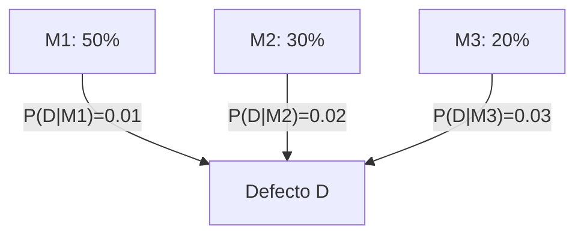

# Probabilidad I - Espacio de Probabilidad

## 1.6 Fórmulas de la probabilidad total y de Bayes.

---

### 1. Introducción

En muchos problemas, un evento puede producirse de varias formas distintas. En estos casos, se utilizan dos herramientas fundamentales:

- **Fórmula de la probabilidad total:** Permite calcular la probabilidad de un evento considerando todas las formas en que puede ocurrir, a través de una **partición** del espacio muestral.
- **Fórmula de Bayes:** Permite **actualizar probabilidades** cuando aparece nueva información.

### 2. Partición del espacio muestral

Un conjunto de eventos $B\_1, B\_2, \dots, B\_n$ es una **partición** de $\Omega$ si:

1. $B\_i \cap B\_j = \emptyset$ para $i \neq j$ (disjuntos dos a dos).
2. $B\_1 \cup B\_2 \cup \dots \cup B\_n = \Omega$ (cubren todo el espacio).

Ejemplo: al lanzar un dado, los eventos

- $B\_1 = {1,2}$,
- $B\_2 = {3,4}$,
- $B\_3 = {5,6}$,
  forman una partición de $\Omega = {1,2,3,4,5,6}$.

### 3. Fórmula de la probabilidad total

Sea $B\_1, B\_2, \dots, B\_n$ una partición de $\Omega$, y sea $A$ un evento cualquiera.

La **probabilidad total de $A$** se obtiene como:

$$
P(A) = \sum_{i=1}^n P(A \mid B_i) \, P(B_i)
$$

-> Se interpreta como: la probabilidad de $A$ es la suma de las probabilidades de que ocurra $A$ en cada escenario $B\_i$, ponderadas por la probabilidad de cada $B\_i$.

### 4. Fórmula de Bayes

La **fórmula de Bayes** permite invertir probabilidades condicionales:

$$
P(B_j \mid A) = \frac{P(A \mid B_j) \, P(B_j)}{\sum_{i=1}^n P(A \mid B_i) \, P(B_i)}
$$

donde ${B\_1, \dots, B\_n}$ es una partición de $\Omega$.

-> Muy utilizada en **diagnóstico médico, clasificación estadística e inteligencia artificial**.

### 5. Ejemplos

#### Ejemplo 1: Probabilidad total

Una fábrica tiene 3 máquinas $M\_1, M\_2, M\_3$.

- $M\_1$ produce el 50% de las piezas, $M\_2$ el 30% y $M\_3$ el 20%.
- La probabilidad de defecto es:

  - $P(D \mid M\_1) = 0.01$
  - $P(D \mid M\_2) = 0.02$
  - $P(D \mid M\_3) = 0.03$

¿Cuál es la probabilidad de que una pieza seleccionada al azar sea defectuosa?

$$
P(D) = (0.01)(0.5) + (0.02)(0.3) + (0.03)(0.2) = 0.017
$$

#### Ejemplo 2: Bayes aplicado a diagnóstico

Continuando con el ejemplo anterior:
Si una pieza es defectuosa, ¿cuál es la probabilidad de que provenga de la máquina $M\_2$?

Aplicamos Bayes:

$$
P(M_2 \mid D) = \frac{P(D \mid M_2) P(M_2)}{P(D)}
$$

$$
P(M_2 \mid D) = \frac{(0.02)(0.3)}{0.017} \approx 0.353
$$

-> Aunque $M\_2$ produce solo el 30% de las piezas, entre las defectuosas representa un **35.3%**.

### 6. Diagrama de apoyo



### 7. Ejercicios propuestos

1. Un dado está cargado de manera que la probabilidad de cada cara es proporcional a su valor ( es decir, $P(i) = i/21 $ ).

   - Calcula la probabilidad de sacar un número par usando la fórmula de la probabilidad total (partición entre pares e impares).

2. En una ciudad, el 1% de la población tiene una enfermedad. Una prueba da positivo al enfermo con 95% de probabilidad y da un falso positivo con 2%.

   - Calcula la probabilidad de que una persona elegida al azar tenga la enfermedad y dé positivo.
   - Calcula la probabilidad de que una persona que dio positivo esté realmente enferma.

3. Una empresa tiene tres proveedores: $A$ (40%), $B$ (35%), $C$ (25%). Las tasas de defectos son 2%, 3% y 5% respectivamente.

   - Calcula la probabilidad de que un producto comprado sea defectuoso.
   - Si un producto es defectuoso, ¿cuál es la probabilidad de que provenga del proveedor $C$?

### 8. Código de apoyo (Python)

```python
# Ejemplo: probabilidad total y Bayes
machines = {
    "M1": {"p": 0.5, "def": 0.01},
    "M2": {"p": 0.3, "def": 0.02},
    "M3": {"p": 0.2, "def": 0.03},
}

# Probabilidad total de defecto
P_D = sum(m["p"] * m["def"] for m in machines.values())

# Bayes: P(M2 | D)
P_M2_given_D = machines["M2"]["p"] * machines["M2"]["def"] / P_D

print("P(D) =", P_D)
print("P(M2 | D) =", P_M2_given_D)
```

### 9. Referencias

- Kolmogorov, A. N. (1933). _Foundations of the Theory of Probability_. Springer.
- Ross, S. (2010). _A First Course in Probability_. Pearson.
- Feller, W. (1968). _An Introduction to Probability Theory and Its Applications_. Wiley.
- Grinstead, C. & Snell, J. (1997). _Introduction to Probability_. AMS.
