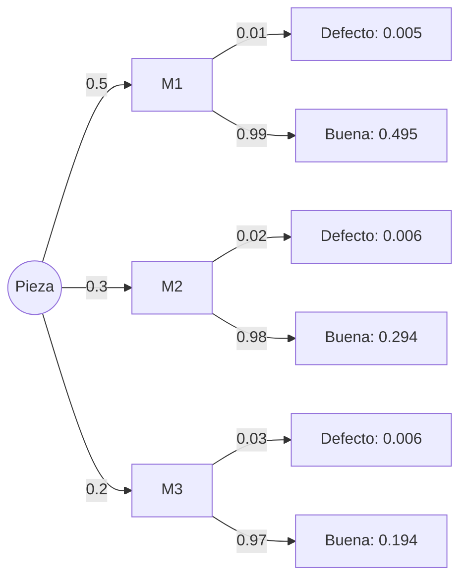

# Probabilidad I - Espacio de Probabilidad

## 1.6 Fórmulas de la probabilidad total y de Bayes.

---

### 1. Introducción

En muchos problemas, un evento puede producirse de varias formas distintas. En estos casos, se utilizan dos herramientas fundamentales:

- **Fórmula de la probabilidad total:** Permite calcular la probabilidad de un evento considerando todas las formas en que puede ocurrir, a través de una **partición** del espacio muestral.
- **Fórmula de Bayes:** Permite **actualizar probabilidades** cuando aparece nueva información.

### 2. Partición del espacio muestral

Un conjunto de eventos $B_1, B_2, \dots, B_n$ es una **partición** de $\Omega$ si:

1. $B_i \cap B_j = \emptyset$ para $i \neq j$ (disjuntos dos a dos).
2. $B_1 \cup B_2 \cup \dots \cup B_n = \Omega$ (cubren todo el espacio).

Ejemplo: al lanzar un dado, los eventos

- $B_1 = \{1,2\},$
- $B_2 = \{3,4\},$
- $B_3 = \{5,6\}$

forman una partición de $\Omega = \{1,2,3,4,5,6\}.$ Un evento $B$ y su complemento $B^c$ forman siempre una partición, la más simple de todas. Pensar en una partición es pensar en **escenarios** o **causas**: en cada realización del experimento ocurre exactamente uno de ellos.

### 3. Fórmula de la probabilidad total

Sea $B_1, B_2, \dots, B_n$ una partición de $\Omega,$ y sea $A$ un evento cualquiera.

Si además $P(B_i) > 0$ para cada $i,$ la **probabilidad total** de $A$ se obtiene como:

$$ P(A) = \sum_{i=1}^n P(A \mid B_i) \, P(B_i) $$

Se interpreta como: la probabilidad de $A$ es la suma de las probabilidades de que ocurra $A$ en cada escenario $B_i,$ ponderadas por la probabilidad de cada $B_i.$ Es un **promedio ponderado** de las probabilidades condicionales.

*Demostración.* Como los $B_i$ cubren $\Omega,$ se tiene $A = (A \cap B_1) \cup \cdots \cup (A \cap B_n),$ y estos eventos son disjuntos porque los $B_i$ lo son. Por la aditividad y la regla del producto,

$$ P(A) = \sum_{i=1}^n P(A \cap B_i) = \sum_{i=1}^n P(A \mid B_i)\,P(B_i). \qquad \blacksquare $$

La fórmula vale igual para particiones numerables, $B_1, B_2, \dots,$ gracias al axioma 3.

### 4. Fórmula de Bayes

La **fórmula de Bayes** permite invertir probabilidades condicionales: conocidas las probabilidades de los efectos dadas las causas, $P(A \mid B_i),$ calcula las de las causas dado el efecto observado, $P(B_j \mid A):$

$$ P(B_j \mid A) = \frac{P(A \mid B_j) \, P(B_j)}{\sum_{i=1}^n P(A \mid B_i) \, P(B_i)} $$

donde $\{B_1, \dots, B_n\}$ es una partición de $\Omega$ y $P(A) > 0.$ Se obtiene de la definición $P(B_j \mid A) = \frac{P(A \cap B_j)}{P(A)},$ escribiendo el numerador con la regla del producto y el denominador con la probabilidad total.

Se lee como un proceso de **aprendizaje**: $P(B_j)$ es lo que se creía antes de observar $A$ (a priori), y $P(B_j \mid A)$ lo que se cree después (a posteriori). Las probabilidades a posteriori suman 1, porque el denominador es la suma de los numeradores. Por eso a veces se escribe

$$ P(B_j \mid A) \propto P(A \mid B_j)\,P(B_j) $$

y se normaliza al final. Es muy utilizada en **diagnóstico médico, clasificación estadística e inteligencia artificial**, por ejemplo en los filtros de correo no deseado.

### 5. Ejemplos

#### Ejemplo 1: Probabilidad total

Una fábrica tiene 3 máquinas $M_1, M_2, M_3.$

- $M_1$ produce el 50% de las piezas, $M_2$ el 30% y $M_3$ el 20%.
- La probabilidad de defecto es:

  - $P(D \mid M_1) = 0.01$
  - $P(D \mid M_2) = 0.02$
  - $P(D \mid M_3) = 0.03$

¿Cuál es la probabilidad de que una pieza seleccionada al azar sea defectuosa?

$$ P(D) = (0.01)(0.5) + (0.02)(0.3) + (0.03)(0.2) = 0.005 + 0.006 + 0.006 = 0.017 $$

#### Ejemplo 2: Bayes, ¿de qué máquina vino?

Continuando con el ejemplo anterior:
Si una pieza es defectuosa, ¿cuál es la probabilidad de que provenga de la máquina $M_2?$

Aplicamos Bayes:

$$ P(M_2 \mid D) = \frac{P(D \mid M_2) P(M_2)}{P(D)} = \frac{(0.02)(0.3)}{0.017} \approx 0.353 $$

Aunque $M_2$ produce solo el 30% de las piezas, entre las defectuosas representa un **35.3%**. De la misma forma, $P(M_1 \mid D) = \frac{0.005}{0.017} \approx 0.294$ y $P(M_3 \mid D) = \frac{0.006}{0.017} \approx 0.353;$ las tres suman 1. La máquina 1 produce la mitad de las piezas, pero menos de un tercio de los defectos.

#### Ejemplo 3: El problema de Monty Hall

En un concurso hay tres puertas; detrás de una hay un auto. El concursante elige la puerta 1. El presentador, que sabe dónde está el auto y **siempre** abre una puerta sin auto distinta de la elegida, abre la puerta 3. ¿Conviene cambiar a la puerta 2?

Sea $A_i$ el evento en que el auto está en la puerta $i,$ con $P(A_i) = \frac{1}{3},$ y $O$ el evento en que el presentador abre la 3. Si el auto está en la 1, el presentador elige al azar entre la 2 y la 3: $P(O \mid A_1) = \frac{1}{2}.$ Si está en la 2, debe abrir la 3: $P(O \mid A_2) = 1.$ Si está en la 3, no puede abrirla: $P(O \mid A_3) = 0.$ Por Bayes,

$$ P(A_2 \mid O) = \frac{1 \cdot \frac{1}{3}}{\frac{1}{2} \cdot \frac{1}{3} + 1 \cdot \frac{1}{3} + 0 \cdot \frac{1}{3}} = \frac{1/3}{1/2} = \frac{2}{3} $$

y $P(A_1 \mid O) = \frac{1}{3}:$ **cambiar duplica la probabilidad de ganar**. La intuición de que quedan "dos puertas iguales" falla porque la decisión del presentador depende de dónde está el auto: no es información neutral.

### 6. Diagrama de apoyo

Un **diagrama de árbol** organiza el cálculo: el primer nivel es la partición, con sus probabilidades, y el segundo nivel las probabilidades condicionales del efecto. La probabilidad de cada camino es el producto de sus ramas (regla del producto); $P(D)$ es la suma de los caminos que terminan en defecto (probabilidad total); y $P(M_j \mid D)$ es el camino de $M_j$ dividido entre esa suma (Bayes).



### 7. Ejercicios propuestos

1. Un dado está cargado de manera que la probabilidad de cada cara es proporcional a su valor, es decir, $P(\{i\}) = i/21.$

   - Calcula la probabilidad de sacar un número par usando la fórmula de la probabilidad total con la partición $B_1 = \{1, 2, 3\},$ $B_2 = \{4, 5, 6\}.$

2. En una ciudad, el 1% de la población tiene una enfermedad. Una prueba da positivo al enfermo con 95% de probabilidad y da un falso positivo con 2%.

   - Calcula la probabilidad de que una persona elegida al azar tenga la enfermedad y dé positivo.
   - Calcula la probabilidad de que una persona que dio positivo esté realmente enferma.

3. Una empresa tiene tres proveedores: $A$ (40%), $B$ (35%), $C$ (25%). Las tasas de defectos son 2%, 3% y 5% respectivamente.

   - Calcula la probabilidad de que un producto comprado sea defectuoso.
   - Si un producto es defectuoso, ¿cuál es la probabilidad de que provenga del proveedor $C?$

### 8. Código de apoyo (Python)

```python
# Ejemplo: probabilidad total y Bayes
machines = {
    "M1": {"p": 0.5, "def": 0.01},
    "M2": {"p": 0.3, "def": 0.02},
    "M3": {"p": 0.2, "def": 0.03},
}

# Probabilidad total de defecto
P_D = sum(m["p"] * m["def"] for m in machines.values())

# Bayes: P(M2 | D)
P_M2_given_D = machines["M2"]["p"] * machines["M2"]["def"] / P_D

print("P(D) =", P_D)
print("P(M2 | D) =", P_M2_given_D)

# Todas las probabilidades a posteriori: suman 1
posterior = {k: m["p"] * m["def"] / P_D for k, m in machines.items()}
print({k: round(v, 3) for k, v in posterior.items()}, "suma =", round(sum(posterior.values()), 10))

# Monty Hall por simulación
import random
random.seed(3)
n, gana_quedarse, gana_cambiar = 100_000, 0, 0
for _ in range(n):
    auto, eleccion = random.randrange(3), 0
    abre = random.choice([p for p in range(3) if p != eleccion and p != auto])
    otra = next(p for p in range(3) if p not in (eleccion, abre))
    gana_quedarse += auto == eleccion
    gana_cambiar += auto == otra
print("Quedarse ≈", gana_quedarse / n, " cambiar ≈", gana_cambiar / n)   # ≈ 1/3 y 2/3
```

### 9. Soluciones

**Ejercicio 1.** $P(B_1) = \frac{1 + 2 + 3}{21} = \frac{6}{21}$ y $P(B_2) = \frac{15}{21}.$ Dentro de $B_1,$ el único par es el 2: $P(\text{par} \mid B_1) = \frac{2/21}{6/21} = \frac{1}{3}.$ Dentro de $B_2,$ los pares son 4 y 6: $P(\text{par} \mid B_2) = \frac{10/21}{15/21} = \frac{2}{3}.$ Entonces

$$ P(\text{par}) = \frac{1}{3} \cdot \frac{6}{21} + \frac{2}{3} \cdot \frac{15}{21} = \frac{2}{21} + \frac{10}{21} = \frac{12}{21} = \frac{4}{7} $$

que coincide con el cálculo directo $\frac{2 + 4 + 6}{21}.$

**Ejercicio 2.** $P(E \cap +) = P(+ \mid E)P(E) = 0.95 \cdot 0.01 = 0.0095.$ Por probabilidad total, $P(+) = 0.0095 + 0.02 \cdot 0.99 = 0.0095 + 0.0198 = 0.0293,$ y por Bayes

$$ P(E \mid +) = \frac{0.0095}{0.0293} \approx 0.324 $$

Una persona con prueba positiva tiene cerca de una probabilidad en tres de estar enferma. Si se repite la prueba y sale positiva otra vez (suponiendo resultados independientes dado el estado de salud), se aplica Bayes con la priori $0.324:$ $\frac{0.95 \cdot 0.324}{0.95 \cdot 0.324 + 0.02 \cdot 0.676} \approx 0.958.$

**Ejercicio 3.** $P(D) = 0.40 \cdot 0.02 + 0.35 \cdot 0.03 + 0.25 \cdot 0.05 = 0.008 + 0.0105 + 0.0125 = 0.031.$ Y $P(C \mid D) = \frac{0.0125}{0.031} \approx 0.403:$ el proveedor con menos participación es el más probable origen de un defecto, porque su tasa de defectos es la más alta.

### 10. Referencias

- Kolmogorov, A. N. (1933). _Foundations of the Theory of Probability_. Springer.
- Ross, S. (2010). _A First Course in Probability_. Pearson.
- Feller, W. (1968). _An Introduction to Probability Theory and Its Applications_. Wiley.
- Grinstead, C. & Snell, J. (1997). _Introduction to Probability_. AMS.
