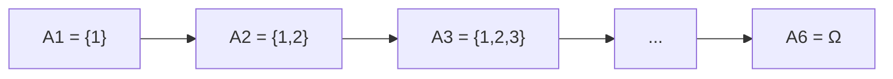
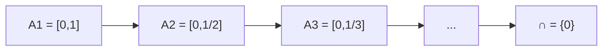

# Probabilidad I - Espacio de Probabilidad

## 1.7 Teorema de continuidad de la probabilidad.

---

### 1. Introducción

Los **axiomas de Kolmogórov** establecen las bases de la probabilidad. Sin embargo, con solo tres axiomas se pueden deducir propiedades más avanzadas.

Entre ellas destaca el **teorema de continuidad de la probabilidad**, que nos permite trabajar con **sucesiones de eventos** (infinitos) y calcular probabilidades en el límite.

### 2. Definiciones preliminares

- **Eventos crecientes:** Una sucesión ${A\_n}$ se dice creciente si

$$
A_1 \subseteq A_2 \subseteq A_3 \subseteq \dots
$$

- **Eventos decrecientes:** Una sucesión ${A\_n}$ es decreciente si

$$
A_1 \supseteq A_2 \supseteq A_3 \supseteq \dots
$$

- **Límite de eventos:**

  - Si ${A\_n}$ es creciente:

  $$
  \lim_{n \to \infty} A_n = \bigcup_{n=1}^\infty A_n
  $$
  - Si ${A\_n}$ es decreciente:

  $$
  \lim_{n \to \infty} A_n = \bigcap_{n=1}^\infty A_n
  $$

### 3. Teorema de continuidad de la probabilidad

Sea $(\Omega, P)$ un espacio de probabilidad.

- **Continuidad creciente:** Si $A\_1 \subseteq A\_2 \subseteq \dots$, entonces

$$
P\!\left(\lim_{n \to \infty} A_n\right) = \lim_{n \to \infty} P(A_n)
$$

Es decir:

$$
P\!\left(\bigcup_{n=1}^\infty A_n\right) = \lim_{n \to \infty} P(A_n)
$$

- **Continuidad decreciente:** Si $A\_1 \supseteq A\_2 \supseteq \dots$ y $P(A\_1) < \infty$, entonces

$$
P\!\left(\lim_{n \to \infty} A_n\right) = \lim_{n \to \infty} P(A_n)
$$

Es decir:

$$
P\!\left(\bigcap_{n=1}^\infty A_n\right) = \lim_{n \to \infty} P(A_n)
$$

### 4. Ejemplos

#### Ejemplo 1: Sucesión creciente

Sea $\Omega = {1,2,3,4,5,6}$ con probabilidad uniforme.

Definimos:

- $A\_1 = {1}$
- $A\_2 = {1,2}$
- $A\_3 = {1,2,3}$
- …
- $A\_6 = {1,2,3,4,5,6}$

Entonces:

$$
\lim_{n \to \infty} A_n = \Omega
$$

y

$$
\lim_{n \to \infty} P(A_n) = P(\Omega) = 1
$$

#### Ejemplo 2: Sucesión decreciente

Sea $\Omega = [0,1]$ con probabilidad uniforme (longitud del intervalo).

Definimos:

- $A\_1 = [0,1]$
- $A\_2 = [0, 1/2]$
- $A\_3 = [0, 1/3]$
- …

Entonces:

$$
\bigcap_{n=1}^\infty A_n = \{0\}
$$

y como $P({0}) = 0$:

$$
\lim_{n \to \infty} P(A_n) = 0
$$

### 5. Representación gráfica (Mermaid)

#### Sucesión creciente



#### Sucesión decreciente



### 6. Ejercicios propuestos

1. Sea $\Omega = {1,2,3,4,5,6}$ con probabilidad uniforme. Define $A\_n = {n, n+1, \dots, 6}$ para $n=1,\dots,6$.

   - Determina si la sucesión es creciente o decreciente.
   - Calcula $\lim\_{n \to \infty} A\_n$ y $\lim\_{n \to \infty} P(A\_n)$.

2. Considera $\Omega = [0,1]$ y $A\_n = [1/n, 1]$.

   - Encuentra el límite de la sucesión de eventos.
   - Calcula $\lim\_{n \to \infty} P(A\_n)$.

3. Demuestra usando el teorema de continuidad que:

   $$
   \lim_{n \to \infty} P\left(\bigcup_{i=1}^n A_i\right) = P\left(\bigcup_{i=1}^\infty A_i\right)
   $$

### 7. Código de apoyo (Python)

```python
# Ejemplo: Sucesión decreciente A_n = [0, 1/n] en [0,1]
import numpy as np

def P_interval(a, b):
    # Probabilidad uniforme = longitud del intervalo
    return b - a

for n in [1, 2, 3, 10, 100]:
    print(f"P(A_{n}) = {P_interval(0, 1/n)}")

print("Límite =", 0)
```

### 8. Referencias

- Kolmogorov, A. N. (1933). _Foundations of the Theory of Probability_. Springer.
- Ross, S. (2010). _A First Course in Probability_. Pearson.
- Billingsley, P. (1995). _Probability and Measure_. Wiley.
- Grinstead, C. & Snell, J. (1997). _Introduction to Probability_. AMS.
