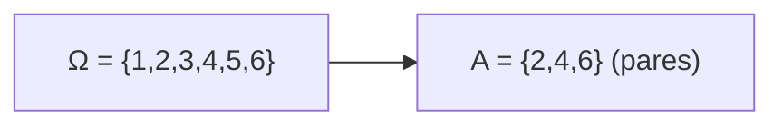
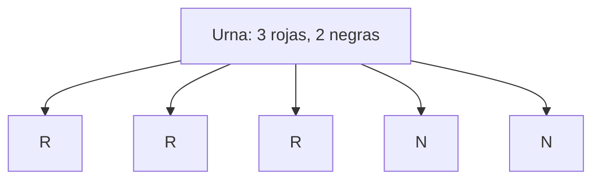

# Probabilidad I - Espacio de Probabilidad

## 1.8 Simulación de ejemplos elementales para ilustrar la interpretación

---

### 1. Introducción

La **probabilidad** puede interpretarse de varias formas (clásica, frecuentista, axiomática). La **interpretación frecuentista** se entiende mejor mediante **simulación computacional**, ya que permite observar cómo, al repetir un experimento aleatorio muchas veces, las frecuencias relativas se aproximan a las probabilidades teóricas.

### 2. Definiciones clave

- **Probabilidad clásica (Laplace):**

$$
P(A) = \frac{\text{Casos favorables}}{\text{Casos posibles}}, \quad \text{si todos son equiprobables.}
$$

- **Interpretación frecuentista:**

Si repetimos un experimento $n$ veces, la **frecuencia relativa** de un evento $A$ es:

$$
f_n(A) = \frac{N_n(A)}{n}
$$

donde $N\_n(A)$ es el número de veces que ocurre $A$.

La probabilidad de $A$ se interpreta como el **límite**:

$$
P(A) = \lim_{n \to \infty} f_n(A)
$$

### 3. Ejemplos clásicos

#### Ejemplo 1: Lanzamiento de una moneda justa

- **Espacio muestral:** $\Omega = {\text{Cara}, \text{Cruz}}$.
- **Probabilidad teórica:**

$$
P(\text{Cara}) = P(\text{Cruz}) = \tfrac{1}{2}
$$

Al simular muchos lanzamientos, la frecuencia relativa de caras y cruces tenderá a $0.5$.

#### Ejemplo 2: Lanzamiento de un dado

- **Espacio muestral:** $\Omega = {1,2,3,4,5,6}$
- **Probabilidad de sacar par:**

$$
P(\text{par}) = \frac{3}{6} = 0.5
$$

Con la simulación de muchos lanzamientos, la frecuencia relativa de pares tenderá a $0.5$.

#### Ejemplo 3: Extracción de bolas de una urna

Una urna contiene 3 bolas rojas y 2 negras. Se extrae una al azar.

- **Espacio muestral:** $\Omega = {\text{Roja}, \text{Negra}}$
- **Probabilidad teórica:**

$$
P(\text{Roja}) = \tfrac{3}{5}, \quad P(\text{Negra}) = \tfrac{2}{5}
$$

Simulando extracciones se verificará esta proporción.

### 4. Diagramas

#### Espacio muestral de un dado



#### Urna con bolas



### 5. Simulación computacional (Python)

```python
import random

# Simulación de lanzamiento de moneda
def simular_moneda(n):
    resultados = [random.choice(["Cara", "Cruz"]) for _ in range(n)]
    caras = resultados.count("Cara")
    return caras / n

# Simulación de lanzamiento de dado
def simular_dado(n):
    resultados = [random.randint(1,6) for _ in range(n)]
    pares = sum(1 for x in resultados if x % 2 == 0)
    return pares / n

# Pruebas
for n in [10, 100, 1000, 10000]:
    print(f"Lanzando moneda {n} veces: P(Cara) ≈ {simular_moneda(n):.3f}")
    print(f"Lanzando dado {n} veces: P(Par) ≈ {simular_dado(n):.3f}")
    print("-----")
```

-> Al aumentar $n$, los valores simulados se acercan a los teóricos.

### 6. Ejercicios propuestos

1. Simula 1,000 lanzamientos de una moneda y grafica la frecuencia relativa acumulada de **caras** en función de $n$. ¿Tiende a $0.5$?

2. Simula 10,000 lanzamientos de un dado y estima:

   - $P(\text{número } \le 3)$
   - $P(\text{número } \gt 4)$
   - $P(\text{número par})$

   Compáralos con los valores teóricos.

3. En una urna con 4 bolas rojas y 6 negras, simula 5,000 extracciones **con reemplazo** y estima $P(\text{Roja})$.

4. Modifica el código para simular un dado **no justo**, donde la probabilidad de cada cara es proporcional a su número $(P(i) = i/21)$.

### 7. Interpretación didáctica

- La simulación muestra que la **probabilidad teórica** se refleja en la **frecuencia relativa** al aumentar el número de experimentos.
- Esto da soporte empírico a la **interpretación frecuentista** de la probabilidad.
- Además, sirve para verificar **modelos probabilísticos** en casos complejos donde el cálculo analítico es difícil.

### 8. Referencias

- Ross, S. (2010). _A First Course in Probability_. Pearson.
- Feller, W. (1968). _An Introduction to Probability Theory and Its Applications_. Wiley.
- Grinstead, C. & Snell, J. (1997). _Introduction to Probability_. AMS.
- Sheldon M. Ross. (2014). _Simulation_. Academic Press.
