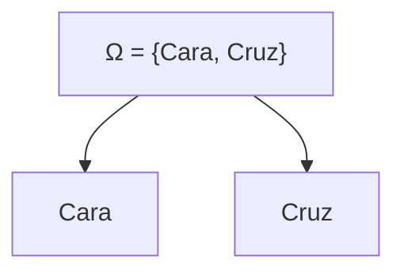

# Probabilidad I - Espacio de Probabilidad

## 1.9 frecuentista.

---

### 1. Introducción

Existen distintas formas de interpretar la probabilidad: **clásica (Laplace)**, **frecuentista**, **geométrica** y **axiomática (Kolmogórov)**.

La **interpretación frecuentista** es una de las más intuitivas y útiles: se basa en la repetición de experimentos y la observación de frecuencias relativas.

### 2. Definición frecuentista

Sea un experimento aleatorio y un evento $A$. Si repetimos el experimento $n$ veces y $N\_n(A)$ es el número de veces que ocurre $A$, la **frecuencia relativa** de $A$ es:

$$
f_n(A) = \frac{N_n(A)}{n}
$$

La probabilidad de $A$ se define como el **límite de la frecuencia relativa** cuando $n$ tiende a infinito:

$$
P(A) = \lim_{n \to \infty} f_n(A)
$$

### 3. Características de la interpretación frecuentista

(✓) Basada en la **repetición de experimentos**.
(✓) Se relaciona con la **ley de los grandes números**.
(✓) No requiere suponer equiprobabilidad (a diferencia de Laplace).
(!) No siempre aplicable en fenómenos no repetibles (ej. probabilidad de que ocurra una guerra).

### 4. Ejemplos

#### Ejemplo 1: Lanzamiento de moneda

- **Espacio muestral:** $\Omega = {\text{Cara}, \text{Cruz}}$
- **Probabilidad teórica:** $P(\text{Cara}) = P(\text{Cruz}) = \tfrac{1}{2}$

Si lanzamos la moneda $n$ veces:

- Para $n=10$, tal vez $f\_{10}(\text{Cara}) = 0.6$
- Para $n=100$, quizás $f\_{100}(\text{Cara}) = 0.49$
- Para $n=1000$, se acerca más a $0.5$

-> Esto ilustra la convergencia de la frecuencia relativa hacia la probabilidad real.

#### Ejemplo 2: Lanzamiento de dado

- **Espacio muestral:** $\Omega = {1,2,3,4,5,6}$
- **Probabilidad de obtener par:**

$$
P(\text{par}) = \frac{3}{6} = 0.5
$$

Al simular 1,000 lanzamientos, la frecuencia relativa de pares tenderá a $0.5$.

### 5. Diagramas

#### Moneda



#### Frecuencia relativa vs. número de lanzamientos

(Imaginemos la gráfica)

- Eje X: número de lanzamientos $(n)$
- Eje Y: $f\_n(\text{Cara})$
- La curva oscila al inicio, pero converge hacia $0.5$.

### 6. Simulación en Python

```python
import random
import matplotlib.pyplot as plt

def simular_moneda(n):
    resultados = [random.choice(["Cara", "Cruz"]) for _ in range(n)]
    caras = 0
    frecs = []
    for i, r in enumerate(resultados, 1):
        if r == "Cara":
            caras += 1
        frecs.append(caras/i)
    return frecs

n = 1000
frecs = simular_moneda(n)

plt.plot(range(1, n+1), frecs, label="Frecuencia relativa")
plt.axhline(0.5, color="red", linestyle="--", label="Probabilidad teórica")
plt.xlabel("Número de lanzamientos")
plt.ylabel("Frecuencia relativa de caras")
plt.legend()
plt.show()
```

-> Este código muestra gráficamente cómo la frecuencia relativa converge a la probabilidad real.

### 7. Ejercicios propuestos

1. Simula 500 lanzamientos de una moneda y observa cómo cambia la frecuencia relativa de **caras** conforme aumenta $n$.
2. Simula 1,000 lanzamientos de un dado y calcula la frecuencia relativa de obtener:

   - Un número mayor a 4.
   - Un número par.

3. En una urna con 4 bolas rojas y 6 negras, simula 2,000 extracciones con reemplazo y estima $P(\text{Roja})$.
4. Relaciona los resultados de tus simulaciones con la **ley de los grandes números**.

### 8. Conexión con la ley de los grandes números

El fundamento matemático de la interpretación frecuentista está en la **Ley de los Grandes Números (LGN)**, que asegura que:

$$
\lim_{n \to \infty} f_n(A) = P(A) \quad \text{casi seguramente.}
$$

Esto justifica que las probabilidades puedan aproximarse por simulación.

### 9. Referencias

- Kolmogorov, A. N. (1933). _Foundations of the Theory of Probability_. Springer.
- Ross, S. (2010). _A First Course in Probability_. Pearson.
- Feller, W. (1968). _An Introduction to Probability Theory and Its Applications_. Wiley.
- Grinstead, C. & Snell, J. (1997). _Introduction to Probability_. AMS.
- Sheldon M. Ross. (2014). _Simulation_. Academic Press.
