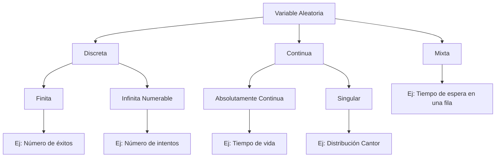

# Probabilidad I - Variables Aleatorias y Funciones de Distribución

## 2.1 Definición de variable aleatoria.

---

Una variable aleatoria es un concepto fundamental en probabilidad que permite cuantificar los resultados de experimentos aleatorios y asignarles valores numéricos. Esta transformación nos permite aplicar herramientas matemáticas para analizar fenómenos probabilísticos.

### Definición Formal

**Variable Aleatoria**: Sea $(Ω, \mathcal{F}, P)$ un espacio de probabilidad. Una **variable aleatoria** $X$ es una función:

$$X: Ω → \mathbb{R}$$

tal que para todo $x \in \mathbb{R},$ el conjunto:

$$\{ω \in Ω: X(ω) \leq x\} \in \mathcal{F}$$

Es decir, es medible respecto a la σ-álgebra $\mathcal{F}.$ Pese a su nombre, una variable aleatoria **no es una variable ni es aleatoria**: es una función determinista. Lo aleatorio es el resultado $\omega$ del experimento; una vez que se conoce, $X(\omega)$ queda determinado.

La condición de medibilidad dice que el conjunto donde $X \leq x$ es un **evento**, de modo que tiene sentido preguntar por su probabilidad. Se escribe abreviadamente

$$ \{X \leq x\} = \{\omega \in \Omega : X(\omega) \leq x\} = X^{-1}((-\infty, x]) $$

y de la misma forma $\{X = x\},$ $\{a < X \leq b\},$ etc. En el nivel de este curso, como se dijo en el tema 1.3, toda función que aparezca será medible, y la condición puede olvidarse; lo importante es la idea de que los eventos sobre $X$ son **eventos sobre** $\Omega.$

Cuando $\Omega$ ya es un conjunto de números, la función identidad $X(\omega) = \omega$ es una variable aleatoria; pero una misma $\Omega$ admite muchas variables. Al lanzar dos dados, $\Omega = \{1, \dots, 6\}^2$ y son variables aleatorias la suma, el máximo, la diferencia o el número de seises, cada una con su propia distribución.

### Interpretación Conceptual


### Tipos de Variables Aleatorias

#### 1. Variables Aleatorias Discretas

Toman valores en un conjunto finito o infinito numerable.

**Ejemplo**: Número de caras al lanzar 3 monedas. El conjunto de valores posibles, o **rango**, es

$$ R_X = \{0, 1, 2, 3\} $$

Un caso especial muy útil es la **variable indicadora** de un evento $A:$ $\mathbf{1}_A(\omega) = 1$ si $\omega \in A$ y $0$ si no. Convierte eventos en números, y $P(\mathbf{1}_A = 1) = P(A).$ Por ejemplo, el número de caras en 3 lanzamientos es la suma de las indicadoras de los eventos en que sale cara en el lanzamiento $i,$ para $i = 1, 2, 3.$

#### 2. Variables Aleatorias Continuas

Toman valores en intervalos de números reales y $P(X = x) = 0$ para cada $x$ individual; las probabilidades se asignan a intervalos.

**Ejemplo**: Tiempo de vida de un componente electrónico, con rango

$$ R_X = [0, \infty) $$

#### 3. Variables Aleatorias Mixtas

No toda variable es discreta o continua. El tiempo de espera en un banco es 0 con probabilidad positiva (si no hay fila) y, si hay fila, toma valores continuos: tiene un **átomo** en 0 y una parte continua. Su función de distribución tiene un salto en 0 y es continua después.

### Función de Distribución Acumulada

Para cualquier variable aleatoria $X,$ definimos su **función de distribución** como:

$$F_X(x) = P(X \leq x) = P(\{ω \in Ω: X(ω) \leq x\})$$

**Propiedades**:

1. $\lim_{x \to -\infty} F_X(x) = 0$
2. $\lim_{x \to \infty} F_X(x) = 1$
3. Es no decreciente: si $x_1 < x_2$ entonces $F_X(x_1) \leq F_X(x_2)$
4. Es continua por la derecha

Estas propiedades, sus demostraciones con el teorema de continuidad (tema 1.7) y cómo se calculan probabilidades a partir de $F_X$ se estudian en el tema 2.2. La función de distribución **determina** a la variable en el sentido probabilístico: dos variables con la misma $F$ tienen las mismas probabilidades para todos los eventos, aunque estén definidas en espacios muestrales distintos.

### Ejemplos Resueltos

#### Ejemplo 1: Variable Aleatoria Discreta

**Experimento**: Lanzar dos monedas justas.

**Espacio muestral**: $Ω = \{CC, CS, SC, SS\}$

**Variable aleatoria**: $X$ = número de caras

| Resultado | $X(ω)$ |
| --------- | ------ |
| CC        | 2      |
| CS        | 1      |
| SC        | 1      |
| SS        | 0      |

**Distribución de probabilidad**: cada valor se obtiene sumando las probabilidades de los resultados que lo producen, por ejemplo $\{X = 1\} = \{CS, SC\}:$

- $P(X = 0) = \frac{1}{4}$
- $P(X = 1) = \frac{1}{2}$
- $P(X = 2) = \frac{1}{4}$

Y su función de distribución es una escalera:

$$ F_X(x) = \begin{cases} 0 & x < 0 \\ \frac{1}{4} & 0 \leq x < 1 \\ \frac{3}{4} & 1 \leq x < 2 \\ 1 & x \geq 2 \end{cases} $$

#### Ejemplo 2: Variable Aleatoria Continua

**Experimento**: Medir el tiempo de vida de una bombilla.

**Variable aleatoria**: $T$ = tiempo de vida en horas

**Función de distribución**:

$$ F_T(t) = \begin{cases} 1 - e^{-0.001t} & \text{si } t \geq 0 \\ 0 & \text{si } t < 0 \end{cases} $$

Es la distribución exponencial con tasa $0.001$ por hora (tema 2.4), con vida media de 1 000 horas. Con ella, por ejemplo, la probabilidad de que la bombilla dure más de 1 000 horas es $1 - F_T(1000) = e^{-1} \approx 0.368,$ y la de que falle entre las 500 y las 1 000 horas es $F_T(1000) - F_T(500) = e^{-0.5} - e^{-1} \approx 0.239.$

### Ejercicios Propuestos

#### Ejercicio 1
Define una variable aleatoria para el experimento "lanzar un dado hasta obtener un 6" y especifica su rango de valores.

#### Ejercicio 2

Para el experimento de seleccionar un punto al azar en el intervalo $[0, 2]:$

- Define una variable aleatoria que represente la distancia al punto 0.
- Encuentra $P(X > 1).$
- Define $Y$ como la distancia al punto 1 y encuentra $P(Y \leq \frac{1}{2}).$

#### Ejercicio 3
Sea $X$ una variable aleatoria con función de distribución:

$$F_X(x) = \begin{cases} 0 & \text{si } x < 0 \\ \frac{x}{2} & \text{si } 0 \leq x < 2 \\ 1 & \text{si } x \geq 2 \end{cases} $$

Calcula $P(0.5 < X \leq 1.5).$

### Código de Simulación (Python)

```python
import itertools
import numpy as np

rng = np.random.default_rng(42)

# La variable aleatoria como función: X(ω) = número de caras
Omega = ["".join(w) for w in itertools.product("CS", repeat=3)]
X = {w: w.count("C") for w in Omega}
print(X)                                         # {'CCC': 3, 'CCS': 2, ...}
print({x: sum(1 for w in Omega if X[w] == x) / len(Omega) for x in range(4)})   # 1/8, 3/8, 3/8, 1/8

# Simulación de variable aleatoria discreta: lanzamiento de monedas
def simular_monedas(n_lanzamientos, n_simulaciones):
    resultados = rng.binomial(n_lanzamientos, 0.5, n_simulaciones)
    return resultados

# Simular 1000 lanzamientos de 3 monedas
simulaciones = simular_monedas(3, 1000)

# Calcular probabilidades empíricas
valores, conteos = np.unique(simulaciones, return_counts=True)
probabilidades = conteos / len(simulaciones)

print("Probabilidades empíricas:")
for valor, prob in zip(valores, probabilidades):
    print(f"P(X = {valor}) = {prob:.3f}")
```

### Diagrama: Clasificación de Variables Aleatorias



Una variable **continua** es aquella cuya función de distribución es continua. Casi todas las que aparecen en la práctica son además **absolutamente continuas**: tienen una función de densidad $f$ con $F(x) = \int_{-\infty}^x f(t)\,dt$ (tema 2.4). Las **singulares**, como la de Cantor, tienen $F$ continua pero no tienen densidad; son una curiosidad teórica que no aparecerá en el curso.

### Propiedades Importantes

1. **Medibilidad**: Garantiza que podemos calcular probabilidades
2. **Transformación**: Si $X$ es v.a. y $g$ es medible, entonces $g(X)$ es v.a.
3. **σ-álgebra generada**: $\sigma(X) = \{X^{-1}(B): B \in \mathcal{B}(\mathbb{R})\}$

### Soluciones

**Ejercicio 1.** $\Omega$ es el conjunto de sucesiones de tiradas que terminan en el primer 6, y $X$ = número de tiradas necesarias. Su rango es $\{1, 2, 3, \dots\},$ infinito numerable, así que $X$ es discreta. Para $X = k$ deben salir $k - 1$ resultados distintos de 6 y luego un 6: $P(X = k) = \left(\frac{5}{6}\right)^{k-1}\frac{1}{6}$ (distribución geométrica, tema 2.3).

**Ejercicio 2.** Con $\Omega = [0, 2]$ y probabilidad proporcional a la longitud, $X(\omega) = \omega.$ Entonces $P(X > 1) = \frac{\text{long}((1, 2])}{2} = \frac{1}{2}.$ Para $Y(\omega) = |\omega - 1|,$ el evento $\{Y \leq \frac{1}{2}\}$ es $\{\omega : \frac{1}{2} \leq \omega \leq \frac{3}{2}\},$ de longitud 1, así que $P(Y \leq \frac{1}{2}) = \frac{1}{2}.$ El cálculo siempre consiste en traducir el evento sobre la variable en un evento sobre $\Omega.$

**Ejercicio 3.** $P(0.5 < X \leq 1.5) = F_X(1.5) - F_X(0.5) = 0.75 - 0.25 = 0.5.$ $X$ es uniforme en $[0, 2].$

### Aplicaciones

Las variables aleatorias son fundamentales en:
- Estadística inferencial
- Procesos estocásticos
- Teoría de colas
- Finanzas cuantitativas
- Machine learning

### Referencias Bibliográficas

1. Ross, S. M. (2019). "A First Course in Probability"
2. Casella, G., & Berger, R. L. (2002). "Statistical Inference"
3. Canavos, G. C. (1988). "Probabilidad y Estadística"

### Consejos de Estudio

1. **Visualiza**: Dibuja diagramas para entender la transformación Ω → ℝ
2. **Practica**: Resuelve ejercicios de diferentes contextos
3. **Programa**: Implementa simulaciones para verificar resultados teóricos
4. **Relaciona**: Conecta el concepto con aplicaciones del mundo real
