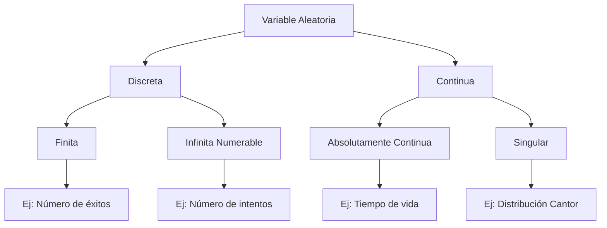

# Probabilidad I - Variables Aleatorias y Funciones de Distribución

## 2.1 Definición de variable aleatoria.

---

Una variable aleatoria es un concepto fundamental en probabilidad que permite cuantificar los resultados de experimentos aleatorios y asignarles valores numéricos. Esta transformación nos permite aplicar herramientas matemáticas para analizar fenómenos probabilísticos.

### Definición Formal

**Variable Aleatoria**: Sea $(Ω, \mathcal{F}, P)$ un espacio de probabilidad. Una **variable aleatoria** $X$ es una función:

$$X: Ω → \mathbb{R}$$

tal que para todo $x \in \mathbb{R},$ el conjunto:

$$\{ω \in Ω: X(ω) \leq x\} \in \mathcal{F}$$

Es decir, es medible respecto a la σ-álgebra $\mathcal{F}.$

### Interpretación Conceptual


### Tipos de Variables Aleatorias

#### 1. Variables Aleatorias Discretas

Toman valores en un conjunto finito o infinito numerable.

**Ejemplo**: Número de caras al lanzar 3 monedas:

$$X = \{0, 1, 2, 3\}$$

#### 2. Variables Aleatorias Continuas

Toman valores en intervalos de números reales.

**Ejemplo**: Tiempo de vida de un componente electrónico:

$$X \in [0, ∞)$$

### Función de Distribución Acumulada

Para cualquier variable aleatoria $X,$ definimos su **función de distribución** como:

$$F_X(x) = P(X \leq x) = P(\{ω \in Ω: X(ω) \leq x\})$$

**Propiedades**:

1. $\lim_{x \to -\infty} F_X(x) = 0$
2. $\lim_{x \to \infty} F_X(x) = 1$
3. Es no decreciente: si $x_1 < x_2$ entonces $F_X(x_1) \leq F_X(x_2)$
4. Es continua por la derecha

### Ejemplos Resueltos

#### Ejemplo 1: Variable Aleatoria Discreta

**Experimento**: Lanzar dos monedas justas.

**Espacio muestral**: $Ω = \{CC, CS, SC, SS\}$

**Variable aleatoria**: $X$ = número de caras

| Resultado | $X(ω)$ |
| --------- | ------ |
| CC        | 2      |
| CS        | 1      |
| SC        | 1      |
| SS        | 0      |

**Distribución de probabilidad**:

- $P(X = 0) = \frac{1}{4}$
- $P(X = 1) = \frac{1}{2}$
- $P(X = 2) = \frac{1}{4}$

#### Ejemplo 2: Variable Aleatoria Continua

**Experimento**: Medir el tiempo de vida de una bombilla.

**Variable aleatoria**: $T$ = tiempo de vida en horas

**Función de distribución**:

$$ F_T(t) = \begin{cases} 1 - e^{-0.001t} & \text{si } t \geq 0 \\ 0 & \text{si } t < 0 \end{cases} $$

### Ejercicios Propuestos

#### Ejercicio 1
Define una variable aleatoria para el experimento "lanzar un dado hasta obtener un 6" y especifica su rango de valores.

#### Ejercicio 2
Para el experimento de seleccionar un punto al azar en el intervalo [0, 2]:
- Define una variable aleatoria que represente la distancia al punto 0
- Encuentra $P(X > 1)$

#### Ejercicio 3
Sea $X$ una variable aleatoria con función de distribución:

$$F_X(x) = \begin{cases} 0 & \text{si } x < 0 \\ \frac{x}{2} & \text{si } 0 \leq x < 2 \\ 1 & \text{si } x \geq 2 \end{cases} $$

Calcula $P(0.5 < X \leq 1.5)$

### Código de Simulación (Python)

```python
import numpy as np
import matplotlib.pyplot as plt

# Simulación de variable aleatoria discreta: lanzamiento de monedas
def simular_monedas(n_lanzamientos, n_simulaciones):
    resultados = np.random.binomial(n_lanzamientos, 0.5, n_simulaciones)
    return resultados

# Simular 1000 lanzamientos de 3 monedas
simulaciones = simular_monedas(3, 1000)

# Calcular probabilidades empíricas
valores, conteos = np.unique(simulaciones, return_counts=True)
probabilidades = conteos / len(simulaciones)

print("Probabilidades empíricas:")
for valor, prob in zip(valores, probabilidades):
    print(f"P(X = {valor}) = {prob:.3f}")
```

### Diagrama: Clasificación de Variables Aleatorias



### Propiedades Importantes

1. **Medibilidad**: Garantiza que podemos calcular probabilidades
2. **Transformación**: Si $X$ es v.a. y $g$ es medible, entonces $g(X)$ es v.a.
3. **σ-álgebra generada**: $\sigma(X) = \{X^{-1}(B): B \in \mathcal{B}(\mathbb{R})\}$

### Aplicaciones

Las variables aleatorias son fundamentales en:
- Estadística inferencial
- Procesos estocásticos
- Teoría de colas
- Finanzas cuantitativas
- Machine learning

### Referencias Bibliográficas

1. Ross, S. M. (2019). "A First Course in Probability"
2. Casella, G., & Berger, R. L. (2002). "Statistical Inference"
3. Canavos, G. C. (1988). "Probabilidad y Estadística"

### Consejos de Estudio

1. **Visualiza**: Dibuja diagramas para entender la transformación Ω → ℝ
2. **Practica**: Resuelve ejercicios de diferentes contextos
3. **Programa**: Implementa simulaciones para verificar resultados teóricos
4. **Relaciona**: Conecta el concepto con aplicaciones del mundo real
