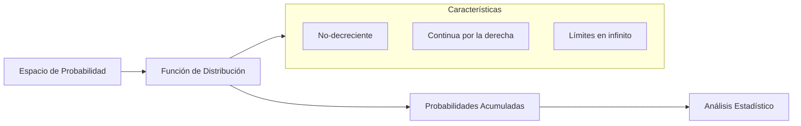
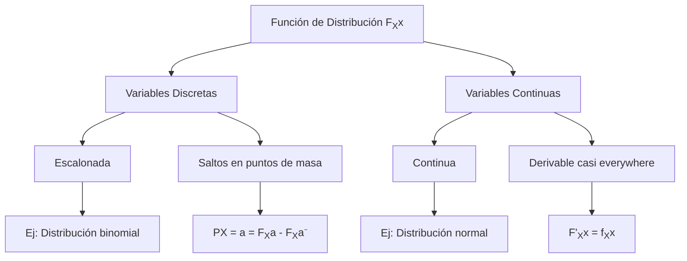

# Probabilidad I - Variables Aleatorias y Funciones de Distribución
## 2.2 Función de distribución y sus propiedades.

---

La **función de distribución acumulativa** es una herramienta fundamental en el estudio de variables aleatorias que encapsula toda la información probabilística sobre su comportamiento. Esta función nos permite calcular probabilidades asociadas a la variable aleatoria y caracterizar completamente su distribución.

### Definición formal

#### Función de distribución acumulativa

Sea $X$ una variable aleatoria definida en un espacio de probabilidad $(Ω, \mathcal{F}, P)$. La **función de distribución** de $X$ se define como:

$$F_X(x) = P(X \leq x) = P(\{ω \in Ω: X(ω) \leq x\})$$

para todo $x \in \mathbb{R}$.

#### Interpretación visual



### Propiedades fundamentales

#### 1. Comportamiento en los límites
$$\lim_{x \to -\infty} F_X(x) = 0$$
$$\lim_{x \to \infty} F_X(x) = 1$$

#### 2. Monotonía
Para cualquier $x_1 < x_2$:

$$F_X(x_1) \leq F_X(x_2)$$

#### 3. Continuidad por la derecha
Para todo $a \in \mathbb{R}$:

$$\lim_{x \to a^+} F_X(x) = F_X(a)$$

#### 4. Cálculo de probabilidades
- $P(X > a) = 1 - F_X(a)$
- $P(a < X \leq b) = F_X(b) - F_X(a)$
- $P(X = a) = F_X(a) - \lim_{x \to a^-} F_X(x)$

### Tipos de funciones de distribución

#### Para variables discretas

$$F_X(x) = \sum_{x_i \leq x} P(X = x_i) = \sum_{x_i \leq x} p(x_i)$$

#### Para variables continuas

$$F_X(x) = \int_{-\infty}^{x} f_X(t)  dt$$

donde $f_X(x)$ es la función de densidad de probabilidad.

### Ejemplos resueltos

#### Ejemplo 1: Variable aleatoria discreta

**Experimento**: Lanzar un dado justo.

**Variable aleatoria**: $X$ = resultado del lanzamiento

**Función de distribución**:

$$ F_X(x) = \begin{cases} 0 & \text{si } x < 1 \\\ \frac{1}{6} & \text{si } 1 \leq x < 2 \\\ \frac{2}{6} & \text{si } 2 \leq x < 3 \\\ \frac{3}{6} & \text{si } 3 \leq x < 4 \\\ \frac{4}{6} & \text{si } 4 \leq x < 5 \\\ \frac{5}{6} & \text{si } 5 \leq x < 6 \\\ 1 & \text{si } x \geq 6 \end{cases} $$

**Cálculo de probabilidades**:
- $P(X \leq 3) = F_X(3) = \frac{3}{6} = 0.5$
- $P(2 < X \leq 4) = F_X(4) - F_X(2) = \frac{4}{6} - \frac{2}{6} = \frac{2}{6} \approx 0.333$

#### Ejemplo 2: Variable aleatoria continua

**Variable aleatoria**: $X$ con distribución uniforme en [0, 2]

**Función de distribución**:

$$ F_X(x) = \begin{cases} 0 & \text{si } x < 0 \\\ \frac{x}{2} & \text{si } 0 \leq x \leq 2 \\\ 1 & \text{si } x > 2 \end{cases} $$

**Cálculo de probabilidades**:
- $P(X \leq 1.5) = F_X(1.5) = \frac{1.5}{2} = 0.75$
- $P(0.5 < X \leq 1.2) = F_X(1.2) - F_X(0.5) = \frac{1.2}{2} - \frac{0.5}{2} = 0.35$

### Diagrama: Comportamiento de la función de distribución



### Ejercicios propuestos

#### Ejercicio 1
Sea $X$ una variable aleatoria con función de distribución:

$$ F_X(x) = \begin{cases} 0 & \text{si } x < 0 \\\ \frac{x^2}{9} & \text{si } 0 \leq x < 3 \\\ 1 & \text{si } x \geq 3 \end{cases} $$

a) Verifica que $F_X(x)$ es una función de distribución válida
b) Calcula $P(1 < X \leq 2)$
c) Determina si $X$ es discreta o continua

#### Ejercicio 2
Para la variable aleatoria $X$ con distribución:

$$ F_X(x) = \begin{cases} 0 & \text{si } x < 1 \\\ 0.2 & \text{si } 1 \leq x < 2 \\\ 0.5 & \text{si } 2 \leq x < 4 \\\ 0.8 & \text{si } 4 \leq x < 5 \\\ 1 & \text{si } x \geq 5 \end{cases} $$

a) Encuentra la función de masa de probabilidad de $X$
b) Calcula $P(X > 3)$
c) Determina $P(X = 2)$

#### Ejercicio 3
Demuestra que para cualquier variable aleatoria $X$ y valores $a < b$:

$$P(a < X \leq b) = F_X(b) - F_X(a)$$

### Código de visualización (Python)

```python
import numpy as np
import matplotlib.pyplot as plt

# Función de distribución para variable discreta (dado)
def distribucion_discreta(x):
    if x < 1:
        return 0
    elif x < 2:
        return 1/6
    elif x < 3:
        return 2/6
    elif x < 4:
        return 3/6
    elif x < 5:
        return 4/6
    elif x < 6:
        return 5/6
    else:
        return 1

# Función de distribución para variable continua (uniforme [0,2])
def distribucion_continua(x):
    if x < 0:
        return 0
    elif x <= 2:
        return x/2
    else:
        return 1

# Visualización
x_discreto = np.linspace(-1, 7, 1000)
y_discreto = [distribucion_discreta(x) for x in x_discreto]

x_continuo = np.linspace(-1, 3, 1000)
y_continuo = [distribucion_continua(x) for x in x_continuo]

plt.figure(figsize=(12, 5))

plt.subplot(1, 2, 1)
plt.step(x_discreto, y_discreto, where='post')
plt.title('Función de Distribución (Discreta)')
plt.xlabel('x')
plt.ylabel('F(x)')
plt.grid(True)

plt.subplot(1, 2, 2)
plt.plot(x_continuo, y_continuo)
plt.title('Función de Distribución (Continua)')
plt.xlabel('x')
plt.ylabel('F(x)')
plt.grid(True)

plt.tight_layout()
plt.show()
```

### Propiedades adicionales

#### Relación con la función de densidad (variables continuas)
Si $X$ es continua con función de densidad $f_X(x)$, entonces:

$$F_X(x) = \int_{-\infty}^{x} f_X(t)  dt$$

y

$$f_X(x) = \frac{d}{dx} F_X(x) \quad \text{en puntos de derivabilidad}$$

#### Puntos de discontinuidad
Para variables discretas, en los puntos $a$ donde $P(X = a) > 0$:

$$P(X = a) = F_X(a) - \lim_{x \to a^-} F_X(x)$$

#### Teorema fundamental
Toda función $F: \mathbb{R} \to [0, 1]$ que satisface:
1. $\lim_{x \to -\infty} F(x) = 0$
2. $\lim_{x \to \infty} F(x) = 1$
3. Es no decreciente
4. Es continua por la derecha

es la función de distribución de alguna variable aleatoria.

### Aplicaciones prácticas

1. **Cálculo de probabilidades**: Determinar $P(X \in A)$ para diversos conjuntos $A$
2. **Simulación**: Generar valores de variables aleatorias usando el método de transformada inversa
3. **Inferencia estadística**: Construir intervalos de confianza y tests de hipótesis
4. **Modelado**: Caracterizar distribuciones en ingeniería, finanzas y ciencias

### Referencias bibliográficas

1. Ross, S. M. (2019). "A First Course in Probability"
2. Casella, G., & Berger, R. L. (2002). "Statistical Inference"
3. Canavos, G. C. (1988). "Probabilidad y Estadística"

### Consejos de estudio

1. **Visualiza**: Dibuja siempre la función de distribución para entender su comportamiento
2. **Practica**: Resuelve ejercicios con ambos tipos de variables (discretas y continuas)
3. **Relaciona**: Conecta las propiedades formales con su interpretación intuitiva
4. **Programa**: Implementa simulaciones para verificar resultados teóricos
