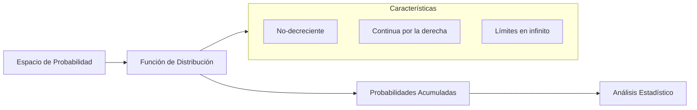

# Probabilidad I - Variables Aleatorias y Funciones de Distribución

## 2.2 Función de distribución y sus propiedades.

---

La **función de distribución acumulativa** es una herramienta fundamental en el estudio de variables aleatorias que encapsula toda la información probabilística sobre su comportamiento. Esta función nos permite calcular probabilidades asociadas a la variable aleatoria y caracterizar completamente su distribución.

### Definición formal

#### Función de distribución acumulativa

Sea $X$ una variable aleatoria definida en un espacio de probabilidad $(Ω, \mathcal{F}, P).$ La **función de distribución** de $X$ se define como:

$$F_X(x) = P(X \leq x) = P(\{ω \in Ω: X(ω) \leq x\})$$

para todo $x \in \mathbb{R}.$

#### Interpretación visual



### Propiedades fundamentales

#### 1. Monotonía

Para cualquier $x_1 < x_2:$

$$ F_X(x_1) \leq F_X(x_2) $$

*Demostración.* $\{X \leq x_1\} \subseteq \{X \leq x_2\},$ y la probabilidad es monótona (tema 1.4). $\blacksquare$

#### 2. Comportamiento en los límites

$$ \lim_{x \to -\infty} F_X(x) = 0, \qquad \lim_{x \to \infty} F_X(x) = 1 $$

*Demostración.* Como $F_X$ es monótona, basta tomar los límites sobre los enteros. Los eventos $\{X \leq n\}$ crecen y su unión es $\Omega,$ porque todo número real $X(\omega)$ es menor que algún entero; por continuidad por abajo (tema 1.7), $F_X(n) \to P(\Omega) = 1.$ Los eventos $\{X \leq -n\}$ decrecen y su intersección es vacía, porque ningún número real es menor que todos los enteros negativos; por continuidad por arriba, $F_X(-n) \to P(\emptyset) = 0.$ $\blacksquare$

#### 3. Continuidad por la derecha

Para todo $a \in \mathbb{R}:$

$$ \lim_{x \to a^+} F_X(x) = F_X(a) $$

*Demostración.* Los eventos $\{X \leq a + \frac{1}{n}\}$ decrecen y su intersección es $\{X \leq a\}.$ Por continuidad por arriba, $F_X(a + \frac{1}{n}) \to F_X(a);$ como $F_X$ es monótona, esto basta para el límite por la derecha. $\blacksquare$

En cambio, por la **izquierda** los eventos $\{X \leq a - \frac{1}{n}\}$ crecen hacia $\{X < a\},$ **no** hacia $\{X \leq a\}.$ Por eso

$$ F_X(a^-) := \lim_{x \to a^-} F_X(x) = P(X < a) $$

y $F_X$ puede tener un **salto** en $a,$ de tamaño $P(X = a).$

#### 4. Cálculo de probabilidades

Todas las probabilidades sobre intervalos se obtienen de $F_X.$ Cuidado con los extremos:

| Evento | Probabilidad |
| --- | --- |
| $X \leq a$ | $F_X(a)$ |
| $X < a$ | $F_X(a^-)$ |
| $X > a$ | $1 - F_X(a)$ |
| $X \geq a$ | $1 - F_X(a^-)$ |
| $a < X \leq b$ | $F_X(b) - F_X(a)$ |
| $a \leq X \leq b$ | $F_X(b) - F_X(a^-)$ |
| $X = a$ | $F_X(a) - F_X(a^-)$ |

Si $F_X$ es continua, $F_X(a^-) = F_X(a)$ y da lo mismo usar desigualdades estrictas o no; si es discreta, no.

### Tipos de funciones de distribución

#### Para variables discretas

$$F_X(x) = \sum_{x_i \leq x} P(X = x_i) = \sum_{x_i \leq x} p(x_i)$$

#### Para variables continuas

$$F_X(x) = \int_{-\infty}^{x} f_X(t) \, dt$$

donde $f_X(x)$ es la función de densidad de probabilidad.

### Ejemplos resueltos

#### Ejemplo 1: Variable aleatoria discreta

**Experimento**: Lanzar un dado justo.

**Variable aleatoria**: $X$ = resultado del lanzamiento

**Función de distribución**:

$$ F_X(x) = \begin{cases} 0 & \text{si } x < 1 \\ \frac{1}{6} & \text{si } 1 \leq x < 2 \\ \frac{2}{6} & \text{si } 2 \leq x < 3 \\ \frac{3}{6} & \text{si } 3 \leq x < 4 \\ \frac{4}{6} & \text{si } 4 \leq x < 5 \\ \frac{5}{6} & \text{si } 5 \leq x < 6 \\ 1 & \text{si } x \geq 6 \end{cases} $$

**Cálculo de probabilidades**:

- $P(X \leq 3) = F_X(3) = \frac{3}{6} = 0.5$
- $P(2 < X \leq 4) = F_X(4) - F_X(2) = \frac{4}{6} - \frac{2}{6} = \frac{2}{6} \approx 0.333$
- $P(2 \leq X \leq 4) = F_X(4) - F_X(2^-) = \frac{4}{6} - \frac{1}{6} = \frac{1}{2},$ distinto del anterior porque ahora el 2 sí cuenta.
- $P(X = 3) = F_X(3) - F_X(3^-) = \frac{3}{6} - \frac{2}{6} = \frac{1}{6},$ el tamaño del salto en 3.

#### Ejemplo 2: Variable aleatoria continua

**Variable aleatoria**: $X$ con distribución uniforme en $[0, 2]$

**Función de distribución**:

$$ F_X(x) = \begin{cases} 0 & \text{si } x < 0 \\ \frac{x}{2} & \text{si } 0 \leq x \leq 2 \\ 1 & \text{si } x > 2 \end{cases} $$

**Cálculo de probabilidades**:

- $P(X \leq 1.5) = F_X(1.5) = \frac{1.5}{2} = 0.75$
- $P(0.5 < X \leq 1.2) = F_X(1.2) - F_X(0.5) = \frac{1.2}{2} - \frac{0.5}{2} = 0.35$

#### Ejemplo 3: Variable aleatoria mixta

Un cliente llega a una ventanilla; con probabilidad 0.4 no hay fila y espera 0 minutos, y si hay fila espera un tiempo exponencial de media 5 minutos. Su tiempo de espera $W$ tiene

$$ F_W(w) = \begin{cases} 0 & w < 0 \\ 0.4 + 0.6\,(1 - e^{-w/5}) & w \geq 0 \end{cases} $$

Hay un salto de tamaño $F_W(0) - F_W(0^-) = 0.4$ en $w = 0,$ que es $P(W = 0),$ y después $F_W$ crece de forma continua hacia 1. $W$ no es discreta ni continua. Por ejemplo, $P(W > 5) = 1 - F_W(5) = 0.6\,e^{-1} \approx 0.221.$

### Diagrama: Comportamiento de la función de distribución

| Tipo de variable | Forma de $F_X$ | Cómo se obtienen las probabilidades |
| --- | --- | --- |
| Discreta | Escalera: constante entre los valores posibles, con un salto de tamaño $P(X = a)$ en cada uno | Sumando la función de masa |
| Continua (con densidad) | Continua, derivable salvo en pocos puntos, con $F'_X = f_X$ | Integrando la densidad |
| Mixta | Saltos en algunos puntos y tramos continuos crecientes | Sumando saltos e integrando |

En todos los casos se cumplen las mismas cuatro propiedades: no decreciente, continua por la derecha, con límites 0 y 1.

### Ejercicios propuestos

#### Ejercicio 1
Sea $X$ una variable aleatoria con función de distribución:

$$ F_X(x) = \begin{cases} 0 & \text{si } x < 0 \\ \frac{x^2}{9} & \text{si } 0 \leq x < 3 \\ 1 & \text{si } x \geq 3 \end{cases} $$

- a) Verifica que $F_X$ es una función de distribución válida.
- b) Calcula $P(1 < X \leq 2).$
- c) Determina si $X$ es discreta o continua y, si tiene densidad, encuéntrala.

#### Ejercicio 2
Para la variable aleatoria $X$ con distribución:

$$ F_X(x) = \begin{cases} 0 & \text{si } x < 1 \\ 0.2 & \text{si } 1 \leq x < 2 \\ 0.5 & \text{si } 2 \leq x < 4 \\ 0.8 & \text{si } 4 \leq x < 5 \\ 1 & \text{si } x \geq 5 \end{cases} $$

- a) Encuentra la función de masa de probabilidad de $X.$
- b) Calcula $P(X > 3).$
- c) Determina $P(X = 2)$ y $P(X = 3).$

#### Ejercicio 3
Demuestra que para cualquier variable aleatoria $X$ y valores $a < b:$

$$P(a < X \leq b) = F_X(b) - F_X(a)$$

### Código de visualización (Python)

```python
import numpy as np
import matplotlib
matplotlib.use("Agg")      # quitar esta línea para ver la ventana
import matplotlib.pyplot as plt

# Función de distribución para variable discreta (dado)
def distribucion_discreta(x):
    if x < 1:
        return 0
    elif x < 2:
        return 1/6
    elif x < 3:
        return 2/6
    elif x < 4:
        return 3/6
    elif x < 5:
        return 4/6
    elif x < 6:
        return 5/6
    else:
        return 1

# Función de distribución para variable continua (uniforme [0,2])
def distribucion_continua(x):
    if x < 0:
        return 0
    elif x <= 2:
        return x/2
    else:
        return 1

# Visualización
x_discreto = np.linspace(-1, 7, 1000)
y_discreto = [distribucion_discreta(x) for x in x_discreto]

x_continuo = np.linspace(-1, 3, 1000)
y_continuo = [distribucion_continua(x) for x in x_continuo]

plt.figure(figsize=(12, 5))

plt.subplot(1, 2, 1)
plt.step(x_discreto, y_discreto, where='post')
plt.title('Función de Distribución (Discreta)')
plt.xlabel('x')
plt.ylabel('F(x)')
plt.grid(True)

plt.subplot(1, 2, 2)
plt.plot(x_continuo, y_continuo)
plt.title('Función de Distribución (Continua)')
plt.xlabel('x')
plt.ylabel('F(x)')
plt.grid(True)

plt.tight_layout()
plt.savefig("distribuciones.png", dpi=110)

# Función de distribución empírica: proporción de datos <= x
rng = np.random.default_rng(0)
datos = rng.integers(1, 7, size=500)              # 500 tiradas de dado
def F_empirica(x):
    return np.mean(datos <= x)
print([round(float(F_empirica(x)), 3) for x in range(1, 7)])   # cerca de 1/6, 2/6, ..., 1
```

La **función de distribución empírica** de una muestra, la proporción de datos menores o iguales que $x,$ es una escalera que se acerca a la verdadera $F_X$ cuando la muestra crece (teorema de Glivenko-Cantelli). Es la forma de "ver" una distribución a partir de datos.

### Propiedades adicionales

#### Relación con la función de densidad (variables continuas)
Si $X$ es continua con función de densidad $f_X(x),$ entonces:

$$F_X(x) = \int_{-\infty}^{x} f_X(t) \, dt$$

y

$$f_X(x) = \frac{d}{dx} F_X(x) \quad \text{en puntos de derivabilidad}$$

#### Puntos de discontinuidad
Para variables discretas, en los puntos $a$ donde $P(X = a) > 0:$

$$P(X = a) = F_X(a) - \lim_{x \to a^-} F_X(x)$$

#### Teorema fundamental
Toda función $F: \mathbb{R} \to [0, 1]$ que satisface:
1. $\lim_{x \to -\infty} F(x) = 0$
2. $\lim_{x \to \infty} F(x) = 1$
3. Es no decreciente
4. Es continua por la derecha

es la función de distribución de alguna variable aleatoria. Es decir, las cuatro propiedades **caracterizan** a las funciones de distribución. Una forma de construir esa variable es el método de la transformada inversa: si $U$ es uniforme en $(0, 1),$ la variable $X = F^{-1}(U),$ con $F^{-1}(u) = \min\{x : F(x) \geq u\},$ tiene función de distribución $F$ (tema 2.6).

#### Cuantiles

El **cuantil** de orden $q \in (0, 1)$ es $x_q = \min\{x : F_X(x) \geq q\}.$ La **mediana** es $x_{0.5}.$ Para la uniforme en $[0, 2],$ $x_q = 2q$ y la mediana es 1; para el dado, la mediana es 3, el primer valor donde $F_X$ alcanza $\frac{1}{2}.$

### Soluciones

**Ejercicio 1.** (a) Es no decreciente: $0$ para $x < 0,$ $\frac{x^2}{9}$ crece en $[0, 3)$ de $0$ a casi $1,$ y luego vale 1. Es continua en todo punto, en particular en 0 y en 3, porque $\frac{0^2}{9} = 0$ y $\frac{3^2}{9} = 1;$ y sus límites son 0 y 1. (b) $P(1 < X \leq 2) = \frac{4}{9} - \frac{1}{9} = \frac{1}{3}.$ (c) Es continua, porque $F_X$ no tiene saltos; su densidad es $f_X(x) = F_X'(x) = \frac{2x}{9}$ en $(0, 3)$ y $0$ fuera, que integra 1.

**Ejercicio 2.** (a) Los saltos de $F_X$ dan la función de masa: $P(X = 1) = 0.2,$ $P(X = 2) = 0.3,$ $P(X = 4) = 0.3,$ $P(X = 5) = 0.2,$ que suman 1. (b) $P(X > 3) = 1 - F_X(3) = 1 - 0.5 = 0.5.$ (c) $P(X = 2) = F_X(2) - F_X(2^-) = 0.5 - 0.2 = 0.3$ y $P(X = 3) = 0.5 - 0.5 = 0,$ porque $F_X$ no salta en 3.

**Ejercicio 3.** Como $a < b,$ el evento $\{X \leq a\}$ está contenido en $\{X \leq b\},$ y $\{X \leq b\}$ es la unión disjunta de $\{X \leq a\}$ y $\{a < X \leq b\}.$ Por aditividad, $F_X(b) = F_X(a) + P(a < X \leq b),$ de donde se despeja el resultado. $\blacksquare$

### Aplicaciones prácticas

1. **Cálculo de probabilidades**: Determinar $P(X \in A)$ para diversos conjuntos $A$
2. **Simulación**: Generar valores de variables aleatorias usando el método de transformada inversa
3. **Inferencia estadística**: Construir intervalos de confianza y tests de hipótesis
4. **Modelado**: Caracterizar distribuciones en ingeniería, finanzas y ciencias

### Referencias bibliográficas

1. Ross, S. M. (2019). "A First Course in Probability"
2. Casella, G., & Berger, R. L. (2002). "Statistical Inference"
3. Canavos, G. C. (1988). "Probabilidad y Estadística"

### Consejos de estudio

1. **Visualiza**: Dibuja siempre la función de distribución para entender su comportamiento
2. **Practica**: Resuelve ejercicios con ambos tipos de variables (discretas y continuas)
3. **Relaciona**: Conecta las propiedades formales con su interpretación intuitiva
4. **Programa**: Implementa simulaciones para verificar resultados teóricos
