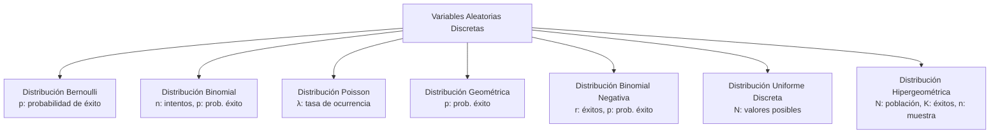
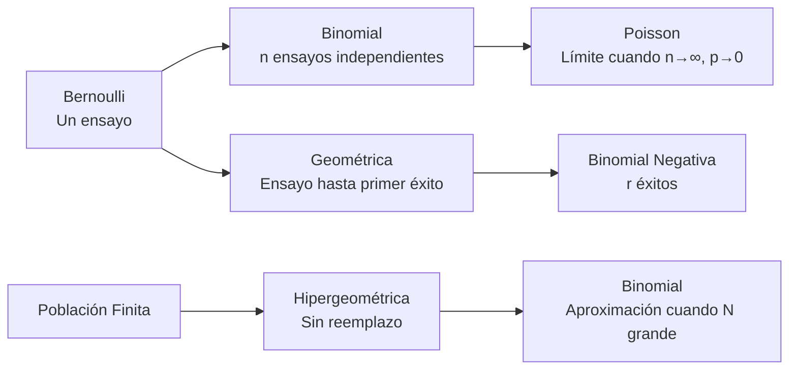

# Probabilidad I - Variables Aleatorias y Funciones de Distribución

## 2.3 Variables aleatorias discretas como familias paramétricas y su interpretación; funciones de masa o densidad, incluyendo los ejemplos: Bernoulli, Binomial, Poisson, Uniforme, Geométrica, Binomial negativa, Hipergeométrica y modelos donde éstas aparecen. Familias paramétricas discretas y su interpretación.

---

Las **variables aleatorias discretas** son aquellas que toman valores en un conjunto finito o infinito numerable. Las **familias paramétricas** son conjuntos de distribuciones que comparten una misma forma funcional pero difieren en los valores de sus parámetros.

### Diagrama conceptual de familias discretas



### 1. Distribución Bernoulli

**Contexto**: Experimentos con solo dos resultados posibles (éxito/fracaso).

**Función de masa de probabilidad**:

$$P(X = x) = p^x (1-p)^{1-x} \quad \text{para } x = 0, 1$$

**Parámetros**:

- $p:$ probabilidad de éxito $(0 \leq p \leq 1)$

**Ejemplo**: Lanzamiento de una moneda (cara = 1, cruz = 0)

### 2. Distribución Binomial

**Contexto**: Número de éxitos en $n$ ensayos independientes de Bernoulli.

**Función de masa de probabilidad**:

$$ P(X = k) = \binom{n}{k} p^k (1-p)^{n-k} \quad \text{para } k = 0, 1, 2, ..., n $$

**Parámetros**:

- $n:$ número de ensayos
- $p:$ probabilidad de éxito en cada ensayo

**Ejemplo**: Número de caras en 10 lanzamientos de moneda.

### 3. Distribución Poisson

**Contexto**: Modela eventos raros que ocurren en un intervalo de tiempo o espacio.

**Función de masa de probabilidad**:

$$ P(X = k) = \frac{e^{-\lambda} \lambda^k}{k!} \quad \text{para } k = 0, 1, 2, ... $$

**Parámetros**:

- $\lambda:$ tasa promedio de ocurrencia

**Ejemplo**: Número de llamadas telefónicas por hora en una central.

### 4. Distribución Geométrica

**Contexto**: Número de ensayos hasta el primer éxito.

**Función de masa de probabilidad**:

$$ P(X = k) = (1-p)^{k-1} p \quad \text{para } k = 1, 2, 3, ... $$

**Parámetros**:

- $p:$ probabilidad de éxito en cada ensayo

**Ejemplo**: Número de lanzamientos hasta obtener la primera cara.

### 5. Distribución Binomial Negativa

**Contexto**: Número de ensayos hasta obtener $r$ éxitos.

**Función de masa de probabilidad**:

$$ P(X = k) = \binom{k-1}{r-1} p^r (1-p)^{k-r} \quad \text{para } k = r, r+1, r+2, ... $$

**Parámetros**:

- $r:$ número de éxitos deseados
- $p:$ probabilidad de éxito en cada ensayo

**Ejemplo**: Número de lanzamientos hasta obtener 3 caras.

### 6. Distribución Uniforme Discreta

**Contexto**: Todos los resultados posibles tienen igual probabilidad.

**Función de masa de probabilidad**:

$$ P(X = x) = \frac{1}{N} \quad \text{para } x = 1, 2, 3, ..., N $$

**Parámetros**:

- $N:$ número de resultados posibles

**Ejemplo**: Lanzamiento de un dado justo.

### 7. Distribución Hipergeométrica

**Contexto**: Muestreo sin reemplazo de una población finita.

**Función de masa de probabilidad**:

$$ P(X = k) = \frac{\binom{K}{k} \binom{N-K}{n-k}}{\binom{N}{n}} $$

**Parámetros**:

- $N:$ tamaño de la población
- $K:$ número de éxitos en la población
- $n:$ tamaño de la muestra

**Ejemplo**: Extraer 5 cartas de una baraja y contar las espadas.

### Ejemplos resueltos

#### Ejemplo 1: Binomial

Una moneda se lanza 5 veces. ¿Probabilidad de exactamente 3 caras?

$$ P(X = 3) = \binom{5}{3} (0.5)^3 (0.5)^2 = 10 \times 0.125 \times 0.25 = 0.3125 $$

#### Ejemplo 2: Poisson

En una central llegan en promedio 4 llamadas por hora. ¿Probabilidad de exactamente 2 llamadas?

$$ P(X = 2) = \frac{e^{-4} 4^2}{2!} = \frac{0.0183 \times 16}{2} = 0.1465 $$

#### Ejemplo 3: Hipergeométrica

De 20 productos, 5 son defectuosos. Si seleccionamos 3, ¿probabilidad de 1 defectuoso?

$$ P(X = 1) = \frac{\binom{5}{1} \binom{15}{2}}{\binom{20}{3}} = \frac{5 \times 105}{1140} = 0.4605 $$

### Código de simulación (Python)

```python
import numpy as np
import matplotlib.pyplot as plt
from scipy.stats import bernoulli, binom, poisson, geom, nbinom, hypergeom

# Parámetros
n, p, lambda_val = 10, 0.5, 3
N, K, n_hyper = 20, 5, 3

# Generar muestras
bernoulli_samples = bernoulli.rvs(p, size=1000)
binomial_samples = binom.rvs(n, p, size=1000)
poisson_samples = poisson.rvs(lambda_val, size=1000)
geometric_samples = geom.rvs(p, size=1000)
neg_binomial_samples = nbinom.rvs(3, p, size=1000)
hypergeom_samples = hypergeom.rvs(N, K, n_hyper, size=1000)

# Visualización
fig, axes = plt.subplots(2, 4, figsize=(15, 8))
distributions = [
    (bernoulli_samples, 'Bernoulli', 'p = 0.5'),
    (binomial_samples, 'Binomial', 'n=10, p=0.5'),
    (poisson_samples, 'Poisson', 'λ=3'),
    (geometric_samples, 'Geométrica', 'p=0.5'),
    (neg_binomial_samples, 'Binomial Negativa', 'r=3, p=0.5'),
    (hypergeom_samples, 'Hipergeométrica', 'N=20, K=5, n=3')
]

for i, (data, title, params) in enumerate(distributions):
    row, col = i // 3, i % 3
    axes[row, col].hist(data, bins=range(min(data), max(data)+2),
                       density=True, alpha=0.7, edgecolor='black')
    axes[row, col].set_title(f'{title}\n{params}')
    axes[row, col].set_xlabel('Valor')
    axes[row, col].set_ylabel('Densidad')

plt.tight_layout()
plt.show()
```

### Ejercicios propuestos

#### Ejercicio 1

En una fábrica, el 2% de los productos son defectuosos. Si se seleccionan 100 productos:
a) ¿Cuál es la probabilidad de que exactamente 3 sean defectuosos?
b) ¿Cuál es la probabilidad de que al menos 2 sean defectuosos?

#### Ejercicio 2

El número de accidentes en una carretera sigue una distribución Poisson con media 2 por día. Calcula:
a) Probabilidad de que no ocurra ningún accidente en un día
b) Probabilidad de que ocurran más de 3 accidentes en dos días

#### Ejercicio 3

Un pescador tiene probabilidad 0.6 de capturar un pez cada vez que lanza su red.
a) ¿Cuál es la probabilidad de que capture su primer pez en el tercer lanzamiento?
b) ¿Cuál es la probabilidad de que capture su tercer pez en el quinto lanzamiento?

#### Ejercicio 4

De un grupo de 15 personas (6 mujeres y 9 hombres), se seleccionan 5 al azar.
a) ¿Cuál es la probabilidad de que exactamente 2 sean mujeres?
b) ¿Cuál es la distribución apropiada para este problema?

### Relaciones entre distribuciones



### Aplicaciones en modelado

1. **Control de calidad**: Binomial e Hipergeométrica
2. **Teoría de colas**: Poisson
3. **Fiabilidad**: Geométrica y Binomial Negativa
4. **Muestreo**: Hipergeométrica
5. **Genética**: Binomial para herencia de caracteres

### Referencias bibliográficas

1. Ross, S. M. (2019). "A First Course in Probability"
2. Casella, G., & Berger, R. L. (2002). "Statistical Inference"
3. Devore, J. L. (2016). "Probability and Statistics for Engineering and the Sciences"

### Consejos de estudio

1. **Identifica el contexto**: Cada distribución modela situaciones específicas
2. **Verifica supuestos**: Independencia, tamaño de población, etc.
3. **Practica derivaciones**: Comprende cómo se obtienen las fórmulas
4. **Usa software**: Implementa simulaciones para verificar resultados
5. **Relaciona distribuciones**: Comprende cómo se conectan entre sí

Esta guía proporciona una visión completa de las principales distribuciones discretas paramétricas, sus aplicaciones y relaciones, esencial para el estudio de la probabilidad y sus aplicaciones prácticas.
