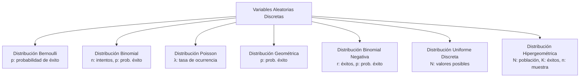
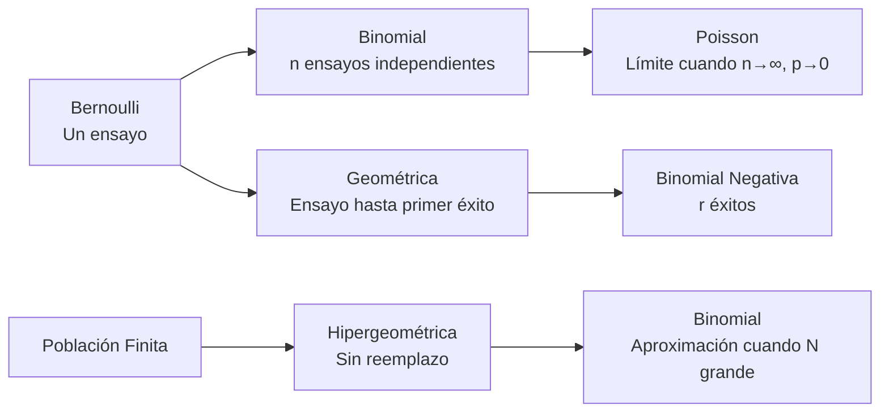

# Probabilidad I - Variables Aleatorias y Funciones de Distribución

## 2.3 Variables aleatorias discretas como familias paramétricas y su interpretación; funciones de masa o densidad, incluyendo los ejemplos: Bernoulli, Binomial, Poisson, Uniforme, Geométrica, Binomial negativa, Hipergeométrica y modelos donde éstas aparecen. Familias paramétricas discretas y su interpretación.

---

Las **variables aleatorias discretas** son aquellas que toman valores en un conjunto finito o infinito numerable $\{x_1, x_2, \dots\}.$ Su distribución queda descrita por la **función de masa de probabilidad**

$$ p_X(x) = P(X = x) $$

que cumple $p_X(x) \geq 0$ y $\sum_i p_X(x_i) = 1;$ con ella, $P(X \in A) = \sum_{x_i \in A} p_X(x_i)$ para cualquier conjunto $A.$ Recíprocamente, cualquier función con esas dos propiedades es la función de masa de alguna variable aleatoria.

Las **familias paramétricas** son conjuntos de distribuciones que comparten una misma forma funcional pero difieren en los valores de sus parámetros. Su utilidad es que cada familia corresponde a un **mecanismo** concreto (contar éxitos, esperar un éxito, muestrear sin reemplazo, contar eventos raros): si se reconoce el mecanismo en un problema, se sabe qué fórmula usar, y los parámetros tienen interpretación directa.

### Diagrama conceptual de familias discretas



### 1. Distribución Bernoulli

**Contexto**: Experimentos con solo dos resultados posibles (éxito/fracaso).

**Función de masa de probabilidad**:

$$P(X = x) = p^x (1-p)^{1-x} \quad \text{para } x = 0, 1$$

**Parámetros**:

- $p:$ probabilidad de éxito $(0 \leq p \leq 1)$

**Ejemplo**: Lanzamiento de una moneda (cara = 1, cruz = 0). Toda variable indicadora $\mathbf{1}_A$ es Bernoulli con $p = P(A).$

### 2. Distribución Binomial

**Contexto**: Número de éxitos en $n$ ensayos independientes de Bernoulli.

**Función de masa de probabilidad**:

$$ P(X = k) = \binom{n}{k} p^k (1-p)^{n-k} \quad \text{para } k = 0, 1, 2, ..., n $$

**Parámetros**:

- $n:$ número de ensayos
- $p:$ probabilidad de éxito en cada ensayo

**Ejemplo**: Número de caras en 10 lanzamientos de moneda.

**Por qué esta fórmula.** Una sucesión concreta de $n$ ensayos con $k$ éxitos, como $\text{EEFEF}\dots,$ tiene probabilidad $p^k(1-p)^{n-k}$ por independencia, sin importar en qué orden aparezcan. Hay $\binom{n}{k}$ formas de elegir en qué ensayos ocurren los éxitos, y esas sucesiones son eventos disjuntos. Por el binomio de Newton, $\sum_{k=0}^n \binom{n}{k}p^k(1-p)^{n-k} = (p + (1 - p))^n = 1.$

Se escribe $X \sim \text{Bin}(n, p).$ El número de éxitos es la suma de $n$ variables Bernoulli independientes.

### 3. Distribución Poisson

**Contexto**: Modela eventos raros que ocurren en un intervalo de tiempo o espacio.

**Función de masa de probabilidad**:

$$ P(X = k) = \frac{e^{-\lambda} \lambda^k}{k!} \quad \text{para } k = 0, 1, 2, ... $$

**Parámetros**:

- $\lambda:$ tasa promedio de ocurrencia

**Ejemplo**: Número de llamadas telefónicas por hora en una central.

**Por qué esta fórmula.** Si se divide una hora en $n$ intervalos muy cortos, en cada uno llega una llamada con probabilidad pequeña $p = \frac{\lambda}{n},$ de forma independiente, y el número total de llamadas es $\text{Bin}(n, \frac{\lambda}{n}).$ Cuando $n \to \infty,$

$$ \binom{n}{k}\left(\frac{\lambda}{n}\right)^k\left(1 - \frac{\lambda}{n}\right)^{n-k} \longrightarrow \frac{\lambda^k}{k!}e^{-\lambda} $$

porque $\frac{n(n-1)\cdots(n-k+1)}{n^k} \to 1$ y $\left(1 - \frac{\lambda}{n}\right)^n \to e^{-\lambda}$ (tema 4.1). Las probabilidades suman 1 porque $\sum_k \frac{\lambda^k}{k!} = e^{\lambda}.$ El parámetro $\lambda$ es a la vez la media y la varianza. Además, si el número de eventos en una hora tiene distribución $\text{Poisson}(\lambda),$ en $t$ horas tiene distribución $\text{Poisson}(\lambda t).$

### 4. Distribución Geométrica

**Contexto**: Número de ensayos hasta el primer éxito.

**Función de masa de probabilidad**:

$$ P(X = k) = (1-p)^{k-1} p \quad \text{para } k = 1, 2, 3, ... $$

**Parámetros**:

- $p:$ probabilidad de éxito en cada ensayo

**Ejemplo**: Número de lanzamientos hasta obtener la primera cara.

Para que el primer éxito llegue en el ensayo $k$ deben ocurrir $k - 1$ fracasos y luego un éxito. Su función de distribución es sencilla: $P(X > k) = (1 - p)^k,$ porque los primeros $k$ ensayos deben fallar.

**Falta de memoria.** La geométrica es la única distribución discreta que cumple

$$ P(X > m + k \mid X > m) = P(X > k) $$

Si ya se fallaron $m$ intentos, el número de intentos adicionales tiene la misma distribución que al principio: la moneda "no recuerda". Se demuestra directamente: $\frac{(1-p)^{m+k}}{(1-p)^m} = (1-p)^k.$

Algunos textos (y `scipy`) definen la geométrica como el número de **fracasos** antes del primer éxito, con valores $0, 1, 2, \dots;$ es la misma variable desplazada en 1.

### 5. Distribución Binomial Negativa

**Contexto**: Número de ensayos hasta obtener $r$ éxitos.

**Función de masa de probabilidad**:

$$ P(X = k) = \binom{k-1}{r-1} p^r (1-p)^{k-r} \quad \text{para } k = r, r+1, r+2, ... $$

**Parámetros**:

- $r:$ número de éxitos deseados
- $p:$ probabilidad de éxito en cada ensayo

**Ejemplo**: Número de lanzamientos hasta obtener 3 caras.

Para que el éxito número $r$ llegue en el ensayo $k,$ el ensayo $k$ debe ser éxito y entre los $k - 1$ anteriores debe haber exactamente $r - 1$ éxitos, lo que explica el coeficiente $\binom{k-1}{r-1}.$ Con $r = 1$ se obtiene la geométrica, y una binomial negativa es la suma de $r$ geométricas independientes. Como antes, `scipy.stats.nbinom` cuenta los **fracasos** $k - r$ en lugar de los ensayos $k.$

### 6. Distribución Uniforme Discreta

**Contexto**: Todos los resultados posibles tienen igual probabilidad.

**Función de masa de probabilidad**:

$$ P(X = x) = \frac{1}{N} \quad \text{para } x = 1, 2, 3, ..., N $$

**Parámetros**:

- $N:$ número de resultados posibles

**Ejemplo**: Lanzamiento de un dado justo.

### 7. Distribución Hipergeométrica

**Contexto**: Muestreo sin reemplazo de una población finita.

**Función de masa de probabilidad**:

$$ P(X = k) = \frac{\binom{K}{k} \binom{N-K}{n-k}}{\binom{N}{n}} $$

**Parámetros**:

- $N:$ tamaño de la población
- $K:$ número de éxitos en la población
- $n:$ tamaño de la muestra

**Ejemplo**: Extraer 5 cartas de una baraja y contar las espadas.

**Por qué esta fórmula.** Todas las muestras de tamaño $n$ son igualmente probables, hay $\binom{N}{n},$ y las que tienen exactamente $k$ éxitos se forman eligiendo $k$ de los $K$ éxitos y $n - k$ de los $N - K$ fracasos. A diferencia de la binomial, los ensayos **no** son independientes: sacar un éxito reduce los éxitos que quedan. Si $N$ es mucho mayor que $n,$ esa dependencia es pequeña y la hipergeométrica se parece a la $\text{Bin}(n, \frac{K}{N}).$

### Resumen de las familias

| Distribución | Valores | $P(X = k)$ | Media | Varianza |
| --- | --- | --- | --- | --- |
| $\text{Bernoulli}(p)$ | $0, 1$ | $p^k(1-p)^{1-k}$ | $p$ | $p(1-p)$ |
| $\text{Binomial}(n, p)$ | $0, \dots, n$ | $\binom{n}{k}p^k(1-p)^{n-k}$ | $np$ | $np(1-p)$ |
| $\text{Poisson}(\lambda)$ | $0, 1, 2, \dots$ | $e^{-\lambda}\frac{\lambda^k}{k!}$ | $\lambda$ | $\lambda$ |
| $\text{Geométrica}(p)$ | $1, 2, \dots$ | $(1-p)^{k-1}p$ | $\frac{1}{p}$ | $\frac{1-p}{p^2}$ |
| $\text{Binomial negativa}(r, p)$ | $r, r+1, \dots$ | $\binom{k-1}{r-1}p^r(1-p)^{k-r}$ | $\frac{r}{p}$ | $\frac{r(1-p)}{p^2}$ |
| $\text{Uniforme}(N)$ | $1, \dots, N$ | $\frac{1}{N}$ | $\frac{N+1}{2}$ | $\frac{N^2-1}{12}$ |
| $\text{Hipergeométrica}(N, K, n)$ | $\max(0, n - N + K), \dots, \min(n, K)$ | $\frac{\binom{K}{k}\binom{N-K}{n-k}}{\binom{N}{n}}$ | $n\frac{K}{N}$ | $n\frac{K}{N}\frac{N-K}{N}\frac{N-n}{N-1}$ |

Las medias y varianzas se calculan en el tema 3.1. El factor $\frac{N-n}{N-1}$ de la hipergeométrica, llamado **corrección por población finita**, hace que su varianza sea menor que la de la binomial correspondiente: muestrear sin reemplazo da más información.

### Ejemplos resueltos

#### Ejemplo 1: Binomial

Una moneda se lanza 5 veces. ¿Probabilidad de exactamente 3 caras?

$$ P(X = 3) = \binom{5}{3} (0.5)^3 (0.5)^2 = 10 \times 0.125 \times 0.25 = 0.3125 $$

#### Ejemplo 2: Poisson

En una central llegan en promedio 4 llamadas por hora. ¿Probabilidad de exactamente 2 llamadas?

$$ P(X = 2) = \frac{e^{-4} 4^2}{2!} = \frac{0.0183 \times 16}{2} \approx 0.1465 $$

#### Ejemplo 3: Hipergeométrica

De 20 productos, 5 son defectuosos. Si seleccionamos 3, ¿probabilidad de 1 defectuoso?

$$ P(X = 1) = \frac{\binom{5}{1} \binom{15}{2}}{\binom{20}{3}} = \frac{5 \times 105}{1140} \approx 0.4605 $$

Si se aproximara con la binomial $\text{Bin}(3, \frac{5}{20}),$ se obtendría $3 \cdot 0.25 \cdot 0.75^2 \approx 0.4219:$ con una población de solo 20, la diferencia es apreciable.

### Código de simulación (Python)

```python
import numpy as np
import matplotlib
matplotlib.use("Agg")
import matplotlib.pyplot as plt
from scipy.stats import bernoulli, binom, poisson, geom, nbinom, hypergeom

np.random.seed(1)

# Parámetros
n, p, lambda_val = 10, 0.5, 3
N, K, n_hyper = 20, 5, 3

# Generar muestras
bernoulli_samples = bernoulli.rvs(p, size=1000)
binomial_samples = binom.rvs(n, p, size=1000)
poisson_samples = poisson.rvs(lambda_val, size=1000)
geometric_samples = geom.rvs(p, size=1000)
neg_binomial_samples = nbinom.rvs(3, p, size=1000) + 3   # scipy cuenta fracasos: +r para contar ensayos
hypergeom_samples = hypergeom.rvs(N, K, n_hyper, size=1000)

# Visualización
fig, axes = plt.subplots(2, 3, figsize=(13, 7))
distributions = [
    (bernoulli_samples, 'Bernoulli', 'p = 0.5'),
    (binomial_samples, 'Binomial', 'n=10, p=0.5'),
    (poisson_samples, 'Poisson', 'λ=3'),
    (geometric_samples, 'Geométrica', 'p=0.5'),
    (neg_binomial_samples, 'Binomial Negativa', 'r=3, p=0.5'),
    (hypergeom_samples, 'Hipergeométrica', 'N=20, K=5, n=3')
]

for i, (data, title, params) in enumerate(distributions):
    row, col = i // 3, i % 3
    axes[row, col].hist(data, bins=range(min(data), max(data)+2),
                       density=True, alpha=0.7, edgecolor='black')
    axes[row, col].set_title(f'{title}\n{params}')
    axes[row, col].set_xlabel('Valor')
    axes[row, col].set_ylabel('Densidad')

plt.tight_layout()
plt.savefig("discretas.png", dpi=100)

# Comprobación numérica de las fórmulas con scipy
print(round(binom.pmf(3, 5, 0.5), 4), round(poisson.pmf(2, 4), 4), round(hypergeom.pmf(1, 20, 5, 3), 4))
# 0.3125 0.1465 0.4605
print("Media binomial simulada:", binomial_samples.mean(), " teórica:", n * p)
```

En `hypergeom.pmf(k, M, n, N)` de scipy el orden de los parámetros es tamaño de población, número de éxitos en la población y tamaño de muestra, que corresponden a $N,$ $K$ y $n$ en la notación de este tema.

### Ejercicios propuestos

#### Ejercicio 1

En una fábrica, el 2% de los productos son defectuosos. Si se seleccionan 100 productos:

- a) ¿Cuál es la probabilidad de que exactamente 3 sean defectuosos?
- b) ¿Cuál es la probabilidad de que al menos 2 sean defectuosos?

#### Ejercicio 2

El número de accidentes en una carretera sigue una distribución Poisson con media 2 por día. Calcula:

- a) Probabilidad de que no ocurra ningún accidente en un día.
- b) Probabilidad de que ocurran más de 3 accidentes en dos días.

#### Ejercicio 3

Un pescador tiene probabilidad 0.6 de capturar un pez cada vez que lanza su red, de forma independiente.

- a) ¿Cuál es la probabilidad de que capture su primer pez en el tercer lanzamiento?
- b) ¿Cuál es la probabilidad de que capture su tercer pez en el quinto lanzamiento?

#### Ejercicio 4

De un grupo de 15 personas (6 mujeres y 9 hombres), se seleccionan 5 al azar.

- a) ¿Cuál es la probabilidad de que exactamente 2 sean mujeres?
- b) ¿Cuál es la distribución apropiada para este problema?

### Soluciones

**Ejercicio 1.** $X \sim \text{Bin}(100, 0.02).$

- a) $P(X = 3) = \binom{100}{3}(0.02)^3(0.98)^{97} \approx 0.1823.$
- b) $P(X \geq 2) = 1 - P(X = 0) - P(X = 1) = 1 - 0.98^{100} - 100(0.02)(0.98)^{99} \approx 1 - 0.1326 - 0.2707 = 0.5967.$

Con la aproximación de Poisson de parámetro $\lambda = np = 2$ se obtiene $0.1804$ y $0.5940,$ muy cercanos (tema 4.1).

**Ejercicio 2.** a) $P(X = 0) = e^{-2} \approx 0.1353.$ b) En dos días el número de accidentes es Poisson de media 4, así que

$$ P(Y > 3) = 1 - e^{-4}\left(1 + 4 + \frac{4^2}{2} + \frac{4^3}{6}\right) = 1 - e^{-4} \cdot \frac{71}{3} \approx 1 - 0.4335 = 0.5665 $$

**Ejercicio 3.** a) Geométrica: dos fallos y un éxito, $0.4^2 \cdot 0.6 = 0.096.$ b) Binomial negativa con $r = 3,$ $k = 5:$ $\binom{4}{2}(0.6)^3(0.4)^2 = 6 \cdot 0.216 \cdot 0.16 \approx 0.2074.$

**Ejercicio 4.** a) $\frac{\binom{6}{2}\binom{9}{3}}{\binom{15}{5}} = \frac{15 \cdot 84}{3003} = \frac{1260}{3003} \approx 0.4196.$ b) Hipergeométrica con $N = 15,$ $K = 6,$ $n = 5,$ porque se elige sin reemplazo de una población pequeña; la binomial $\text{Bin}(5, 0.4)$ daría $0.3456,$ bastante distinta.

### Relaciones entre distribuciones



### Aplicaciones en modelado

1. **Control de calidad**: Binomial e Hipergeométrica
2. **Teoría de colas**: Poisson
3. **Fiabilidad**: Geométrica y Binomial Negativa
4. **Muestreo**: Hipergeométrica
5. **Genética**: Binomial para herencia de caracteres

### Referencias bibliográficas

1. Ross, S. M. (2019). "A First Course in Probability"
2. Casella, G., & Berger, R. L. (2002). "Statistical Inference"
3. Devore, J. L. (2016). "Probability and Statistics for Engineering and the Sciences"

### Consejos de estudio

1. **Identifica el contexto**: Cada distribución modela situaciones específicas
2. **Verifica supuestos**: Independencia, tamaño de población, etc.
3. **Practica derivaciones**: Comprende cómo se obtienen las fórmulas
4. **Usa software**: Implementa simulaciones para verificar resultados
5. **Relaciona distribuciones**: Comprende cómo se conectan entre sí

Esta guía proporciona una visión completa de las principales distribuciones discretas paramétricas, sus aplicaciones y relaciones, esencial para el estudio de la probabilidad y sus aplicaciones prácticas.
