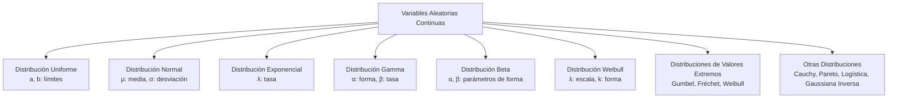
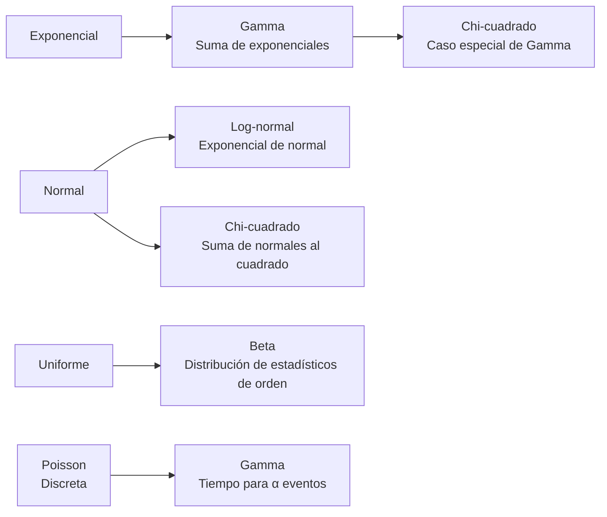

# Probabilidad I - Variables Aleatorias y Funciones de Distribución

## 2.4 Variables aleatorias continuas (o absolutamente continuas) y funciones de densidad. Familias paramétricas, incluyendo los ejemplos: Uniforme, Normal, Exponencial, Gamma, Cauchy, Beta, Weibull, Pareto, Frechet, Gumbel, Logística, Gaussiana inversa y modelos donde éstas aparecen.

---

Las **variables aleatorias continuas** son aquellas que pueden tomar cualquier valor en un intervalo de números reales. A diferencia de las discretas, se caracterizan por tener una **función de densidad de probabilidad** en lugar de una función de masa de probabilidad.

### Diagrama conceptual de familias continuas



### Definición formal

Una variable aleatoria $X$ es **absolutamente continua** si existe una función $f_X(x) \geq 0,$ con $\int_{-\infty}^{\infty} f_X(x)\,dx = 1,$ tal que para cualquier intervalo (y, en general, cualquier conjunto razonable) $B \subseteq \mathbb{R}:$

$$ P(X \in B) = \int_B f_X(x) \, dx $$

La **función de distribución acumulativa** se relaciona con la densidad mediante:

$$ F_X(x) = P(X \leq x) = \int_{-\infty}^x f_X(t) \, dt $$

Y la **función de densidad** es la derivada de la distribución, en los puntos donde $F_X$ es derivable:

$$ f_X(x) = \frac{d}{dx} F_X(x) $$

**Cómo interpretar la densidad.** $f_X(x)$ **no** es una probabilidad: puede ser mayor que 1 (la uniforme en $[0, \frac{1}{2}]$ tiene densidad 2). Lo que se interpreta es $f_X(x)\,dx:$ para $h$ pequeño,

$$ P(x < X \leq x + h) \approx f_X(x)\,h $$

La densidad mide qué tan **concentrada** está la probabilidad cerca de $x.$ En consecuencia, $P(X = x) = 0$ para cada valor individual, y $P(a < X < b) = P(a \leq X \leq b).$ Una densidad tampoco es única: cambiarla en un número finito de puntos no altera ninguna integral.

En las fórmulas siguientes, la densidad vale 0 fuera del intervalo indicado.

### Principales distribuciones continuas

#### 1. Distribución Uniforme

**Función de densidad**:

$$f(x) = \frac{1}{b-a} \quad \text{para } a \leq x \leq b$$

**Parámetros**:

- $a:$ límite inferior
- $b:$ límite superior, con $b > a$

**Aplicaciones**: Modela situaciones donde intervalos de igual longitud son igualmente probables, como el punto donde se rompe una varilla o el instante de llegada dentro de un minuto. Su distribución es $F(x) = \frac{x - a}{b - a}$ en $[a, b];$ la media es $\frac{a + b}{2}$ y la varianza $\frac{(b - a)^2}{12}.$

#### 2. Distribución Normal (Gaussiana)

**Función de densidad**:

$$ f(x) = \frac{1}{\sigma\sqrt{2\pi}} e^{-\frac{(x-\mu)^2}{2\sigma^2}} $$

**Parámetros**:

- $\mu:$ media, cualquier número real
- $\sigma:$ desviación estándar, con $\sigma > 0$

Se escribe $X \sim N(\mu, \sigma^2),$ con la **varianza** como segundo parámetro. La densidad es simétrica alrededor de $\mu$ y tiene forma de campana; $\sigma$ es la distancia del centro a los puntos de inflexión.

**Estandarización.** Si $X \sim N(\mu, \sigma^2),$ entonces $Z = \frac{X - \mu}{\sigma} \sim N(0, 1),$ la **normal estándar** (tema 2.5). Su distribución $\Phi(z)$ no tiene fórmula cerrada y se consulta en tablas o con software; basta una tabla para todas las normales. Las reglas prácticas: la probabilidad de estar a menos de 1, 2 y 3 desviaciones de la media es aproximadamente 68%, 95% y 99.7%.

**Aplicaciones**: Fenómenos naturales, errores de medición, distribución de promedios. Su importancia viene del Teorema del Límite Central: la suma de muchas contribuciones independientes y pequeñas es aproximadamente normal (tema 4.4).

#### 3. Distribución Exponencial

**Función de densidad**:

$$f(x) = \lambda e^{-\lambda x} \quad \text{para } x \geq 0$$

**Parámetros**:

- $\lambda:$ tasa, con $\lambda > 0;$ la media es $\frac{1}{\lambda}.$

Su distribución es $F(x) = 1 - e^{-\lambda x}$ para $x \geq 0,$ así que $P(X > x) = e^{-\lambda x}.$

**Falta de memoria.** Como la geométrica en el caso discreto, la exponencial es la única distribución continua con

$$ P(X > s + t \mid X > s) = \frac{e^{-\lambda(s+t)}}{e^{-\lambda s}} = e^{-\lambda t} = P(X > t) $$

Un componente con vida exponencial que ya funcionó $s$ horas está "como nuevo": no envejece.

**Aplicaciones**: Tiempos entre eventos, duración de componentes, procesos de Poisson. Si los eventos ocurren según un proceso de Poisson de tasa $\lambda,$ el tiempo hasta el primero cumple $P(T > t) = P(\text{ningún evento en } [0, t]) = e^{-\lambda t}:$ es exponencial.

#### 4. Distribución Gamma

**Función de densidad**:

$$ f(x) = \frac{\beta^\alpha}{\Gamma(\alpha)} x^{\alpha-1} e^{-\beta x} \quad \text{para } x > 0 $$

**Parámetros**:

- $\alpha:$ parámetro de forma, con $\alpha > 0$
- $\beta:$ parámetro de tasa, con $\beta > 0$

donde $\Gamma(\alpha) = \int_0^{\infty} t^{\alpha - 1}e^{-t}\,dt$ es la **función gamma**, que cumple $\Gamma(\alpha + 1) = \alpha\,\Gamma(\alpha)$ y $\Gamma(n) = (n - 1)!$ para enteros positivos; es la constante que hace que la densidad integre 1. La media es $\frac{\alpha}{\beta}$ y la varianza $\frac{\alpha}{\beta^2}.$

Con $\alpha = 1$ es la exponencial. Con $\alpha = n$ entero, es la distribución del tiempo hasta el evento número $n$ de un proceso de Poisson de tasa $\beta,$ es decir, la suma de $n$ exponenciales independientes (distribución de Erlang). Con $\alpha = \frac{k}{2}$ y $\beta = \frac{1}{2}$ es la ji-cuadrada con $k$ grados de libertad.

**Aplicaciones**: Tiempos de espera, modelado de ingresos, procesos de Poisson.

#### 5. Distribución Beta

**Función de densidad**:

$$ f(x) = \frac{x^{\alpha-1}(1-x)^{\beta-1}}{B(\alpha, \beta)} \quad \text{para } 0 \leq x \leq 1 $$

**Parámetros**:

- $\alpha,$ $\beta:$ parámetros de forma, con $\alpha > 0$ y $\beta > 0$

donde $B(\alpha, \beta) = \int_0^1 x^{\alpha-1}(1-x)^{\beta-1}\,dx = \frac{\Gamma(\alpha)\Gamma(\beta)}{\Gamma(\alpha + \beta)}$ es la **función beta**. La media es $\frac{\alpha}{\alpha + \beta}.$ Con $\alpha = \beta = 1$ es la uniforme en $[0, 1];$ con $\alpha, \beta > 1$ tiene un máximo en el interior del intervalo, y con parámetros menores que 1 se acumula en los extremos.

**Aplicaciones**: Modelado de proporciones, probabilidades bayesianas: si la probabilidad desconocida $p$ de una moneda tiene una distribución a priori $\text{Beta}(\alpha, \beta)$ y se observan $k$ caras en $n$ lanzamientos, la distribución a posteriori es $\text{Beta}(\alpha + k, \beta + n - k).$

#### 6. Distribución Weibull

**Función de densidad**:

$$ f(x) = \frac{k}{\lambda} \left(\frac{x}{\lambda}\right)^{k-1} e^{-(x/\lambda)^k} \quad \text{para } x \geq 0 $$

**Parámetros**:

- $\lambda:$ parámetro de escala, con $\lambda > 0$
- $k:$ parámetro de forma, con $k > 0$

Su distribución es $F(x) = 1 - e^{-(x/\lambda)^k}$ para $x \geq 0.$ Con $k = 1$ es la exponencial. El parámetro de forma indica cómo cambia el riesgo de falla con el tiempo: con $k < 1$ el riesgo disminuye (fallas tempranas por defectos de fabricación), con $k = 1$ es constante, y con $k > 1$ aumenta (desgaste).

**Aplicaciones**: Análisis de supervivencia, fiabilidad de componentes, velocidad del viento.

#### 7. Distribución de Cauchy

**Función de densidad**:

$$f(x) = \frac{1}{\pi \gamma \left[1 + \left(\frac{x-x_0}{\gamma}\right)^2\right]}$$

**Parámetros**:

- $x_0:$ parámetro de localización
- $\gamma:$ parámetro de escala $(\gamma > 0)$

Con $x_0 = 0$ y $\gamma = 1$ es la Cauchy estándar, $f(x) = \frac{1}{\pi(1 + x^2)}.$ Su forma recuerda a una normal, pero sus colas decaen tan lentamente, como $\frac{1}{x^2},$ que **no tiene media**: la integral $\int |x| f(x)\,dx$ diverge. Es el contraejemplo clásico de muchos teoremas: el promedio de $n$ variables Cauchy independientes tiene la **misma** distribución Cauchy y no se estabiliza, así que la ley de los grandes números no se aplica.

**Aplicaciones**: Distribución de cocientes de variables normales; también es la distribución de $\tan\theta$ si $\theta$ es uniforme en $(-\frac{\pi}{2}, \frac{\pi}{2}),$ por ejemplo el punto donde un rayo de luz con ángulo aleatorio llega a una pared.

#### 8. Distribución de Pareto

**Función de densidad**:

$$f(x) = \frac{\alpha x_m^\alpha}{x^{\alpha+1}} \quad \text{para } x \geq x_m$$

**Parámetros**:

- $x_m:$ escala, con $x_m > 0$
- $\alpha:$ forma, con $\alpha > 0$

Su cola es $P(X > x) = \left(\frac{x_m}{x}\right)^{\alpha}$ para $x \geq x_m,$ una **potencia** y no una exponencial: decae mucho más despacio que la normal, por lo que los valores extremos son relativamente frecuentes (**cola pesada**). La media es finita solo si $\alpha > 1,$ y la varianza solo si $\alpha > 2.$

**Aplicaciones**: Distribución de riqueza, donde la regla de que el 20% más rico tiene el 80% de la riqueza corresponde a $\alpha \approx 1.16;$ tamaños de ciudades, tamaños de archivos.

### Distribuciones de valores extremos

#### 9. Distribución Gumbel

**Función de densidad**:

$$ f(x) = \frac{1}{\beta} e^{-(z + e^{-z})} \quad \text{donde } z = \frac{x-\mu}{\beta}, \quad x \in \mathbb{R} $$

con localización $\mu$ y escala $\beta > 0,$ y distribución $F(x) = e^{-e^{-z}}.$ Las distribuciones de **valores extremos** describen el **máximo** de muchas observaciones independientes. El teorema de Fisher-Tippett-Gnedenko dice que, normalizado adecuadamente, ese máximo solo puede tener tres distribuciones límite: Gumbel (si las colas son de tipo exponencial, como la normal), Fréchet (colas pesadas, como Pareto) y Weibull invertida (variables acotadas).

**Aplicaciones**: Valores extremos, análisis de inundaciones: la crecida máxima anual de un río.

#### 10. Distribución Fréchet

**Función de densidad**:

$$ f(x) = \frac{\alpha}{s} \left(\frac{x-m}{s}\right)^{-1-\alpha} e^{-\left(\frac{x-m}{s}\right)^{-\alpha}} \quad \text{para } x > m $$

con forma $\alpha > 0,$ escala $s > 0$ y localización $m;$ su distribución es $F(x) = e^{-\left(\frac{x-m}{s}\right)^{-\alpha}}.$

**Aplicaciones**: Valores extremos con cola pesada, como la pérdida máxima anual en seguros o la mayor lluvia diaria en climas con tormentas intensas.

#### 11. Distribución Logística

**Función de densidad**:

$$ f(x) = \frac{e^{-(x-\mu)/s}}{s\left(1 + e^{-(x-\mu)/s}\right)^2}, \quad x \in \mathbb{R} $$

con localización $\mu$ y escala $s > 0.$ Su distribución es la **función logística** $F(x) = \frac{1}{1 + e^{-(x - \mu)/s}},$ la curva en forma de S. Se parece a la normal pero con colas algo más pesadas, y su ventaja es que $F$ tiene fórmula cerrada.

**Aplicaciones**: Modelado de crecimiento, regresión logística, sistema de puntuación Elo en ajedrez.

#### 12. Distribución Gaussiana Inversa

**Función de densidad**:

$$ f(x) = \left(\frac{\lambda}{2\pi x^3}\right)^{1/2} e^{-\frac{\lambda(x-\mu)^2}{2\mu^2 x}} \quad \text{para } x > 0 $$

con media $\mu > 0$ y parámetro de forma $\lambda > 0;$ la varianza es $\frac{\mu^3}{\lambda}.$ El nombre no significa que sea la inversa de una normal: viene de que describe el **tiempo** que tarda un movimiento browniano con deriva en alcanzar un nivel, mientras que la normal describe la **posición** en un tiempo fijo.

**Aplicaciones**: Tiempos de primer paso, procesos de difusión, tiempos de reacción, fiabilidad por desgaste acumulado.

### Código de visualización (Python)

```python
import numpy as np
import matplotlib
matplotlib.use("Agg")
import matplotlib.pyplot as plt
from scipy import integrate
from scipy.stats import uniform, norm, expon, gamma, beta, weibull_min, cauchy, pareto, gumbel_r, logistic, invgauss, invweibull

# Configuración
x = np.linspace(0, 5, 1000)
x_extended = np.linspace(-5, 5, 1000)

# Crear figura
fig, axes = plt.subplots(4, 3, figsize=(15, 12))

# Distribuciones
distributions = [
    (uniform(0, 2), 'Uniforme(0,2)', x),
    (norm(0, 1), 'Normal(0,1)', x_extended),
    (expon(scale=1), 'Exponencial(1)', x),   # expon(1) significaría loc = 1: desplazada
    (gamma(2, 0, 1), 'Gamma(2,1)', x),
    (beta(2, 5), 'Beta(2,5)', np.linspace(0, 1, 100)),
    (weibull_min(1.5), 'Weibull(1.5)', x),
    (cauchy(), 'Cauchy', x_extended),
    (pareto(2.5), 'Pareto(2.5)', np.linspace(1, 5, 100)),
    (gumbel_r(), 'Gumbel', x_extended),
    (logistic(), 'Logística', x_extended),
    (invgauss(1), 'Gaussiana Inversa(1)', x),
    (invweibull(2), 'Fréchet(2)', x),
]

for i, (dist, title, x_vals) in enumerate(distributions):
    row, col = i // 3, i % 3
    axes[row, col].plot(x_vals, dist.pdf(x_vals), 'b-', lw=2)
    axes[row, col].set_title(title)
    axes[row, col].set_xlabel('x')
    axes[row, col].set_ylabel('f(x)')
    axes[row, col].grid(True)

plt.tight_layout()
plt.savefig("continuas.png", dpi=90)

# Comprobación: cada densidad integra 1
for dist, title, _ in distributions:
    total, _ = integrate.quad(dist.pdf, *dist.support(), limit=200)
    print(f"{title:22s} integral = {total:.4f}")
```

En `scipy.stats`, todas las distribuciones aceptan los argumentos `loc` (desplazamiento) y `scale` (escala); el primer argumento posicional suele ser el de forma, si la familia lo tiene, y si no es `loc`. Por eso `expon(1)` no es la exponencial de tasa 1 sino una exponencial desplazada a $[1, \infty);$ hay que escribir `expon(scale=1/lam)`. La Cauchy se excluye del cálculo de la media, pero su densidad sí integra 1.

### Ejemplos resueltos

#### Ejemplo 1: Distribución Normal

Si $X \sim N(100, 15^2),$ es decir, con media 100 y desviación estándar 15, calcula $P(85 < X < 115).$

**Solución**: Estandarizamos con $Z = \frac{X - \mu}{\sigma}:$

$$ P(85 < X < 115) = P\left(\frac{85-100}{15} < Z < \frac{115-100}{15}\right) = P(-1 < Z < 1) = 2\Phi(1) - 1 \approx 0.6827 $$

#### Ejemplo 2: Distribución Exponencial

El tiempo entre llegadas a un servidor sigue una distribución exponencial con tasa $\lambda = 0.5$ llegadas por minuto. ¿Probabilidad de que el tiempo entre llegadas sea mayor a 3 minutos?

**Solución**:

$$P(X > 3) = 1 - F(3) = e^{-0.5 \times 3} = e^{-1.5} \approx 0.2231$$

#### Ejemplo 3: Distribución Uniforme

Una variable sigue una distribución uniforme en $[0, 10].$ Calcula $P(2 < X < 7).$

**Solución**:

$$P(2 < X < 7) = \frac{7-2}{10-0} = 0.5$$

### Ejercicios propuestos

#### Ejercicio 1

El diámetro de cojinetes sigue una distribución normal con media 5.0 mm y desviación estándar 0.02 mm.

- a) Calcula la probabilidad de que un cojinete tenga diámetro entre 4.98 y 5.02 mm.
- b) ¿Qué diámetro es superado por el 95% de los cojinetes?

#### Ejercicio 2

El tiempo de falla de un componente sigue una distribución Weibull con $\lambda = 100$ horas y $k = 2.5.$

- a) Calcula la probabilidad de que el componente dure más de 120 horas.
- b) Encuentra el tiempo mediano de falla.

#### Ejercicio 3

Supón que $X \sim \text{Beta}(2, 3).$

- a) Calcula $P(0.2 < X < 0.7).$
- b) Encuentra la media y varianza de $X.$

#### Ejercicio 4

El ingreso mensual en una población sigue una distribución Pareto con $x_m = 1000$ y $\alpha = 2.5.$

- a) Calcula la probabilidad de que una persona gane más de 5000 al mes.
- b) ¿Cuál es el ingreso mediano?

### Soluciones

**Ejercicio 1.** a) $P(4.98 < X < 5.02) = P(-1 < Z < 1) \approx 0.6827.$ b) Se busca $d$ con $P(X > d) = 0.95,$ es decir $P(Z \leq \frac{d - 5}{0.02}) = 0.05.$ Como $\Phi(-1.645) \approx 0.05,$ $d = 5 - 1.645 \cdot 0.02 \approx 4.967$ mm.

**Ejercicio 2.** a) $P(X > 120) = e^{-(120/100)^{2.5}} = e^{-1.2^{2.5}} \approx e^{-1.577} \approx 0.2065.$ b) La mediana $m$ cumple $e^{-(m/100)^{2.5}} = \frac{1}{2},$ así que $m = 100\,(\ln 2)^{1/2.5} \approx 86.4$ horas.

**Ejercicio 3.** La densidad es $f(x) = \frac{x(1-x)^2}{B(2, 3)} = 12x(1-x)^2$ en $[0, 1],$ porque $B(2, 3) = \frac{1! \, 2!}{4!} = \frac{1}{12}.$ Integrando, $F(x) = 6x^2 - 8x^3 + 3x^4,$ y

- a) $F(0.7) = 6(0.49) - 8(0.343) + 3(0.2401) = 2.94 - 2.744 + 0.7203 = 0.9163$ y $F(0.2) = 0.24 - 0.064 + 0.0048 = 0.1808,$ así que $P(0.2 < X < 0.7) = 0.9163 - 0.1808 = 0.7355.$ Con scipy: `beta(2, 3).cdf(0.7) - beta(2, 3).cdf(0.2)`.
- b) Media $\frac{\alpha}{\alpha + \beta} = \frac{2}{5} = 0.4;$ varianza $\frac{\alpha\beta}{(\alpha + \beta)^2(\alpha + \beta + 1)} = \frac{6}{25 \cdot 6} = 0.04.$

**Ejercicio 4.** a) $P(X > 5000) = \left(\frac{1000}{5000}\right)^{2.5} = 0.2^{2.5} \approx 0.0179.$ b) La mediana cumple $\left(\frac{1000}{m}\right)^{2.5} = \frac{1}{2},$ así que $m = 1000 \cdot 2^{1/2.5} \approx 1319.5.$ La media es $\frac{\alpha x_m}{\alpha - 1} \approx 1666.7,$ mayor que la mediana: los pocos ingresos muy altos jalan la media hacia arriba, algo típico de las distribuciones con cola pesada.

### Relaciones entre distribuciones



### Aplicaciones en modelado

1. **Ingeniería**: Weibull para análisis de fiabilidad
2. **Economía**: Pareto para distribución de riqueza
3. **Meteorología**: Gumbel para valores extremos de precipitación
4. **Biología**: Normal para características físicas en poblaciones
5. **Fiabilidad**: Exponencial y Gamma para tiempos de falla
6. **Bayesianas**: Beta como distribución conjugada previa

### Referencias bibliográficas

1. Ross, S. M. (2019). "A First Course in Probability"
2. Casella, G., & Berger, R. L. (2002). "Statistical Inference"
3. Johnson, N. L., Kotz, S., & Balakrishnan, N. (1994). "Continuous Univariate Distributions"

### Consejos de estudio

1. **Visualiza las distribuciones**: Grafica las funciones de densidad para diferentes parámetros
2. **Comprende los parámetros**: Identifica cómo cada parámetro afecta la forma de la distribución
3. **Domina la estandarización**: Es crucial para trabajar con la distribución normal
4. **Practica integración**: Muchos problemas requieren calcular integrales de funciones de densidad
5. **Relaciona aplicaciones**: Asocia cada distribución con situaciones del mundo real
