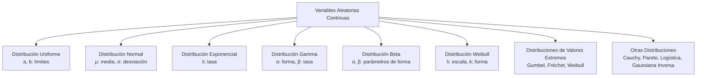
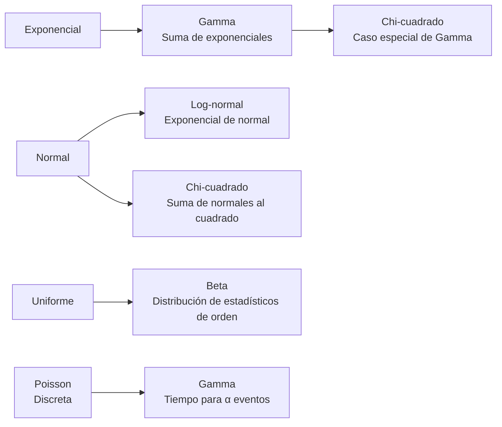

# Probabilidad I - Variables Aleatorias y Funciones de Distribución

## 2.4 Variables aleatorias continuas (o absolutamente continuas) y funciones de densidad. Familias paramétricas, incluyendo los ejemplos: Uniforme, Normal, Exponencial, Gamma, Cauchy, Beta, Weibull, Pareto, Frechet, Gumbel, Logística, Gaussiana inversa y modelos donde éstas aparecen.

---

Las **variables aleatorias continuas** son aquellas que pueden tomar cualquier valor en un intervalo de números reales. A diferencia de las discretas, se caracterizan por tener una **función de densidad de probabilidad** en lugar de una función de masa de probabilidad.

### Diagrama conceptual de familias continuas



### Definición formal

Una variable aleatoria $X$ es **absolutamente continua** si existe una función $f_X(x) \geq 0$ tal que para cualquier conjunto $B \subseteq \mathbb{R}:$

$$P(X \in B) = \int_B f_X(x) \, dx$$

La **función de distribución acumulativa** se relaciona con la densidad mediante:

$$F_X(x) = P(X \leq x) = \int_{-\infty}^x f_X(t) \, dt$$

Y la **función de densidad** es la derivada de la distribución:

$$f_X(x) = \frac{d}{dx} F_X(x)$$

### Principales distribuciones continuas

#### 1. Distribución Uniforme

**Función de densidad**:

$$f(x) = \frac{1}{b-a} \quad \text{para } a \leq x \leq b$$

**Parámetros**:

- $a:$ límite inferior
- $b:$ límite superior $(b > a)$

**Aplicaciones**: Modela situaciones donde todos los resultados son igualmente probables en un intervalo.

#### 2. Distribución Normal (Gaussiana)

**Función de densidad**:

$$ f(x) = \frac{1}{\sigma\sqrt{2\pi}} e^{-\frac{(x-\mu)^2}{2\sigma^2}} $$

**Parámetros**:

- $\mu:$ media ( $-\infty < \mu < \infty$ )
- $\sigma:$ desviación estándar ( $\sigma > 0$ )

**Aplicaciones**: Fenómenos naturales, errores de medición, distribución de promedios.

#### 3. Distribución Exponencial

**Función de densidad**:

$$f(x) = \lambda e^{-\lambda x} \quad \text{para } x \geq 0$$

**Parámetros**:

- $\lambda:$ tasa $(\lambda > 0)$

**Aplicaciones**: Tiempos entre eventos, duración de componentes, procesos de Poisson.

#### 4. Distribución Gamma

**Función de densidad**:

$$ f(x) = \frac{\beta^\alpha}{\Gamma(\alpha)} x^{\alpha-1} e^{-\beta x} \quad \text{para } x > 0 $$

**Parámetros**:

- $\alpha:$ parámetro de forma $(\alpha > 0)$
- $\beta:$ parámetro de tasa $(\beta > 0)$

**Aplicaciones**: Tiempos de espera, modelado de ingresos, procesos de Poisson.

#### 5. Distribución Beta

**Función de densidad**:

$$ f(x) = \frac{x^{\alpha-1}(1-x)^{\beta-1}}{B(\alpha, \beta)} \quad \text{para } 0 \leq x \leq 1 $$

**Parámetros**:

- $\alpha,$ $\beta:$ parámetros de forma $(\alpha > 0,$ $\beta > 0)$

**Aplicaciones**: Modelado de proporciones, probabilidades Bayesianas.

#### 6. Distribución Weibull

**Función de densidad**:

$$ f(x) = \frac{k}{\lambda} \left(\frac{x}{\lambda}\right)^{k-1} e^{-(x/\lambda)^k} \quad \text{para } x \geq 0 $$

**Parámetros**:

- $\lambda:$ parámetro de escala $(\lambda > 0)$
- $k:$ parámetro de forma $(k > 0)$

**Aplicaciones**: Análisis de supervivencia, fiabilidad de componentes.

#### 7. Distribución de Cauchy

**Función de densidad**:

$$f(x) = \frac{1}{\pi \gamma \left[1 + \left(\frac{x-x_0}{\gamma}\right)^2\right]}$$

**Parámetros**:

- $x_0:$ parámetro de localización
- $\gamma:$ parámetro de escala $(\gamma > 0)$

**Aplicaciones**: Distribución de cocientes de variables normales.

#### 8. Distribución de Pareto

**Función de densidad**:

$$f(x) = \frac{\alpha x_m^\alpha}{x^{\alpha+1}} \quad \text{para } x \geq x_m$$

**Parámetros**:

- $x_m:$ escala ( $x_m > 0$ )
- $\alpha:$ forma ( $\alpha > 0$ )

**Aplicaciones**: Distribución de riqueza, tamaños de ciudades.

### Distribuciones de valores extremos

#### 9. Distribución Gumbel

**Función de densidad**:

$$f(x) = \frac{1}{\beta} e^{-(z + e^{-z})} \quad \text{donde } z = \frac{x-\mu}{\beta}$$

**Aplicaciones**: Valores extremos, análisis de inundaciones.

#### 10. Distribución Fréchet

**Función de densidad**:

$$f(x) = \frac{\alpha}{s} \left(\frac{x-m}{s}\right)^{-1-\alpha} e^{-(\frac{x-m}{s})^{-\alpha}}$$

**Aplicaciones**: Valores extremos con cola pesada.

#### 11. Distribución Logística

**Función de densidad**:

$$f(x) = \frac{e^{-(x-\mu)/s}}{s(1 + e^{-(x-\mu)/s})^2}$$

**Aplicaciones**: Modelado de crecimiento, regresión logística.

#### 12. Distribución Gaussiana Inversa

**Función de densidad**:

$$f(x) = \left(\frac{\lambda}{2\pi x^3}\right)^{1/2} e^{-\frac{\lambda(x-\mu)^2}{2\mu^2 x}}$$

**Aplicaciones**: Tiempos de primer paso, procesos de difusión.

### Código de visualización (Python)

```python
import numpy as np
import matplotlib.pyplot as plt
from scipy.stats import uniform, norm, expon, gamma, beta, weibull_min, cauchy, pareto, gumbel_r, logistic, invgauss

# Configuración
x = np.linspace(0, 5, 1000)
x_extended = np.linspace(-5, 5, 1000)

# Crear figura
fig, axes = plt.subplots(4, 3, figsize=(15, 12))

# Distribuciones
distributions = [
    (uniform(0, 2), 'Uniforme(0,2)', x),
    (norm(0, 1), 'Normal(0,1)', x_extended),
    (expon(1), 'Exponencial(1)', x),
    (gamma(2, 0, 1), 'Gamma(2,1)', x),
    (beta(2, 5), 'Beta(2,5)', np.linspace(0, 1, 100)),
    (weibull_min(1.5), 'Weibull(1.5)', x),
    (cauchy(), 'Cauchy', x_extended),
    (pareto(2.5), 'Pareto(2.5)', np.linspace(1, 5, 100)),
    (gumbel_r(), 'Gumbel', x_extended),
    (logistic(), 'Logística', x_extended),
    (invgauss(1), 'Gaussiana Inversa(1)', x)
]

for i, (dist, title, x_vals) in enumerate(distributions):
    row, col = i // 3, i % 3
    axes[row, col].plot(x_vals, dist.pdf(x_vals), 'b-', lw=2)
    axes[row, col].set_title(title)
    axes[row, col].set_xlabel('x')
    axes[row, col].set_ylabel('f(x)')
    axes[row, col].grid(True)

plt.tight_layout()
plt.show()
```

### Ejemplos resueltos

#### Ejemplo 1: Distribución Normal

Si $X \sim N(100, 15),$ calcula $P(85 < X < 115).$

**Solución**:
Estandarizamos: $Z = \frac{X - \mu}{\sigma}$

$$P(85 < X < 115) = P\left(\frac{85-100}{15} < Z < \frac{115-100}{15}\right) = P(-1 < Z < 1) \approx 0.6827$$

#### Ejemplo 2: Distribución Exponencial

El tiempo entre llegadas a un servidor sigue una distribución exponencial con $\lambda = 0.5$ min⁻¹. ¿Probabilidad de que el tiempo entre llegadas sea mayor a 3 minutos?

**Solución**:

$$P(X > 3) = 1 - F(3) = e^{-0.5 \times 3} = e^{-1.5} \approx 0.2231$$

#### Ejemplo 3: Distribución Uniforme

Una variable sigue una distribución uniforme en [0, 10]. Calcula $P(2 < X < 7).$

**Solución**:

$$P(2 < X < 7) = \frac{7-2}{10-0} = 0.5$$

### Ejercicios propuestos

#### Ejercicio 1

El diámetro de cojinetes sigue una distribución normal con media 5.0 mm y desviación estándar 0.02 mm.
a) Calcula la probabilidad de que un cojinete tenga diámetro entre 4.98 y 5.02 mm.
b) ¿Qué diámetro es superado por el 95% de los cojinetes?

#### Ejercicio 2

El tiempo de falla de un componente sigue una distribución Weibull con $\lambda = 100$ horas y $k = 2.5.$
a) Calcula la probabilidad de que el componente dure más de 120 horas.
b) Encuentra el tiempo mediano de falla.

#### Ejercicio 3

Supón que $X \sim Beta(2, 3).$
a) Calcula $P(0.2 < X < 0.7)$
b) Encuentra la media y varianza de X.

#### Ejercicio 4

El ingreso mensual en una población sigue una distribución Pareto con $x_m = 1000$ y $\alpha = 2.5.$
a) Calcula la probabilidad de que una persona gane más de 5000 al mes.
b) ¿Cuál es el ingreso mediano?

### Relaciones entre distribuciones



### Aplicaciones en modelado

1. **Ingeniería**: Weibull para análisis de fiabilidad
2. **Economía**: Pareto para distribución de riqueza
3. **Meteorología**: Gumbel para valores extremos de precipitación
4. **Biología**: Normal para características físicas en poblaciones
5. **Fiabilidad**: Exponencial y Gamma para tiempos de falla
6. **Bayesianas**: Beta como distribución conjugada previa

### Referencias bibliográficas

1. Ross, S. M. (2019). "A First Course in Probability"
2. Casella, G., & Berger, R. L. (2002). "Statistical Inference"
3. Johnson, N. L., Kotz, S., & Balakrishnan, N. (1994). "Continuous Univariate Distributions"

### Consejos de estudio

1. **Visualiza las distribuciones**: Grafica las funciones de densidad para diferentes parámetros
2. **Comprende los parámetros**: Identifica cómo cada parámetro afecta la forma de la distribución
3. **Domina la estandarización**: Es crucial para trabajar con la distribución normal
4. **Practica integración**: Muchos problemas requieren calcular integrales de funciones de densidad
5. **Relaciona aplicaciones**: Asocia cada distribución con situaciones del mundo real
