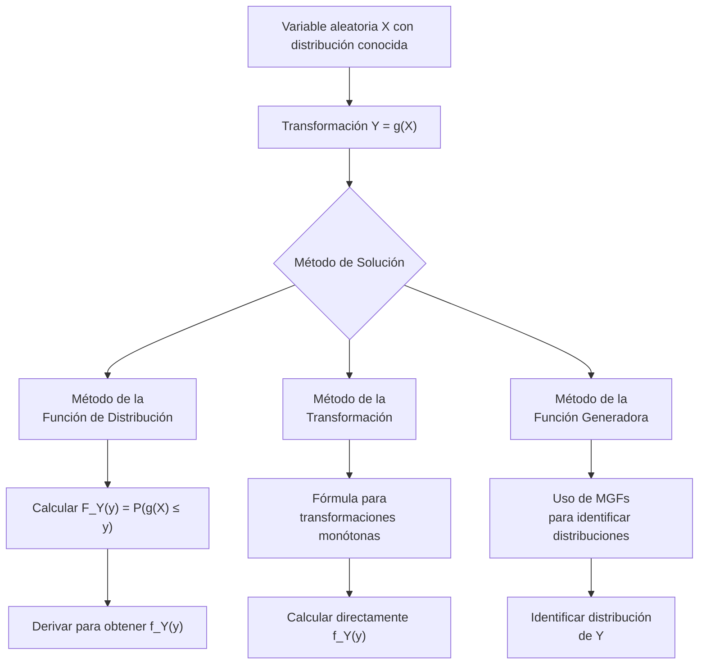

# Probabilidad I - Variables Aleatorias y Funciones de Distribución

## 2.5 Función de distribución de funciones de variables aleatorias.

---

En probabilidad, frecuentemente nos interesa estudiar **funciones de variables aleatorias**, donde una nueva variable aleatoria $Y$ se define como $Y = g(X),$ siendo $X$ una variable aleatoria y $g$ una función medible. Comprender cómo obtener la distribución de $Y$ a partir de la distribución de $X$ es fundamental en diversas aplicaciones estadísticas y de modelado.

### Diagrama conceptual del proceso



### Métodos para encontrar la distribución de Y = g(X)

#### 0. Caso discreto

Si $X$ es discreta, $Y = g(X)$ también lo es, y basta sumar las probabilidades de todos los valores de $X$ que van al mismo valor de $Y:$

$$ p_Y(y) = P(g(X) = y) = \sum_{x \,:\, g(x) = y} p_X(x) $$

Por ejemplo, si $X$ es uniforme en $\{-2, -1, 0, 1, 2\}$ y $Y = X^2,$ entonces $p_Y(0) = \frac{1}{5},$ $p_Y(1) = \frac{2}{5}$ y $p_Y(4) = \frac{2}{5}.$ La función $g$ no tiene que ser inyectiva: varios valores de $X$ pueden juntarse en uno de $Y.$

#### 1. Método de la función de distribución

Para encontrar la distribución de $Y = g(X):$

1. Encontrar $F_Y(y) = P(Y \leq y) = P(g(X) \leq y)$
2. Expresar el evento $\{g(X) \leq y\}$ en términos de $X$
3. Derivar para obtener la densidad: $f_Y(y) = \frac{d}{dy} F_Y(y)$

Es el método más general: funciona aunque $g$ no sea monótona ni derivable. El paso delicado es el segundo, que requiere despejar con cuidado, sobre todo cuando $g$ no es inyectiva. Hay que determinar también el **rango** de $Y,$ fuera del cual $F_Y$ vale 0 o 1.

#### 2. Método de transformación (para funciones monótonas)

Si $X$ tiene densidad y $g$ es estrictamente monótona y diferenciable en el rango de $X:$

$$ f_Y(y) = f_X(g^{-1}(y)) \left| \frac{d}{dy} g^{-1}(y) \right| $$

para $y$ en la imagen de $g,$ y $f_Y(y) = 0$ fuera de ella.

*Demostración.* Si $g$ es creciente, $F_Y(y) = P(g(X) \leq y) = P(X \leq g^{-1}(y)) = F_X(g^{-1}(y)),$ y la regla de la cadena da $f_Y(y) = f_X(g^{-1}(y)) \frac{d}{dy}g^{-1}(y).$ Si $g$ es decreciente, la desigualdad se invierte: $F_Y(y) = P(X \geq g^{-1}(y)) = 1 - F_X(g^{-1}(y)),$ y al derivar aparece un signo menos que compensa el de la derivada negativa de $g^{-1}.$ El valor absoluto cubre ambos casos. $\blacksquare$

La intuición: la probabilidad de un intervalo pequeño se conserva, $f_Y(y)\,|dy| = f_X(x)\,|dx|;$ donde $g$ estira los intervalos, la densidad baja, y donde los comprime, sube.

Si $g$ no es monótona pero cada $y$ tiene un número finito de preimágenes $x_1, \dots, x_m$ con $g'(x_i) \neq 0,$ se suman las contribuciones de cada una:

$$ f_Y(y) = \sum_{i=1}^{m} \frac{f_X(x_i)}{|g'(x_i)|} $$

Para el caso lineal $Y = aX + b:$

$$f_Y(y) = \frac{1}{|a|} f_X\left(\frac{y - b}{a}\right)$$

#### 3. Método de la función generadora de momentos

Si $Y = g(X),$ la función generadora de momentos de $Y$ es:

$$ M_Y(t) = E[e^{tY}] = E[e^{tg(X)}] $$

Si se reconoce $M_Y$ como la función generadora de una distribución conocida, esa es la distribución de $Y,$ porque la función generadora (cuando existe en un intervalo alrededor de 0) determina la distribución. Por ejemplo, si $X \sim N(\mu, \sigma^2),$ entonces $M_X(t) = e^{\mu t + \sigma^2 t^2/2}$ y para $Y = aX + b$ se tiene $M_Y(t) = e^{bt}M_X(at) = e^{(a\mu + b)t + a^2\sigma^2t^2/2},$ que es la de $N(a\mu + b, a^2\sigma^2).$ Este método se desarrolla en el tema 3.5 y es especialmente útil para **sumas** de variables independientes (tema 4.3).

### Transformaciones comunes

#### Transformación lineal

$$ Y = aX + b \Rightarrow F_Y(y) = F_X\left(\frac{y - b}{a}\right) \text{ para } a > 0 $$

y, para $a < 0,$ $F_Y(y) = P\left(X \geq \frac{y - b}{a}\right) = 1 - F_X\left(\frac{y - b}{a}\right)$ si $X$ es continua.

#### Transformación cuadrática

$$ Y = X^2 \Rightarrow F_Y(y) = F_X(\sqrt{y}) - F_X(-\sqrt{y}) \text{ para } y \geq 0 $$

si $X$ es continua, y $F_Y(y) = 0$ para $y < 0.$ Derivando, $f_Y(y) = \frac{f_X(\sqrt{y}) + f_X(-\sqrt{y})}{2\sqrt{y}},$ el caso de dos preimágenes de la fórmula general.

#### Transformación inversa

$$ Y = \frac{1}{X} \Rightarrow F_Y(y) = 1 - F_X\left(\frac{1}{y}\right) \text{ para } y > 0 $$

válido si $X$ es continua y **positiva**: entonces $\frac{1}{X} \leq y$ equivale a $X \geq \frac{1}{y}.$ Si $X$ puede ser negativa hay que separar casos.

### Ejemplos resueltos

#### Ejemplo 1: Transformación lineal

Sea $X \sim \text{Uniforme}(0, 1)$ y $Y = 2X + 3.$ Encuentra $f_Y(y).$

**Solución**: Usando el método de transformación,

$$ f_Y(y) = \frac{1}{|2|} f_X\left(\frac{y - 3}{2}\right) = \frac{1}{2} \cdot 1 = \frac{1}{2} $$

para $0 \leq \frac{y-3}{2} \leq 1,$ es decir $3 \leq y \leq 5,$ y $f_Y(y) = 0$ fuera de ese intervalo. Así, $Y \sim \text{Uniforme}(3, 5):$ una transformación lineal de una uniforme es uniforme.

#### Ejemplo 2: Transformación cuadrática

Sea $X$ con densidad $f_X(x) = e^{-x}$ para $x > 0$ y $Y = X^2.$ Encuentra $f_Y(y).$

**Solución**: Usando el método de la función de distribución, para $y > 0,$ y como $X > 0:$

$$ F_Y(y) = P(Y \leq y) = P(X^2 \leq y) = P(X \leq \sqrt{y}) = F_X(\sqrt{y}) $$

$$f_Y(y) = \frac{d}{dy} F_X(\sqrt{y}) = f_X(\sqrt{y}) \cdot \frac{1}{2\sqrt{y}} = \frac{e^{-\sqrt{y}}}{2\sqrt{y}}$$

#### Ejemplo 3: Transformación de la distribución normal

Si $X \sim N(0, 1)$ y $Y = X^2,$ entonces $Y \sim \chi^2(1).$

**Solución**: Ahora $X$ puede ser negativa, así que hay dos preimágenes. Para $y > 0:$

$$F_Y(y) = P(X^2 \leq y) = P(-\sqrt{y} \leq X \leq \sqrt{y}) = \Phi(\sqrt{y}) - \Phi(-\sqrt{y})$$

$$ f_Y(y) = \frac{d}{dy} [\Phi(\sqrt{y}) - \Phi(-\sqrt{y})] = \frac{\varphi(\sqrt{y}) + \varphi(-\sqrt{y})}{2\sqrt{y}} = \frac{1}{\sqrt{2\pi y}} e^{-y/2} $$

donde $\varphi$ es la densidad normal estándar. Es la densidad $\text{Gamma}(\frac{1}{2}, \frac{1}{2}),$ la ji-cuadrada con un grado de libertad.

#### Ejemplo 4: La distribución log-normal

Si $X \sim N(\mu, \sigma^2)$ y $Y = e^X,$ la función $g(x) = e^x$ es creciente con inversa $\ln y,$ así que para $y > 0$

$$ f_Y(y) = f_X(\ln y)\,\frac{1}{y} = \frac{1}{y\,\sigma\sqrt{2\pi}}\,e^{-\frac{(\ln y - \mu)^2}{2\sigma^2}} $$

Es la **log-normal**: modela cantidades positivas que resultan de multiplicar muchos factores, como precios de acciones o tamaños de partículas.

#### Ejemplo 5: La transformada integral de probabilidad

Si $X$ es continua con distribución $F_X$ estrictamente creciente y $U = F_X(X),$ entonces para $0 < u < 1$

$$ P(U \leq u) = P(F_X(X) \leq u) = P(X \leq F_X^{-1}(u)) = F_X(F_X^{-1}(u)) = u $$

así que $U \sim \text{Uniforme}(0, 1),$ **cualquiera que sea** la distribución de $X.$ Leído al revés, $X = F_X^{-1}(U)$ tiene distribución $F_X$ si $U$ es uniforme: es el método de la transformada inversa para simular (tema 2.6).

### Código de simulación (Python)

```python
import numpy as np
import matplotlib
matplotlib.use("Agg")
import matplotlib.pyplot as plt
from scipy.stats import norm, uniform, lognorm

# Configuración
np.random.seed(42)
n_samples = 10000

# Generar datos
X_unif = uniform.rvs(size=n_samples)
X_norm = norm.rvs(size=n_samples)

# Transformaciones
Y_linear = 2 * X_unif + 3
Y_square = X_norm ** 2
Y_exp = np.exp(X_norm)

# Visualización
fig, axes = plt.subplots(2, 3, figsize=(15, 10))

# Distribución original y transformada
axes[0, 0].hist(X_unif, bins=50, density=True, alpha=0.7)
axes[0, 0].set_title('X ~ Uniforme(0,1)')
axes[0, 0].set_xlabel('x')
axes[0, 0].set_ylabel('Densidad')

axes[0, 1].hist(Y_linear, bins=50, density=True, alpha=0.7)
axes[0, 1].set_title('Y = 2X + 3')
axes[0, 1].set_xlabel('y')
axes[0, 1].set_ylabel('Densidad')

axes[0, 2].hist(X_norm, bins=50, density=True, alpha=0.7)
axes[0, 2].set_title('X ~ N(0,1)')
axes[0, 2].set_xlabel('x')
axes[0, 2].set_ylabel('Densidad')

axes[1, 0].hist(Y_square, bins=50, density=True, alpha=0.7)
axes[1, 0].set_title('Y = X² (Chi-cuadrado)')
axes[1, 0].set_xlabel('y')
axes[1, 0].set_ylabel('Densidad')

axes[1, 1].hist(Y_exp, bins=50, density=True, alpha=0.7)
axes[1, 1].set_title('Y = e^X (Log-normal)')
axes[1, 1].set_xlabel('y')
axes[1, 1].set_ylabel('Densidad')

# Teórica
x = np.linspace(0, 5, 100)
chi2_pdf = (1 / (np.sqrt(2 * np.pi * x))) * np.exp(-x / 2)
axes[1, 0].plot(x, chi2_pdf, 'r-', linewidth=2, label='χ²(1) teórica')
axes[1, 0].legend()

xl = np.linspace(0.01, 8, 200)
axes[1, 1].plot(xl, lognorm(s=1).pdf(xl), 'r-', linewidth=2, label='log-normal teórica')
axes[1, 1].set_xlim(0, 8)
axes[1, 1].legend()

# Transformada integral: F_X(X) es uniforme
axes[1, 2].hist(norm.cdf(X_norm), bins=20, density=True, alpha=0.7)
axes[1, 2].set_title('U = Φ(X) (Uniforme)')

plt.tight_layout()
plt.savefig("transformaciones.png", dpi=90)

# Verificación numérica: P(Y ≤ 1) para Y = X², X normal estándar
print(np.mean(Y_square <= 1), "vs", norm.cdf(1) - norm.cdf(-1))   # ≈ 0.683
```

### Ejercicios propuestos

#### Ejercicio 1

Sea $X \sim \text{Uniforme}(0, 1).$ Encuentra la función de densidad de:

- a) $Y = -\ln(X)$
- b) $Y = X^3$
- c) $Y = \sqrt{X}$

#### Ejercicio 2

Si $X \sim \text{Exponencial}(\lambda),$ encuentra la distribución de:

- a) $Y = X^2$
- b) $Y = \sqrt{X}$
- c) $Y = \frac{1}{X}$

#### Ejercicio 3

Sea $X \sim N(\mu, \sigma^2).$ Demuestra que, para $a \neq 0:$

- a) $Y = aX + b \sim N(a\mu + b, a^2\sigma^2)$
- b) $Z = \frac{X - \mu}{\sigma} \sim N(0, 1)$

#### Ejercicio 4

Si $X$ tiene función de densidad $f_X(x) = 2x$ para $0 < x < 1,$ encuentra la densidad de:

- a) $Y = X^2$
- b) $Y = e^X$
- c) $Y = -\ln(1 - X)$

### Soluciones

**Ejercicio 1.** En los tres casos $g$ es monótona en $(0, 1)$ y $f_X = 1$ ahí.

- a) $-\ln X > y$ equivale a $X < e^{-y},$ así que $P(Y > y) = e^{-y}$ para $y > 0:$ $Y \sim \text{Exponencial}(1),$ con $f_Y(y) = e^{-y}.$ Es la base para simular exponenciales.
- b) $F_Y(y) = P(X \leq y^{1/3}) = y^{1/3}$ y $f_Y(y) = \frac{1}{3}y^{-2/3}$ para $0 < y < 1.$ La densidad no está acotada cerca de 0: elevar al cubo comprime los valores pequeños.
- c) $F_Y(y) = P(X \leq y^2) = y^2$ y $f_Y(y) = 2y$ para $0 < y < 1.$

**Ejercicio 2.** Con $F_X(x) = 1 - e^{-\lambda x}$ para $x \geq 0:$

- a) $F_Y(y) = F_X(\sqrt{y}) = 1 - e^{-\lambda\sqrt{y}},$ $f_Y(y) = \frac{\lambda e^{-\lambda\sqrt{y}}}{2\sqrt{y}}$ para $y > 0.$ Es una Weibull de forma $\frac{1}{2}.$
- b) $F_Y(y) = F_X(y^2) = 1 - e^{-\lambda y^2},$ $f_Y(y) = 2\lambda y\,e^{-\lambda y^2}$ para $y > 0:$ la distribución de **Rayleigh**, una Weibull de forma 2.
- c) $F_Y(y) = P(X \geq \frac{1}{y}) = e^{-\lambda/y},$ $f_Y(y) = \frac{\lambda}{y^2}e^{-\lambda/y}$ para $y > 0:$ una Fréchet de forma 1. Tiene cola pesada y no tiene media.

**Ejercicio 3.** a) Con la fórmula del caso lineal, $f_Y(y) = \frac{1}{|a|}f_X\left(\frac{y - b}{a}\right) = \frac{1}{|a|\sigma\sqrt{2\pi}}\exp\left(-\frac{\left(\frac{y-b}{a} - \mu\right)^2}{2\sigma^2}\right).$ Como $\left(\frac{y-b}{a} - \mu\right)^2 = \frac{(y - (a\mu + b))^2}{a^2},$ queda $\frac{1}{|a|\sigma\sqrt{2\pi}}\exp\left(-\frac{(y - (a\mu + b))^2}{2a^2\sigma^2}\right),$ que es la densidad $N(a\mu + b, a^2\sigma^2).$ b) Es el caso $a = \frac{1}{\sigma},$ $b = -\frac{\mu}{\sigma}.$ $\blacksquare$

**Ejercicio 4.** Con $F_X(x) = x^2$ en $(0, 1):$

- a) $F_Y(y) = P(X \leq \sqrt{y}) = y,$ así que $Y \sim \text{Uniforme}(0, 1).$ Es la transformada integral: $Y = F_X(X).$
- b) $F_Y(y) = P(X \leq \ln y) = (\ln y)^2$ y $f_Y(y) = \frac{2\ln y}{y}$ para $1 < y < e.$
- c) $Y > y$ equivale a $X > 1 - e^{-y},$ así que $F_Y(y) = (1 - e^{-y})^2$ y $f_Y(y) = 2e^{-y}(1 - e^{-y})$ para $y > 0.$ Es la distribución del máximo de dos exponenciales independientes de tasa 1.

### Teorema de la transformación multivariada

Para transformaciones de múltiples variables:
Si $Y_1 = g_1(X_1, X_2)$ y $Y_2 = g_2(X_1, X_2)$ con transformación invertible y diferenciable, entonces:

$$ f_{Y_1,Y_2}(y_1, y_2) = f_{X_1,X_2}\big(x_1(y_1, y_2), x_2(y_1, y_2)\big)\, |J| $$

donde $x_1(y_1, y_2)$ y $x_2(y_1, y_2)$ dan la transformación inversa y $J$ es su Jacobiano:

$$ J = \begin{vmatrix} \frac{\partial x_1}{\partial y_1} & \frac{\partial x_1}{\partial y_2} \\ \frac{\partial x_2}{\partial y_1} & \frac{\partial x_2}{\partial y_2} \end{vmatrix} $$

Es la versión en varias dimensiones del factor $\left|\frac{d}{dy}g^{-1}(y)\right|.$ Equivalentemente, se puede usar el Jacobiano $J_g$ de la transformación **directa**, evaluado en $(x_1, x_2),$ y dividir entre $|J_g|,$ porque $J = J_g^{-1}.$ Por ejemplo, si $X_1, X_2$ son normales estándar independientes y se pasa a coordenadas polares $(R, \Theta),$ el Jacobiano de la inversa $x_1 = r\cos\theta,$ $x_2 = r\sin\theta$ es $r,$ y $f_{R,\Theta}(r, \theta) = \frac{1}{2\pi}e^{-r^2/2}\,r:$ el ángulo es uniforme e independiente del radio. Es la base del método de Box-Muller para simular normales (tema 2.6).

### Aplicaciones importantes

1. **Estadística inferencial**: Distribuciones de estadísticos muestrales
2. **Simulación**: Generación de variables aleatorias con distribuciones específicas
3. **Procesos estocásticos**: Transformación de procesos
4. **Teoría de la información**: Transformación de señales
5. **Finanzas cuantitativas**: Transformación de rendimientos

### Referencias bibliográficas

1. Ross, S. M. (2019). "A First Course in Probability"
2. Casella, G., & Berger, R. L. (2002). "Statistical Inference"
3. Hogg, R. V., McKean, J. W., & Craig, A. T. (2019). "Introduction to Mathematical Statistics"

### Consejos de estudio

1. **Domina el método de la función de distribución**: Es el más general y aplicable
2. **Verifica monotonicidad**: Antes de usar el método de transformación
3. **Practica con diferentes funciones**: Lineales, cuadráticas, exponenciales, logarítmicas
4. **Comprende el Jacobiano**: Para transformaciones multivariadas
5. **Visualiza las transformaciones**: Gráficas ayudan a entender el cambio de variable

