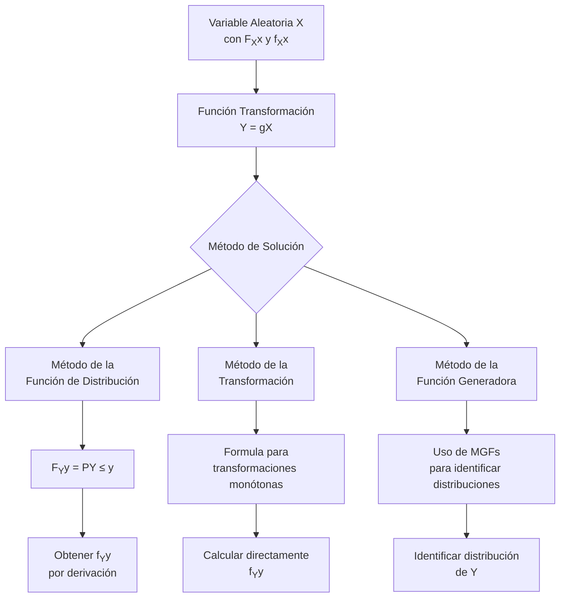

# Probabilidad I - Variables Aleatorias y Funciones de Distribución

## 2.5 Función de distribución de funciones de variables aleatorias.

---

En probabilidad, frecuentemente nos interesa estudiar **funciones de variables aleatorias**, donde una nueva variable aleatoria $Y$ se define como $Y = g(X)$, siendo $X$ una variable aleatoria y $g$ una función medible. Comprender cómo obtener la distribución de $Y$ a partir de la distribución de $X$ es fundamental en diversas aplicaciones estadísticas y de modelado.

### Diagrama conceptual del proceso



### Métodos para encontrar la distribución de Y = g(X)

#### 1. Método de la función de distribución

Para encontrar la distribución de $Y = g(X)$:

1. Encontrar $F_Y(y) = P(Y \leq y) = P(g(X) \leq y)$
2. Expresar el evento $\{g(X) \leq y\}$ en términos de $X$
3. Derivar para obtener la densidad: $f_Y(y) = \frac{d}{dy} F_Y(y)$

#### 2. Método de transformación (para funciones monótonas)

Si $g$ es estrictamente monótona y diferenciable:

$$f_Y(y) = f_X(g^{-1}(y)) \left| \frac{d}{dy} g^{-1}(y) \right|$$

Para el caso lineal $Y = aX + b$:

$$f_Y(y) = \frac{1}{|a|} f_X\left(\frac{y - b}{a}\right)$$

#### 3. Método de la función generadora de momentos

Si $Y = g(X)$, la función generadora de momentos de $Y$ es:

$$M_Y(t) = E[e^{tY}] = E[e^{tg(X)}]$$

### Transformaciones comunes

#### Transformación lineal

$$Y = aX + b \Rightarrow F_Y(y) = F_X\left(\frac{y - b}{a}\right) \text{ para } a > 0$$

#### Transformación cuadrática

$$Y = X^2 \Rightarrow F_Y(y) = F_X(\sqrt{y}) - F_X(-\sqrt{y}) \text{ para } y \geq 0$$

#### Transformación inversa

$$Y = \frac{1}{X} \Rightarrow F_Y(y) = 1 - F_X\left(\frac{1}{y}\right) \text{ para } y > 0$$

### Ejemplos resueltos

#### Ejemplo 1: Transformación lineal

Sea $X \sim Uniforme(0, 1)$ y $Y = 2X + 3$. Encuentra $f_Y(y)$.

**Solución**:
Usando el método de transformación:

$$f_Y(y) = \frac{1}{|2|} f_X\left(\frac{y - 3}{2}\right) = \frac{1}{2} \cdot 1 = \frac{1}{2}$$

para $0 \leq \frac{y-3}{2} \leq 1 \Rightarrow 3 \leq y \leq 5$

#### Ejemplo 2: Transformación cuadrática

Sea $X$ con densidad $f_X(x) = e^{-x}$ para $x > 0$ y $Y = X^2$. Encuentra $f_Y(y)$.

**Solución**:
Usando el método de la función de distribución:

$$F_Y(y) = P(Y \leq y) = P(X^2 \leq y) = P(X \leq \sqrt{y}) = F_X(\sqrt{y})$$

$$f_Y(y) = \frac{d}{dy} F_X(\sqrt{y}) = f_X(\sqrt{y}) \cdot \frac{1}{2\sqrt{y}} = \frac{e^{-\sqrt{y}}}{2\sqrt{y}}$$

#### Ejemplo 3: Transformación de la distribución normal

Si $X \sim N(0, 1)$ y $Y = X^2$, entonces $Y \sim \chi^2(1)$

**Solución**:
Para $y > 0$:

$$F_Y(y) = P(X^2 \leq y) = P(-\sqrt{y} \leq X \leq \sqrt{y}) = \Phi(\sqrt{y}) - \Phi(-\sqrt{y})$$

$$f_Y(y) = \frac{d}{dy} [\Phi(\sqrt{y}) - \Phi(-\sqrt{y})] = \frac{1}{\sqrt{2\pi y}} e^{-y/2}$$

### Código de simulación (Python)

```python
import numpy as np
import matplotlib.pyplot as plt
from scipy.stats import norm, uniform

# Configuración
np.random.seed(42)
n_samples = 10000

# Generar datos
X_unif = uniform.rvs(size=n_samples)
X_norm = norm.rvs(size=n_samples)

# Transformaciones
Y_linear = 2 * X_unif + 3
Y_square = X_norm ** 2
Y_exp = np.exp(X_norm)

# Visualización
fig, axes = plt.subplots(2, 3, figsize=(15, 10))

# Distribución original y transformada
axes[0, 0].hist(X_unif, bins=50, density=True, alpha=0.7)
axes[0, 0].set_title('X ~ Uniforme(0,1)')
axes[0, 0].set_xlabel('x')
axes[0, 0].set_ylabel('Densidad')

axes[0, 1].hist(Y_linear, bins=50, density=True, alpha=0.7)
axes[0, 1].set_title('Y = 2X + 3')
axes[0, 1].set_xlabel('y')
axes[0, 1].set_ylabel('Densidad')

axes[0, 2].hist(X_norm, bins=50, density=True, alpha=0.7)
axes[0, 2].set_title('X ~ N(0,1)')
axes[0, 2].set_xlabel('x')
axes[0, 2].set_ylabel('Densidad')

axes[1, 0].hist(Y_square, bins=50, density=True, alpha=0.7)
axes[1, 0].set_title('Y = X² (Chi-cuadrado)')
axes[1, 0].set_xlabel('y')
axes[1, 0].set_ylabel('Densidad')

axes[1, 1].hist(Y_exp, bins=50, density=True, alpha=0.7)
axes[1, 1].set_title('Y = e^X (Log-normal)')
axes[1, 1].set_xlabel('y')
axes[1, 1].set_ylabel('Densidad')

# Teórica
x = np.linspace(0, 5, 100)
chi2_pdf = (1 / (np.sqrt(2 * np.pi * x))) * np.exp(-x / 2)
axes[1, 0].plot(x, chi2_pdf, 'r-', linewidth=2, label='χ²(1) teórica')
axes[1, 0].legend()

plt.tight_layout()
plt.show()
```

### Ejercicios propuestos

#### Ejercicio 1

Sea $X \sim Uniforme(0, 1)$. Encuentra la función de densidad de:
a) $Y = -\ln(X)$
b) $Y = X^3$
c) $Y = \sqrt{X}$

#### Ejercicio 2

Si $X \sim Exponencial(\lambda)$, encuentra la distribución de:
a) $Y = X^2$
b) $Y = \sqrt{X}$
c) $Y = \frac{1}{X}$

#### Ejercicio 3

Sea $X \sim N(\mu, \sigma^2)$. Demuestra que:
a) $Y = aX + b \sim N(a\mu + b, a^2\sigma^2)$
b) $Z = \frac{X - \mu}{\sigma} \sim N(0, 1)$

#### Ejercicio 4

Si $X$ tiene función de densidad $f_X(x) = 2x$ para $0 < x < 1$, encuentra la densidad de:
a) $Y = X^2$
b) $Y = e^X$
c) $Y = -\ln(1 - X)$

### Teorema de la transformación multivariada

Para transformaciones de múltiples variables:
Si $Y_1 = g_1(X_1, X_2)$ y $Y_2 = g_2(X_1, X_2)$ con transformación invertible, entonces:

$$f_{Y_1,Y_2}(y_1, y_2) = f_{X_1,X_2}(x_1, x_2) |J|^{-1}$$

donde $J$ es el Jacobiano de la transformación inversa:

$$ J = \begin{vmatrix} \frac{\partial x_1}{\partial y_1} & \frac{\partial x_1}{\partial y_2} \\\ \frac{\partial x_2}{\partial y_1} & \frac{\partial x_2}{\partial y_2} \end{vmatrix} $$

### Aplicaciones importantes

1. **Estadística inferencial**: Distribuciones de estadísticos muestrales
2. **Simulación**: Generación de variables aleatorias con distribuciones específicas
3. **Procesos estocásticos**: Transformación de procesos
4. **Teoría de la información**: Transformación de señales
5. **Finanzas cuantitativas**: Transformación de rendimientos

### Referencias bibliográficas

1. Ross, S. M. (2019). "A First Course in Probability"
2. Casella, G., & Berger, R. L. (2002). "Statistical Inference"
3. Hogg, R. V., McKean, J. W., & Craig, A. T. (2019). "Introduction to Mathematical Statistics"

### Consejos de estudio

1. **Domina el método de la función de distribución**: Es el más general y aplicable
2. **Verifica monotonicidad**: Antes de usar el método de transformación
3. **Practica con diferentes funciones**: Lineales, cuadráticas, exponenciales, logarítmicas
4. **Comprende el Jacobiano**: Para transformaciones multivariadas
5. **Visualiza las transformaciones**: Gráficas ayudan a entender el cambio de variable

