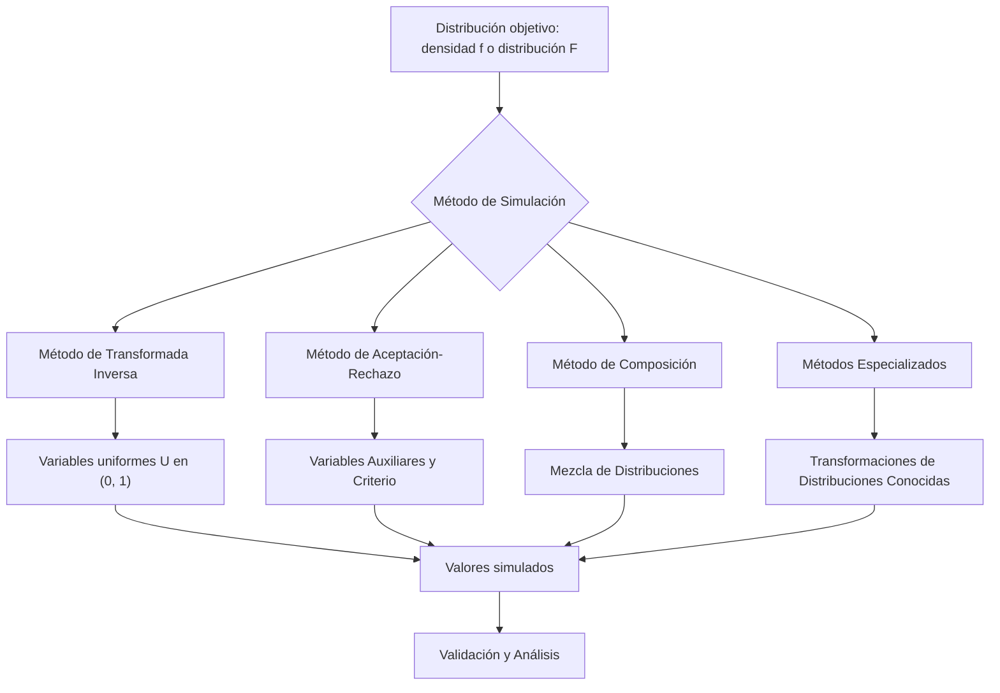

# Probabilidad I - Variables Aleatorias y Funciones de Distribución

## 2.6 Simulación de variables aleatorias.

---

La **simulación de variables aleatorias** es el proceso de generar valores numéricos que siguen una distribución de probabilidad específica. Esta técnica es fundamental en estudios de Monte Carlo, análisis de sistemas complejos y en aplicaciones donde los experimentos reales son costosos o imposibles de realizar.

### Diagrama conceptual del proceso de simulación



### Métodos principales de simulación

#### 1. Método de la Transformada Inversa

Todo empieza con números **uniformes** en $(0, 1),$ que el generador pseudoaleatorio produce (tema 1.8). Si $X$ es una variable aleatoria continua con función de distribución $F_X$ estrictamente creciente, entonces (tema 2.5):

$$ F_X(X) \sim \text{Uniforme}(0,1) $$

Por lo tanto, si $U \sim \text{Uniforme}(0,1),$ entonces:

$$ X = F_X^{-1}(U) $$

tiene la distribución deseada.

*Demostración.* Como $F_X$ es creciente, $F_X^{-1}(U) \leq x$ si y solo si $U \leq F_X(x),$ así que $P(F_X^{-1}(U) \leq x) = P(U \leq F_X(x)) = F_X(x).$ $\blacksquare$

**Para distribuciones discretas** se usa la **inversa generalizada**, que funciona para cualquier $F:$

$$ X = \min\{x: F_X(x) \geq U\} $$

En la práctica: si los valores son $x_1 < x_2 < \cdots$ con probabilidades $p_1, p_2, \dots,$ se devuelve $x_k$ cuando $p_1 + \cdots + p_{k-1} < U \leq p_1 + \cdots + p_k.$ Es decir, se parte $(0, 1)$ en intervalos de longitudes $p_k$ y se ve en cuál cae $U.$

El método es exacto y usa un solo número uniforme por valor, pero requiere poder calcular $F_X^{-1}.$ Para la normal no hay fórmula cerrada, y por eso existen otros métodos.

#### 2. Método de Aceptación-Rechazo

Para simular $X$ con densidad $f(x),$ encontramos una densidad $g(x)$ y una constante $c$ tal que:

$$f(x) \leq c \cdot g(x) \quad \text{para todo } x$$

El algoritmo:

1. Generar $Y \sim g$
2. Generar $U \sim \text{Uniforme}(0,1),$ independiente de $Y$
3. Si $U \leq \frac{f(Y)}{c \cdot g(Y)},$ aceptar $X = Y$
4. Si no, repetir desde paso 1

**Por qué funciona.** Un candidato $Y = y$ se acepta con probabilidad $\frac{f(y)}{c\,g(y)},$ así que la probabilidad de proponer un valor en $[y, y + dy]$ **y** aceptarlo es $g(y)\,dy \cdot \frac{f(y)}{c\,g(y)} = \frac{f(y)}{c}\,dy,$ proporcional a $f.$ Integrando, cada intento se acepta con probabilidad $\frac{1}{c},$ y condicionando a la aceptación queda exactamente la densidad $f.$ Geométricamente, se lanzan puntos uniformes bajo la curva $c\,g$ y se conservan los que caen bajo $f.$

El número de intentos hasta aceptar es geométrico con parámetro $\frac{1}{c},$ con media $c:$ conviene que $c$ sea lo más pequeño posible, es decir $c = \max_x \frac{f(x)}{g(x)}.$

#### 3. Método de Composición

Si la densidad puede expresarse como:

$$f(x) = \int f(x|y)h(y)dy$$

o como mezcla finita:

$$ f(x) = \sum_{i=1}^{k} p_i f_i(x) $$

con $p_i \geq 0$ y $\sum p_i = 1,$ se simula en dos pasos: primero se elige el componente $i$ con probabilidad $p_i$ (una variable discreta) y luego se genera $X$ con la densidad $f_i.$ Por probabilidad total, $X$ tiene densidad $\sum_i p_i f_i.$ Por ejemplo, la densidad de Laplace $f(x) = \frac{1}{2}e^{-|x|}$ es la mezcla, con pesos $\frac{1}{2},$ de una exponencial y de una exponencial reflejada: se genera una exponencial y se le pone signo positivo o negativo con una moneda.

### Simulación de distribuciones comunes

#### Distribución uniforme continua en el intervalo $(a,b)$

$$ X = a + (b - a)U \quad \text{donde } U \sim U(0,1) $$

#### Distribución exponencial con tasa $\lambda$

Despejando $u = 1 - e^{-\lambda x}$ se obtiene

$$ X = -\frac{1}{\lambda} \ln(1 - U) $$

y como $1 - U$ también es uniforme, se usa igualmente $X = -\frac{1}{\lambda}\ln U.$

#### Distribución normal con parámetros $(\mu, \sigma^2)$

**Método de Box-Muller**:

Si $U_1, U_2 \sim U(0,1)$ independientes, entonces:

$$Z_1 = \sqrt{-2 \ln U_1} \cos(2\pi U_2)$$

$$Z_2 = \sqrt{-2 \ln U_1} \sin(2\pi U_2)$$

son $N(0,1)$ independientes. Para obtener $N(\mu, \sigma^2)$ se usa $X = \mu + \sigma Z.$

La justificación es el cambio a coordenadas polares del tema 2.5: para dos normales estándar independientes, el ángulo es uniforme en $[0, 2\pi)$ y el cuadrado del radio, $R^2,$ es exponencial de media 2; $\sqrt{-2\ln U_1}$ genera ese radio y $2\pi U_2$ el ángulo.

#### Distribución Poisson con parámetro $\lambda$

Usando la relación con la exponencial: en un proceso de Poisson de tasa $\lambda,$ los tiempos entre eventos son exponenciales independientes de tasa $\lambda,$ y el número de eventos en $[0, 1]$ es $\text{Poisson}(\lambda).$ Se suman exponenciales hasta pasar de 1 y se cuenta cuántos eventos cupieron:

1. Sea $S_0 = 0,$ $i = 0$
2. Mientras $S_i \leq 1:$
   - Generar $E_i \sim \text{Exponencial}(\lambda)$
   - $S_{i+1} = S_i + E_i$
   - $i = i + 1$
3. $X = i - 1$

En promedio se generan $\lambda + 1$ exponenciales por valor, así que el método es lento para $\lambda$ grande.

### Código de implementación (Python)

```python
import numpy as np
import matplotlib
matplotlib.use("Agg")
import matplotlib.pyplot as plt
from scipy.stats import norm, expon, poisson, uniform, kstest

np.random.seed(0)

def simulate_inverse_transform(F_inv, n=10000):
    """Método de transformada inversa"""
    U = np.random.uniform(0, 1, n)
    return F_inv(U)

def box_muller(n=10000):
    """Generación de normales por Box-Muller"""
    U1 = 1 - np.random.uniform(0, 1, n)   # en (0, 1]: evita log(0)
    U2 = np.random.uniform(0, 1, n)
    Z1 = np.sqrt(-2 * np.log(U1)) * np.cos(2 * np.pi * U2)
    Z2 = np.sqrt(-2 * np.log(U1)) * np.sin(2 * np.pi * U2)
    return np.concatenate([Z1, Z2])

def simulate_poisson(lambd, n=10000):
    """Simulación de Poisson usando exponenciales"""
    results = []
    for _ in range(n):
        s, k = 0, 0
        while s <= 1:
            s += np.random.exponential(1/lambd)
            k += 1
        results.append(k - 1)
    return np.array(results)

# Simulaciones
n_samples = 10000

# Exponencial(λ=2) por transformada inversa
exponential_samples = simulate_inverse_transform(
    lambda u: -0.5 * np.log(1 - u), n_samples)

# Normal(0,1) por Box-Muller
normal_samples = box_muller(n_samples//2)

# Poisson(λ=3)
poisson_samples = simulate_poisson(3, n_samples)

# Visualización
fig, axes = plt.subplots(2, 2, figsize=(12, 10))

# Exponencial
axes[0, 0].hist(exponential_samples, bins=50, density=True, alpha=0.7)
x_exp = np.linspace(0, 5, 100)
axes[0, 0].plot(x_exp, expon(scale=0.5).pdf(x_exp), 'r-', lw=2)
axes[0, 0].set_title('Exponencial(λ=2)')

# Normal
axes[0, 1].hist(normal_samples, bins=50, density=True, alpha=0.7)
x_norm = np.linspace(-4, 4, 100)
axes[0, 1].plot(x_norm, norm.pdf(x_norm), 'r-', lw=2)
axes[0, 1].set_title('Normal(0,1)')

# Poisson
axes[1, 0].hist(poisson_samples, bins=range(0, 15),
                density=True, alpha=0.7, align='left')
x_poiss = np.arange(0, 15)
axes[1, 0].plot(x_poiss, poisson(3).pmf(x_poiss), 'ro', ms=5)
axes[1, 0].set_title('Poisson(λ=3)')

# Validación Q-Q plot: cuantiles muestrales contra teóricos en (i - 0.5)/n
m = len(normal_samples)
axes[1, 1].scatter(np.sort(normal_samples),
                  norm.ppf((np.arange(1, m + 1) - 0.5) / m),
                  alpha=0.5, s=4)
axes[1, 1].plot([-3, 3], [-3, 3], 'r-')
axes[1, 1].set_title('Q-Q Plot para Normalidad')
axes[1, 1].set_xlabel('Cuantiles Muestrales')
axes[1, 1].set_ylabel('Cuantiles Teóricos')

plt.tight_layout()
plt.savefig("simulacion.png", dpi=90)

# Prueba de Kolmogorov-Smirnov: valores p grandes = sin evidencia de desajuste
print("KS exponencial:", round(kstest(exponential_samples, expon(scale=0.5).cdf).pvalue, 3))
print("KS normal:     ", round(kstest(normal_samples, "norm").pvalue, 3))
print("Media Poisson simulada:", poisson_samples.mean(), " teórica: 3")
```

En el Q-Q plot no se usan los cuantiles teóricos en $0$ y $1,$ que son $\pm\infty$ para la normal, sino en las posiciones $\frac{i - 0.5}{n}.$ Si la muestra viene de la distribución teórica, los puntos quedan cerca de la diagonal.

### Ejercicios propuestos

#### Ejercicio 1

Implementa el método de transformada inversa para simular:

- a) Una distribución $\text{Weibull}(\lambda, k)$ con $F(x) = 1 - e^{-(x/\lambda)^k}$
- b) Una distribución Cauchy con $f(x) = \frac{1}{\pi(1 + x^2)}$

#### Ejercicio 2

Desarrolla un algoritmo de aceptación-rechazo para simular una distribución $\text{Beta}(2, 2)$ usando una distribución uniforme como propuesta.

#### Ejercicio 3

Implementa la simulación de una distribución geométrica con parámetro $p$ usando:

- a) El método de transformada inversa
- b) Generación de Bernoulli hasta el primer éxito

#### Ejercicio 4

Simula una distribución $N(\mu, \sigma^2)$ usando:

- a) El método de Box-Muller
- b) El teorema del límite central (suma de 12 uniformes)

Compara la eficiencia y precisión de ambos métodos.

### Soluciones

```python
import numpy as np
from scipy.stats import weibull_min, cauchy, beta, geom, norm, kstest

rng = np.random.default_rng(1)
n = 20_000

# Ejercicio 1a: despejando u = 1 - exp(-(x/λ)^k)  ->  x = λ (-ln(1-u))^(1/k)
lam, k = 2.0, 1.5
w = lam * (-np.log(1 - rng.random(n))) ** (1 / k)
print("1a KS Weibull p =", round(kstest(w, weibull_min(k, scale=lam).cdf).pvalue, 3))

# Ejercicio 1b: F(x) = 1/2 + arctan(x)/π  ->  x = tan(π(u - 1/2))
c = np.tan(np.pi * (rng.random(n) - 0.5))
print("1b KS Cauchy p =", round(kstest(c, cauchy.cdf).pvalue, 3), " mediana ≈", round(np.median(c), 3))

# Ejercicio 2: f(x) = 6x(1-x) ≤ 1.5 = c · 1 (máximo en x = 1/2)
def beta22(n):
    salida, intentos = [], 0
    while len(salida) < n:
        y, u = rng.random(), rng.random()
        intentos += 1
        if u <= 6 * y * (1 - y) / 1.5:
            salida.append(y)
    return np.array(salida), intentos
b, intentos = beta22(n)
print("2  KS Beta(2,2) p =", round(kstest(b, beta(2, 2).cdf).pvalue, 3), " intentos por valor ≈", round(intentos / n, 3))

# Ejercicio 3a: P(X > k) = (1-p)^k  ->  X = ceil(ln(1-U) / ln(1-p))
p = 0.3
g1 = np.ceil(np.log(1 - rng.random(n)) / np.log(1 - p)).astype(int)
# Ejercicio 3b: lanzar Bernoulli hasta el primer éxito
def geom_bernoulli():
    k = 1
    while rng.random() >= p:
        k += 1
    return k
g2 = np.array([geom_bernoulli() for _ in range(n)])
print("3  medias:", round(g1.mean(), 3), round(g2.mean(), 3), " teórica:", round(1 / p, 3))

# Ejercicio 4: Box-Muller contra suma de 12 uniformes menos 6
mu, sigma = 10, 2
u1, u2 = 1 - rng.random(n), rng.random(n)
bm = mu + sigma * np.sqrt(-2 * np.log(u1)) * np.cos(2 * np.pi * u2)
tlc = mu + sigma * (rng.random((n, 12)).sum(axis=1) - 6)
for nombre, x in [("Box-Muller", bm), ("12 uniformes", tlc)]:
    print(f"4  {nombre:13s} media {x.mean():.3f}  desv {x.std():.3f}  "
          f"P(|Z|>3.5) {np.mean(np.abs((x - mu) / sigma) > 3.5):.5f}")
print("   teórico P(|Z|>3.5) =", round(2 * norm.sf(3.5), 5))
```

**Ejercicio 1.** a) Despejando $u = F(x),$ se obtiene $x = \lambda(-\ln(1 - u))^{1/k}.$ b) $F(x) = \frac{1}{2} + \frac{\arctan x}{\pi},$ así que $x = \tan\left(\pi\left(u - \frac{1}{2}\right)\right).$ Como la Cauchy no tiene media, el promedio de la muestra no se estabiliza; la mediana, en cambio, sí se acerca a 0.

**Ejercicio 2.** La densidad $\text{Beta}(2, 2)$ es $f(x) = 6x(1 - x)$ en $[0, 1],$ con máximo $\frac{3}{2}$ en $x = \frac{1}{2}.$ Con propuesta uniforme, $c = \frac{3}{2},$ y se acepta $Y$ si $U \leq \frac{6Y(1 - Y)}{3/2} = 4Y(1 - Y).$ En promedio se necesitan $c = 1.5$ intentos por valor, lo que confirma la simulación. Si la distribución simulada es correcta, el valor $p$ de la prueba de Kolmogorov-Smirnov es él mismo uniforme en $(0, 1):$ en una sola corrida puede salir menor que 0.05 una de cada veinte veces sin que haya ningún error, así que ante un valor pequeño conviene repetir con otras semillas antes de concluir.

**Ejercicio 3.** a) Como $P(X > k) = (1 - p)^k,$ el valor $X = \left\lceil \frac{\ln(1 - U)}{\ln(1 - p)} \right\rceil$ cumple $X > k$ si y solo si $1 - U < (1 - p)^k,$ evento de probabilidad $(1 - p)^k.$ b) Es la definición misma de la geométrica. El método (a) usa un solo uniforme por valor; el (b), en promedio $\frac{1}{p}.$

**Ejercicio 4.** La suma de 12 uniformes tiene media 6 y varianza $12 \cdot \frac{1}{12} = 1,$ y por el teorema del límite central es aproximadamente normal, pero **no exactamente**: está acotada en $[-6, 6]$ y sus colas son demasiado delgadas, lo que se nota en $P(|Z| > 3.5).$ Box-Muller es exacto y usa 2 uniformes por cada 2 normales, contra 12 uniformes por normal del otro método. En la práctica, las bibliotecas usan métodos aún más rápidos, como el algoritmo zigurat, una forma refinada de aceptación-rechazo.

### Validación de simulaciones

#### Pruebas de bondad de ajuste

- **Test de Kolmogorov-Smirnov**: Compara la distribución empírica con la teórica
- **Test de Chi-cuadrado**: Para distribuciones discretas
- **Q-Q plots**: Visualización gráfica de cuantiles

#### Métricas de calidad

- **Sesgo**: $E[\hat{\theta}] - \theta$
- **Varianza**: $\text{Var}(\hat{\theta})$
- **Error cuadrático medio**: $E[(\hat{\theta} - \theta)^2] = \text{Var}(\hat{\theta}) + \text{sesgo}^2$

Aquí $\hat{\theta}$ es una estimación obtenida por simulación de una cantidad $\theta,$ por ejemplo una probabilidad. Un promedio de $n$ simulaciones independientes no tiene sesgo y su varianza decrece como $\frac{1}{n}$ (tema 1.9).

### Aplicaciones de la simulación

1. **Métodos de Monte Carlo**: Integración numérica, estimación de parámetros
2. **Análisis de sistemas**: Simulación de colas, sistemas de inventarios
3. **Finanzas cuantitativas**: Valoración de opciones, gestión de riesgos
4. **Investigación operativa**: Optimización estocástica
5. **Ciencias físicas**: Simulación de procesos aleatorios

### Referencias bibliográficas

1. Ross, S. M. (2019). "Simulation"
2. Rubinstein, R. Y., & Kroese, D. P. (2016). "Simulation and the Monte Carlo Method"
3. Law, A. M. (2014). "Simulation Modeling and Analysis"

### Consejos de estudio

1. **Comprende los fundamentos**: Entiende por qué cada método funciona
2. **Implementa desde cero**: Escribe tus propias implementaciones
3. **Valida siempre**: Verifica que tus simulaciones reproduzcan la distribución correcta
4. **Analiza la eficiencia**: Compara diferentes métodos para la misma distribución
5. **Practica con aplicaciones**: Aplica la simulación a problemas reales
