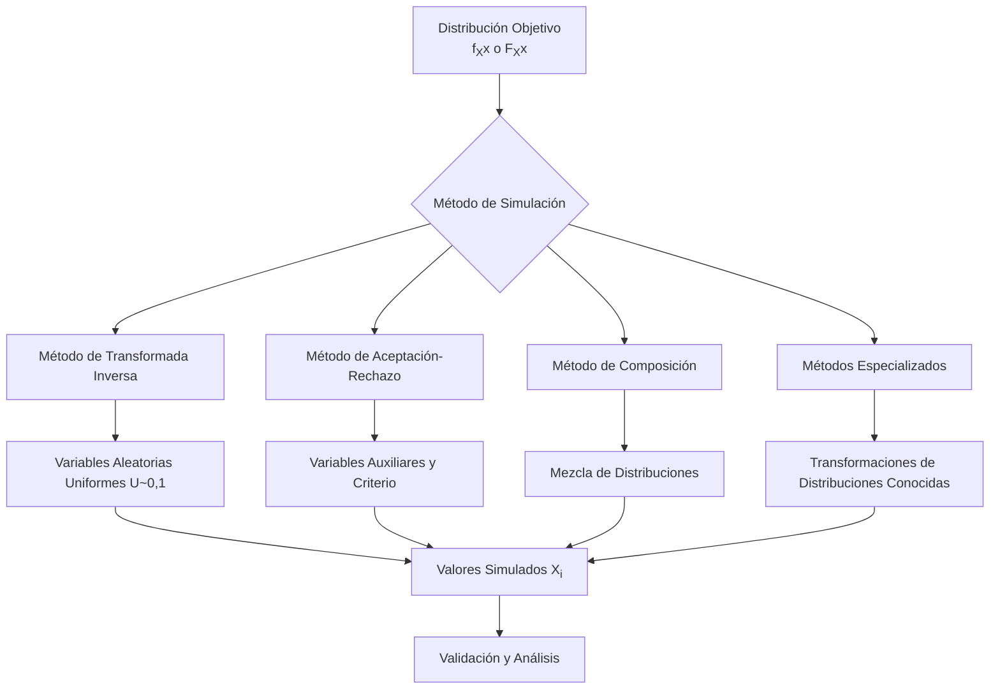

# Probabilidad I - Variables Aleatorias y Funciones de Distribución

## 2.6 Simulación de variables aleatorias.

---

La **simulación de variables aleatorias** es el proceso de generar valores numéricos que siguen una distribución de probabilidad específica. Esta técnica es fundamental en estudios de Monte Carlo, análisis de sistemas complejos y en aplicaciones donde los experimentos reales son costosos o imposibles de realizar.

### Diagrama conceptual del proceso de simulación



### Métodos principales de simulación

#### 1. Método de la Transformada Inversa

Si $X$ es una variable aleatoria continua con función de distribución $F_X$ estrictamente creciente, entonces:

$$F_X(X) \sim Uniforme(0,1)$$

Por lo tanto, si $U \sim Uniforme(0,1)$, entonces:

$$X = F_X^{-1}(U)$$

tiene la distribución deseada.

**Para distribuciones discretas**:

$$x_i = \min\{x: F_X(x) \geq u\}$$

#### 2. Método de Aceptación-Rechazo

Para simular $X$ con densidad $f(x)$, encontramos una densidad $g(x)$ y una constante $c$ tal que:

$$f(x) \leq c \cdot g(x) \quad \text{para todo } x$$

El algoritmo:

1. Generar $Y \sim g$
2. Generar $U \sim Uniforme(0,1)$
3. Si $U \leq \frac{f(Y)}{c \cdot g(Y)}$, aceptar $X = Y$
4. Si no, repetir desde paso 1

#### 3. Método de Composición

Si la densidad puede expresarse como:

$$f(x) = \int f(x|y)h(y)dy$$

o como mezcla finita:

$$f(x) = \sum_{i=1}^{k} p_i f_i(x)$$

### Simulación de distribuciones comunes

#### Distribución Uniforme Continua $U(a,b)$

$$X = a + (b - a)U \quad \text{donde } U \sim U(0,1)$$

#### Distribución Exponencial $(\lambda)$

$$X = -\frac{1}{\lambda} \ln(1 - U)$$

#### Distribución Normal $(\mu, \sigma^2)$

**Método de Box-Muller**:

Si $U_1, U_2 \sim U(0,1)$ independientes, entonces:

$$Z_1 = \sqrt{-2 \ln U_1} \cos(2\pi U_2)$$

$$Z_2 = \sqrt{-2 \ln U_1} \sin(2\pi U_2)$$

son $N(0,1)$ independientes.

#### Distribución Poisson $(\lambda)$

Usando la relación con la exponencial:

1. Sea $S_0 = 0$, $i = 0$
2. Mientras $S_i \leq 1$:
   - Generar $E_i \sim Exponencial(\lambda)$
   - $S_{i+1} = S_i + E_i$
   - $i = i + 1$
3. $X = i - 1$

### Código de implementación (Python)

```python
import numpy as np
import matplotlib.pyplot as plt
from scipy.stats import norm, expon, poisson, uniform

def simulate_inverse_transform(F_inv, n=10000):
    """Método de transformada inversa"""
    U = np.random.uniform(0, 1, n)
    return F_inv(U)

def box_muller(n=10000):
    """Generación de normales por Box-Muller"""
    U1 = np.random.uniform(0, 1, n)
    U2 = np.random.uniform(0, 1, n)
    Z1 = np.sqrt(-2 * np.log(U1)) * np.cos(2 * np.pi * U2)
    Z2 = np.sqrt(-2 * np.log(U1)) * np.sin(2 * np.pi * U2)
    return np.concatenate([Z1, Z2])

def simulate_poisson(lambd, n=10000):
    """Simulación de Poisson usando exponenciales"""
    results = []
    for _ in range(n):
        s, k = 0, 0
        while s <= 1:
            s += np.random.exponential(1/lambd)
            k += 1
        results.append(k - 1)
    return np.array(results)

# Simulaciones
n_samples = 10000

# Exponencial(λ=2) por transformada inversa
exponential_samples = simulate_inverse_transform(
    lambda u: -0.5 * np.log(1 - u), n_samples)

# Normal(0,1) por Box-Muller
normal_samples = box_muller(n_samples//2)

# Poisson(λ=3)
poisson_samples = simulate_poisson(3, n_samples)

# Visualización
fig, axes = plt.subplots(2, 2, figsize=(12, 10))

# Exponencial
axes[0, 0].hist(exponential_samples, bins=50, density=True, alpha=0.7)
x_exp = np.linspace(0, 5, 100)
axes[0, 0].plot(x_exp, expon(scale=0.5).pdf(x_exp), 'r-', lw=2)
axes[0, 0].set_title('Exponencial(λ=2)')

# Normal
axes[0, 1].hist(normal_samples, bins=50, density=True, alpha=0.7)
x_norm = np.linspace(-4, 4, 100)
axes[0, 1].plot(x_norm, norm.pdf(x_norm), 'r-', lw=2)
axes[0, 1].set_title('Normal(0,1)')

# Poisson
axes[1, 0].hist(poisson_samples, bins=range(0, 15),
                density=True, alpha=0.7, align='left')
x_poiss = np.arange(0, 15)
axes[1, 0].plot(x_poiss, poisson(3).pmf(x_poiss), 'ro', ms=5)
axes[1, 0].set_title('Poisson(λ=3)')

# Validación Q-Q plot
axes[1, 1].scatter(np.sort(normal_samples),
                  norm.ppf(np.linspace(0, 1, len(normal_samples))),
                  alpha=0.5)
axes[1, 1].plot([-3, 3], [-3, 3], 'r-')
axes[1, 1].set_title('Q-Q Plot para Normalidad')
axes[1, 1].set_xlabel('Cuantiles Muestrales')
axes[1, 1].set_ylabel('Cuantiles Teóricos')

plt.tight_layout()
plt.show()
```

### Ejercicios propuestos

#### Ejercicio 1

Implementa el método de transformada inversa para simular:
a) Una distribución Weibull( $\lambda, k$ ) con $F(x) = 1 - e^{-(x/\lambda)^k}$
b) Una distribución Cauchy con $f(x) = \frac{1}{\pi(1 + x^2)}$

#### Ejercicio 2

Desarrolla un algoritmo de aceptación-rechazo para simular una distribución Beta(2, 2) usando una distribución uniforme como propuesta.

#### Ejercicio 3

Implementa la simulación de una distribución geométrica( $p$ ) usando:
a) El método de transformada inversa
b) Generación de Bernoulli hasta el primer éxito

#### Ejercicio 4

Simula una distribución $N(\mu, \sigma^2)$ usando:
a) El método de Box-Muller
b) El teorema del límite central (suma de 12 uniformes)

Compara la eficiencia y precisión de ambos métodos.

### Validación de simulaciones

#### Pruebas de bondad de ajuste

- **Test de Kolmogorov-Smirnov**: Compara la distribución empírica con la teórica
- **Test de Chi-cuadrado**: Para distribuciones discretas
- **Q-Q plots**: Visualización gráfica de cuantiles

#### Métricas de calidad

- **Sesgo**: $E[\hat{\theta}] - \theta$
- **Error cuadrático medio**: $E[(\hat{\theta} - \theta)^2]$
- **Varianza**: $Var(\hat{\theta})$

### Aplicaciones de la simulación

1. **Métodos de Monte Carlo**: Integración numérica, estimación de parámetros
2. **Análisis de sistemas**: Simulación de colas, sistemas de inventarios
3. **Finanzas cuantitativas**: Valoración de opciones, gestión de riesgos
4. **Investigación operativa**: Optimización estocástica
5. **Ciencias físicas**: Simulación de procesos aleatorios

### Referencias bibliográficas

1. Ross, S. M. (2019). "Simulation"
2. Rubinstein, R. Y., & Kroese, D. P. (2016). "Simulation and the Monte Carlo Method"
3. Law, A. M. (2014). "Simulation Modeling and Analysis"

### Consejos de estudio

1. **Comprende los fundamentos**: Entiende por qué cada método funciona
2. **Implementa desde cero**: Escribe tus propias implementaciones
3. **Valida siempre**: Verifica que tus simulaciones reproduzcan la distribución correcta
4. **Analiza la eficiencia**: Compara diferentes métodos para la misma distribución
5. **Practica con aplicaciones**: Aplica la simulación a problemas reales
