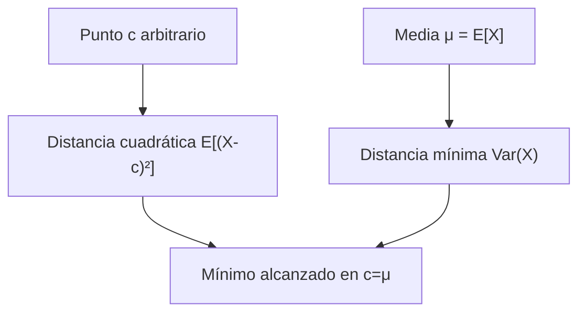
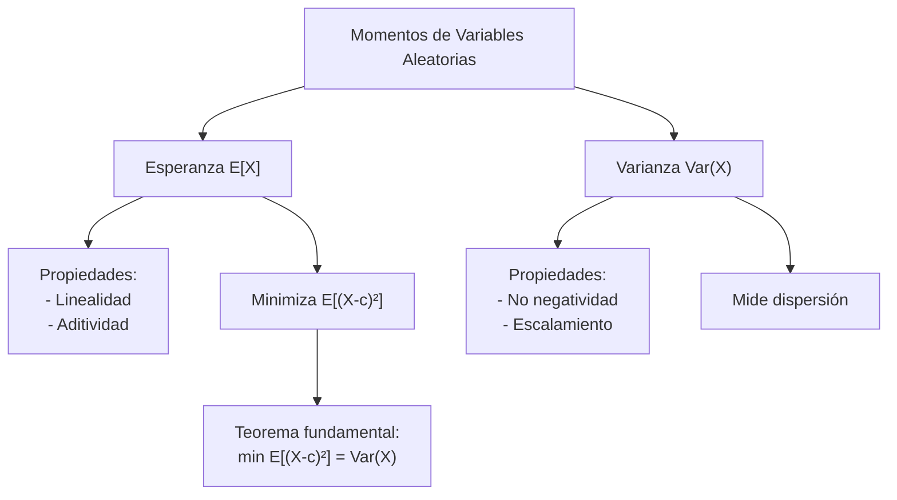

# Probabilidad I - Momentos de Variables Aleatorias

## 3.1 Esperanza, varianza y propiedades. La esperanza minimiza la distancia cuadrática.

---

Los **momentos** son medidas numéricas que caracterizan propiedades importantes de las distribuciones de probabilidad. En esta guía nos enfocaremos en los dos momentos más importantes: la **esperanza** (primer momento) y la **varianza** (segundo momento central).

### 1. Esperanza Matemática (Valor Esperado)

#### Definición

La **esperanza matemática** o **valor esperado** de una variable aleatoria representa el promedio teórico que se esperaría obtener al repetir un experimento infinitas veces.

##### Para variables discretas:

$$E[X] = \sum_{i} x_i \cdot P(X = x_i)$$

##### Para variables continuas:

$$E[X] = \int_{-\infty}^{\infty} x \cdot f(x)  dx$$

donde $f(x)$ es la función de densidad de probabilidad.

#### Ejemplo 1: Variable discreta

Sea $X$ el resultado de lanzar un dado justo:

$$E[X] = \sum_{i=1}^{6} i \cdot \frac{1}{6} = 3.5$$

#### Ejemplo 2: Variable continua

Sea $X \sim Uniforme(0,1)$:

$$E[X] = \int_{0}^{1} x \cdot 1  dx = \frac{1}{2}$$

### 2. Varianza y Desviación Estándar

#### Definición

La **varianza** mide la dispersión de una variable aleatoria respecto a su valor esperado.

$$\text{Var}(X) = E[(X - E[X])^2] = E[X^2] - (E[X])^2$$

La **desviación estándar** es la raíz cuadrada de la varianza:

$$\sigma_X = \sqrt{\text{Var}(X)}$$

#### Ejemplo: Varianza de un dado

$$E[X] = 3.5$$

$$E[X^2] = \sum_{i=1}^{6} i^2 \cdot \frac{1}{6} = \frac{91}{6} \approx 15.1667$$

$$\text{Var}(X) = 15.1667 - (3.5)^2 = 2.9167$$

### 3. Propiedades de la Esperanza y Varianza

#### Propiedades de la Esperanza

1. **Linealidad**: $E[aX + b] = aE[X] + b$
2. **Aditividad**: $E[X + Y] = E[X] + E[Y]$
3. **Independencia**: Si $X$ e $Y$ son independientes, $E[XY] = E[X]E[Y]$

#### Propiedades de la Varianza

1. $\text{Var}(aX + b) = a^2\text{Var}(X)$
2. $\text{Var}(X + Y) = \text{Var}(X) + \text{Var}(Y) + 2\text{Cov}(X,Y)$
3. Si $X$ e $Y$ son independientes: $\text{Var}(X + Y) = \text{Var}(X) + \text{Var}(Y)$

### 4. La Esperanza Minimiza la Distancia Cuadrática

#### Teorema Fundamental

Para cualquier constante $c$, se cumple que:

$$E[(X - c)^2] \geq E[(X - E[X])^2] = \text{Var}(X)$$

La igualdad se alcanza solo cuando $c = E[X]$.

#### Demostración

$$E[(X - c)^2] = E[(X - \mu + \mu - c)^2]$$

$$= E[(X - \mu)^2] + 2(\mu - c)E[X - \mu] + (\mu - c)^2$$

$$= \text{Var}(X) + 0 + (\mu - c)^2 \geq \text{Var}(X)$$

#### Interpretación geométrica



### 5. Ejercicios Resueltos

#### Ejercicio 1

Sea $X$ con distribución $P(X=0) = 0.5$, $P(X=1) = 0.3$, $P(X=2) = 0.2$. Calcular $E[X]$ y $\text{Var}(X)$.

**Solución**:

$$E[X] = 0×0.5 + 1×0.3 + 2×0.2 = 0.7$$

$$E[X^2] = 0^2×0.5 + 1^2×0.3 + 2^2×0.2 = 1.1$$

$$\text{Var}(X) = 1.1 - (0.7)^2 = 0.61$$

#### Ejercicio 2

Demostrar que $E[(X - c)^2]$ es mínimo cuando $c = E[X]$.

**Solución**:
Derivamos respecto a $c$:

$$\frac{d}{dc}E[(X - c)^2] = -2E[X - c]$$

Igualamos a cero: $-2(E[X] - c) = 0 \Rightarrow c = E[X]$

### 6. Ejercicios Propuestos

1. Sea $X \sim Poisson(\lambda)$. Calcular $E[X]$ y $\text{Var}(X)$.

2. Demuestre que $\text{Var}(X) = E[X^2] - (E[X])^2$.

3. Para $X \sim Exponencial(\lambda)$, calcule $E[X]$ y $\text{Var}(X)$.

4. Sea $Y = aX + b$. Encuentre $\text{Var}(Y)$ en términos de $\text{Var}(X)$.

5. Demuestre que para cualquier constante $a$:

   $$E[(X - a)^2] = \text{Var}(X) + (E[X] - a)^2$$

### 7. Implementación en Python

```python
import numpy as np
import matplotlib.pyplot as plt

# Simulación del teorema de minimización
def simular_minimizacion_distancia(n=1000, mu=5, sigma=2):
    X = np.random.normal(mu, sigma, n)
    c_values = np.linspace(mu-3*sigma, mu+3*sigma, 100)
    distancias = [np.mean((X - c)**2) for c in c_values]

    plt.figure(figsize=(10, 6))
    plt.plot(c_values, distancias, label='E[(X-c)²]')
    plt.axvline(mu, color='r', linestyle='--', label=f'μ = {mu}')
    plt.xlabel('c')
    plt.ylabel('Distancia cuadrática media')
    plt.title('La esperanza minimiza la distancia cuadrática')
    plt.legend()
    plt.grid(True)
    plt.show()

    return c_values[np.argmin(distancias)]

# Ejecutar simulación
c_optimo = simular_minimizacion_distancia()
print(f"Valor óptimo de c encontrado: {c_optimo:.4f}")
```

### 8. Diagrama conceptual



### 9. Referencias y Bibliografía

1. **Libros recomendados**:
   - "Probability and Statistics" by Morris H. DeGroot
   - "Introduction to Probability" by Joseph K. Blitzstein
   - "Probabilidad y Estadística" por Mario F. Triola

2. **Conceptos clave para recordar**:
   - La esperanza es un operador lineal
   - La varianza mide dispersión alrededor de la media
   - La media minimiza el error cuadrático medio
   - Para variables independientes: $Var(X+Y) = Var(X) + Var(Y)$

3. **Aplicaciones**:
   - Teoría de estimación
   - Minimización de error en predicciones
   - Análisis de riesgo en finanzas
   - Control de calidad en procesos industriales

### 10. Consejos de estudio

- **Visualiza** los conceptos con gráficos y simulaciones
- **Practica** con ejercicios de diferentes distribuciones
- **Comprende** las demostraciones clave
- **Relaciona** con aplicaciones del mundo real
- **Usa software** (Python/R) para verificar resultados
