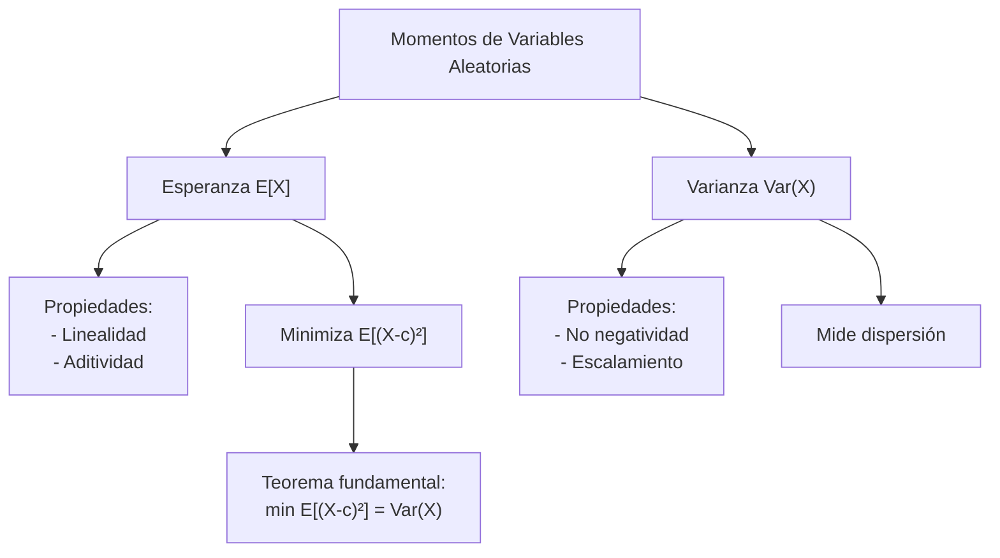

# Probabilidad I - Momentos de Variables Aleatorias

## 3.1 Esperanza, varianza y propiedades. La esperanza minimiza la distancia cuadrática.

---

Los **momentos** son medidas numéricas que caracterizan propiedades importantes de las distribuciones de probabilidad. En esta guía nos enfocaremos en los dos momentos más importantes: la **esperanza** (primer momento) y la **varianza** (segundo momento central).

### 1. Esperanza Matemática (Valor Esperado)

#### Definición

La **esperanza matemática** o **valor esperado** de una variable aleatoria es el **promedio ponderado** de sus valores, donde cada valor pesa según su probabilidad. Representa el promedio que se obtendría al repetir el experimento muchas veces; la ley de los grandes números (tema 4.4) convierte esta intuición en teorema. Físicamente, es el **centro de masa** de la distribución.

##### Para variables discretas:

$$ E[X] = \sum_{i} x_i \cdot P(X = x_i) $$

##### Para variables continuas:

$$ E[X] = \int_{-\infty}^{\infty} x \cdot f(x) \, dx $$

donde $f(x)$ es la función de densidad de probabilidad.

**Existencia.** La esperanza solo está definida si la serie o la integral converge **absolutamente**: $\sum_i |x_i| P(X = x_i) < \infty$ o $\int |x| f(x)\,dx < \infty.$ No siempre ocurre. La distribución de Cauchy (tema 2.4) no tiene esperanza, y tampoco una variable con $P(X = 2^k) = 2^{-k}$ para $k = 1, 2, \dots$ (la paradoja de San Petersburgo), cuya serie $\sum_k 2^k \cdot 2^{-k} = \sum_k 1$ diverge.

#### Ejemplo 1: Variable discreta

Sea $X$ el resultado de lanzar un dado justo:

$$ E[X] = \sum_{i=1}^{6} i \cdot \frac{1}{6} = \frac{21}{6} = 3.5 $$

La esperanza no tiene que ser un valor posible de $X:$ ningún dado muestra 3.5.

#### Ejemplo 2: Variable continua

Sea $X \sim \text{Uniforme}(0,1):$

$$ E[X] = \int_{0}^{1} x \cdot 1 \, dx = \frac{1}{2} $$

#### Fórmula de las colas

Para una variable que toma valores enteros no negativos,

$$ E[X] = \sum_{k=1}^{\infty} P(X \geq k) $$

porque cada valor $X = n$ se cuenta una vez en cada uno de los términos $k = 1, \dots, n.$ Por ejemplo, para la geométrica, $P(X \geq k) = (1 - p)^{k-1}$ y $E[X] = \sum_{k \geq 1}(1-p)^{k-1} = \frac{1}{p}.$ La versión continua para $X \geq 0$ es $E[X] = \int_0^\infty P(X > x)\,dx.$

### 2. Varianza y Desviación Estándar

#### Definición

La **varianza** mide la dispersión de una variable aleatoria respecto a su valor esperado.

$$ \text{Var}(X) = E[(X - E[X])^2] = E[X^2] - (E[X])^2 $$

Es el promedio de las distancias **al cuadrado** a la media. Se usa el cuadrado y no el valor absoluto porque se comporta mucho mejor algebraicamente, como muestran las propiedades de la sección 3. La segunda forma se obtiene desarrollando el cuadrado con $\mu = E[X]:$

$$ E[(X - \mu)^2] = E[X^2] - 2\mu E[X] + \mu^2 = E[X^2] - \mu^2 $$

y es la que se usa para calcular. Como $\text{Var}(X) \geq 0,$ se sigue que $E[X^2] \geq (E[X])^2.$

La **desviación estándar** es la raíz cuadrada de la varianza:

$$ \sigma_X = \sqrt{\text{Var}(X)} $$

y tiene las mismas unidades que $X,$ mientras que la varianza tiene unidades al cuadrado.

#### Ejemplo: Varianza de un dado

$$ E[X] = 3.5, \qquad E[X^2] = \sum_{i=1}^{6} i^2 \cdot \frac{1}{6} = \frac{91}{6} \approx 15.1667 $$

$$ \text{Var}(X) = \frac{91}{6} - \frac{49}{4} = \frac{35}{12} \approx 2.9167, \qquad \sigma_X \approx 1.708 $$

### 3. Propiedades de la Esperanza y Varianza

#### Propiedades de la Esperanza

1. **Linealidad**: $E[aX + b] = aE[X] + b$
2. **Aditividad**: $E[X + Y] = E[X] + E[Y],$ **siempre**, sean o no independientes
3. **Monotonía**: si $X \leq Y,$ entonces $E[X] \leq E[Y];$ en particular, si $X \geq 0$ entonces $E[X] \geq 0$
4. **Independencia**: Si $X$ y $Y$ son independientes, $E[XY] = E[X]E[Y]$

La aditividad, combinada con variables indicadoras, es una herramienta muy poderosa. Si $X$ cuenta cuántos de los eventos $A_1, \dots, A_n$ ocurren, entonces $X = \sum_i \mathbf{1}_{A_i}$ y $E[X] = \sum_i P(A_i),$ aunque los eventos dependan entre sí. Por ejemplo, para $X \sim \text{Bin}(n, p),$ $E[X] = np$ sin calcular ninguna suma de coeficientes binomiales; y en el problema de los sombreros (tema 1.4), el número esperado de personas que reciben su sombrero es $n \cdot \frac{1}{n} = 1.$

#### Propiedades de la Varianza

1. $\text{Var}(aX + b) = a^2\text{Var}(X):$ sumar una constante no cambia la dispersión, y multiplicar por $a$ la escala por $|a|$ en desviación estándar
2. $\text{Var}(X + Y) = \text{Var}(X) + \text{Var}(Y) + 2\text{Cov}(X,Y),$ donde $\text{Cov}(X, Y) = E[(X - E[X])(Y - E[Y])]$
3. Si $X$ y $Y$ son independientes: $\text{Var}(X + Y) = \text{Var}(X) + \text{Var}(Y)$
4. $\text{Var}(X) = 0$ si y solo si $X$ es constante con probabilidad 1

*Demostración de 1.* Con $\mu = E[X],$ $E[aX + b] = a\mu + b,$ así que $\text{Var}(aX + b) = E[(aX + b - a\mu - b)^2] = E[a^2(X - \mu)^2] = a^2\text{Var}(X).$ $\blacksquare$

Con la propiedad 3, la varianza de $X \sim \text{Bin}(n, p),$ suma de $n$ Bernoulli independientes con varianza $p(1-p),$ es $np(1 - p).$ Las desviaciones estándar **no** se suman: $\sigma_{X+Y} = \sqrt{\sigma_X^2 + \sigma_Y^2} \leq \sigma_X + \sigma_Y.$

### 4. La Esperanza Minimiza la Distancia Cuadrática

#### Teorema Fundamental

Para cualquier constante $c,$ se cumple que:

$$E[(X - c)^2] \geq E[(X - E[X])^2] = \text{Var}(X)$$

La igualdad se alcanza solo cuando $c = E[X].$

#### Demostración

$$E[(X - c)^2] = E[(X - \mu + \mu - c)^2]$$

$$= E[(X - \mu)^2] + 2(\mu - c)E[X - \mu] + (\mu - c)^2$$

$$= \text{Var}(X) + 0 + (\mu - c)^2 \geq \text{Var}(X)$$

En el segundo paso se usó que $E[X - \mu] = 0.$ Como $(\mu - c)^2 > 0$ si $c \neq \mu,$ la igualdad solo ocurre en $c = \mu.$ $\blacksquare$

#### Interpretación

La función $c \mapsto E[(X - c)^2] = \text{Var}(X) + (\mu - c)^2$ es una **parábola** en $c$ con vértice en $c = \mu$ y altura mínima $\text{Var}(X).$ Si hay que **predecir** $X$ con un solo número $c$ y el costo del error es su cuadrado, la mejor predicción es la esperanza, y el error que no se puede evitar es la varianza.

Es el análogo de un hecho de geometría: en el espacio de variables aleatorias, con la distancia $\sqrt{E[(X - Y)^2]},$ la constante más cercana a $X$ es su media. Si en lugar del error cuadrático se usa el error absoluto $E[|X - c|],$ la mejor constante es la **mediana**.

### 5. Ejercicios Resueltos

#### Ejercicio 1

Sea $X$ con distribución $P(X=0) = 0.5,$ $P(X=1) = 0.3,$ $P(X=2) = 0.2.$ Calcular $E[X]$ y $\text{Var}(X).$

**Solución**:

$$ E[X] = 0 \times 0.5 + 1 \times 0.3 + 2 \times 0.2 = 0.7 $$

$$ E[X^2] = 0^2 \times 0.5 + 1^2 \times 0.3 + 2^2 \times 0.2 = 1.1 $$

$$ \text{Var}(X) = 1.1 - (0.7)^2 = 0.61 $$

#### Ejercicio 2

Demostrar que $E[(X - c)^2]$ es mínimo cuando $c = E[X].$

**Solución**:
Derivamos respecto a $c:$

$$\frac{d}{dc}E[(X - c)^2] = -2E[X - c]$$

Igualamos a cero: $-2(E[X] - c) = 0,$ de donde $c = E[X].$ Como la segunda derivada es $2 > 0,$ es un mínimo. Derivar dentro de la esperanza se justifica aquí porque $E[(X - c)^2] = E[X^2] - 2cE[X] + c^2$ es un polinomio en $c.$

### 6. Ejercicios Propuestos

1. Sea $X \sim \text{Poisson}(\lambda).$ Calcular $E[X]$ y $\text{Var}(X).$

2. Demuestre que $\text{Var}(X) = E[X^2] - (E[X])^2.$

3. Para $X \sim \text{Exponencial}(\lambda),$ calcule $E[X]$ y $\text{Var}(X).$

4. Sea $Y = aX + b.$ Encuentre $\text{Var}(Y)$ en términos de $\text{Var}(X).$

5. Demuestre que para cualquier constante $a:$

   $$ E[(X - a)^2] = \text{Var}(X) + (E[X] - a)^2 $$

6. Se lanzan 10 dados. Calcula el valor esperado y la varianza de la suma, y el número esperado de caras distintas que aparecen.

### Soluciones

**Ejercicio 1.** $E[X] = \sum_{k \geq 0} k\,e^{-\lambda}\frac{\lambda^k}{k!} = \lambda e^{-\lambda}\sum_{k \geq 1}\frac{\lambda^{k-1}}{(k-1)!} = \lambda e^{-\lambda}e^{\lambda} = \lambda.$ Para la varianza conviene el **momento factorial** $E[X(X-1)] = \lambda^2 e^{-\lambda}\sum_{k \geq 2}\frac{\lambda^{k-2}}{(k-2)!} = \lambda^2,$ de modo que $E[X^2] = \lambda^2 + \lambda$ y $\text{Var}(X) = \lambda.$

**Ejercicio 2.** Es el desarrollo de la sección 2: $E[(X - \mu)^2] = E[X^2 - 2\mu X + \mu^2] = E[X^2] - 2\mu^2 + \mu^2,$ usando la linealidad.

**Ejercicio 3.** Integrando por partes, $E[X] = \int_0^\infty x\lambda e^{-\lambda x}\,dx = \frac{1}{\lambda}$ y $E[X^2] = \int_0^\infty x^2\lambda e^{-\lambda x}\,dx = \frac{2}{\lambda^2},$ así que $\text{Var}(X) = \frac{2}{\lambda^2} - \frac{1}{\lambda^2} = \frac{1}{\lambda^2}.$ Con la fórmula de las colas es más rápido: $E[X] = \int_0^\infty e^{-\lambda x}\,dx = \frac{1}{\lambda}.$

**Ejercicio 4.** $\text{Var}(Y) = a^2\text{Var}(X),$ como se demostró en la sección 3; $b$ no influye.

**Ejercicio 5.** Es el desarrollo de la demostración de la sección 4 con $c = a.$

**Ejercicio 6.** Por aditividad, $E[S] = 10 \cdot 3.5 = 35$ y, por independencia, $\text{Var}(S) = 10 \cdot \frac{35}{12} \approx 29.17.$ Para las caras distintas, sea $\mathbf{1}_j$ la indicadora de que la cara $j$ aparece al menos una vez; $P(\text{aparece } j) = 1 - \left(\frac{5}{6}\right)^{10},$ y el número esperado de caras distintas es $6\left(1 - \left(\frac{5}{6}\right)^{10}\right) \approx 5.03,$ aunque las indicadoras no sean independientes.

### 7. Implementación en Python

```python
import numpy as np
import matplotlib
matplotlib.use("Agg")
import matplotlib.pyplot as plt

np.random.seed(5)

# Simulación del teorema de minimización
def simular_minimizacion_distancia(n=1000, mu=5, sigma=2):
    X = np.random.normal(mu, sigma, n)
    c_values = np.linspace(mu-3*sigma, mu+3*sigma, 100)
    distancias = [np.mean((X - c)**2) for c in c_values]

    plt.figure(figsize=(10, 6))
    plt.plot(c_values, distancias, label='E[(X-c)²]')
    plt.axvline(mu, color='r', linestyle='--', label=f'μ = {mu}')
    plt.xlabel('c')
    plt.ylabel('Distancia cuadrática media')
    plt.title('La esperanza minimiza la distancia cuadrática')
    plt.legend()
    plt.grid(True)
    plt.savefig("minimizacion.png", dpi=90)

    return c_values[np.argmin(distancias)], X.mean()

# Ejecutar simulación
c_optimo, media_muestral = simular_minimizacion_distancia()
print(f"Valor óptimo de c en la rejilla: {c_optimo:.4f}  media muestral: {media_muestral:.4f}")

# Ejercicio 6: diez dados
dados = np.random.randint(1, 7, size=(100_000, 10))
print("E[S] ≈", dados.sum(axis=1).mean(), " Var(S) ≈", round(dados.sum(axis=1).var(), 2))
print("Caras distintas ≈", np.mean([len(set(f)) for f in dados[:20_000]]), " teórico:", round(6 * (1 - (5 / 6) ** 10), 3))
```

El mínimo de la curva empírica está en la **media muestral**, no exactamente en $\mu = 5:$ la parábola $\frac{1}{n}\sum (X_i - c)^2$ tiene su vértice en $\bar{X}.$ Lo que se calcula es la versión muestral del teorema.

### 8. Diagrama conceptual



### 9. Referencias y Bibliografía

1. **Libros recomendados**:
   - "Probability and Statistics" by Morris H. DeGroot
   - "Introduction to Probability" by Joseph K. Blitzstein
   - "Probabilidad y Estadística" por Mario F. Triola

2. **Conceptos clave para recordar**:
   - La esperanza es un operador lineal
   - La varianza mide dispersión alrededor de la media
   - La media minimiza el error cuadrático medio
   - Para variables independientes: $\text{Var}(X+Y) = \text{Var}(X) + \text{Var}(Y)$

3. **Aplicaciones**:
   - Teoría de estimación
   - Minimización de error en predicciones
   - Análisis de riesgo en finanzas
   - Control de calidad en procesos industriales

### 10. Consejos de estudio

- **Visualiza** los conceptos con gráficos y simulaciones
- **Practica** con ejercicios de diferentes distribuciones
- **Comprende** las demostraciones clave
- **Relaciona** con aplicaciones del mundo real
- **Usa software** (Python/R) para verificar resultados
