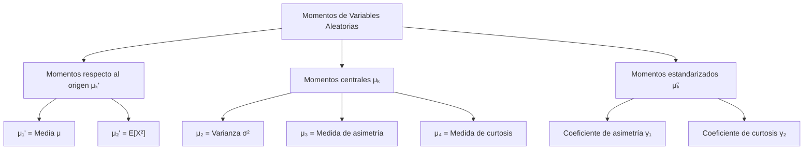
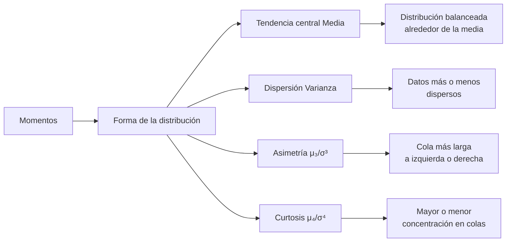

# Probabilidad I - Momentos de Variables Aleatorias

## 3.2 Momentos de variables aleatorias.

---

Los **momentos** son valores numéricos que caracterizan propiedades importantes de las distribuciones de probabilidad. Proporcionan información sobre la forma, tendencia central, dispersión y otras características de las variables aleatorias.

### 1. Concepto de Momentos

#### Definición general

El **momento de orden k** de una variable aleatoria $X$ respecto a un valor $a$ se define como:

$$m_k(a) = E[(X - a)^k]$$

Dependiendo del valor de $a,$ tenemos diferentes tipos de momentos.

### 2. Tipos de Momentos

#### Momentos respecto al origen (momentos ordinarios)

Cuando $a = 0,$ obtenemos los momentos respecto al origen:

$$ \mu_k' = E[X^k] = \begin{cases} \sum x_i^k P(X=x_i) & \text{(variables discretas)} \\ \int_{-\infty}^{\infty} x^k f(x) dx & \text{(variables continuas)} \end{cases}$$

- $\mu_1' = E[X]:$ Media o valor esperado (primer momento)
- $\mu_2' = E[X^2]:$ Segundo momento

#### Momentos centrales (respecto a la media)

Cuando $a = E[X] = \mu,$ obtenemos los momentos centrales:

$$\mu_k = E[(X - \mu)^k]$$

- $\mu_1 = E[(X - \mu)] = 0:$ Primer momento central
- $\mu_2 = E[(X - \mu)^2]:$ Varianza (segundo momento central)
- $\mu_3 = E[(X - \mu)^3]:$ Medida de asimetría
- $\mu_4 = E[(X - \mu)^4]:$ Medida de curtosis

#### Momentos estandarizados

Para comparar distribuciones con diferentes escalas, usamos momentos estandarizados:

$$\tilde{\mu}_k = \frac{\mu_k}{\sigma^k} = E\left[\left(\frac{X - \mu}{\sigma}\right)^k\right]$$

### 3. Momentos importantes y su interpretación

#### Media $(\mu_1')$

$$E[X] = \mu$$

Representa el centro de gravedad de la distribución.

#### Varianza $(\mu_2)$

$$\text{Var}(X) = \sigma^2 = E[(X - \mu)^2] = E[X^2] - (E[X])^2$$

Mide la dispersión de los valores alrededor de la media.

#### Coeficiente de asimetría (skewness)

$$\gamma_1 = \frac{\mu_3}{\sigma^3}$$

- $\gamma_1 = 0:$ Distribución simétrica
- $\gamma_1 > 0:$ Asimetría positiva (cola a la derecha)
- $\gamma_1 < 0:$ Asimetría negativa (cola a la izquierda)

#### Coeficiente de curtosis

$$\gamma_2 = \frac{\mu_4}{\sigma^4} - 3$$

- $\gamma_2 = 0:$ Curtosis similar a la normal
- $\gamma_2 > 0:$ Distribución más apuntada que la normal
- $\gamma_2 < 0:$ Distribución menos apuntada que la normal

### 4. Función generadora de momentos

#### Definición
La función generadora de momentos se define como:

$$M_X(t) = E[e^{tX}]$$

#### Relación con los momentos
Los momentos se pueden obtener derivando la función generadora:

$$E[X^k] = M_X^{(k)}(0) = \frac{d^k}{dt^k}M_X(t)\bigg|_{t=0}$$

#### Propiedades
1. $M_{aX+b}(t) = e^{bt}M_X(at)$
2. Si $X$ e $Y$ son independientes, $M_{X+Y}(t) = M_X(t)M_Y(t)$

### 5. Diagrama conceptual de momentos



### 6. Ejemplos de cálculo de momentos

#### Ejemplo 1: Distribución uniforme discreta
Sea $X$ el resultado de lanzar un dado justo:
- $P(X=i) = \frac{1}{6}$ para $i=1,2,...,6$

Cálculo de momentos:
- $\mu_1' = E[X] = \sum_{i=1}^{6} i \cdot \frac{1}{6} = 3.5$
- $\mu_2' = E[X^2] = \sum_{i=1}^{6} i^2 \cdot \frac{1}{6} = \frac{91}{6} \approx 15.1667$
- $\mu_2 = \text{Var}(X) = E[X^2] - (E[X])^2 = \frac{91}{6} - (3.5)^2 \approx 2.9167$

#### Ejemplo 2: Distribución exponencial
Sea $X \sim \text{Exponencial}(\lambda)$ con $f(x) = \lambda e^{-\lambda x}$ para $x \geq 0$

Cálculo de momentos:
- $\mu_1' = E[X] = \int_{0}^{\infty} x \lambda e^{-\lambda x} dx = \frac{1}{\lambda}$
- $\mu_2' = E[X^2] = \int_{0}^{\infty} x^2 \lambda e^{-\lambda x} dx = \frac{2}{\lambda^2}$
- $\mu_2 = \text{Var}(X) = E[X^2] - (E[X])^2 = \frac{2}{\lambda^2} - \frac{1}{\lambda^2} = \frac{1}{\lambda^2}$

### 7. Código Python para cálculo de momentos

```python
import numpy as np
from scipy import stats
import matplotlib.pyplot as plt

def calcular_momentos(muestra):
    """Calcula los primeros cuatro momentos de una muestra"""
    n = len(muestra)

    # Media (primer momento)
    media = np.mean(muestra)

    # Varianza (segundo momento central)
    varianza = np.var(muestra, ddof=0)  # ddof=0 para varianza poblacional

    # Sesgo (tercer momento estandarizado)
    sesgo = stats.skew(muestra)

    # Curtosis (cuarto momento estandarizado)
    curtosis = stats.kurtosis(muestra)

    return media, varianza, sesgo, curtosis

# Ejemplo con distribución normal
np.random.seed(42)
muestra_normal = np.random.normal(0, 1, 1000)
media, varianza, sesgo, curtosis = calcular_momentos(muestra_normal)

print(f"Media: {media:.4f}")
print(f"Varianza: {varianza:.4f}")
print(f"Sesgo: {sesgo:.4f}")
print(f"Curtosis: {curtosis:.4f}")

# Visualización de la distribución y sus momentos
plt.figure(figsize=(10, 6))
plt.hist(muestra_normal, bins=30, density=True, alpha=0.7, label='Datos')
plt.axvline(media, color='r', linestyle='--', label=f'Media: {media:.2f}')
plt.title('Distribución normal y sus momentos')
plt.xlabel('Valor')
plt.ylabel('Densidad')
plt.legend()
plt.grid(True, alpha=0.3)
plt.show()
```

### 8. Ejercicios propuestos

1. Para una variable aleatoria $X$ con distribución $P(X=0) = 0.4,$ $P(X=1) = 0.3,$ $P(X=2) = 0.2,$ $P(X=3) = 0.1:$
   - Calcule $E[X],$ $E[X^2],$ $E[X^3]$ y $E[X^4]$
   - Calcule $\text{Var}(X)$
   - Calcule el coeficiente de asimetría

2. Sea $X \sim \text{Uniforme}(a,b):$
   - Encuentre la función generadora de momentos $M_X(t)$
   - Use $M_X(t)$ para encontrar $E[X]$ y $\text{Var}(X)$

3. Demuestre que para cualquier variable aleatoria $X:$

   $$\text{Var}(X) = E[X^2] - (E[X])^2$$

4. Para una variable aleatoria $X$ con distribución Poisson( $\lambda$ ):
   - Encuentre $E[X],$ $E[X^2]$ y $E[X^3]$
   - Calcule el coeficiente de asimetría

5. Investigue cómo se relacionan los momentos con:
   - La función característica $\phi_X(t) = E[e^{itX}]$
   - La función generadora de probabilidades $G_X(s) = E[s^X]$

### 9. Relación entre momentos y forma de la distribución



### 10. Aplicaciones de los momentos

1. **Identificación de distribuciones**: Los momentos caracterizan únicamente muchas distribuciones.

2. **Ajuste de distribuciones**: Se usan métodos como el de momentos para estimar parámetros.

3. **Análisis de forma**: Asimetría y curtosis describen la forma de las distribuciones.

4. **Ingeniería y física**: Análisis de señales, vibraciones y patrones de ondas.

5. **Finanzas**: Medición de riesgo, rendimiento esperado y volatilidad.

### 11. Referencias y bibliografía

1. **Libros recomendados**:
   - "Probability and Statistical Inference" by Hogg, McKean, and Craig
   - "Introduction to Probability" by Blitzstein and Hwang
   - "A First Course in Probability" by Sheldon Ross

2. **Conceptos clave**:
   - Los momentos proporcionan información sobre la forma de las distribuciones
   - Los momentos centrales son invariantes bajo traslaciones
   - Los momentos estandarizados son invariantes bajo cambios de escala
   - La función generadora de momentos caracteriza la distribución

3. **Para profundizar**:
   - Momentos factoriales: $E[X(X-1)...(X-k+1)]$
   - Momentos condicionales: $E[X^k|Y]$
   - Momentos de vectores aleatorios
