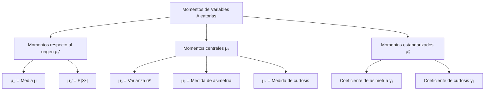
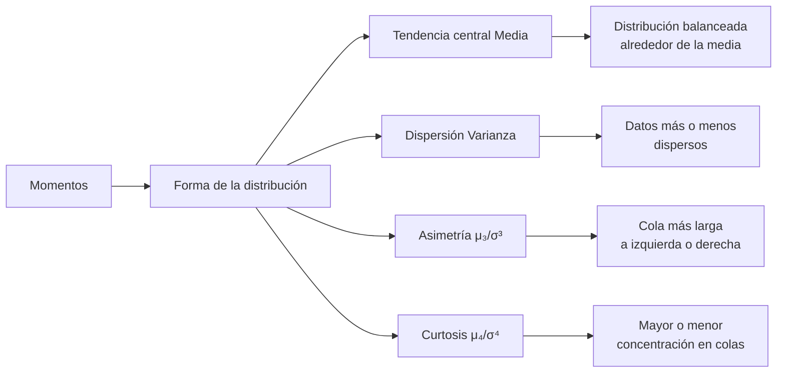

# Probabilidad I - Momentos de Variables Aleatorias

## 3.2 Momentos de variables aleatorias.

---

Los **momentos** son valores numéricos que caracterizan propiedades importantes de las distribuciones de probabilidad. Proporcionan información sobre la forma, tendencia central, dispersión y otras características de las variables aleatorias.

### 1. Concepto de Momentos

#### Definición general

El **momento de orden k** de una variable aleatoria $X$ respecto a un valor $a$ se define como:

$$ m_k(a) = E[(X - a)^k] $$

Dependiendo del valor de $a,$ tenemos diferentes tipos de momentos.

El momento de orden $k$ existe si $E[|X|^k] < \infty.$ Si existe el de orden $k,$ existen todos los de orden menor, porque $|x|^j \leq 1 + |x|^k$ para $j \leq k.$ Lo contrario no es cierto: una variable con densidad $\text{Pareto}$ de forma $\alpha = 2.5$ tiene media y varianza, pero no tercer momento.

### 2. Tipos de Momentos

#### Momentos respecto al origen (momentos ordinarios)

Cuando $a = 0,$ obtenemos los momentos respecto al origen:

$$ \mu_k' = E[X^k] = \begin{cases} \sum x_i^k P(X=x_i) & \text{(variables discretas)} \\ \int_{-\infty}^{\infty} x^k f(x) \, dx & \text{(variables continuas)} \end{cases} $$

- $\mu_1' = E[X]:$ Media o valor esperado (primer momento)
- $\mu_2' = E[X^2]:$ Segundo momento

#### Momentos centrales (respecto a la media)

Cuando $a = E[X] = \mu,$ obtenemos los momentos centrales:

$$\mu_k = E[(X - \mu)^k]$$

- $\mu_1 = E[(X - \mu)] = 0:$ Primer momento central
- $\mu_2 = E[(X - \mu)^2]:$ Varianza (segundo momento central)
- $\mu_3 = E[(X - \mu)^3]:$ Medida de asimetría
- $\mu_4 = E[(X - \mu)^4]:$ Medida de curtosis

Los momentos centrales se calculan a partir de los ordinarios desarrollando el binomio; los más usados son

$$ \mu_2 = \mu_2' - \mu^2, \qquad \mu_3 = \mu_3' - 3\mu\mu_2' + 2\mu^3, \qquad \mu_4 = \mu_4' - 4\mu\mu_3' + 6\mu^2\mu_2' - 3\mu^4 $$

Los momentos centrales no cambian si se suma una constante a $X,$ porque miden la forma alrededor de la media.

#### Momentos estandarizados

Para comparar distribuciones con diferentes escalas, usamos momentos estandarizados:

$$ \tilde{\mu}_k = \frac{\mu_k}{\sigma^k} = E\left[\left(\frac{X - \mu}{\sigma}\right)^k\right] $$

No tienen unidades y no cambian si $X$ se transforma en $aX + b$ con $a > 0:$ miden solo la **forma**.

### 3. Momentos importantes y su interpretación

#### Media $(\mu_1')$

$$E[X] = \mu$$

Representa el centro de gravedad de la distribución.

#### Varianza $(\mu_2)$

$$\text{Var}(X) = \sigma^2 = E[(X - \mu)^2] = E[X^2] - (E[X])^2$$

Mide la dispersión de los valores alrededor de la media.

#### Coeficiente de asimetría (skewness)

$$\gamma_1 = \frac{\mu_3}{\sigma^3}$$

- $\gamma_1 = 0:$ toda distribución simétrica (con tercer momento) lo cumple, aunque el recíproco no es cierto
- $\gamma_1 > 0:$ Asimetría positiva (cola a la derecha), como en los ingresos o los tiempos de espera
- $\gamma_1 < 0:$ Asimetría negativa (cola a la izquierda)

Al cubo, las desviaciones grandes dominan y conservan su signo: una cola larga a la derecha produce muchos términos positivos grandes.

#### Coeficiente de curtosis

$$\gamma_2 = \frac{\mu_4}{\sigma^4} - 3$$

Se le llama **exceso de curtosis**: se resta 3 porque $\frac{\mu_4}{\sigma^4} = 3$ para cualquier normal.

- $\gamma_2 = 0:$ colas como las de la normal
- $\gamma_2 > 0:$ colas más pesadas que la normal (leptocúrtica): los valores extremos son más frecuentes
- $\gamma_2 < 0:$ colas más ligeras que la normal (platicúrtica), como la uniforme, con $\gamma_2 = -1.2$

Es común leer que la curtosis mide qué tan "apuntada" es la distribución, pero esa interpretación es engañosa: al elevar a la cuarta potencia, $\mu_4$ está dominado casi por completo por los valores alejados de la media, así que la curtosis mide sobre todo el **peso de las colas** (Westfall, 2014). En finanzas, los rendimientos tienen curtosis positiva: las caídas extremas son mucho más frecuentes de lo que predice una normal.

### 4. Función generadora de momentos

#### Definición
La función generadora de momentos se define como:

$$ M_X(t) = E[e^{tX}] $$

para los $t$ en que la esperanza es finita; siempre $M_X(0) = 1.$

#### Relación con los momentos

Si $M_X$ es finita en un intervalo alrededor de 0, los momentos se pueden obtener derivando la función generadora:

$$ E[X^k] = M_X^{(k)}(0) = \frac{d^k}{dt^k}M_X(t)\bigg|_{t=0} $$

La razón es el desarrollo en serie de la exponencial: $M_X(t) = E\left[\sum_{k \geq 0}\frac{t^kX^k}{k!}\right] = \sum_{k \geq 0}\frac{E[X^k]}{k!}t^k,$ así que los momentos son, salvo el factor $k!,$ los coeficientes de la serie de Taylor de $M_X$ en 0. De ahí el nombre.

#### Propiedades

1. $M_{aX+b}(t) = e^{bt}M_X(at)$
2. Si $X$ y $Y$ son independientes, $M_{X+Y}(t) = M_X(t)M_Y(t)$
3. Si $M_X$ y $M_Y$ son finitas y coinciden en un intervalo alrededor de 0, $X$ y $Y$ tienen la misma distribución.

El tema 3.5 desarrolla estas funciones con detalle.

### 5. Diagrama conceptual de momentos



### 6. Ejemplos de cálculo de momentos

#### Ejemplo 1: Distribución uniforme discreta
Sea $X$ el resultado de lanzar un dado justo:
con $P(X=i) = \frac{1}{6}$ para $i=1,2,\dots,6.$

Cálculo de momentos:

- $\mu_1' = E[X] = \sum_{i=1}^{6} i \cdot \frac{1}{6} = 3.5$
- $\mu_2' = E[X^2] = \sum_{i=1}^{6} i^2 \cdot \frac{1}{6} = \frac{91}{6} \approx 15.1667$
- $\mu_2 = \text{Var}(X) = E[X^2] - (E[X])^2 = \frac{91}{6} - (3.5)^2 \approx 2.9167$
- $\mu_3 = 0,$ porque la distribución es simétrica alrededor de 3.5, así que $\gamma_1 = 0.$
- $\mu_4 = \frac{1}{6}\sum_{i=1}^6 (i - 3.5)^4 = \frac{2(0.0625 + 5.0625 + 39.0625)}{6} \approx 14.729,$ y $\gamma_2 = \frac{14.729}{2.9167^2} - 3 \approx -1.27:$ colas más ligeras que la normal, porque los valores están acotados.

#### Ejemplo 2: Distribución exponencial
Sea $X \sim \text{Exponencial}(\lambda)$ con $f(x) = \lambda e^{-\lambda x}$ para $x \geq 0.$ Con el cambio $u = \lambda x$ y la función gamma, $E[X^k] = \int_0^\infty x^k\lambda e^{-\lambda x}\,dx = \frac{\Gamma(k+1)}{\lambda^k} = \frac{k!}{\lambda^k}.$

Cálculo de momentos:

- $\mu_1' = E[X] = \frac{1}{\lambda}$
- $\mu_2' = E[X^2] = \frac{2}{\lambda^2}$
- $\mu_2 = \text{Var}(X) = E[X^2] - (E[X])^2 = \frac{2}{\lambda^2} - \frac{1}{\lambda^2} = \frac{1}{\lambda^2}$
- $\mu_3 = \frac{6}{\lambda^3} - 3 \cdot \frac{1}{\lambda} \cdot \frac{2}{\lambda^2} + \frac{2}{\lambda^3} = \frac{2}{\lambda^3},$ así que $\gamma_1 = 2:$ fuertemente asimétrica a la derecha.
- $\mu_4 = \frac{24}{\lambda^4} - 4 \cdot \frac{1}{\lambda} \cdot \frac{6}{\lambda^3} + 6 \cdot \frac{1}{\lambda^2} \cdot \frac{2}{\lambda^2} - \frac{3}{\lambda^4} = \frac{9}{\lambda^4},$ así que $\gamma_2 = 9 - 3 = 6.$

Ambos coeficientes son independientes de $\lambda,$ como debe ser: cambiar $\lambda$ solo cambia la escala.

### 7. Código Python para cálculo de momentos

```python
import numpy as np
from scipy import stats
import matplotlib
matplotlib.use("Agg")
import matplotlib.pyplot as plt

def calcular_momentos(muestra):
    """Calcula los primeros cuatro momentos de una muestra"""
    n = len(muestra)

    # Media (primer momento)
    media = np.mean(muestra)

    # Varianza (segundo momento central)
    varianza = np.var(muestra, ddof=0)  # ddof=0 para varianza poblacional

    # Sesgo (tercer momento estandarizado)
    sesgo = stats.skew(muestra)

    # Exceso de curtosis (cuarto momento estandarizado menos 3)
    curtosis = stats.kurtosis(muestra)   # por omisión, scipy ya resta 3 (fisher=True)

    return media, varianza, sesgo, curtosis

# Ejemplo con distribución normal
np.random.seed(42)
muestra_normal = np.random.normal(0, 1, 1000)
media, varianza, sesgo, curtosis = calcular_momentos(muestra_normal)

print(f"Media: {media:.4f}")
print(f"Varianza: {varianza:.4f}")
print(f"Sesgo: {sesgo:.4f}")
print(f"Curtosis: {curtosis:.4f}")

# Visualización de la distribución y sus momentos
plt.figure(figsize=(10, 6))
plt.hist(muestra_normal, bins=30, density=True, alpha=0.7, label='Datos')
plt.axvline(media, color='r', linestyle='--', label=f'Media: {media:.2f}')
plt.title('Distribución normal y sus momentos')
plt.xlabel('Valor')
plt.ylabel('Densidad')
plt.legend()
plt.grid(True, alpha=0.3)
plt.savefig("momentos.png", dpi=90)

# Exponencial: se esperan asimetría 2 y exceso de curtosis 6
m = calcular_momentos(np.random.exponential(1.0, 200_000))
print("Exponencial: media %.3f var %.3f asimetría %.3f curtosis %.3f" % m)
```

Con 1 000 datos normales, la asimetría y la curtosis muestrales no son exactamente 0, sino que fluctúan alrededor de 0; los momentos de orden alto requieren muestras grandes para estimarse bien, porque son muy sensibles a unos pocos valores extremos.

### 8. Ejercicios propuestos

1. Para una variable aleatoria $X$ con distribución $P(X=0) = 0.4,$ $P(X=1) = 0.3,$ $P(X=2) = 0.2,$ $P(X=3) = 0.1:$
   - Calcule $E[X],$ $E[X^2],$ $E[X^3]$ y $E[X^4]$
   - Calcule $\text{Var}(X)$
   - Calcule el coeficiente de asimetría

2. Sea $X \sim \text{Uniforme}(a,b):$
   - Encuentre la función generadora de momentos $M_X(t)$
   - Use $M_X(t)$ para encontrar $E[X]$ y $\text{Var}(X)$

3. Demuestre que para cualquier variable aleatoria $X:$

   $$\text{Var}(X) = E[X^2] - (E[X])^2$$

4. Para una variable aleatoria $X$ con distribución $\text{Poisson}(\lambda):$
   - Encuentre $E[X],$ $E[X^2]$ y $E[X^3]$
   - Calcule el coeficiente de asimetría

5. Investigue cómo se relacionan los momentos con:
   - La función característica $\phi_X(t) = E[e^{itX}]$
   - La función generadora de probabilidades $G_X(s) = E[s^X]$

### Soluciones

**Ejercicio 1.** $E[X] = 0.3 + 0.4 + 0.3 = 1,$ $E[X^2] = 0.3 + 0.8 + 0.9 = 2,$ $E[X^3] = 0.3 + 1.6 + 2.7 = 4.6$ y $E[X^4] = 0.3 + 3.2 + 8.1 = 11.6.$ Entonces $\text{Var}(X) = 2 - 1 = 1,$ $\mu_3 = 4.6 - 3 \cdot 1 \cdot 2 + 2 \cdot 1 = 0.6$ y $\gamma_1 = \frac{0.6}{1^3} = 0.6:$ asimetría positiva, porque la masa se concentra en los valores pequeños y la cola va hacia el 3.

**Ejercicio 2.** Para $t \neq 0,$ $M_X(t) = \int_a^b \frac{e^{tx}}{b - a}\,dx = \frac{e^{tb} - e^{ta}}{t(b - a)},$ y $M_X(0) = 1.$ Derivar directamente es incómodo por la $t$ en el denominador; es más fácil desarrollar en serie: $\frac{e^{tb} - e^{ta}}{t(b-a)} = \sum_{k \geq 0}\frac{b^{k+1} - a^{k+1}}{(k+1)(b - a)}\frac{t^k}{k!},$ así que $E[X^k] = \frac{b^{k+1} - a^{k+1}}{(k+1)(b-a)}.$ Con $k = 1,$ $E[X] = \frac{a + b}{2};$ con $k = 2,$ $E[X^2] = \frac{a^2 + ab + b^2}{3},$ y $\text{Var}(X) = \frac{a^2 + ab + b^2}{3} - \frac{(a+b)^2}{4} = \frac{(b - a)^2}{12}.$

**Ejercicio 3.** Ver la sección 2 del tema 3.1: se desarrolla $(X - \mu)^2$ y se usa la linealidad.

**Ejercicio 4.** Con $M_X(t) = e^{\lambda(e^t - 1)}$ (tema 3.5): $M' = \lambda e^t M,$ $M'' = (\lambda e^t + \lambda^2e^{2t})M,$ $M''' = (\lambda e^t + 3\lambda^2e^{2t} + \lambda^3e^{3t})M.$ En $t = 0:$ $E[X] = \lambda,$ $E[X^2] = \lambda + \lambda^2,$ $E[X^3] = \lambda + 3\lambda^2 + \lambda^3.$ Entonces $\mu_3 = \lambda + 3\lambda^2 + \lambda^3 - 3\lambda(\lambda + \lambda^2) + 2\lambda^3 = \lambda$ y $\gamma_1 = \frac{\lambda}{\lambda^{3/2}} = \frac{1}{\sqrt{\lambda}}:$ la Poisson es asimétrica a la derecha, pero cada vez menos cuando $\lambda$ crece, coherente con su aproximación normal.

**Ejercicio 5.** La función característica es $\phi_X(t) = M_X(it)$ cuando ambas existen, y $\phi_X^{(k)}(0) = i^k E[X^k];$ su ventaja es que **siempre** existe, porque $|e^{itX}| = 1,$ incluso para la Cauchy. La generadora de probabilidades, para variables con valores enteros no negativos, cumple $M_X(t) = G_X(e^t),$ y sus derivadas en $s = 1$ dan los **momentos factoriales**: $G_X^{(k)}(1) = E[X(X-1)\cdots(X-k+1)].$

### 9. Relación entre momentos y forma de la distribución



### 10. Aplicaciones de los momentos

1. **Identificación de distribuciones**: Los momentos caracterizan únicamente muchas distribuciones, por ejemplo las que tienen función generadora finita cerca de 0. No todas: existen distribuciones distintas con exactamente los mismos momentos de todos los órdenes, como la log-normal y ciertas perturbaciones suyas.

2. **Ajuste de distribuciones**: Se usan métodos como el de momentos para estimar parámetros.

3. **Análisis de forma**: Asimetría y curtosis describen la forma de las distribuciones.

4. **Ingeniería y física**: Análisis de señales, vibraciones y patrones de ondas.

5. **Finanzas**: Medición de riesgo, rendimiento esperado y volatilidad.

### 11. Referencias y bibliografía

1. **Libros recomendados**:
   - "Probability and Statistical Inference" by Hogg, McKean, and Craig
   - "Introduction to Probability" by Blitzstein and Hwang
   - "A First Course in Probability" by Sheldon Ross

2. **Conceptos clave**:
   - Los momentos proporcionan información sobre la forma de las distribuciones
   - Los momentos centrales son invariantes bajo traslaciones
   - Los momentos estandarizados son invariantes bajo cambios de escala
   - La función generadora de momentos caracteriza la distribución

3. **Para profundizar**:
   - Momentos factoriales: $E[X(X-1)...(X-k+1)]$
   - Momentos condicionales: $E[X^k|Y]$
   - Momentos de vectores aleatorios
