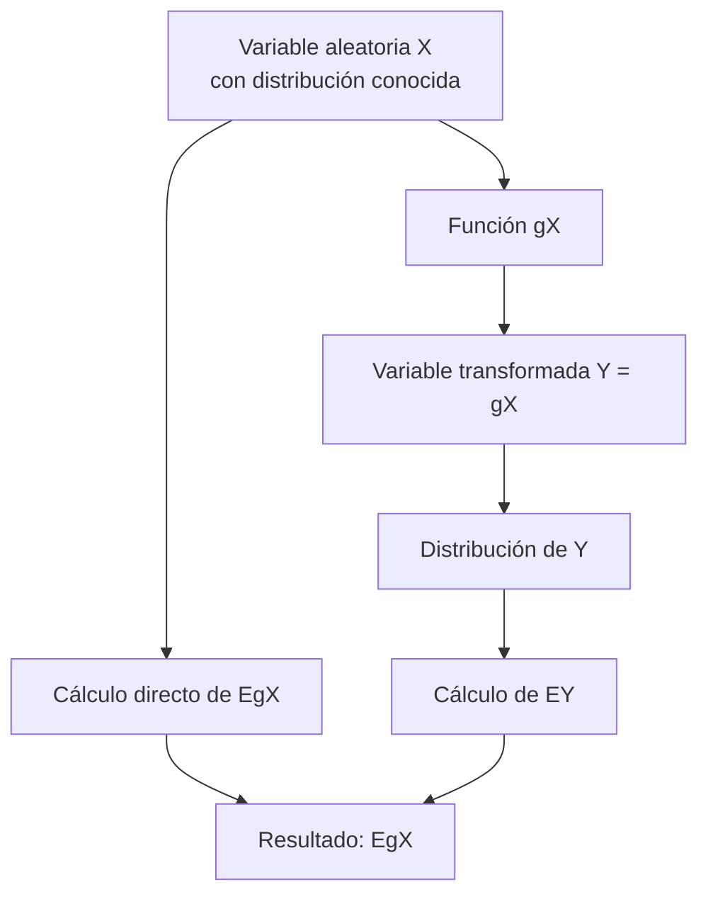

# Probabilidad I - Momentos de Variables Aleatorias

## 3.3 Esperanza de funciones de una variable aleatoria.

---

La **esperanza de funciones de variables aleatorias** es un concepto fundamental en probabilidad que extiende la noción de valor esperado. Nos permite calcular cantidades como $E[g(X)]$ donde $g$ es una función medible y $X$ es una variable aleatoria.

### 1. Definición formal

#### Para variables discretas

Si $X$ es una variable aleatoria discreta con función de masa de probabilidad $p(x)$, entonces:

$$E[g(X)] = \sum_{x} g(x) \cdot p(x)$$

#### Para variables continuas

Si $X$ es una variable aleatoria continua con función de densidad $f(x)$, entonces:

$$E[g(X)] = \int_{-\infty}^{\infty} g(x) \cdot f(x)  dx$$

### 2. Propiedades fundamentales

#### Linealidad de la esperanza

Para cualesquiera constantes $a$, $b$ y funciones $g$, $h$:

$$E[a \cdot g(X) + b \cdot h(X)] = a \cdot E[g(X)] + b \cdot E[h(X)]$$

#### Monotonía

Si $g(X) \leq h(X)$ para todo $X$, entonces:

$$E[g(X)] \leq E[h(X)]$$

#### Valor absoluto

$$|E[g(X)]| \leq E[|g(X)|]$$

### 3. Casos especiales importantes

#### Momentos de una variable aleatoria

$$ E[X^k] = \begin{cases} \sum x_i^k p(x_i) & \text{(discreta)} \\\ \int x^k f(x) dx & \text{(continua)} \end{cases} $$

#### Función generadora de momentos

$$M_X(t) = E[e^{tX}]$$

#### Varianza como esperanza

$$\text{Var}(X) = E[(X - E[X])^2] = E[X^2] - (E[X])^2$$

### 4. Teorema fundamental (Ley del estadístico inconsciente)

No es necesario encontrar la distribución de $Y = g(X)$ para calcular $E[g(X)]$. Basta con conocer la distribución de $X$:

$$E[g(X)] = \int_{-\infty}^{\infty} g(x) f_X(x) dx$$

### 5. Diagrama conceptual



### 6. Ejemplos detallados

#### Ejemplo 1: Variable discreta
Sea $X$ una variable aleatoria con distribución:
$P(X = -1) = 0.2$, $P(X = 0) = 0.5$, $P(X = 2) = 0.3$

Calcular $E[X^2]$:

$$E[X^2] = (-1)^2 \cdot 0.2 + 0^2 \cdot 0.5 + 2^2 \cdot 0.3 = 1 \cdot 0.2 + 0 \cdot 0.5 + 4 \cdot 0.3 = 0.2 + 1.2 = 1.4$$

#### Ejemplo 2: Variable continua
Sea $X \sim \text{Uniforme}(0, 1)$ con $f(x) = 1$ para $0 \leq x \leq 1$.

Calcular $E[e^X]$:

$$E[e^X] = \int_{0}^{1} e^x \cdot 1  dx = e^x \big|_{0}^{1} = e - 1 \approx 1.718$$

#### Ejemplo 3: Aplicación física
Si $X$ representa la posición de una partícula con densidad $f(x) = 2x$ para $0 \leq x \leq 1$, la energía potencial es $U(X) = kX^2$. Calcular la energía esperada:

$$E[U(X)] = E[kX^2] = k \int_{0}^{1} x^2 \cdot 2x  dx = 2k \int_{0}^{1} x^3 dx = 2k \cdot \frac{1}{4} = \frac{k}{2}$$

### 7. Implementación computacional

```python
import numpy as np
from scipy import integrate
import matplotlib.pyplot as plt

def esperanza_funcion_discreta(valores, probabilidades, funcion):
    """Calcula E[g(X)] para variable discreta"""
    return sum(funcion(x) * p for x, p in zip(valores, probabilidades))

def esperanza_funcion_continua(funcion_densidad, funcion, lim_inf, lim_sup):
    """Calcula E[g(X)] para variable continua"""
    integrando = lambda x: funcion(x) * funcion_densidad(x)
    resultado, error = integrate.quad(integrando, lim_inf, lim_sup)
    return resultado

# Ejemplo 1: Variable discreta
valores = np.array([-1, 0, 2])
probabilidades = np.array([0.2, 0.5, 0.3])
funcion_cuadratica = lambda x: x**2

E_X2 = esperanza_funcion_discreta(valores, probabilidades, funcion_cuadratica)
print(f"E[X²] = {E_X2:.4f}")

# Ejemplo 2: Variable continua - Uniforme(0,1)
f_uniforme = lambda x: 1 if 0 <= x <= 1 else 0
funcion_exponencial = lambda x: np.exp(x)

E_eX = esperanza_funcion_continua(f_uniforme, funcion_exponencial, 0, 1)
print(f"E[e^X] = {E_eX:.4f}")

# Visualización de la transformación
x_vals = np.linspace(0, 1, 100)
plt.figure(figsize=(10, 6))
plt.plot(x_vals, f_uniforme(x_vals), 'b-', label='f(x) = 1', linewidth=2)
plt.plot(x_vals, np.exp(x_vals), 'r-', label='g(x) = e^x', linewidth=2)
plt.fill_between(x_vals, 0, np.exp(x_vals), alpha=0.3, color='red')
plt.title('Esperanza de g(X) = e^X para X ~ Uniforme(0,1)')
plt.xlabel('x')
plt.ylabel('Valor')
plt.legend()
plt.grid(True, alpha=0.3)
plt.show()
```

### 8. Ejercicios propuestos

1. Sea $X$ con distribución $P(X=1) = 0.1$, $P(X=2) = 0.3$, $P(X=3) = 0.4$, $P(X=4) = 0.2$. Calcule:
   - $E[X]$
   - $E[X^2]$
   - $E[2^X]$
   - $E[\sqrt{X}]$

2. Para $X \sim \text{Exponencial}(\lambda)$ con $f(x) = \lambda e^{-\lambda x}$ para $x \geq 0$:
   - Encuentre $E[X^n]$ para $n \in \mathbb{N}$
   - Calcule $E[e^{tX}]$ (función generadora de momentos)
   - Determine $E[\ln(X)]$

3. Demuestre que si $g(X) \geq 0$, entonces $E[g(X)] \geq 0$.

4. Sea $X \sim N(0, 1)$. Calcule $E[|X|]$ usando el hecho de que:

   $$E[|X|] = \frac{1}{\sqrt{2\pi}} \int_{-\infty}^{\infty} |x| e^{-x^2/2} dx$$

5. Para una variable aleatoria $X$ con media $\mu$ y varianza $\sigma^2$, encuentre:
   - $E[(X - a)^2]$ como función de $a$
   - El valor de $a$ que minimiza esta expresión

### 9. Aplicaciones y contextos reales

1. **Finanzas**: Valor esperado de funciones de utilidad $U(W)$ donde $W$ es la riqueza.

2. **Física**: Valores esperados de observables en mecánica cuántica.

3. **Ingeniería**: Esperanza de funciones de coste en optimización.

4. **Machine Learning**: Función de pérdida esperada en aprendizaje estadístico.

### 10. Referencias bibliográficas

1. **Textos principales**:
   - Ross, S. M. (2019). "A First Course in Probability". Pearson. (Capítulo 4, 7)
   - Casella, G., & Berger, R. L. (2002). "Statistical Inference". Duxbury. (Capítulo 2)

2. **Para profundización**:
   - Billingsley, P. (1995). "Probability and Measure". Wiley. (Teorema de transformación)
   - Durrett, R. (2019). "Probability: Theory and Examples". Cambridge University Press.

3. **Recursos en línea**:
   - MIT OpenCourseWare: "Introduction to Probability"
   - Khan Academy: Probability and Statistics
