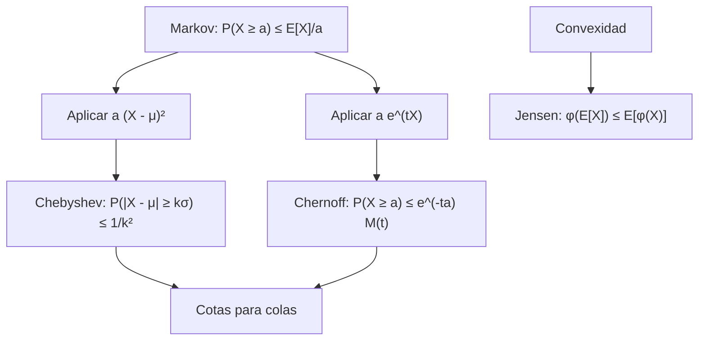

# Probabilidad I - Momentos de Variables Aleatorias

## 3.4 Desigualdades, incluyendo las de Tchebyshev, Jensen, Markov, Chernoff.

---

Las **desigualdades probabilísticas** son herramientas fundamentales en teoría de probabilidad que proporcionan cotas superiores e inferiores para probabilidades y valores esperados, incluso cuando la distribución completa es desconocida. Son esenciales para análisis de colas, teoremas límite y aplicaciones en estadística, machine learning y finanzas.

### 1. Desigualdad de Markov

#### Enunciado

Para cualquier variable aleatoria **no negativa** $X$ y cualquier $a > 0:$

$$P(X \geq a) \leq \frac{E[X]}{a}$$

#### Demostración (caso continuo)

$$ E[X] = \int_{0}^{\infty} x f(x) \, dx \geq \int_{a}^{\infty} x f(x) \, dx \geq a \int_{a}^{\infty} f(x) \, dx = a P(X \geq a) $$

#### Demostración general

Para cualquier $X \geq 0,$ discreta, continua o mixta, se cumple la desigualdad entre variables $a\,\mathbf{1}_{\{X \geq a\}} \leq X:$ si $X \geq a,$ el lado izquierdo vale $a \leq X;$ si no, vale $0 \leq X.$ Tomando esperanzas y usando la monotonía, $a\,P(X \geq a) \leq E[X].$ $\blacksquare$

La idea: si una variable no negativa tiene media pequeña, no puede tomar valores grandes con mucha probabilidad. La cota es **óptima**: la variable que vale $a$ con probabilidad $\frac{E[X]}{a}$ y 0 en otro caso la alcanza con igualdad.

#### Ejemplo

Si el tiempo promedio de espera es 10 minutos:

$$ P(\text{espera} \geq 30) \leq \frac{10}{30} = \frac{1}{3} $$

sin saber nada más de la distribución de la espera. Si se supiera que es exponencial, la probabilidad exacta sería $e^{-3} \approx 0.05:$ Markov es una cota segura, pero puede ser muy holgada.

### 2. Desigualdad de Chebyshev (Tchebyshev)

#### Enunciado

Para cualquier variable aleatoria $X$ con media $\mu$ y varianza $\sigma^2,$ y cualquier $k > 0:$

$$ P(|X - \mu| \geq k\sigma) \leq \frac{1}{k^2} $$

o, en la forma equivalente con $\varepsilon = k\sigma,$ $P(|X - \mu| \geq \varepsilon) \leq \frac{\sigma^2}{\varepsilon^2}.$ Solo es informativa para $k > 1.$ Garantiza que **cualquier** distribución tiene al menos 75% de su probabilidad a menos de 2 desviaciones de la media, y al menos 89% a menos de 3; para la normal esos porcentajes son 95% y 99.7%. Es la herramienta con la que se demuestra la ley débil de los grandes números (tema 4.5).

#### Relación con Markov

Se deriva aplicando Markov a $Y = (X - \mu)^2$ con $a = k^2\sigma^2:$

$$P(|X - \mu| \geq k\sigma) = P((X - \mu)^2 \geq k^2\sigma^2) \leq \frac{E[(X - \mu)^2]}{k^2\sigma^2} = \frac{1}{k^2}$$

#### Ejemplo

Para $k = 2:$

$$ P(|X - \mu| \geq 2\sigma) \leq \frac{1}{4} = 0.25 $$

Esta cota también es óptima: si $X$ vale $\mu - 2\sigma$ y $\mu + 2\sigma$ con probabilidad $\frac{1}{8}$ cada uno y $\mu$ con probabilidad $\frac{3}{4},$ su varianza es $\sigma^2$ y $P(|X - \mu| \geq 2\sigma) = \frac{1}{4}$ exactamente.

### 3. Desigualdad de Jensen

#### Enunciado

Para cualquier variable aleatoria $X$ con media finita y función **convexa** $\varphi:$

$$ \varphi(E[X]) \leq E[\varphi(X)] $$

Para funciones **cóncavas**, la desigualdad se invierte.

#### Demostración

Una función convexa queda por encima de cualquiera de sus rectas tangentes (o de apoyo). Sea $\mu = E[X]$ y $\ell(x) = \varphi(\mu) + m(x - \mu)$ una recta de apoyo en $\mu,$ de modo que $\varphi(x) \geq \ell(x)$ para todo $x.$ Entonces $E[\varphi(X)] \geq E[\ell(X)] = \varphi(\mu) + m(E[X] - \mu) = \varphi(\mu).$ $\blacksquare$

Geométricamente: el promedio de los valores de una función convexa está por encima del valor en el promedio, porque las "alas" de la curva suben.

#### Funciones convexas comunes

- $\varphi(x) = x^2$ (convexa)
- $\varphi(x) = e^x$ (convexa)
- $\varphi(x) = |x|$ (convexa)
- $\varphi(x) = \frac{1}{x}$ en $x > 0$ (convexa)
- $\varphi(x) = \log(x)$ y $\varphi(x) = \sqrt{x}$ en $x > 0$ (cóncavas)

#### Ejemplo

Por Jensen:

$$ (E[X])^2 \leq E[X^2] $$

que equivale a $\text{Var}(X) = E[X^2] - (E[X])^2 \geq 0.$ Con $\varphi = \log,$ que es cóncava, para números positivos $x_1, \dots, x_n$ con pesos iguales se obtiene $\frac{1}{n}\sum \log x_i \leq \log\left(\frac{1}{n}\sum x_i\right),$ es decir, la **desigualdad entre la media geométrica y la aritmética**.

### 4. Desigualdad de Chernoff

#### Enunciado

Para una variable aleatoria $X$ y cualquier $t > 0:$

$$ P(X \geq a) \leq \frac{E[e^{tX}]}{e^{ta}} $$

y, como vale para todo $t > 0,$ se toma la mejor cota:

$$ P(X \geq a) \leq \inf_{t > 0} e^{-ta}M_X(t) $$

*Demostración.* Para $t > 0,$ la función $x \mapsto e^{tx}$ es creciente y positiva, así que $\{X \geq a\} = \{e^{tX} \geq e^{ta}\},$ y por Markov $P(e^{tX} \geq e^{ta}) \leq \frac{E[e^{tX}]}{e^{ta}}.$ $\blacksquare$

Es la misma idea que Chebyshev, aplicar Markov a una función creciente de $X,$ pero con una función que crece tan rápido que aprovecha **todos** los momentos a la vez.

#### Aplicación a sumas

Para $S_n = X_1 + \cdots + X_n$ con $X_i$ i.i.d.:

$$ P(S_n \geq na) \leq \inf_{t > 0} \left[ e^{-ta} M_X(t) \right]^n $$

donde $M_X(t)$ es la función generadora de momentos. Se obtiene porque $M_{S_n}(t) = M_X(t)^n$ para variables independientes (tema 3.5). Para la binomial, con $\mu = np,$ una forma usual es

$$ P(X \geq (1 + \delta)\mu) \leq \left(\frac{e^{\delta}}{(1 + \delta)^{1+\delta}}\right)^{\mu} $$

#### Ventaja

Proporciona cotas que decrecen **exponencialmente** con $n,$ mucho más ajustadas que Chebyshev, cuya cota para un promedio solo decrece como $\frac{1}{n}.$ Requiere, a cambio, que exista la función generadora. Es la base de las cotas de concentración que se usan en análisis de algoritmos aleatorizados y en aprendizaje automático (desigualdad de Hoeffding).

### 5. Diagrama de relaciones entre desigualdades



Markov usa solo la media; Chebyshev, la varianza; Chernoff, la función generadora completa. Cuanta más información se usa, más ajustada es la cota.

### 6. Implementación computacional

```python
import numpy as np
import matplotlib
matplotlib.use("Agg")
import matplotlib.pyplot as plt
from scipy.stats import norm, binom

# Configuración
np.random.seed(42)
mu, sigma = 0, 1
n_samples = 10000
X = np.random.normal(mu, sigma, n_samples)

# Desigualdad de Chebyshev
def chebyshev_bound(k):
    return 1 / (k**2)

# Probabilidad real (distribución normal)
def actual_probability_normal(k, mu=0, sigma=1):
    return 2 * (1 - norm.cdf(k, loc=mu, scale=sigma))

# Visualización
k_values = np.linspace(1, 3, 50)
chebyshev_bounds = [chebyshev_bound(k) for k in k_values]
actual_probs = [actual_probability_normal(k, mu, sigma) for k in k_values]

plt.figure(figsize=(10, 6))
plt.plot(k_values, chebyshev_bounds, 'r-', label='Cota de Chebyshev: $1/k^2$')
plt.plot(k_values, actual_probs, 'b-', label='Probabilidad real (Normal)')
plt.fill_between(k_values, 0, chebyshev_bounds, alpha=0.2, color='red')
plt.fill_between(k_values, 0, actual_probs, alpha=0.2, color='blue')
plt.xlabel('k')
plt.ylabel('Probabilidad')
plt.title('Comparación: Desigualdad de Chebyshev vs. Probabilidad Real')
plt.legend()
plt.grid(True, alpha=0.3)
plt.savefig("chebyshev.png", dpi=90)

# Análisis de la cota
print("Análisis de la desigualdad de Chebyshev:")
for k in [1, 2, 3]:
    cheby_bound = chebyshev_bound(k)
    actual_prob = actual_probability_normal(k, mu, sigma)
    print(f"k = {k}: Chebyshev ≤ {cheby_bound:.4f}, Real = {actual_prob:.4f}")

# Ejercicio 4: Binomial(100, 0.3), P(X ≥ 45)
n, p, delta = 100, 0.3, 0.5
mu = n * p
cheb = n * p * (1 - p) / (delta * mu) ** 2
chern_formula = (np.exp(delta) / (1 + delta) ** (1 + delta)) ** mu
ts = np.linspace(1e-3, 3, 3000)
chern_optima = np.min(np.exp(-ts * (1 + delta) * mu) * (1 - p + p * np.exp(ts)) ** n)
exacta = binom.sf((1 + delta) * mu - 1, n, p)
print(f"Chebyshev ≤ {cheb:.4f}  Chernoff (fórmula) ≤ {chern_formula:.4f}  "
      f"Chernoff (t óptimo) ≤ {chern_optima:.5f}  exacta = {exacta:.5f}")
```

Para $k = 1$ la cota de Chebyshev vale 1 y no dice nada. Para la normal, la probabilidad real es mucho menor que la cota, porque Chebyshev debe valer también para las distribuciones más desfavorables.

### 7. Ejemplos detallados

#### Ejemplo 1: Aplicación de Markov

Sea $X$ el ingreso mensual (en miles) con $E[X] = 2.5.$ Acotar la probabilidad de que alguien gane 10 mil o más:

$$ P(X \geq 10) \leq \frac{2.5}{10} = 0.25 $$

Es decir, a lo más una cuarta parte de la población puede ganar al menos cuatro veces el promedio. Se usa que el ingreso es no negativo.

#### Ejemplo 2: Aplicación de Chebyshev

Examen con media $\mu = 70$ y desviación $\sigma = 10.$ Probabilidad de una calificación fuera del intervalo $(50, 90):$

$$ P(|X - 70| \geq 20) = P(|X - 70| \geq 2\sigma) \leq \frac{1}{4} = 0.25 $$

#### Ejemplo 3: Aplicación de Jensen

Sea $X$ positiva con $E[X] = 3.$ Por Jensen:

$$ E[\log(X)] \leq \log(E[X]) = \log(3) $$

En finanzas esto explica por qué la tasa de crecimiento de una inversión con rendimientos variables es menor que la de su rendimiento promedio: el crecimiento a largo plazo depende de $E[\log(1 + R)],$ que es menor que $\log(1 + E[R]).$

### 8. Ejercicios propuestos

1. **Markov**: El número promedio de errores por página es 2.
   - Acotar la probabilidad de que una página tenga al menos 8 errores.
   - ¿Es útil esta cota si queremos probabilidad de al menos 1 error?

2. **Chebyshev**: Variable con $\mu = 100,$ $\sigma = 15.$
   - Encontrar intervalo que contenga al menos 75% de valores.
   - Acotar $P(|X - 100| \geq 30)$

3. **Jensen**: Para $X > 0$ con $E[X] = 4.$
   - Demostrar que $E[1/X] \geq 1/4$
   - Probar que $E[\sqrt{X}] \leq 2$

4. **Chernoff**: Para $X \sim \text{Binomial}(n, p):$
   - Usar Chernoff para acotar $P(X \geq (1+\delta)np)$
   - Comparar con Chebyshev para $n=100,$ $p=0.3,$ $\delta=0.5$

5. **Integración**: Para $X$ con $E[X] = 5,$ $\text{Var}(X) = 4:$
   - Acotar $P(X \leq 0)$ usando ambas desigualdades
   - Discutir qué cota es más ajustada

### Soluciones

**Ejercicio 1.** $P(X \geq 8) \leq \frac{2}{8} = 0.25.$ Para al menos 1 error, Markov da $P(X \geq 1) \leq 2,$ que no dice nada porque toda probabilidad es a lo más 1: la cota solo sirve para valores de $a$ mayores que la media.

**Ejercicio 2.** Con $\frac{1}{k^2} = 0.25,$ $k = 2,$ así que el intervalo $\mu \pm 2\sigma = [70, 130]$ contiene al menos 75% de la probabilidad. $P(|X - 100| \geq 30) = P(|X - 100| \geq 2\sigma) \leq 0.25.$

**Ejercicio 3.** $\frac{1}{x}$ es convexa en $x > 0,$ así que $E[\frac{1}{X}] \geq \frac{1}{E[X]} = \frac{1}{4}.$ $\sqrt{x}$ es cóncava, así que $E[\sqrt{X}] \leq \sqrt{E[X]} = 2.$

**Ejercicio 4.** Para $X \sim \text{Bin}(n, p),$ $M_X(t) = (1 - p + pe^t)^n \leq e^{np(e^t - 1)},$ usando $1 + x \leq e^x.$ Con $\mu = np$ y $a = (1 + \delta)\mu,$ la cota $e^{-ta}e^{\mu(e^t - 1)}$ se minimiza en $t = \ln(1 + \delta),$ y da

$$ P(X \geq (1 + \delta)\mu) \leq \left(\frac{e^{\delta}}{(1 + \delta)^{1 + \delta}}\right)^{\mu} $$

Con $n = 100,$ $p = 0.3,$ $\delta = 0.5,$ es decir $\mu = 30$ y $P(X \geq 45):$

| Método | Cota o valor |
| --- | --- |
| Chebyshev: $\frac{\text{Var}(X)}{(\delta\mu)^2} = \frac{21}{225}$ | 0.0933 |
| Chernoff con la fórmula anterior | 0.0389 |
| Chernoff con $t$ óptimo para la binomial exacta | 0.0069 |
| Probabilidad exacta | 0.0011 |

Chernoff es mucho mejor que Chebyshev y la diferencia crece con $n:$ al duplicar $n$ con la misma $p,$ la cota de Chernoff se eleva al cuadrado, mientras que la de Chebyshev solo se divide entre 2.

**Ejercicio 5.** Markov **no** se puede usar, porque no se sabe que $X$ sea no negativa; si lo fuera, $P(X \leq 0) = P(X = 0)$ y Markov no acota esa probabilidad. Con Chebyshev, $P(X \leq 0) \leq P(|X - 5| \geq 5) \leq \frac{4}{25} = 0.16.$ Como solo interesa una cola, la desigualdad unilateral de Cantelli, $P(X - \mu \leq -a) \leq \frac{\sigma^2}{\sigma^2 + a^2},$ da algo mejor: $\frac{4}{4 + 25} \approx 0.138.$

### 9. Aplicaciones prácticas

1. **Control de calidad**: Cotas para proporción de defectuosos.

2. **Finanzas**: Valor en riesgo (VaR) usando desigualdades.

3. **Machine Learning**:
   - Generalización con desigualdades PAC
   - Análisis de algoritmos de aprendizaje

4. **Teoría de información**:
   - Desigualdad de Jensen en divergencia de KL
   - Cotas para probabilidad de error

### 10. Referencias bibliográficas

1. **Textos principales**:
   - Ross, S. M. (2019). "A First Course in Probability". Pearson. (Capítulo 8)
   - Mitzenmacher, M. & Upfal, E. (2017). "Probability and Computing". Cambridge University Press. (Capítulo 4)

2. **Para profundización**:
   - Boucheron, S., Lugosi, G., & Massart, P. (2013). "Concentration Inequalities". Oxford University Press.
   - Vershynin, R. (2018). "High-Dimensional Probability". Cambridge University Press.

3. **Recursos en línea**:
   - MIT OpenCourseWare: "Introduction to Probability"
   - Stanford CS229: "Probability Theory Review"
