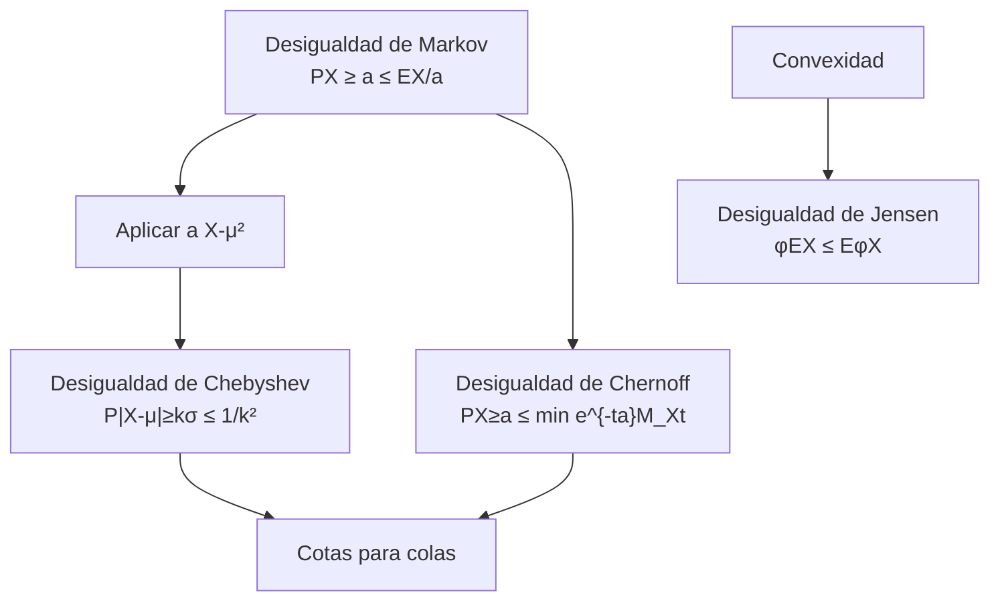

# Probabilidad I - Momentos de Variables Aleatorias

## 3.4 Desigualdades, incluyendo las de Tchebyshev, Jensen, Markov, Chernoff.

---

Las **desigualdades probabilísticas** son herramientas fundamentales en teoría de probabilidad que proporcionan cotas superiores e inferiores para probabilidades y valores esperados, incluso cuando la distribución completa es desconocida. Son esenciales para análisis de colas, teoremas límite y aplicaciones en estadística, machine learning y finanzas.

### 1. Desigualdad de Markov

#### Enunciado

Para cualquier variable aleatoria **no negativa** $X$ y cualquier $a > 0$:

$$P(X \geq a) \leq \frac{E[X]}{a}$$

#### Demostración (caso continuo)

$$E[X] = \int_{0}^{\infty} x f(x) dx \geq \int_{a}^{\infty} x f(x) dx \geq a \int_{a}^{\infty} f(x) dx = a P(X \geq a)$$

#### Ejemplo

Si el tiempo promedio de espera es 10 minutos:

$$P(\text{espera} \geq 30) \leq \frac{10}{30} = \frac{1}{3}$$

### 2. Desigualdad de Chebyshev (Tchebyshev)

#### Enunciado

Para cualquier variable aleatoria $X$ con media $\mu$ y varianza $\sigma^2$, y cualquier $k > 0$:

$$P(|X - \mu| \geq k\sigma) \leq \frac{1}{k^2}$$

#### Relación con Markov

Se deriva aplicando Markov a $Y = (X - \mu)^2$ con $a = k^2\sigma^2$:

$$P(|X - \mu| \geq k\sigma) = P((X - \mu)^2 \geq k^2\sigma^2) \leq \frac{E[(X - \mu)^2]}{k^2\sigma^2} = \frac{1}{k^2}$$

#### Ejemplo

Para $k = 2$:

$$P(|X - \mu| \geq 2\sigma) \leq \frac{1}{4} = 0.25$$

### 3. Desigualdad de Jensen

#### Enunciado

Para cualquier variable aleatoria $X$ y función **convexa** $\varphi$:

$$\varphi(E[X]) \leq E[\varphi(X)]$$

Para funciones **cóncavas**, la desigualdad se invierte.

#### Funciones convexas comunes

- $\varphi(x) = x^2$ (convexa)
- $\varphi(x) = e^x$ (convexa)
- $\varphi(x) = \log(x)$ (cóncava)

#### Ejemplo

Por Jensen:

$$(E[X])^2 \leq E[X^2]$$

que equivale a $\text{Var}(X) = E[X^2] - (E[X])^2 \geq 0$

### 4. Desigualdad de Chernoff

#### Enunciado

Para una variable aleatoria $X$ y cualquier $t > 0$:

$$P(X \geq a) \leq \min_{t > 0} \frac{E[e^{tX}]}{e^{ta}}$$

#### Aplicación a sumas

Para $S_n = X_1 + \cdots + X_n$ con $X_i$ i.i.d.:

$$P(S_n \geq na) \leq \min_{t > 0} \left[ e^{-ta} M_X(t) \right]^n$$

donde $M_X(t)$ es la función generadora de momentos.

#### Ventaja

Proporciona cotas exponencialmente decrecientes, más ajustadas que Chebyshev.

### 5. Diagrama de relaciones entre desigualdades



### 6. Implementación computacional

```python
import numpy as np
import matplotlib.pyplot as plt
from scipy.stats import norm

# Configuración
np.random.seed(42)
mu, sigma = 0, 1
n_samples = 10000
X = np.random.normal(mu, sigma, n_samples)

# Desigualdad de Chebyshev
def chebyshev_bound(k):
    return 1 / (k**2)

# Probabilidad real (distribución normal)
def actual_probability_normal(k, mu=0, sigma=1):
    return 2 * (1 - norm.cdf(k, loc=mu, scale=sigma))

# Visualización
k_values = np.linspace(1, 3, 50)
chebyshev_bounds = [chebyshev_bound(k) for k in k_values]
actual_probs = [actual_probability_normal(k, mu, sigma) for k in k_values]

plt.figure(figsize=(10, 6))
plt.plot(k_values, chebyshev_bounds, 'r-', label='Cota de Chebyshev: $1/k^2$')
plt.plot(k_values, actual_probs, 'b-', label='Probabilidad real (Normal)')
plt.fill_between(k_values, 0, chebyshev_bounds, alpha=0.2, color='red')
plt.fill_between(k_values, 0, actual_probs, alpha=0.2, color='blue')
plt.xlabel('k')
plt.ylabel('Probabilidad')
plt.title('Comparación: Desigualdad de Chebyshev vs. Probabilidad Real')
plt.legend()
plt.grid(True, alpha=0.3)
plt.show()

# Análisis de la cota
print("Análisis de la desigualdad de Chebyshev:")
for k in [1, 2, 3]:
    cheby_bound = chebyshev_bound(k)
    actual_prob = actual_probability_normal(k, mu, sigma)
    print(f"k = {k}: Chebyshev ≤ {cheby_bound:.4f}, Real = {actual_prob:.4f}")
```

### 7. Ejemplos detallados

#### Ejemplo 1: Aplicación de Markov

Sea $X$ el ingreso mensual (en miles) con $E[X] = 2.5$. Estimar la probabilidad de que alguien gane más de 10 mil:

$$P(X \geq 10) \leq \frac{2.5}{10} = 0.25$$

#### Ejemplo 2: Aplicación de Chebyshev

Examen con media $\mu = 70$ y desviación $\sigma = 10$. Probabilidad de score fuera de [50, 90]:

$$P(|X - 70| \geq 20) = P(|X - 70| \geq 2\sigma) \leq \frac{1}{4} = 0.25$$

#### Ejemplo 3: Aplicación de Jensen

Sea $X$ positiva con $E[X] = 3$. Por Jensen:

$$E[\log(X)] \leq \log(E[X]) = \log(3)$$

### 8. Ejercicios propuestos

1. **Markov**: El número promedio de errores por página es 2.
   - Acotar la probabilidad de que una página tenga al menos 8 errores.
   - ¿Es útil esta cota si queremos probabilidad de al menos 1 error?

2. **Chebyshev**: Variable con $\mu = 100$, $\sigma = 15$.
   - Encontrar intervalo que contenga al menos 75% de valores.
   - Acotar $P(|X - 100| \geq 30)$

3. **Jensen**: Para $X > 0$ con $E[X] = 4$.
   - Demostrar que $E[1/X] \geq 1/4$
   - Probar que $E[\sqrt{X}] \leq 2$

4. **Chernoff**: Para $X \sim \text{Binomial}(n, p)$:
   - Usar Chernoff para acotar $P(X \geq (1+\delta)np)$
   - Comparar con Chebyshev para $n=100$, $p=0.3$, $\delta=0.5$

5. **Integración**: Para $X$ con $E[X] = 5$, $\text{Var}(X) = 4$:
   - Acotar $P(X \leq 0)$ usando ambas desigualdades
   - Discutir qué cota es más ajustada

### 9. Aplicaciones prácticas

1. **Control de calidad**: Cotas para proporción de defectuosos.

2. **Finanzas**: Valor en riesgo (VaR) usando desigualdades.

3. **Machine Learning**:
   - Generalización con desigualdades PAC
   - Análisis de algoritmos de aprendizaje

4. **Teoría de información**:
   - Desigualdad de Jensen en divergencia de KL
   - Cotas para probabilidad de error

### 10. Referencias bibliográficas

1. **Textos principales**:
   - Ross, S. M. (2019). "A First Course in Probability". Pearson. (Capítulo 8)
   - Mitzenmacher, M. & Upfal, E. (2017). "Probability and Computing". Cambridge University Press. (Capítulo 4)

2. **Para profundización**:
   - Boucheron, S., Lugosi, G., & Massart, P. (2013). "Concentration Inequalities". Oxford University Press.
   - Vershynin, R. (2018). "High-Dimensional Probability". Cambridge University Press.

3. **Recursos en línea**:
   - MIT OpenCourseWare: "Introduction to Probability"
   - Stanford CS229: "Probability Theory Review"
