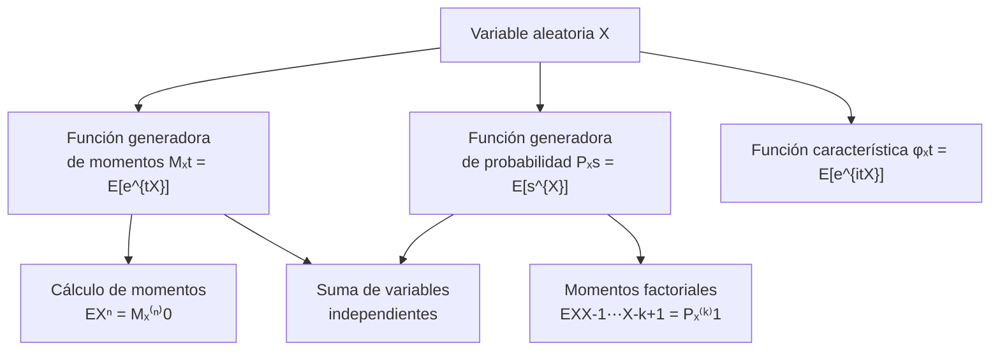

# Probabilidad I - Momentos de Variables Aleatorias

## 3.5 Funciones Generadoras: Función generadora de momentos, función generadora de momentos factoriales (para variables aleatorias con valores en los naturales) y aplicaciones.

---

Las **funciones generadoras** son herramientas poderosas en teoría de probabilidad que encapsulan toda la información sobre una distribución de probabilidad. Transforman problemas de probabilidad en problemas algebraicos o analíticos, facilitando el cálculo de momentos, la determinación de distribuciones y el análisis de sumas de variables aleatorias.

### 1. Función Generadora de Momentos (MGF)

#### Definición

La **función generadora de momentos** (MGF) de una variable aleatoria $X$ se define como:

$$ M_X(t) = E[e^{tX}] = \begin{cases} \sum_{x} e^{tx} p(x) & \text{(discreta)} \\ \int_{-\infty}^{\infty} e^{tx} f(x) dx & \text{(continua)} \end{cases} $$

#### Propiedades fundamentales
1. **Unicidad**: Si $M_X(t) = M_Y(t)$ en un intervalo alrededor de 0, entonces $X$ y $Y$ tienen la misma distribución.
2. **Momentos**: $E[X^n] = M_X^{(n)}(0) = \frac{d^n}{dt^n}M_X(t)\big|_{t=0}$
3. **Transformaciones**: $M_{aX+b}(t) = e^{bt}M_X(at)$
4. **Independencia**: Si $X$ e $Y$ son independientes, $M_{X+Y}(t) = M_X(t)M_Y(t)$

#### Ejemplo: Distribución exponencial

Para $X \sim \text{Exp}(\lambda)$ con $f(x) = \lambda e^{-\lambda x}$ para $x \geq 0:$

$$ M_X(t) = \int_{0}^{\infty} e^{tx} \lambda e^{-\lambda x} dx = \lambda \int_{0}^{\infty} e^{-(\lambda - t)x} dx = \frac{\lambda}{\lambda - t}, \quad t < \lambda $$

### 2. Función Generadora de Momentos Factoriales

#### Definición
Para variables aleatorias con valores en los naturales, la **función generadora de momentos factoriales** se define como:

$$G_X(s) = E[s^X] = \sum_{k=0}^{\infty} s^k P(X = k)$$

#### Relación con momentos factoriales
Los **momentos factoriales** son $E[X(X-1)\cdots(X-k+1)] = G_X^{(k)}(1)$

#### Ejemplo: Distribución Poisson
Para $X \sim \text{Poisson}(\lambda):$

$$G_X(s) = \sum_{k=0}^{\infty} s^k \frac{e^{-\lambda} \lambda^k}{k!} = e^{-\lambda} \sum_{k=0}^{\infty} \frac{(\lambda s)^k}{k!} = e^{-\lambda} e^{\lambda s} = e^{\lambda(s-1)}$$

### 3. Función Generadora de Probabilidad (PGF)

#### Definición (caso discreto)
Para variables aleatorias discretas en enteros no negativos:

$$P_X(s) = E[s^X] = \sum_{k=0}^{\infty} s^k P(X = k)$$

#### Relación con MGF

$$M_X(t) = E[e^{tX}] = P_X(e^t)$$

$$P_X(s) = M_X(\ln s)$$

### 4. Diagrama conceptual de relaciones



### 5. Aplicaciones importantes

#### Cálculo de momentos
Para $X \sim \text{Poisson}(\lambda)$ con $M_X(t) = e^{\lambda(e^t - 1)}:$

$$M_X'(t) = \lambda e^t e^{\lambda(e^t - 1)} \Rightarrow E[X] = M_X'(0) = \lambda$$

$$M_X''(t) = (\lambda e^t + \lambda^2 e^{2t}) e^{\lambda(e^t - 1)} \Rightarrow E[X^2] = M_X''(0) = \lambda + \lambda^2$$

#### Suma de variables independientes
Si $X_1, \ldots, X_n$ son i.i.d. con MGF $M_X(t),$ entonces:

$$M_{S_n}(t) = [M_X(t)]^n$$

#### Determinación de distribuciones
Si $M_X(t) = \left(\frac{p}{1 - (1-p)e^t}\right)^r$ para $t < -\ln(1-p),$ entonces $X \sim \text{Binomial Negativa}(r, p).$

### 6. Implementación computacional

```python
import numpy as np
import matplotlib.pyplot as plt
from scipy.stats import poisson, expon, binom

# Configuración
np.random.seed(42)

# Función para calcular MGF empíricamente
def empirical_mgf(data, t_values):
    """Calcula la MGF empírica para valores de t dados"""
    mgf_values = []
    for t in t_values:
        mgf_values.append(np.mean(np.exp(t * data)))
    return np.array(mgf_values)

# Generar datos de diferentes distribuciones
n_samples = 10000
lambda_poisson = 3
lambda_exp = 0.5
n_binom, p_binom = 10, 0.4

# Datos
poisson_data = poisson.rvs(mu=lambda_poisson, size=n_samples)
exp_data = expon.rvs(scale=1/lambda_exp, size=n_samples)
binom_data = binom.rvs(n=n_binom, p=p_binom, size=n_samples)

# Valores de t para evaluar MGF
t_values = np.linspace(-1, 0.9, 100)

# Calcular MGF empíricas y teóricas
mgf_poisson_emp = empirical_mgf(poisson_data, t_values)
mgf_poisson_theo = np.exp(lambda_poisson * (np.exp(t_values) - 1))

mgf_exp_emp = empirical_mgf(exp_data, t_values)
mgf_exp_theo = lambda_exp / (lambda_exp - t_values)

mgf_binom_emp = empirical_mgf(binom_data, t_values)
mgf_binom_theo = (1 - p_binom + p_binom * np.exp(t_values))**n_binom

# Visualización
plt.figure(figsize=(15, 5))

# Poisson
plt.subplot(1, 3, 1)
plt.plot(t_values, mgf_poisson_emp, 'b-', label='Empírica')
plt.plot(t_values, mgf_poisson_theo, 'r--', label='Teórica: $e^{\lambda(e^t - 1)}$')
plt.title(f'Poisson($\lambda={lambda_poisson}$)')
plt.xlabel('t')
plt.ylabel('MGF')
plt.legend()
plt.grid(True, alpha=0.3)

# Exponencial
plt.subplot(1, 3, 2)
plt.plot(t_values, mgf_exp_emp, 'b-', label='Empírica')
plt.plot(t_values, mgf_exp_theo, 'r--', label='Teórica: $\\frac{\lambda}{\lambda - t}$')
plt.title(f'Exponencial($\lambda={lambda_exp}$)')
plt.xlabel('t')
plt.ylabel('MGF')
plt.legend()
plt.grid(True, alpha=0.3)

# Binomial
plt.subplot(1, 3, 3)
plt.plot(t_values, mgf_binom_emp, 'b-', label='Empírica')
plt.plot(t_values, mgf_binom_theo, 'r--', label='Teórica: $(1-p + pe^t)^n$')
plt.title(f'Binomial(n={n_binom}, p={p_binom})')
plt.xlabel('t')
plt.ylabel('MGF')
plt.legend()
plt.grid(True, alpha=0.3)

plt.tight_layout()
plt.show()

# Cálculo de momentos usando MGF
def calculate_moments_from_mgf(mgf_func, n_moments=3, t0=0):
    """Calcula momentos derivando la MGF numéricamente"""
    from scipy.misc import derivative
    moments = []
    for n in range(1, n_moments+1):
        # Derivada n-ésima en t=0
        moment_n = derivative(mgf_func, t0, n=n, dx=1e-5, order=2*n+1)
        moments.append(moment_n)
    return moments

# Ejemplo para Poisson
def mgf_poisson(t):
    return np.exp(lambda_poisson * (np.exp(t) - 1))

poisson_moments = calculate_moments_from_mgf(mgf_poisson)
print(f"Momentos de Poisson(λ={lambda_poisson}):")
for i, moment in enumerate(poisson_moments, 1):
    print(f"E[X^{i}] = {moment:.4f}")
```

### 7. Ejemplos detallados

#### Ejemplo 1: Distribución Bernoulli
Para $X \sim \text{Bernoulli}(p):$

$$M_X(t) = E[e^{tX}] = e^{t \cdot 1}p + e^{t \cdot 0}(1-p) = pe^t + (1-p)$$

$$P_X(s) = E[s^X] = s^1p + s^0(1-p) = ps + (1-p)$$

#### Ejemplo 2: Distribución Normal
Para $X \sim N(\mu, \sigma^2):$

$$M_X(t) = e^{\mu t + \frac{1}{2}\sigma^2 t^2}$$

#### Ejemplo 3: Suma de variables Poisson
Si $X \sim \text{Poisson}(\lambda),$ $Y \sim \text{Poisson}(\mu)$ independientes:

$$M_{X+Y}(t) = M_X(t)M_Y(t) = e^{\lambda(e^t - 1)} e^{\mu(e^t - 1)} = e^{(\lambda + \mu)(e^t - 1)}$$

∴ $X + Y \sim \text{Poisson}(\lambda + \mu)$

### 8. Ejercicios propuestos

1. Para $X \sim \text{Geométrica}(p)$ con $P(X = k) = (1-p)^{k-1}p$ para $k = 1, 2, \ldots:$
   - Encuentre $M_X(t)$ y $P_X(s)$
   - Calcule $E[X]$ y $\text{Var}(X)$ usando la MGF

2. Sea $X$ con MGF $M_X(t) = \frac{1}{2} e^t + \frac{1}{4} e^{2t} + \frac{1}{4} e^{3t}:$
   - Encuentre la distribución de $X$
   - Calcule $P(X \leq 2)$

3. Para $X \sim \text{Binomial}(n, p):$
   - Encuentre la MGF y PGF
   - Usando la PGF, calcule $E[X(X-1)]$
   - Relacione con $\text{Var}(X) = np(1-p)$

4. Demuestre que si $M_X(t)$ existe en un intervalo alrededor de 0, entonces:

   $$E[X^n] = \frac{d^n}{dt^n}M_X(t)\big|_{t=0}$$

5. Para variables independientes $X_1, \ldots, X_n$ con MGFs $M_{X_i}(t):$
   - Encuentre la MGF de $S_n = \sum_{i=1}^n X_i$
   - Aplique al caso $X_i \sim \text{Exp}(\lambda)$ i.i.d.

### 9. Aplicaciones avanzadas

#### Teorema del límite central
La MGF permite demostrar elegantemente el TLC mediante la expansión en series de Taylor.

#### Procesos estocásticos
Las funciones generadoras son esenciales en:
- Procesos de Poisson
- Cadenas de Markov
- Procesos de ramificación

#### Teoría de la información
La función generadora de cumulantes $\kappa(t) = \ln M_X(t)$ proporciona información sobre:
- Sesgo (skewness)
- Curtosis
- Entropía

### 10. Referencias bibliográficas

1. **Textos principales**:
   - Ross, S. M. (2019). "A First Course in Probability". Pearson. (Capítulo 7)
   - Casella, G., & Berger, R. L. (2002). "Statistical Inference". Duxbury. (Capítulo 2)

2. **Para profundización**:
   - Feller, W. (1968). "An Introduction to Probability Theory and Its Applications". Wiley.
   - Billingsley, P. (1995). "Probability and Measure". Wiley.

3. **Recursos en línea**:
   - MIT OpenCourseWare: "Introduction to Probability"
   - Stanford STATS 116: "Probability Theory"
