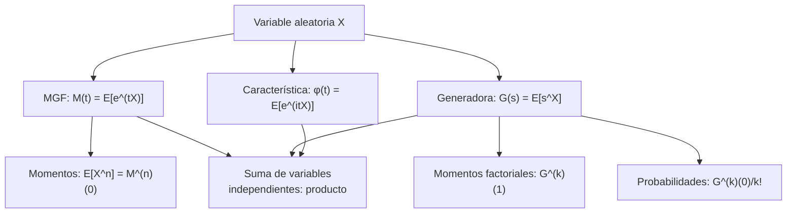

# Probabilidad I - Momentos de Variables Aleatorias

## 3.5 Funciones Generadoras: Función generadora de momentos, función generadora de momentos factoriales (para variables aleatorias con valores en los naturales) y aplicaciones.

---

Las **funciones generadoras** son herramientas poderosas en teoría de probabilidad que encapsulan toda la información sobre una distribución de probabilidad. Transforman problemas de probabilidad en problemas algebraicos o analíticos, facilitando el cálculo de momentos, la determinación de distribuciones y el análisis de sumas de variables aleatorias.

### 1. Función Generadora de Momentos (MGF)

#### Definición

La **función generadora de momentos** (MGF) de una variable aleatoria $X$ se define como:

$$ M_X(t) = E[e^{tX}] = \begin{cases} \sum_{x} e^{tx} p(x) & \text{(discreta)} \\ \int_{-\infty}^{\infty} e^{tx} f(x) \, dx & \text{(continua)} \end{cases} $$

para los $t$ donde la esperanza es finita. Siempre $M_X(0) = 1,$ pero puede ocurrir que $M_X(t) = \infty$ para todo $t \neq 0,$ como para la Cauchy o la log-normal; las propiedades siguientes suponen que $M_X$ es finita en un intervalo abierto alrededor de 0.

#### Propiedades fundamentales

1. **Unicidad**: Si $M_X(t) = M_Y(t)$ en un intervalo alrededor de 0, entonces $X$ y $Y$ tienen la misma distribución.
2. **Momentos**: $E[X^n] = M_X^{(n)}(0) = \frac{d^n}{dt^n}M_X(t)\big|_{t=0}$
3. **Transformaciones**: $M_{aX+b}(t) = e^{bt}M_X(at)$
4. **Independencia**: Si $X$ y $Y$ son independientes, $M_{X+Y}(t) = M_X(t)M_Y(t)$

La propiedad 2 se obtiene derivando $E[e^{tX}]$ dentro de la esperanza: $\frac{d^n}{dt^n}e^{tX} = X^ne^{tX},$ que en $t = 0$ vale $X^n$ (ejercicio 4). La propiedad 4 se debe a que $e^{t(X+Y)} = e^{tX}e^{tY}$ y la esperanza de un producto de variables independientes es el producto de las esperanzas. Esta última es la razón principal para usar funciones generadoras: la distribución de una suma de independientes requiere una convolución (tema 4.3), mientras que su MGF es un simple producto.

#### Ejemplo: Distribución exponencial

Para $X \sim \text{Exp}(\lambda)$ con $f(x) = \lambda e^{-\lambda x}$ para $x \geq 0:$

$$ M_X(t) = \int_{0}^{\infty} e^{tx} \lambda e^{-\lambda x} \, dx = \lambda \int_{0}^{\infty} e^{-(\lambda - t)x} \, dx = \frac{\lambda}{\lambda - t}, \quad t < \lambda $$

Para $t \geq \lambda$ la integral diverge. Desarrollando, $\frac{\lambda}{\lambda - t} = \frac{1}{1 - t/\lambda} = \sum_{k \geq 0}\frac{t^k}{\lambda^k},$ y comparando con $\sum_k \frac{E[X^k]}{k!}t^k$ se leen todos los momentos de una vez: $E[X^k] = \frac{k!}{\lambda^k}.$

### 2. Función Generadora de Momentos Factoriales

#### Definición

Para variables aleatorias con valores en los naturales $\{0, 1, 2, \dots\},$ la **función generadora de momentos factoriales** se define como:

$$ G_X(s) = E[s^X] = \sum_{k=0}^{\infty} s^k P(X = k) $$

La serie converge al menos para $|s| \leq 1,$ porque sus coeficientes son probabilidades que suman 1; por eso, a diferencia de la MGF, **siempre existe** en ese intervalo, y $G_X(1) = 1.$ Es la misma función que se conoce como **función generadora de probabilidad** (PGF); los dos nombres corresponden a los dos usos que se le dan, según se derive en $s = 1$ o en $s = 0.$

#### Relación con momentos factoriales

Derivando $k$ veces dentro de la serie, $G_X^{(k)}(s) = \sum_{j \geq k} j(j-1)\cdots(j-k+1)\,s^{j-k}P(X = j),$ y evaluando en $s = 1$ se obtienen los **momentos factoriales**:

$$ G_X^{(k)}(1) = E[X(X-1)\cdots(X-k+1)] $$

En particular, $E[X] = G_X'(1)$ y $E[X(X-1)] = G_X''(1),$ de donde

$$ \text{Var}(X) = G_X''(1) + G_X'(1) - (G_X'(1))^2 $$

Para variables enteras, los momentos factoriales suelen ser mucho más fáciles de calcular que los ordinarios, porque los factores $j(j-1)\cdots$ se cancelan con factoriales en las fórmulas de las probabilidades.

#### Relación con las probabilidades

Evaluando las mismas derivadas en $s = 0$ se recuperan las probabilidades, como coeficientes de una serie de Taylor:

$$ P(X = k) = \frac{G_X^{(k)}(0)}{k!} $$

así que $G_X$ determina la distribución de $X.$

#### Ejemplo: Distribución Poisson

Para $X \sim \text{Poisson}(\lambda):$

$$ G_X(s) = \sum_{k=0}^{\infty} s^k \frac{e^{-\lambda} \lambda^k}{k!} = e^{-\lambda} \sum_{k=0}^{\infty} \frac{(\lambda s)^k}{k!} = e^{-\lambda} e^{\lambda s} = e^{\lambda(s-1)} $$

Sus derivadas son $G_X^{(k)}(s) = \lambda^k e^{\lambda(s-1)},$ así que los momentos factoriales son $E[X(X-1)\cdots(X-k+1)] = \lambda^k.$ De ahí $E[X] = \lambda$ y $\text{Var}(X) = \lambda^2 + \lambda - \lambda^2 = \lambda,$ sin calcular ninguna serie.

### 3. Relación entre las funciones generadoras

Para variables con valores enteros no negativos,

$$ M_X(t) = E[e^{tX}] = G_X(e^t), \qquad G_X(s) = M_X(\ln s) \quad (s > 0) $$

Y para cualquier variable, la **función característica** $\varphi_X(t) = E[e^{itX}] = M_X(it)$ existe siempre, porque $|e^{itX}| = 1;$ es la herramienta que se usa cuando la MGF no existe, como para la distribución de Cauchy, cuya función característica es $e^{-|t|}.$

| Función | Definición | Existe | Derivadas dan |
| --- | --- | --- | --- |
| MGF | $E[e^{tX}]$ | si es finita cerca de 0 | momentos $E[X^k]$ en $t = 0$ |
| Generadora de probabilidad / factorial | $E[s^X]$ | siempre, en $\lvert s \rvert \leq 1$ (valores enteros) | probabilidades en $s = 0,$ momentos factoriales en $s = 1$ |
| Característica | $E[e^{itX}]$ | siempre | $i^k E[X^k]$ en $t = 0,$ si el momento existe |

### 4. Diagrama conceptual de relaciones



### 5. Aplicaciones importantes

#### Cálculo de momentos

Para $X \sim \text{Poisson}(\lambda)$ con $M_X(t) = G_X(e^t) = e^{\lambda(e^t - 1)}:$

$$ M_X'(t) = \lambda e^t e^{\lambda(e^t - 1)} \quad \Rightarrow \quad E[X] = M_X'(0) = \lambda $$

$$ M_X''(t) = (\lambda e^t + \lambda^2 e^{2t}) e^{\lambda(e^t - 1)} \quad \Rightarrow \quad E[X^2] = M_X''(0) = \lambda + \lambda^2 $$

#### Suma de variables independientes

Si $X_1, \ldots, X_n$ son independientes e idénticamente distribuidas con MGF $M_X(t)$ y $S_n = X_1 + \cdots + X_n,$ entonces:

$$ M_{S_n}(t) = [M_X(t)]^n $$

Por ejemplo, una $\text{Bin}(n, p)$ es la suma de $n$ Bernoulli independientes, así que $M(t) = (1 - p + pe^t)^n$ y $G(s) = (1 - p + ps)^n.$ Y la suma de $\text{Bin}(n, p)$ y $\text{Bin}(m, p)$ independientes es $\text{Bin}(n + m, p),$ porque el producto de sus MGF es $(1 - p + pe^t)^{n + m}.$

#### Determinación de distribuciones

Si $M_X(t) = \left(\frac{pe^t}{1 - (1-p)e^t}\right)^r$ para $t < -\ln(1-p),$ entonces $X$ tiene distribución binomial negativa con parámetros $r$ y $p,$ contando el número de **ensayos** hasta el éxito $r$ (tema 2.3): es la MGF de una geométrica elevada a la $r,$ porque $X$ es la suma de $r$ geométricas independientes. Si $X$ cuenta los **fracasos** antes del éxito $r,$ se quita el factor $e^t$ del numerador, porque $X - r$ tiene MGF $e^{-rt}M_X(t).$

### 6. Implementación computacional

```python
import numpy as np
import sympy as sp
import matplotlib
matplotlib.use("Agg")
import matplotlib.pyplot as plt
from scipy.stats import poisson, expon, binom

# Configuración
np.random.seed(42)

# Función para calcular MGF empíricamente
def empirical_mgf(data, t_values):
    """Calcula la MGF empírica para valores de t dados"""
    mgf_values = []
    for t in t_values:
        mgf_values.append(np.mean(np.exp(t * data)))
    return np.array(mgf_values)

# Generar datos de diferentes distribuciones
n_samples = 10000
lambda_poisson = 3
lambda_exp = 0.5
n_binom, p_binom = 10, 0.4

# Datos
poisson_data = poisson.rvs(mu=lambda_poisson, size=n_samples)
exp_data = expon.rvs(scale=1/lambda_exp, size=n_samples)
binom_data = binom.rvs(n=n_binom, p=p_binom, size=n_samples)

# Valores de t para evaluar MGF: deben quedar por debajo de lambda_exp = 0.5,
# porque la MGF de la exponencial es infinita para t >= lambda
t_values = np.linspace(-1, 0.2, 100)

# Calcular MGF empíricas y teóricas
mgf_poisson_emp = empirical_mgf(poisson_data, t_values)
mgf_poisson_theo = np.exp(lambda_poisson * (np.exp(t_values) - 1))

mgf_exp_emp = empirical_mgf(exp_data, t_values)
mgf_exp_theo = lambda_exp / (lambda_exp - t_values)

mgf_binom_emp = empirical_mgf(binom_data, t_values)
mgf_binom_theo = (1 - p_binom + p_binom * np.exp(t_values))**n_binom

# Visualización
plt.figure(figsize=(15, 5))

# Poisson
plt.subplot(1, 3, 1)
plt.plot(t_values, mgf_poisson_emp, 'b-', label='Empírica')
plt.plot(t_values, mgf_poisson_theo, 'r--', label=r'Teórica: $e^{\lambda(e^t - 1)}$')
plt.title(rf'Poisson($\lambda={lambda_poisson}$)')
plt.xlabel('t')
plt.ylabel('MGF')
plt.legend()
plt.grid(True, alpha=0.3)

# Exponencial
plt.subplot(1, 3, 2)
plt.plot(t_values, mgf_exp_emp, 'b-', label='Empírica')
plt.plot(t_values, mgf_exp_theo, 'r--', label=r'Teórica: $\frac{\lambda}{\lambda - t}$')
plt.title(rf'Exponencial($\lambda={lambda_exp}$)')
plt.xlabel('t')
plt.ylabel('MGF')
plt.legend()
plt.grid(True, alpha=0.3)

# Binomial
plt.subplot(1, 3, 3)
plt.plot(t_values, mgf_binom_emp, 'b-', label='Empírica')
plt.plot(t_values, mgf_binom_theo, 'r--', label='Teórica: $(1-p + pe^t)^n$')
plt.title(f'Binomial(n={n_binom}, p={p_binom})')
plt.xlabel('t')
plt.ylabel('MGF')
plt.legend()
plt.grid(True, alpha=0.3)

plt.tight_layout()
plt.savefig("mgf.png", dpi=90)

# Cálculo de momentos derivando la MGF de forma simbólica (exacta) con sympy
t, lam = sp.symbols("t lambda", positive=True)
M_poisson = sp.exp(lam * (sp.exp(t) - 1))
for k in range(1, 4):
    momento = sp.expand(sp.diff(M_poisson, t, k).subs(t, 0))
    print(f"E[X^{k}] =", momento, "=", momento.subs(lam, lambda_poisson))
# E[X^1] = lambda, E[X^2] = lambda**2 + lambda, E[X^3] = lambda**3 + 3*lambda**2 + lambda

# Momentos factoriales con la generadora G(s) = exp(lambda (s - 1))
s = sp.symbols("s")
G = sp.exp(lam * (s - 1))
print([sp.simplify(sp.diff(G, s, k).subs(s, 1)) for k in range(1, 4)])   # [lambda, lambda**2, lambda**3]
```

La MGF empírica $\frac{1}{n}\sum_i e^{tX_i}$ se acerca a la teórica para $t$ cerca de 0, pero se vuelve inestable al acercarse a la frontera donde la MGF deja de existir: con la exponencial de tasa 0.5, para $t$ cerca de 0.5 un solo dato grande domina el promedio. Las derivadas se calculan de forma simbólica con `sympy`; la función `scipy.misc.derivative` que se usaba antes para hacerlo numéricamente fue eliminada de scipy.

### 7. Ejemplos detallados

#### Ejemplo 1: Distribución Bernoulli
Para $X \sim \text{Bernoulli}(p):$

$$ M_X(t) = E[e^{tX}] = e^{t \cdot 1}p + e^{t \cdot 0}(1-p) = pe^t + (1-p) $$

$$ G_X(s) = E[s^X] = s^1p + s^0(1-p) = ps + (1-p) $$

#### Ejemplo 2: Distribución Normal
Para $X \sim N(\mu, \sigma^2):$

$$ M_X(t) = e^{\mu t + \frac{1}{2}\sigma^2 t^2} $$

*Demostración para la normal estándar.* Completando el cuadrado, $tx - \frac{x^2}{2} = \frac{t^2}{2} - \frac{(x - t)^2}{2},$ así que

$$ M_Z(t) = \int_{-\infty}^{\infty}\frac{1}{\sqrt{2\pi}}e^{tx - x^2/2}\,dx = e^{t^2/2}\int_{-\infty}^{\infty}\frac{1}{\sqrt{2\pi}}e^{-(x-t)^2/2}\,dx = e^{t^2/2} $$

porque la última integral es la de una densidad normal con media $t.$ Para $X = \mu + \sigma Z$ se usa la propiedad 3: $M_X(t) = e^{\mu t}M_Z(\sigma t).$ $\blacksquare$ En consecuencia, la suma de normales independientes es normal: $e^{\mu_1 t + \sigma_1^2t^2/2}e^{\mu_2 t + \sigma_2^2t^2/2}$ es la MGF de $N(\mu_1 + \mu_2, \sigma_1^2 + \sigma_2^2).$

#### Ejemplo 3: Suma de variables Poisson
Si $X \sim \text{Poisson}(\lambda),$ $Y \sim \text{Poisson}(\mu)$ independientes:

$$ M_{X+Y}(t) = M_X(t)M_Y(t) = e^{\lambda(e^t - 1)} e^{\mu(e^t - 1)} = e^{(\lambda + \mu)(e^t - 1)} $$

Por la unicidad, $X + Y \sim \text{Poisson}(\lambda + \mu).$ Si las llamadas de dos centrales independientes son Poisson, el total también lo es, con la suma de las tasas.

### 8. Ejercicios propuestos

1. Para $X \sim \text{Geométrica}(p)$ con $P(X = k) = (1-p)^{k-1}p$ para $k = 1, 2, \ldots:$
   - Encuentre $M_X(t)$ y $G_X(s)$
   - Calcule $E[X]$ y $\text{Var}(X)$ usando la MGF

2. Sea $X$ con MGF $M_X(t) = \frac{1}{2} e^t + \frac{1}{4} e^{2t} + \frac{1}{4} e^{3t}:$
   - Encuentre la distribución de $X$
   - Calcule $P(X \leq 2)$

3. Para $X \sim \text{Binomial}(n, p):$
   - Encuentre la MGF y PGF
   - Usando la PGF, calcule $E[X(X-1)]$
   - Relacione con $\text{Var}(X) = np(1-p)$

4. Demuestre que si $M_X(t)$ existe en un intervalo alrededor de 0, entonces:

   $$E[X^n] = \frac{d^n}{dt^n}M_X(t)\big|_{t=0}$$

5. Para variables independientes $X_1, \ldots, X_n$ con MGFs $M_{X_i}(t):$
   - Encuentre la MGF de $S_n = \sum_{i=1}^n X_i$
   - Aplique al caso $X_i \sim \text{Exp}(\lambda)$ i.i.d.

### Soluciones

**Ejercicio 1.** $G_X(s) = \sum_{k \geq 1}s^k(1-p)^{k-1}p = ps\sum_{j \geq 0}((1-p)s)^j = \frac{ps}{1 - (1-p)s}$ para $|s| < \frac{1}{1-p},$ y $M_X(t) = G_X(e^t) = \frac{pe^t}{1 - (1-p)e^t}$ para $t < -\ln(1-p).$ Derivando $G$ es más cómodo: $G'(s) = \frac{p}{(1 - (1-p)s)^2}$ y $G''(s) = \frac{2p(1-p)}{(1 - (1-p)s)^3},$ así que $E[X] = G'(1) = \frac{1}{p}$ y $E[X(X-1)] = G''(1) = \frac{2(1-p)}{p^2}.$ Entonces $\text{Var}(X) = \frac{2(1-p)}{p^2} + \frac{1}{p} - \frac{1}{p^2} = \frac{1-p}{p^2}.$

**Ejercicio 2.** Una MGF de la forma $\sum_k p_k e^{tx_k}$ corresponde a la variable que vale $x_k$ con probabilidad $p_k;$ por la unicidad, $P(X = 1) = \frac{1}{2},$ $P(X = 2) = \frac{1}{4},$ $P(X = 3) = \frac{1}{4},$ y $P(X \leq 2) = \frac{3}{4}.$

**Ejercicio 3.** $M_X(t) = (1 - p + pe^t)^n$ y $G_X(s) = (1 - p + ps)^n.$ Como $G''(s) = n(n-1)p^2(1 - p + ps)^{n-2},$ $E[X(X-1)] = G''(1) = n(n-1)p^2.$ Con $E[X] = np,$

$$ \text{Var}(X) = n(n-1)p^2 + np - n^2p^2 = np - np^2 = np(1-p) $$

**Ejercicio 4.** Si $M_X$ es finita en $(-h, h),$ se puede intercambiar esperanza y serie: $M_X(t) = E\left[\sum_{k \geq 0}\frac{(tX)^k}{k!}\right] = \sum_{k \geq 0}\frac{E[X^k]}{k!}t^k$ para $|t| < h.$ El intercambio se justifica porque $\sum_k \frac{|tX|^k}{k!} = e^{|tX|} \leq e^{tX} + e^{-tX},$ que tiene esperanza finita. Una serie de potencias es derivable término a término dentro de su intervalo de convergencia, y su derivada de orden $n$ en 0 es $n!$ veces el coeficiente de $t^n,$ es decir $E[X^n].$ $\blacksquare$

**Ejercicio 5.** Por independencia, $M_{S_n}(t) = \prod_{i=1}^n M_{X_i}(t).$ Para exponenciales, $M_{S_n}(t) = \left(\frac{\lambda}{\lambda - t}\right)^n,$ que es la MGF de la distribución $\text{Gamma}(n, \lambda)$ (tema 2.4). Así se demuestra que la suma de $n$ exponenciales independientes de tasa $\lambda,$ el tiempo hasta el evento $n$ de un proceso de Poisson, tiene densidad $\frac{\lambda^n x^{n-1}e^{-\lambda x}}{(n-1)!}.$

### 9. Aplicaciones avanzadas

#### Teorema del límite central

La MGF permite demostrar elegantemente el TLC mediante la expansión en series de Taylor: si $X_i$ tienen media 0, varianza 1 y MGF finita, la MGF de $\frac{S_n}{\sqrt{n}}$ es $M\left(\frac{t}{\sqrt{n}}\right)^n = \left(1 + \frac{t^2}{2n} + o\left(\frac{1}{n}\right)\right)^n \to e^{t^2/2},$ la MGF de la normal estándar (tema 4.4).

#### Procesos estocásticos
Las funciones generadoras son esenciales en:
- Procesos de Poisson
- Cadenas de Markov
- Procesos de ramificación

#### Cumulantes

La función generadora de cumulantes $K(t) = \ln M_X(t)$ tiene como coeficientes de Taylor los **cumulantes** $\kappa_n = K^{(n)}(0):$

- $\kappa_1 = \mu,$ la media
- $\kappa_2 = \sigma^2,$ la varianza
- $\kappa_3 = \mu_3,$ de donde la asimetría es $\frac{\kappa_3}{\kappa_2^{3/2}}$
- $\kappa_4 = \mu_4 - 3\sigma^4,$ de donde el exceso de curtosis es $\frac{\kappa_4}{\kappa_2^2}$

Como $\ln$ convierte productos en sumas, los cumulantes de una suma de variables independientes son la **suma** de los cumulantes. La normal es la única distribución con todos los cumulantes de orden mayor que 2 iguales a 0: su $K(t) = \mu t + \frac{\sigma^2t^2}{2}$ es un polinomio de grado 2. Para la Poisson, $K(t) = \lambda(e^t - 1)$ y todos los cumulantes valen $\lambda.$

### 10. Referencias bibliográficas

1. **Textos principales**:
   - Ross, S. M. (2019). "A First Course in Probability". Pearson. (Capítulo 7)
   - Casella, G., & Berger, R. L. (2002). "Statistical Inference". Duxbury. (Capítulo 2)

2. **Para profundización**:
   - Feller, W. (1968). "An Introduction to Probability Theory and Its Applications". Wiley.
   - Billingsley, P. (1995). "Probability and Measure". Wiley.

3. **Recursos en línea**:
   - MIT OpenCourseWare: "Introduction to Probability"
   - Stanford STATS 116: "Probability Theory"
