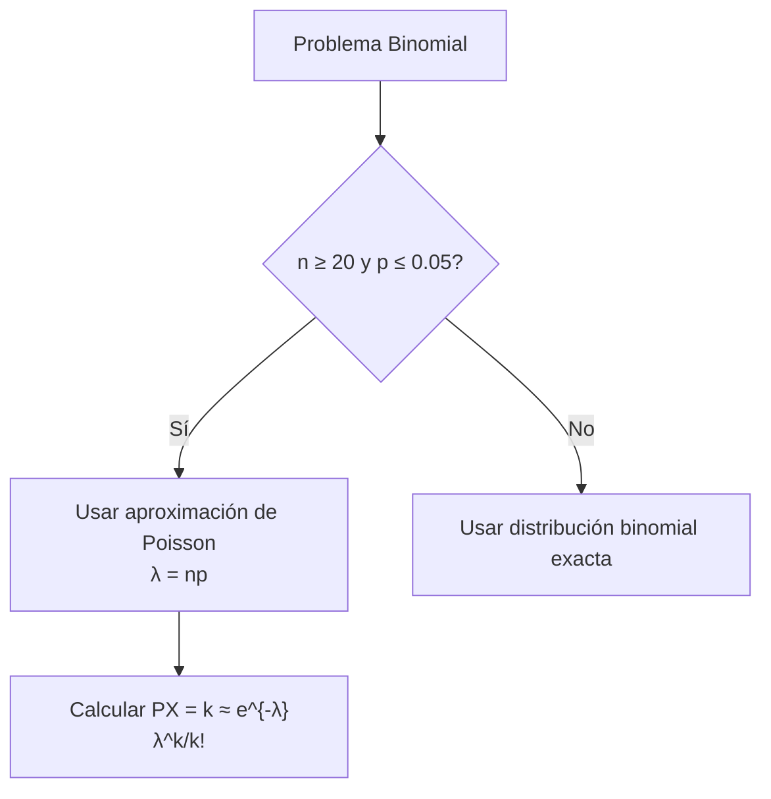

# Probabilidad I - Teoremas límite para sucesiones de variables aleatorias discretas

## 4.1 Aproximación Poisson a la Binomial.

---

La **aproximación de Poisson a la distribución binomial** es uno de los teoremas límite más importantes en probabilidad. Establece que cuando tenemos una distribución binomial con parámetros $n$ (número de ensayos) y $p$ (probabilidad de éxito), donde $n$ es grande y $p$ es pequeño, podemos aproximarla eficientemente mediante una distribución de Poisson.

### Definiciones Fundamentales

#### Distribución Binomial

Una variable aleatoria $X$ sigue una distribución binomial si:

$$P(X = k) = \binom{n}{k} p^k (1-p)^{n-k}, \quad k = 0, 1, 2, \ldots, n$$

#### Distribución de Poisson

Una variable aleatoria $Y$ sigue una distribución de Poisson si:

$$P(Y = k) = \frac{e^{-\lambda} \lambda^k}{k!}, \quad k = 0, 1, 2, \ldots$$

### Teorema de Aproximación Poisson-Binomial

**Teorema:** Sea $X_n \sim \text{Binomial}(n, p_n)$ tal que $\lim_{n \to \infty} np_n = \lambda > 0.$ Entonces:

$$\lim_{n \to \infty} P(X_n = k) = \frac{e^{-\lambda} \lambda^k}{k!}$$

#### Condiciones para la Aproximación

- $n \geq 20$
- $p \leq 0.05$
- $np \leq 7$ (regla práctica)

### Justificación Matemática

Para $X \sim \text{Binomial}(n, p)$ con $\lambda = np:$

$$P(X = k) = \binom{n}{k} p^k (1-p)^{n-k}$$

$$= \frac{n!}{k!(n-k)!} \left(\frac{\lambda}{n}\right)^k \left(1-\frac{\lambda}{n}\right)^{n-k}$$

Desarrollando el límite:

$$\lim_{n \to \infty} P(X = k) = \frac{\lambda^k}{k!} \lim_{n \to \infty} \frac{n!}{(n-k)!n^k} \left(1-\frac{\lambda}{n}\right)^n \left(1-\frac{\lambda}{n}\right)^{-k}$$

### Diagrama de Flujo: Cuándo Usar la Aproximación



### Ejemplos Resueltos

#### Ejemplo 1: Defectos en Manufactura

En una fábrica, la probabilidad de que un artículo sea defectuoso es 0.01. Si se producen 200 artículos, ¿cuál es la probabilidad de que haya exactamente 3 defectuosos?

**Solución:**

- $n = 200,$ $p = 0.01,$ $\lambda = np = 2$
- Aproximación Poisson: $P(X = 3) ≈ \frac{e^{-2} \cdot 2^3}{3!} = 0.1804$

#### Ejemplo 2: Errores de Tipeo

Un escritor comete en promedio 2 errores por página. ¿Probabilidad de exactamente 1 error en una página?

**Solución:**

- $\lambda = 2,$ $k = 1$
- $P(X = 1) = \frac{e^{-2} \cdot 2^1}{1!} = 0.2707$

### Código Python para Comparación

```python
import math
import numpy as np
from scipy.stats import binom, poisson

# Comparación Binomial vs Poisson
def comparar_aproximacion(n, p, k_values):
    lambda_ = n * p
    resultados = []

    for k in k_values:
        binom_prob = binom.pmf(k, n, p)
        poisson_prob = poisson.pmf(k, lambda_)
        error = abs(binom_prob - poisson_prob)

        resultados.append({
            'k': k,
            'Binomial': binom_prob,
            'Poisson': poisson_prob,
            'Error': error
        })

    return resultados

# Ejemplo de uso
n = 100
p = 0.02
k_values = [0, 1, 2, 3, 4, 5]
resultados = comparar_aproximacion(n, p, k_values)

print("Comparación Binomial vs Poisson")
print("n =", n, "p =", p, "λ =", n*p)
for res in resultados:
    print(f"k={res['k']}: Binomial={res['Binomial']:.6f}, "
          f"Poisson={res['Poisson']:.6f}, Error={res['Error']:.6f}")
```

### Ejercicios Propuestos

#### Ejercicio 1

En una empresa, el 0.5% de los productos tienen defectos. Si se producen 1000 unidades:
a) Calcule la probabilidad de exactamente 4 defectuosos
b) Calcule la probabilidad de máximo 6 defectuosos
c) Compare con el valor exacto binomial

#### Ejercicio 2

Un banco recibe en promedio 3 solicitudes de préstamo por hora. Calcule:
a) Probabilidad de recibir exactamente 5 solicitudes en 2 horas
b) Probabilidad de recibir al menos 2 solicitudes en 1 hora

#### Ejercicio 3

Demuestre matemáticamente que:

$$\lim_{n \to \infty} \binom{n}{k} p^k (1-p)^{n-k} = \frac{e^{-\lambda} \lambda^k}{k!}$$

cuando $np = \lambda$ constante.

### Tabla de Comparación

| Condición      | Binomial Exacta | Poisson Aprox. | Error Relativo |
| -------------- | --------------- | -------------- | -------------- |
| n=50, p=0.02   | 0.3642          | 0.3679         | 1.01%          |
| n=100, p=0.01  | 0.3697          | 0.3679         | 0.49%          |
| n=200, p=0.005 | 0.3682          | 0.3679         | 0.08%          |

### Aplicaciones Prácticas

1. **Control de calidad:** Defectos en líneas de producción
2. **Telecomunicaciones:** Llamadas a centrales telefónicas
3. **Biología:** Mutaciones genéticas
4. **Seguros:** Siniestros en pólizas de riesgo

### Referencias

1. Ross, S. M. (2019). "A First Course in Probability"
2. Grinstead, C. M., & Snell, J. L. (1997). "Introduction to Probability"
3. Feller, W. (1968). "An Introduction to Probability Theory and Its Applications"

### Consejos de Estudio

1. **Memoriza las condiciones** para usar la aproximación
2. **Practica con ejercicios** de ambos tipos (exactos y aproximados)
3. **Usa software** para comparar resultados
4. **Entiende el límite matemático** detrás de la aproximación

### Preguntas de Autoevaluación

1. ¿Cuándo es apropiado usar la aproximación de Poisson?
2. ¿Cómo se calcula el parámetro λ para la aproximación?
3. ¿Qué sucede si n es grande pero p no es pequeño?
4. ¿Por qué la aproximación mejora cuando n → ∞ y p → 0?

Esta guía cubre los aspectos fundamentales de la aproximación de Poisson a la binomial, proporcionando herramientas teóricas y prácticas para su comprensión y aplicación.
