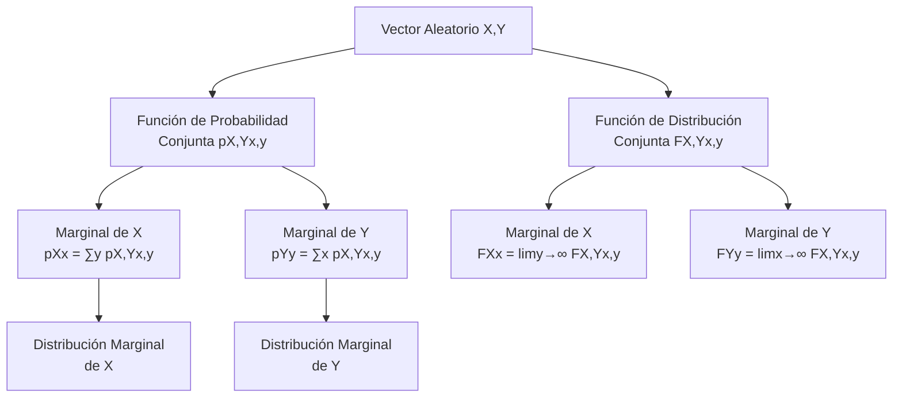

# Probabilidad I - Teoremas límite para sucesiones de variables aleatorias discretas

## 4.2 Vectores aleatorios, funciones de densidad y de distribución; conjunta y marginales.

---

Los **vectores aleatorios** son una generalización multidimensional de las variables aleatorias. En esta guía estudiaremos los conceptos fundamentales de vectores aleatorios discretos, sus funciones de distribución y densidad, tanto conjuntas como marginales.

### Definiciones Fundamentales

#### Vector Aleatorio Discreto

Un vector aleatorio discreto $(X, Y)$ es una función que asigna a cada resultado del espacio muestral un par de valores reales, donde cada componente puede tomar valores en un conjunto finito o infinito numerable.

#### Función de Probabilidad Conjunta

Para un vector aleatorio discreto $(X, Y)$, la función de probabilidad conjunta se define como:

$$p_{X,Y}(x, y) = P(X = x, Y = y)$$

#### Propiedades de la Función Conjunta

1. No negatividad: $p_{X,Y}(x, y) \geq 0$ para todo $(x, y)$
2. Suma total: $\sum_x \sum_y p_{X,Y}(x, y) = 1$

### Funciones Marginales

#### Función de Probabilidad Marginal

Las funciones de probabilidad marginal para $X$ e $Y$ se obtienen sumando sobre la otra variable:

$$p_X(x) = \sum_y p_{X,Y}(x, y)$$
$$p_Y(y) = \sum_x p_{X,Y}(x, y)$$

#### Función de Distribución Conjunta

$$F_{X,Y}(x, y) = P(X \leq x, Y \leq y) = \sum_{u \leq x} \sum_{v \leq y} p_{X,Y}(u, v)$$

#### Funciones de Distribución Marginales

$$F_X(x) = P(X \leq x) = \lim_{y \to \infty} F_{X,Y}(x, y)$$
$$F_Y(y) = P(Y \leq y) = \lim_{x \to \infty} F_{X,Y}(x, y)$$

### Diagrama de Relaciones Conceptuales



### Ejemplos Resueltos

#### Ejemplo 1: Lanzamiento de Dos Dados

Sean $X$ y $Y$ los resultados de dos dados justos. La función de probabilidad conjunta es:

$$p_{X,Y}(x, y) = \frac{1}{36} \quad \text{para } x,y = 1,2,...,6$$

**Marginal de X:**

$$p_X(x) = \sum_{y=1}^6 \frac{1}{36} = \frac{6}{36} = \frac{1}{6}$$

**Distribución conjunta en (3,4):**

$$F_{X,Y}(3, 4) = P(X \leq 3, Y \leq 4) = \frac{12}{36} = \frac{1}{3}$$

#### Ejemplo 2: Distribución Conjunta Tabular

Sea $(X, Y)$ con la siguiente distribución:

| X\Y      | 1   | 2   | 3   | $p_X(x)$ |
| -------- | --- | --- | --- | -------- |
| 0        | 0.1 | 0.2 | 0.1 | 0.4      |
| 1        | 0.2 | 0.1 | 0.3 | 0.6      |
| $p_Y(y)$ | 0.3 | 0.3 | 0.4 | 1.0      |

**Probabilidades marginales:**

- $p_X(0) = 0.1 + 0.2 + 0.1 = 0.4$
- $p_Y(2) = 0.2 + 0.1 = 0.3$

### Código Python para Visualización

```python
import numpy as np
import matplotlib.pyplot as plt
import pandas as pd
from scipy.stats import multinomial

# Crear una distribución conjunta artificial
def crear_distribucion_conjunta():
    # Valores posibles para X e Y
    x_vals = [0, 1, 2]
    y_vals = [0, 1, 2]

    # Crear una matriz de probabilidades conjuntas
    prob_conjunta = np.array([[0.1, 0.2, 0.1],
                             [0.2, 0.1, 0.1],
                             [0.05, 0.1, 0.05]])

    # Normalizar para que sume 1
    prob_conjunta = prob_conjunta / np.sum(prob_conjunta)

    return x_vals, y_vals, prob_conjunta

# Calcular marginales
def calcular_marginales(prob_conjunta):
    marginal_x = np.sum(prob_conjunta, axis=1)
    marginal_y = np.sum(prob_conjunta, axis=0)
    return marginal_x, marginal_y

# Visualizar distribución conjunta
def visualizar_distribucion(x_vals, y_vals, prob_conjunta):
    fig, (ax1, ax2) = plt.subplots(1, 2, figsize=(12, 5))

    # Gráfico de calor de la distribución conjunta
    im = ax1.imshow(prob_conjunta, cmap='Blues', origin='lower')
    ax1.set_xticks(range(len(y_vals)))
    ax1.set_yticks(range(len(x_vals)))
    ax1.set_xticklabels(y_vals)
    ax1.set_yticklabels(x_vals)
    ax1.set_xlabel('Y')
    ax1.set_ylabel('X')
    ax1.set_title('Función de Probabilidad Conjunta')
    plt.colorbar(im, ax=ax1)

    # Gráfico de barras 3D
    x_pos, y_pos = np.meshgrid(range(len(x_vals)), range(len(y_vals)))
    x_pos = x_pos.flatten()
    y_pos = y_pos.flatten()
    z_pos = np.zeros_like(x_pos)

    dx = dy = 0.5
    dz = prob_conjunta.flatten()

    ax2 = fig.add_subplot(122, projection='3d')
    ax2.bar3d(x_pos, y_pos, z_pos, dx, dy, dz, shade=True)
    ax2.set_xlabel('X')
    ax2.set_ylabel('Y')
    ax2.set_zlabel('Probabilidad')
    ax2.set_title('Distribución Conjunta 3D')
    ax2.set_xticks(range(len(x_vals)))
    ax2.set_yticks(range(len(y_vals)))
    ax2.set_xticklabels(x_vals)
    ax2.set_yticklabels(y_vals)

    plt.tight_layout()
    plt.show()

# Ejemplo de uso
x_vals, y_vals, prob_conjunta = crear_distribucion_conjunta()
marginal_x, marginal_y = calcular_marginales(prob_conjunta)

print("Distribución Conjunta:")
print(prob_conjunta)
print("\nMarginal de X:", marginal_x)
print("Marginal de Y:", marginal_y)

visualizar_distribucion(x_vals, y_vals, prob_conjunta)
```

### Ejercicios Propuestos

#### Ejercicio 1

Sea $(X, Y)$ un vector aleatorio discreto con función de probabilidad conjunta:

$$p_{X,Y}(x, y) = k(x + y) \quad \text{para } x = 1,2,3; y = 1,2$$

a) Encuentre el valor de $k$ que hace que esto sea una distribución válida
b) Calcule las funciones de probabilidad marginales de $X$ e $Y$
c) Calcule $P(X > Y)$
d) Calcule $F_{X,Y}(2, 2)$

#### Ejercicio 2

Dada la siguiente función de distribución conjunta:

$$ F_{X,Y}(x, y) = \begin{cases} 0 & x < 0 \text{ o } y < 0 \\\ \frac{xy}{12} & 0 \leq x < 2, 0 \leq y < 3 \\\ \frac{x}{4} & 0 \leq x < 2, y \geq 3 \\\ \frac{y}{6} & x \geq 2, 0 \leq y < 3 \\\ 1 & x \geq 2, y \geq 3 \end{cases} $$

a) Verifique que es una función de distribución válida
b) Encuentre la función de probabilidad conjunta
c) Calcule las distribuciones marginales

#### Ejercicio 3

Un estudio analiza el número de hijos (X) y el número de mascotas (Y) en familias. La distribución conjunta es:

| X\Y | 0    | 1    | 2    |
| --- | ---- | ---- | ---- |
| 0   | 0.10 | 0.05 | 0.02 |
| 1   | 0.15 | 0.12 | 0.06 |
| 2   | 0.08 | 0.10 | 0.08 |
| 3   | 0.05 | 0.07 | 0.12 |

a) Calcule $P(X = 2, Y = 1)$
b) Encuentre la probabilidad de que una familia tenga al menos un hijo y al menos una mascota
c) Determine si X e Y son independientes

### Tabla de Propiedades

| Concepto              | Notación        | Fórmula                        |
| --------------------- | --------------- | ------------------------------ |
| Probabilidad Conjunta | $p_{X,Y}(x, y)$ | $P(X = x, Y = y)$              |
| Distribución Conjunta | $F_{X,Y}(x, y)$ | $P(X \leq x, Y \leq y)$        |
| Marginal de X         | $p_X(x)$        | $\sum_y p_{X,Y}(x, y)$         |
| Marginal de Y         | $p_Y(y)$        | $\sum_x p_{X,Y}(x, y)$         |
| Independencia         | $X \perp Y$     | $p_{X,Y}(x, y) = p_X(x)p_Y(y)$ |

### Aplicaciones Prácticas

1. **Estadística multivariada:** Análisis de relaciones entre variables categóricas
2. **Epidemiología:** Estudio de factores de riesgo y enfermedades
3. **Control de calidad:** Análisis de defectos en múltiples características
4. **Genética:** Estudio de la herencia de múltiples características

### Referencias

1. Ross, S. M. (2019). "A First Course in Probability"
2. Devore, J. L. (2016). "Probability and Statistics for Engineering and the Sciences"
3. Walpole, R. E., et al. (2012). "Probability and Statistics for Engineers and Scientists"

### Consejos de Estudio

1. **Visualiza las distribuciones** usando tablas de contingencia
2. **Practica el cálculo** de marginales a partir de conjuntas
3. **Comprende la diferencia** entre función de probabilidad y función de distribución
4. **Verifica siempre** que las sumas de probabilidades den 1

### Preguntas de Autoevaluación

1. ¿Cómo se relacionan las distribuciones marginales con la conjunta?
2. ¿Qué condiciones debe cumplir una función para ser una distribución conjunta válida?
3. ¿Cómo se calcula la probabilidad de un evento utilizando la función conjunta?
4. ¿Qué significa que dos variables aleatorias sean independientes?
