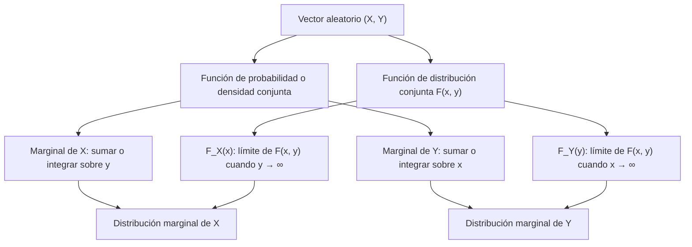

# Probabilidad I - Teoremas límite para sucesiones de variables aleatorias discretas

## 4.2 Vectores aleatorios, funciones de densidad y de distribución; conjunta y marginales.

---

Los **vectores aleatorios** son una generalización multidimensional de las variables aleatorias. En esta guía estudiaremos los conceptos fundamentales de vectores aleatorios discretos y continuos, sus funciones de distribución y densidad, tanto conjuntas como marginales.

Un vector aleatorio $(X, Y)$ son dos variables aleatorias definidas sobre el **mismo** experimento, como la estatura y el peso de una persona elegida al azar, o los resultados de dos dados. Conocer por separado la distribución de cada una no basta para responder preguntas que las involucran a ambas, como $P(X > Y)$ o la distribución de $X + Y:$ para eso se necesita la distribución **conjunta**, que describe también cómo se relacionan.

### Definiciones Fundamentales

#### Vector Aleatorio Discreto

Un vector aleatorio discreto $(X, Y)$ es una función que asigna a cada resultado del espacio muestral un par de valores reales, donde cada componente puede tomar valores en un conjunto finito o infinito numerable.

#### Función de Probabilidad Conjunta

Para un vector aleatorio discreto $(X, Y),$ la función de probabilidad conjunta se define como:

$$p_{X,Y}(x, y) = P(X = x, Y = y)$$

#### Propiedades de la Función Conjunta

1. No negatividad: $p_{X,Y}(x, y) \geq 0$ para todo $(x, y)$
2. Suma total: $\sum_x \sum_y p_{X,Y}(x, y) = 1$

### Funciones Marginales

#### Función de Probabilidad Marginal

Las funciones de probabilidad marginal para $X$ e $Y$ se obtienen sumando sobre la otra variable:

$$p_X(x) = \sum_y p_{X,Y}(x, y)$$

$$p_Y(y) = \sum_x p_{X,Y}(x, y)$$

#### Función de Distribución Conjunta

$$F_{X,Y}(x, y) = P(X \leq x, Y \leq y) = \sum_{u \leq x} \sum_{v \leq y} p_{X,Y}(u, v)$$

#### Funciones de Distribución Marginales

$$ F_X(x) = P(X \leq x) = \lim_{y \to \infty} F_{X,Y}(x, y) $$

$$ F_Y(y) = P(Y \leq y) = \lim_{x \to \infty} F_{X,Y}(x, y) $$

Los límites se justifican con la continuidad de la probabilidad (tema 1.7): los eventos $\{X \leq x, Y \leq n\}$ crecen con $n$ hacia $\{X \leq x\}.$ La función de distribución conjunta cumple propiedades análogas a las del caso de una variable: es no decreciente en cada variable, continua por la derecha en cada variable, tiende a 0 si $x \to -\infty$ o $y \to -\infty,$ y a 1 si ambas tienden a $\infty.$ Además, la probabilidad de un rectángulo debe ser no negativa:

$$ P(a < X \leq b, c < Y \leq d) = F(b, d) - F(a, d) - F(b, c) + F(a, c) \geq 0 $$

### Vectores Aleatorios Continuos

El vector $(X, Y)$ es **continuo** (absolutamente continuo) si existe una **densidad conjunta** $f_{X,Y}(x, y) \geq 0$ con

$$ P((X, Y) \in A) = \iint_A f_{X,Y}(x, y)\,dx\,dy $$

para regiones $A$ del plano. En particular, $\iint_{\mathbb{R}^2} f_{X,Y} = 1,$ $F_{X,Y}(x, y) = \int_{-\infty}^{x}\int_{-\infty}^{y} f_{X,Y}(u, v)\,dv\,du$ y, donde la derivada existe,

$$ f_{X,Y}(x, y) = \frac{\partial^2 F_{X,Y}}{\partial x\,\partial y}(x, y) $$

Las **densidades marginales** se obtienen integrando la otra variable, en lugar de sumarla:

$$ f_X(x) = \int_{-\infty}^{\infty} f_{X,Y}(x, y)\,dy, \qquad f_Y(y) = \int_{-\infty}^{\infty} f_{X,Y}(x, y)\,dx $$

#### Ejemplo: densidad en un triángulo

Sea $(X, Y)$ uniforme en el triángulo $T = \{(x, y) : 0 \leq y \leq x \leq 1\},$ de área $\frac{1}{2};$ la densidad es $f_{X,Y}(x, y) = 2$ en $T$ y 0 fuera.

- Marginal de $X:$ para $0 \leq x \leq 1,$ $f_X(x) = \int_0^x 2\,dy = 2x.$
- Marginal de $Y:$ para $0 \leq y \leq 1,$ $f_Y(y) = \int_y^1 2\,dx = 2(1 - y).$
- $P(X + Y \leq 1)$ es el área de la parte de $T$ bajo la recta $x + y = 1,$ un triángulo de vértices $(0, 0),$ $(1, 0),$ $(\frac{1}{2}, \frac{1}{2}),$ con área $\frac{1}{4},$ multiplicada por la densidad 2: $P = \frac{1}{2}.$

Al calcular marginales hay que cuidar los **límites de integración**, que dependen de la región donde la densidad no es cero. Las marginales no son uniformes aunque la conjunta lo sea, y **no determinan** la conjunta: la densidad $f(x, y) = 2x \cdot 2(1 - y)$ en el cuadrado unitario tiene las mismas marginales y es distinta.

### Independencia

Las variables $X$ y $Y$ son **independientes** si para todos los conjuntos $A$ y $B$ se cumple $P(X \in A, Y \in B) = P(X \in A)\,P(Y \in B).$ Equivale a que la conjunta se **factorice**:

$$ F_{X,Y}(x, y) = F_X(x)F_Y(y), \qquad p_{X,Y}(x, y) = p_X(x)p_Y(y), \qquad f_{X,Y}(x, y) = f_X(x)f_Y(y) $$

La segunda forma se usa en el caso discreto y la tercera en el continuo, para todos los valores $x, y.$ En el ejemplo del triángulo, $X$ y $Y$ **no** son independientes: $f_X(x)f_Y(y) = 4x(1 - y)$ no es la densidad conjunta, y basta notar que $Y$ siempre es menor que $X.$ Una señal rápida de dependencia es que la región donde la densidad es positiva no sea un rectángulo.

Con independencia, la conjunta queda determinada por las marginales; sin ella, no.

### Diagrama de Relaciones Conceptuales



### Ejemplos Resueltos

#### Ejemplo 1: Lanzamiento de Dos Dados

Sean $X$ y $Y$ los resultados de dos dados justos. La función de probabilidad conjunta es:

$$p_{X,Y}(x, y) = \frac{1}{36} \quad \text{para } x,y = 1,2,...,6$$

**Marginal de X:**

$$p_X(x) = \sum_{y=1}^6 \frac{1}{36} = \frac{6}{36} = \frac{1}{6}$$

**Distribución conjunta en el punto** $(3,4):$

$$ F_{X,Y}(3, 4) = P(X \leq 3, Y \leq 4) = \frac{12}{36} = \frac{1}{3} $$

porque hay $3 \cdot 4 = 12$ pares con $x \leq 3$ y $y \leq 4.$ Como los dados son independientes, $F_{X,Y}(3, 4) = F_X(3)F_Y(4) = \frac{3}{6} \cdot \frac{4}{6}.$

**Una función de las dos variables:** la suma $S = X + Y$ tiene $P(S = s) = \sum_{x} p_{X,Y}(x, s - x),$ sumando sobre la diagonal $x + y = s$ de la tabla; por ejemplo $P(S = 7) = \frac{6}{36}.$

#### Ejemplo 2: Distribución Conjunta Tabular

Sea $(X, Y)$ con la siguiente distribución:

| X\Y      | 1   | 2   | 3   | $p_X(x)$ |
| -------- | --- | --- | --- | -------- |
| 0        | 0.1 | 0.2 | 0.1 | 0.4      |
| 1        | 0.2 | 0.1 | 0.3 | 0.6      |
| $p_Y(y)$ | 0.3 | 0.3 | 0.4 | 1.0      |

**Probabilidades marginales:** se suman los renglones y las columnas, y por eso se escriben en los **márgenes** de la tabla, de donde viene el nombre.

- $p_X(0) = 0.1 + 0.2 + 0.1 = 0.4$
- $p_Y(2) = 0.2 + 0.1 = 0.3$

**¿Son independientes?** $p_{X,Y}(0, 1) = 0.1,$ pero $p_X(0)p_Y(1) = 0.4 \cdot 0.3 = 0.12:$ no lo son. Basta una celda que no cumpla la factorización.

**Distribución condicional:** fijando $X = 1,$ la distribución de $Y$ se obtiene dividiendo el renglón entre su total: $P(Y = y \mid X = 1) = \frac{p_{X,Y}(1, y)}{p_X(1)},$ es decir $\frac{0.2}{0.6},$ $\frac{0.1}{0.6}$ y $\frac{0.3}{0.6}$ para $y = 1, 2, 3.$

### Código Python para Visualización

```python
import numpy as np
import matplotlib
matplotlib.use("Agg")
import matplotlib.pyplot as plt

# Crear una distribución conjunta artificial
def crear_distribucion_conjunta():
    # Valores posibles para X e Y
    x_vals = [0, 1, 2]
    y_vals = [0, 1, 2]

    # Crear una matriz de probabilidades conjuntas
    prob_conjunta = np.array([[0.1, 0.2, 0.1],
                             [0.2, 0.1, 0.1],
                             [0.05, 0.1, 0.05]])

    # Normalizar para que sume 1
    prob_conjunta = prob_conjunta / np.sum(prob_conjunta)

    return x_vals, y_vals, prob_conjunta

# Calcular marginales
def calcular_marginales(prob_conjunta):
    marginal_x = np.sum(prob_conjunta, axis=1)
    marginal_y = np.sum(prob_conjunta, axis=0)
    return marginal_x, marginal_y

# Visualizar distribución conjunta
def visualizar_distribucion(x_vals, y_vals, prob_conjunta):
    fig = plt.figure(figsize=(12, 5))
    ax1 = fig.add_subplot(121)

    # Gráfico de calor de la distribución conjunta
    im = ax1.imshow(prob_conjunta, cmap='Blues', origin='lower')
    ax1.set_xticks(range(len(y_vals)))
    ax1.set_yticks(range(len(x_vals)))
    ax1.set_xticklabels(y_vals)
    ax1.set_yticklabels(x_vals)
    ax1.set_xlabel('Y')
    ax1.set_ylabel('X')
    ax1.set_title('Función de Probabilidad Conjunta')
    plt.colorbar(im, ax=ax1)

    # Gráfico de barras 3D; indexing="ij" hace que x_pos recorra los renglones (X)
    x_pos, y_pos = np.meshgrid(range(len(x_vals)), range(len(y_vals)), indexing="ij")
    x_pos = x_pos.flatten()
    y_pos = y_pos.flatten()
    z_pos = np.zeros_like(x_pos)

    dx = dy = 0.5
    dz = prob_conjunta.flatten()

    ax2 = fig.add_subplot(122, projection='3d')
    ax2.bar3d(x_pos, y_pos, z_pos, dx, dy, dz, shade=True)
    ax2.set_xlabel('X')
    ax2.set_ylabel('Y')
    ax2.set_zlabel('Probabilidad')
    ax2.set_title('Distribución Conjunta 3D')
    ax2.set_xticks(range(len(x_vals)))
    ax2.set_yticks(range(len(y_vals)))
    ax2.set_xticklabels(x_vals)
    ax2.set_yticklabels(y_vals)

    plt.tight_layout()
    plt.savefig("conjunta.png", dpi=90)

# Ejemplo de uso
x_vals, y_vals, prob_conjunta = crear_distribucion_conjunta()
marginal_x, marginal_y = calcular_marginales(prob_conjunta)

print("Distribución Conjunta:")
print(prob_conjunta)
print("\nMarginal de X:", marginal_x)
print("Marginal de Y:", marginal_y)

visualizar_distribucion(x_vals, y_vals, prob_conjunta)

# Independencia: comparar la conjunta con el producto de marginales
producto = np.outer(marginal_x, marginal_y)
print("¿Independientes?", np.allclose(prob_conjunta, producto))

# Ejemplo continuo: uniforme en el triángulo 0 <= y <= x <= 1, por simulación
rng = np.random.default_rng(0)
u = rng.random((200_000, 2))
x, y = u.max(axis=1), u.min(axis=1)          # ordenar dos uniformes da un punto uniforme en T
print("P(X + Y <= 1) ≈", np.mean(x + y <= 1), " teórico 0.5")
print("E[X] ≈", x.mean(), " teórico 2/3 (densidad 2x)")
```

El último bloque usa un truco: si $U_1, U_2$ son uniformes independientes, el punto $(\max, \min)$ es uniforme en el triángulo $T,$ porque cada punto de $T$ proviene de exactamente dos puntos del cuadrado, $(u_1, u_2)$ y $(u_2, u_1).$

### Ejercicios Propuestos

#### Ejercicio 1

Sea $(X, Y)$ un vector aleatorio discreto con función de probabilidad conjunta:

$$p_{X,Y}(x, y) = k(x + y) \quad \text{para } x = 1,2,3; y = 1,2$$

- a) Encuentre el valor de $k$ que hace que esto sea una distribución válida.
- b) Calcule las funciones de probabilidad marginales de $X$ y $Y.$
- c) Calcule $P(X > Y).$
- d) Calcule $F_{X,Y}(2, 2).$

#### Ejercicio 2

Dada la siguiente función de distribución conjunta:

$$ F_{X,Y}(x, y) = \begin{cases} 0 & x < 0 \text{ o } y < 0 \\ \frac{xy}{12} & 0 \leq x < 2, 0 \leq y < 3 \\ \frac{x}{4} & 0 \leq x < 2, y \geq 3 \\ \frac{y}{6} & x \geq 2, 0 \leq y < 3 \\ 1 & x \geq 2, y \geq 3 \end{cases} $$

- a) Verifique que es una función de distribución válida.
- b) Describa la distribución conjunta: ¿tiene densidad?
- c) Calcule las distribuciones marginales y determine si $X$ y $Y$ son independientes.

#### Ejercicio 3

Un estudio analiza el número de hijos, $X,$ y el número de mascotas, $Y,$ en familias. La distribución conjunta es:

| X\Y | 0    | 1    | 2    |
| --- | ---- | ---- | ---- |
| 0   | 0.10 | 0.05 | 0.02 |
| 1   | 0.15 | 0.12 | 0.06 |
| 2   | 0.08 | 0.10 | 0.08 |
| 3   | 0.05 | 0.07 | 0.12 |

- a) Calcule $P(X = 2, Y = 1).$
- b) Encuentre la probabilidad de que una familia tenga al menos un hijo y al menos una mascota.
- c) Determine si $X$ y $Y$ son independientes.

### Soluciones

**Ejercicio 1.** a) $\sum_{x=1}^{3}\sum_{y=1}^{2}(x + y) = (2 + 3) + (3 + 4) + (4 + 5) = 21,$ así que $k = \frac{1}{21}.$ b) $p_X(x) = \frac{(x + 1) + (x + 2)}{21} = \frac{2x + 3}{21},$ es decir $\frac{5}{21},$ $\frac{7}{21},$ $\frac{9}{21};$ y $p_Y(y) = \frac{(1 + y) + (2 + y) + (3 + y)}{21} = \frac{6 + 3y}{21},$ es decir $\frac{9}{21}$ y $\frac{12}{21}.$ c) Los pares con $x > y$ son $(2, 1),$ $(3, 1)$ y $(3, 2),$ con $P = \frac{3 + 4 + 5}{21} = \frac{4}{7}.$ d) $F(2, 2) = \frac{2 + 3 + 3 + 4}{21} = \frac{4}{7}.$ No son independientes: $p(1, 1) = \frac{2}{21},$ pero $p_X(1)p_Y(1) = \frac{5}{21} \cdot \frac{9}{21} = \frac{45}{441} \neq \frac{42}{441}.$

**Ejercicio 2.** a) Es no decreciente en cada variable, vale 0 si alguna coordenada es negativa y 1 cuando ambas son grandes, y las piezas coinciden en las fronteras **interiores**: en $x = 2$ con $y < 3,$ $\frac{2y}{12} = \frac{y}{6};$ en $y = 3$ con $x < 2,$ $\frac{3x}{12} = \frac{x}{4}.$ En la esquina $(2, 3)$ hay un salto: al acercarse por abajo o por la izquierda $F$ vale $\frac{1}{2},$ y en $(2, 3)$ vale 1. Falta comprobar que todo rectángulo tenga probabilidad no negativa; el único caso delicado es el que contiene la esquina, y ahí $F(2, 3) - F(2, 3^-) - F(2^-, 3) + F(2^-, 3^-) = 1 - \frac{1}{2} - \frac{1}{2} + \frac{1}{2} = \frac{1}{2} \geq 0.$ Es una función de distribución válida.

b) La distribución es **mixta**. En el interior del rectángulo, $\frac{\partial^2}{\partial x\,\partial y}\frac{xy}{12} = \frac{1}{12},$ una densidad uniforme que, sobre un área de 6, solo acumula probabilidad $\frac{1}{2}.$ La otra mitad está concentrada en el punto $(2, 3):$ el cálculo anterior muestra que $P(X = 2, Y = 3) = \frac{1}{2}.$ Así, $(X, Y)$ es uniforme en el rectángulo con probabilidad $\frac{1}{2}$ y vale $(2, 3)$ con probabilidad $\frac{1}{2}.$

c) $F_X(x) = \lim_{y \to \infty}F(x, y) = \frac{x}{4}$ para $0 \leq x < 2$ y 1 para $x \geq 2:$ $X$ tiene densidad $\frac{1}{4}$ en $[0, 2)$ y un átomo $P(X = 2) = \frac{1}{2}.$ Del mismo modo, $F_Y(y) = \frac{y}{6}$ en $[0, 3),$ con $P(Y = 3) = \frac{1}{2}.$ No son independientes: en el rectángulo, $F_X(x)F_Y(y) = \frac{xy}{24} \neq \frac{xy}{12}.$ Intuitivamente, si $X = 2$ entonces casi seguro $Y = 3.$

**Ejercicio 3.** a) $P(X = 2, Y = 1) = 0.10.$ b) $P(X \geq 1, Y \geq 1) = 0.12 + 0.06 + 0.10 + 0.08 + 0.07 + 0.12 = 0.55.$ c) $p_X(0) = 0.17$ y $p_Y(0) = 0.10 + 0.15 + 0.08 + 0.05 = 0.38,$ así que $p_X(0)p_Y(0) = 0.0646 \neq 0.10 = p(0, 0):$ no son independientes. Las familias sin hijos tienden también a no tener mascotas, y las de 3 hijos tienen más.

### Tabla de Propiedades

| Concepto              | Notación        | Fórmula                        |
| --------------------- | --------------- | ------------------------------ |
| Probabilidad Conjunta | $p_{X,Y}(x, y)$ | $P(X = x, Y = y)$              |
| Distribución Conjunta | $F_{X,Y}(x, y)$ | $P(X \leq x, Y \leq y)$        |
| Marginal de X         | $p_X(x)$        | $\sum_y p_{X,Y}(x, y)$         |
| Marginal de Y         | $p_Y(y)$        | $\sum_x p_{X,Y}(x, y)$         |
| Independencia         | $X \perp Y$     | $p_{X,Y}(x, y) = p_X(x)p_Y(y)$ |

### Aplicaciones Prácticas

1. **Estadística multivariada:** Análisis de relaciones entre variables categóricas
2. **Epidemiología:** Estudio de factores de riesgo y enfermedades
3. **Control de calidad:** Análisis de defectos en múltiples características
4. **Genética:** Estudio de la herencia de múltiples características

### Referencias

1. Ross, S. M. (2019). "A First Course in Probability"
2. Devore, J. L. (2016). "Probability and Statistics for Engineering and the Sciences"
3. Walpole, R. E., et al. (2012). "Probability and Statistics for Engineers and Scientists"

### Consejos de Estudio

1. **Visualiza las distribuciones** usando tablas de contingencia
2. **Practica el cálculo** de marginales a partir de conjuntas
3. **Comprende la diferencia** entre función de probabilidad y función de distribución
4. **Verifica siempre** que las sumas de probabilidades den 1

### Preguntas de Autoevaluación

1. ¿Cómo se relacionan las distribuciones marginales con la conjunta?
2. ¿Qué condiciones debe cumplir una función para ser una distribución conjunta válida?
3. ¿Cómo se calcula la probabilidad de un evento utilizando la función conjunta?
4. ¿Qué significa que dos variables aleatorias sean independientes?
