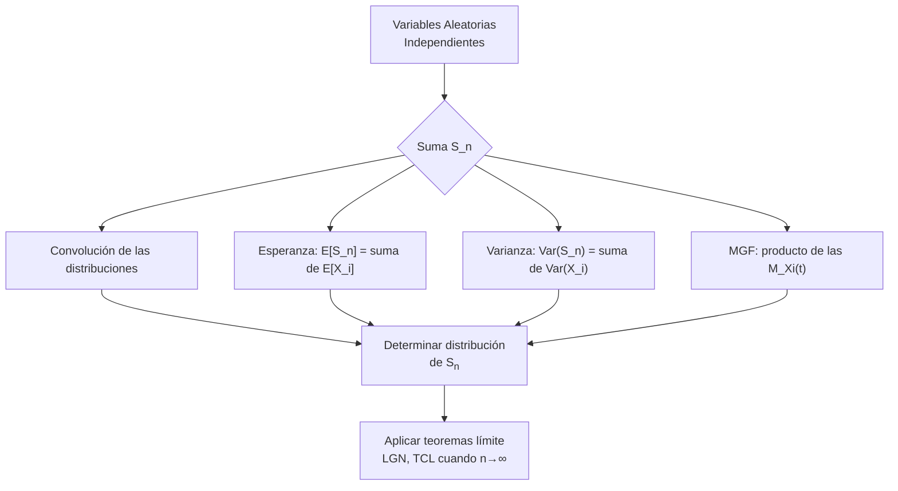

# Probabilidad I - Teoremas límite para sucesiones de variables aleatorias discretas

## 4.3 Sumas de variables aleatorias independientes.

---

El estudio de **sumas de variables aleatorias independientes** es fundamental en probabilidad y estadística, ya que constituye la base para comprender los teoremas límite y el comportamiento de promedios y sumas de observaciones.

### Definiciones Fundamentales

#### Suma de Variables Aleatorias

Dadas $n$ variables aleatorias independientes $X_1, X_2, \ldots, X_n,$ definimos su suma como:

$$ S_n = X_1 + X_2 + \cdots + X_n $$

#### Convolución: la distribución de una suma

Para dos variables independientes $X$ y $Y$ con valores enteros, el evento $\{X + Y = s\}$ es la unión disjunta de los eventos $\{X = k, Y = s - k\},$ y por independencia

$$ P(X + Y = s) = \sum_{k} P(X = k)\,P(Y = s - k) $$

En el caso continuo, con densidades, la fórmula análoga es

$$ f_{X+Y}(s) = \int_{-\infty}^{\infty} f_X(x)\,f_Y(s - x)\,dx $$

Esta operación se llama **convolución** y se escribe $f_X * f_Y.$ Para $n$ sumandos se aplica repetidamente. Es el método directo, pero las sumas o integrales se complican rápido; por eso se usan las funciones generadoras, que convierten la convolución en un producto.

**Ejemplo: dos dados.** $P(X + Y = s) = \sum_{k=1}^{6}\frac{1}{6}P(Y = s - k) = \frac{\text{número de } k \text{ con } 1 \leq s - k \leq 6}{36},$ que es $\frac{s - 1}{36}$ para $s \leq 7$ y $\frac{13 - s}{36}$ para $s \geq 7:$ una distribución triangular, aunque cada dado sea uniforme.

**Ejemplo: dos uniformes.** Si $X, Y \sim \text{Uniforme}(0, 1)$ son independientes, $f_{X+Y}(s) = \int_0^1 \mathbf{1}_{\{0 \leq s - x \leq 1\}}\,dx,$ la longitud de $[0, 1] \cap [s - 1, s],$ que es $s$ para $0 \leq s \leq 1$ y $2 - s$ para $1 \leq s \leq 2:$ una densidad triangular. Con tres uniformes la densidad ya está formada por parábolas y empieza a parecerse a una campana; es el teorema del límite central en acción (tema 4.4).

#### Función Generadora de Momentos (MGF)

La MGF de una variable aleatoria $X$ se define como:

$$M_X(t) = E[e^{tX}]$$

Para variables discretas

$$M_X(t) = \sum_x e^{tx} p_X(x)$$

#### Propiedad Clave de la MGF para Sumas

Si $X_1, X_2, \ldots, X_n$ son independientes, entonces:

$$M_{S_n}(t) = M_{X_1}(t) \cdot M_{X_2}(t) \cdots M_{X_n}(t)$$

### Distribuciones de Sumas Específicas

#### Suma de Variables de Bernoulli

Si $X_i \sim \text{Bernoulli}(p)$ independientes, entonces:

$$S_n \sim \text{Binomial}(n, p)$$

#### Suma de Variables Poisson

Si $X_i \sim \text{Poisson}(\lambda_i)$ independientes, entonces:

$$ S_n \sim \text{Poisson}(\lambda_1 + \lambda_2 + \cdots + \lambda_n) $$

*Demostración por convolución para dos sumandos.* Por la fórmula del binomio,

$$ P(X + Y = s) = \sum_{k=0}^{s} e^{-\lambda}\frac{\lambda^k}{k!}e^{-\mu}\frac{\mu^{s-k}}{(s-k)!} = \frac{e^{-(\lambda + \mu)}}{s!}\sum_{k=0}^{s}\binom{s}{k}\lambda^k\mu^{s-k} = e^{-(\lambda + \mu)}\frac{(\lambda + \mu)^s}{s!}. \qquad \blacksquare $$

#### Suma de Variables Binomiales

Si $X_1, \dots, X_k$ son independientes con $X_i \sim \text{Binomial}(n_i, p),$ con la **misma** $p,$ entonces:

$$ X_1 + \cdots + X_k \sim \text{Binomial}(n_1 + n_2 + \cdots + n_k, p) $$

Con probabilidades distintas, la suma ya no es binomial.

#### Otras sumas importantes

| Sumandos independientes | Suma |
| --- | --- |
| $n$ geométricas con parámetro $p$ | binomial negativa con parámetros $r = n$ y $p$ |
| $n$ exponenciales con tasa $\lambda$ | $\text{Gamma}(n, \lambda)$ |
| $\text{Gamma}(\alpha_1, \beta)$ y $\text{Gamma}(\alpha_2, \beta)$ | $\text{Gamma}(\alpha_1 + \alpha_2, \beta)$ |
| $N(\mu_1, \sigma_1^2)$ y $N(\mu_2, \sigma_2^2)$ | $N(\mu_1 + \mu_2, \sigma_1^2 + \sigma_2^2)$ |
| $n$ cuadrados de normales estándar | $\chi^2(n)$ |

Las familias que se conservan bajo sumas, como Poisson, normal y gamma, se llaman **cerradas bajo convolución**. Todos estos resultados se demuestran multiplicando funciones generadoras (tema 3.5).

### Esperanza y Varianza de Sumas

#### Linealidad de la Esperanza

Para cualesquiera variables aleatorias, no necesariamente independientes:

$$ E[S_n] = E[X_1] + E[X_2] + \cdots + E[X_n] $$

#### Varianza de la Suma

En general,

$$ \text{Var}(S_n) = \sum_{i=1}^n \text{Var}(X_i) + 2\sum_{i < j}\text{Cov}(X_i, X_j) $$

y si $X_1, X_2, \ldots, X_n$ son independientes, las covarianzas son 0 y queda:

$$ \text{Var}(S_n) = \text{Var}(X_1) + \text{Var}(X_2) + \cdots + \text{Var}(X_n) $$

Basta, de hecho, que no estén correlacionadas. Para variables independientes con la misma media $\mu$ y varianza $\sigma^2,$ el **promedio** $\bar{X}_n = \frac{S_n}{n}$ cumple

$$ E[\bar{X}_n] = \mu, \qquad \text{Var}(\bar{X}_n) = \frac{\sigma^2}{n} $$

La varianza del promedio tiende a 0: es la base de la ley de los grandes números (tema 4.5). La desviación estándar de la suma crece solo como $\sqrt{n},$ mientras que la media crece como $n.$

### Diagrama de Flujo: Proceso de Suma



### Ejemplos Resueltos

#### Ejemplo 1: Suma de Variables de Bernoulli

Sean $X_1, X_2, X_3 \sim \text{Bernoulli}(0.4)$ independientes. Calcular la distribución de $S_3.$

**Solución:**

- $S_3 = X_1 + X_2 + X_3 \sim \text{Binomial}(3, 0.4)$
- $P(S_3 = 0) = (0.6)^3 = 0.216$
- $P(S_3 = 1) = 3 \times (0.4) \times (0.6)^2 = 0.432$
- $P(S_3 = 2) = 3 \times (0.4)^2 \times (0.6) = 0.288$
- $P(S_3 = 3) = (0.4)^3 = 0.064$

#### Ejemplo 2: Suma de Variables Poisson

Sean $X_1 \sim \text{Poisson}(2)$ y $X_2 \sim \text{Poisson}(3)$ independientes. Calcular $P(S_2 = 4).$

**Solución:**

- $S_2 \sim \text{Poisson}(5)$
- $P(S_2 = 4) = \frac{e^{-5} \cdot 5^4}{4!} = \frac{e^{-5} \cdot 625}{24} \approx 0.1755$

#### Ejemplo 3: Tiempo total de servicio

Un cajero atiende a 3 clientes uno tras otro; cada atención dura un tiempo exponencial de media 2 minutos, es decir de tasa $\lambda = 0.5,$ y las atenciones son independientes. El tiempo total $T$ es $\text{Gamma}(3, 0.5),$ con $E[T] = 6$ minutos y $\text{Var}(T) = 3 \cdot 4 = 12.$ La probabilidad de que tarde más de 10 minutos es la de que en un proceso de Poisson de tasa 0.5 haya menos de 3 eventos en 10 minutos:

$$ P(T > 10) = P(\text{Poisson}(5) \leq 2) = e^{-5}\left(1 + 5 + \frac{25}{2}\right) \approx 0.1247 $$

### Código Python para Simulación

```python
import numpy as np
import matplotlib
matplotlib.use("Agg")
import matplotlib.pyplot as plt
from scipy.stats import binom, poisson, gamma

np.random.seed(3)

def simular_sumas(n_simulaciones, n_variables, distribucion, params):
    """
    Simula sumas de variables aleatorias independientes

    Args:
        n_simulaciones: número de simulaciones
        n_variables: número de variables a sumar
        distribucion: 'bernoulli', 'binomial', 'poisson'
        params: parámetros de la distribución
    """
    sumas = np.zeros(n_simulaciones)

    for i in range(n_simulaciones):
        if distribucion == 'bernoulli':
            p = params['p']
            variables = np.random.binomial(1, p, n_variables)
        elif distribucion == 'poisson':
            lam = params['lambda']
            variables = np.random.poisson(lam, n_variables)
        elif distribucion == 'binomial':
            n = params['n']
            p = params['p']
            variables = np.random.binomial(n, p, n_variables)

        sumas[i] = np.sum(variables)

    return sumas

# Ejemplo: Suma de 10 variables Bernoulli(p=0.3)
sumas_bernoulli = simular_sumas(10000, 10, 'bernoulli', {'p': 0.3})

# Comparar con distribución teórica Binomial(10, 0.3)
x = np.arange(0, 11)
teorica = binom.pmf(x, 10, 0.3)

# Visualización
plt.figure(figsize=(10, 6))
plt.hist(sumas_bernoulli, bins=np.arange(-0.5, 10.6, 1),
         density=True, alpha=0.7, label='Simulación')
plt.plot(x, teorica, 'ro-', linewidth=2, label='Binomial(10, 0.3) teórica')
plt.xlabel('Valor de la suma')
plt.ylabel('Densidad de probabilidad')
plt.title('Suma de 10 variables Bernoulli(0.3) independientes')
plt.legend()
plt.grid(alpha=0.3)
plt.savefig("sumas.png", dpi=90)

# Calcular media y varianza teórica vs empírica
media_teorica = 10 * 0.3
varianza_teorica = 10 * 0.3 * 0.7
media_empirica = np.mean(sumas_bernoulli)
varianza_empirica = np.var(sumas_bernoulli)

print(f"Media teórica: {media_teorica:.4f}, Media empírica: {media_empirica:.4f}")
print(f"Varianza teórica: {varianza_teorica:.4f}, Varianza empírica: {varianza_empirica:.4f}")

# Convolución numérica: distribución de la suma de dos y de tres dados
dado = np.ones(6) / 6
dos = np.convolve(dado, dado)              # valores 2..12
tres = np.convolve(dos, dado)              # valores 3..18
print("P(suma de dos dados = s):", np.round(dos * 36).astype(int))   # [1 2 3 4 5 6 5 4 3 2 1] / 36
print("P(suma de tres dados = 10) =", round(tres[10 - 3], 4))         # 27/216 = 0.125

# Ejemplo 3: suma de 3 exponenciales de media 2 contra Gamma(3, 0.5)
T = np.random.exponential(2, size=(100_000, 3)).sum(axis=1)
print("P(T > 10) ≈", np.mean(T > 10), " teórico:", round(gamma(3, scale=2).sf(10), 4))
```

`np.convolve` calcula exactamente la fórmula de convolución para dos vectores de probabilidades: el resultado para dos dados tiene la forma triangular $\frac{1, 2, \dots, 6, \dots, 2, 1}{36}.$

### Ejercicios Propuestos

#### Ejercicio 1

Sean $X_1, X_2, X_3 \sim \text{Poisson}(2)$ independientes.

- a) Determine la distribución de $S_3 = X_1 + X_2 + X_3.$
- b) Calcule $P(S_3 \leq 4).$
- c) Encuentre $E[S_3]$ y $\text{Var}(S_3).$

#### Ejercicio 2

Un sistema tiene 5 componentes independientes. Cada componente funciona con probabilidad 0.8. Sea $X_i = 1$ si el componente $i$ funciona, y 0 en otro caso.

- a) ¿Cuál es la distribución del número de componentes que funcionan?
- b) Calcule la probabilidad de que al menos 3 componentes funcionen.
- c) Calcule el valor esperado y la varianza.

#### Ejercicio 3

Sean $X \sim \text{Binomial}(5, 0.4)$ y $Y \sim \text{Binomial}(3, 0.4)$ independientes.

- a) Determine la distribución de $S = X + Y.$
- b) Calcule $P(S = 4)$ usando dos métodos diferentes.
- c) Verifique que $M_S(t) = M_X(t) \cdot M_Y(t).$

#### Ejercicio 4 (Avanzado)

Demuestre que si $X_1, X_2, \ldots, X_n$ son variables aleatorias independientes con $X_i \sim \text{Poisson}(\lambda_i),$ entonces:

$$S_n = \sum_{i=1}^n X_i \sim \text{Poisson}\left(\sum_{i=1}^n \lambda_i\right)$$

usando funciones generadoras de momentos.

### Soluciones

**Ejercicio 1.** a) $S_3 \sim \text{Poisson}(6).$ b) $P(S_3 \leq 4) = e^{-6}\left(1 + 6 + 18 + 36 + 54\right) = 115e^{-6} \approx 0.2851.$ c) $E[S_3] = \text{Var}(S_3) = 6.$

**Ejercicio 2.** a) La suma de 5 Bernoulli(0.8) independientes es $\text{Bin}(5, 0.8).$ b) $P(S \geq 3) = \binom{5}{3}0.8^3 0.2^2 + \binom{5}{4}0.8^4 0.2 + 0.8^5 = 0.2048 + 0.4096 + 0.32768 = 0.94208.$ c) $E[S] = 4$ y $\text{Var}(S) = 5 \cdot 0.8 \cdot 0.2 = 0.8.$

**Ejercicio 3.** a) $S \sim \text{Bin}(8, 0.4).$ b) Directamente, $P(S = 4) = \binom{8}{4}0.4^4 0.6^4 \approx 0.2322.$ Por convolución, $P(S = 4) = \sum_{k=1}^{4}P(X = k)P(Y = 4 - k),$ donde $k$ empieza en 1 porque $Y \leq 3;$ sumando los cuatro productos se obtiene el mismo valor $0.2322.$ c) $M_X(t)M_Y(t) = (0.6 + 0.4e^t)^5(0.6 + 0.4e^t)^3 = (0.6 + 0.4e^t)^8 = M_S(t).$

**Ejercicio 4.** Por independencia, $M_{S_n}(t) = \prod_{i=1}^n e^{\lambda_i(e^t - 1)} = e^{(\sum_i \lambda_i)(e^t - 1)},$ que es la MGF de una $\text{Poisson}\left(\sum_i \lambda_i\right).$ Como la MGF existe para todo $t,$ la unicidad garantiza que esa es la distribución de $S_n.$ $\blacksquare$

### Tabla de Propiedades de Sumas

Suma de $n$ variables independientes con la misma distribución:

| Distribución   | Parámetros | Suma de n variables | Esperanza | Varianza |
| -------------- | ---------- | ------------------- | --------- | -------- |
| Bernoulli(p)   | p          | Binomial(n, p)      | np        | np(1-p)  |
| Poisson(λ)     | λ          | Poisson(nλ)         | nλ        | nλ       |
| Binomial(m, p) | m, p       | Binomial(nm, p)     | nmp       | nmp(1-p) |
| Exponencial(λ) | λ          | Gamma(n, λ)         | n/λ       | n/λ²     |
| Normal(μ, σ²)  | μ, σ²      | Normal(nμ, nσ²)     | nμ        | nσ²      |

### Aplicaciones Prácticas

1. **Control de calidad:** Número de defectos en múltiples lotes
2. **Telecomunicaciones:** Número de llamadas en intervalos de tiempo
3. **Fiabilidad:** Número de componentes que funcionan en un sistema
4. **Seguros:** Número de siniestros en múltiples pólizas

### Referencias

1. Ross, S. M. (2019). "A First Course in Probability"
2. Casella, G., & Berger, R. L. (2002). "Statistical Inference"
3. Walpole, R. E., et al. (2012). "Probability and Statistics for Engineers and Scientists"

### Consejos de Estudio

1. **Domina las distribuciones individuales** antes de estudiar sus sumas
2. **Practica con funciones generadoras** de momentos
3. **Verifica siempre la independencia** antes de aplicar las propiedades
4. **Usa simulaciones** para confirmar resultados teóricos

### Preguntas de Autoevaluación

1. ¿Por qué es importante la independencia para calcular la varianza de una suma?
2. ¿Cómo se relaciona la suma de variables de Bernoulli con la distribución binomial?
3. ¿Qué propiedad de las funciones generadoras de momentos las hace útiles para estudiar sumas?
4. ¿Bajo qué condiciones la suma de variables Poisson sigue siendo Poisson?
