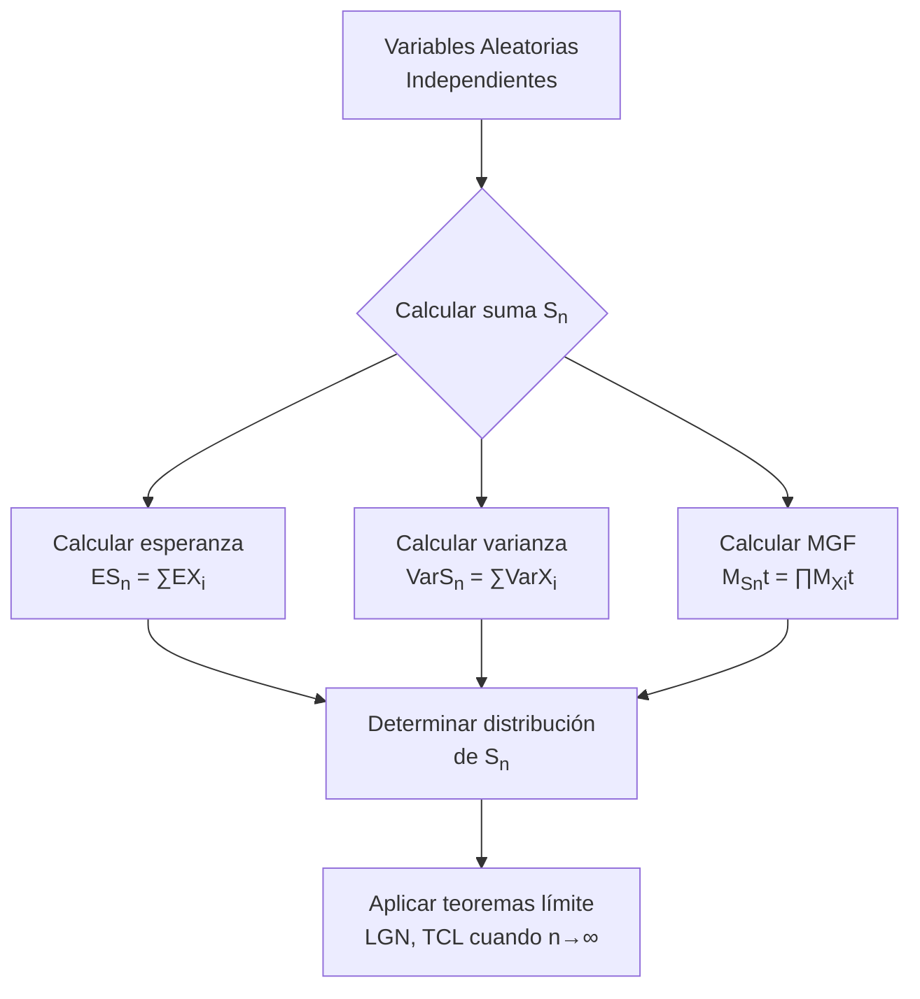

# Probabilidad I - Teoremas límite para sucesiones de variables aleatorias discretas

## 4.3 Sumas de variables aleatorias independientes.

---

El estudio de **sumas de variables aleatorias independientes** es fundamental en probabilidad y estadística, ya que constituye la base para comprender los teoremas límite y el comportamiento de promedios y sumas de observaciones.

### Definiciones Fundamentales

#### Suma de Variables Aleatorias

Dadas $n$ variables aleatorias independientes $X_1, X_2, \ldots, X_n,$ definimos su suma como:

$$S_n = X_1 + X_2 + \cdots + X_n$$

#### Función Generadora de Momentos (MGF)

La MGF de una variable aleatoria $X$ se define como:

$$M_X(t) = E[e^{tX}]$$

Para variables discretas

$$M_X(t) = \sum_x e^{tx} p_X(x)$$

#### Propiedad Clave de la MGF para Sumas

Si $X_1, X_2, \ldots, X_n$ son independientes, entonces:

$$M_{S_n}(t) = M_{X_1}(t) \cdot M_{X_2}(t) \cdots M_{X_n}(t)$$

### Distribuciones de Sumas Específicas

#### Suma de Variables de Bernoulli

Si $X_i \sim \text{Bernoulli}(p)$ independientes, entonces:

$$S_n \sim \text{Binomial}(n, p)$$

#### Suma de Variables Poisson

Si $X_i \sim \text{Poisson}(\lambda_i)$ independientes, entonces:

$$S_n \sim \text{Poisson}(\lambda_1 + \lambda_2 + \cdots + \lambda_n)$$

#### Suma de Variables Binomiales

Si $X_i \sim \text{Binomial}(n_i, p)$ independientes, entonces:

$$S_n \sim \text{Binomial}(n_1 + n_2 + \cdots + n_n, p)$$

### Esperanza y Varianza de Sumas

#### Linealidad de la Esperanza

Para cualquier variables aleatorias (no necesariamente independientes):

$$E[S_n] = E[X_1] + E[X_2] + \cdots + E[X_n]$$

#### Varianza de la Suma

Si $X_1, X_2, \ldots, X_n$ son independientes:

$$\text{Var}(S_n) = \text{Var}(X_1) + \text{Var}(X_2) + \cdots + \text{Var}(X_n)$$

### Diagrama de Flujo: Proceso de Suma



### Ejemplos Resueltos

#### Ejemplo 1: Suma de Variables de Bernoulli

Sean $X_1, X_2, X_3 \sim \text{Bernoulli}(0.4)$ independientes. Calcular la distribución de $S_3.$

**Solución:**

- $S_3 = X_1 + X_2 + X_3 \sim \text{Binomial}(3, 0.4)$
- $P(S_3 = 0) = (0.6)^3 = 0.216$
- $P(S_3 = 1) = 3 \times (0.4) \times (0.6)^2 = 0.432$
- $P(S_3 = 2) = 3 \times (0.4)^2 \times (0.6) = 0.288$
- $P(S_3 = 3) = (0.4)^3 = 0.064$

#### Ejemplo 2: Suma de Variables Poisson

Sean $X_1 \sim \text{Poisson}(2)$ y $X_2 \sim \text{Poisson}(3)$ independientes. Calcular $P(S_2 = 4).$

**Solución:**

- $S_2 \sim \text{Poisson}(5)$
- $P(S_2 = 4) = \frac{e^{-5} \cdot 5^4}{4!} = \frac{e^{-5} \cdot 625}{24} \approx 0.1755$

### Código Python para Simulación

```python
import numpy as np
import matplotlib.pyplot as plt
from scipy.stats import binom, poisson, bernoulli

def simular_sumas(n_simulaciones, n_variables, distribucion, params):
    """
    Simula sumas de variables aleatorias independientes

    Args:
        n_simulaciones: número de simulaciones
        n_variables: número de variables a sumar
        distribucion: 'bernoulli', 'binomial', 'poisson'
        params: parámetros de la distribución
    """
    sumas = np.zeros(n_simulaciones)

    for i in range(n_simulaciones):
        if distribucion == 'bernoulli':
            p = params['p']
            variables = np.random.binomial(1, p, n_variables)
        elif distribucion == 'poisson':
            lam = params['lambda']
            variables = np.random.poisson(lam, n_variables)
        elif distribucion == 'binomial':
            n = params['n']
            p = params['p']
            variables = np.random.binomial(n, p, n_variables)

        sumas[i] = np.sum(variables)

    return sumas

# Ejemplo: Suma de 10 variables Bernoulli(p=0.3)
sumas_bernoulli = simular_sumas(10000, 10, 'bernoulli', {'p': 0.3})

# Comparar con distribución teórica Binomial(10, 0.3)
x = np.arange(0, 11)
teorica = binom.pmf(x, 10, 0.3)

# Visualización
plt.figure(figsize=(10, 6))
plt.hist(sumas_bernoulli, bins=np.arange(-0.5, 10.6, 1),
         density=True, alpha=0.7, label='Simulación')
plt.plot(x, teorica, 'ro-', linewidth=2, label='Binomial(10, 0.3) teórica')
plt.xlabel('Valor de la suma')
plt.ylabel('Densidad de probabilidad')
plt.title('Suma de 10 variables Bernoulli(0.3) independientes')
plt.legend()
plt.grid(alpha=0.3)
plt.show()

# Calcular media y varianza teórica vs empírica
media_teorica = 10 * 0.3
varianza_teorica = 10 * 0.3 * 0.7
media_empirica = np.mean(sumas_bernoulli)
varianza_empirica = np.var(sumas_bernoulli)

print(f"Media teórica: {media_teorica:.4f}, Media empírica: {media_empirica:.4f}")
print(f"Varianza teórica: {varianza_teorica:.4f}, Varianza empírica: {varianza_empirica:.4f}")
```

### Ejercicios Propuestos

#### Ejercicio 1

Sean $X_1, X_2, X_3 \sim \text{Poisson}(2)$ independientes.
a) Determine la distribución de $S_3 = X_1 + X_2 + X_3$
b) Calcule $P(S_3 \leq 4)$
c) Encuentre $E[S_3]$ y $\text{Var}(S_3)$

#### Ejercicio 2

Un sistema tiene 5 componentes independientes. Cada componente funciona con probabilidad 0.8. Sea $X_i = 1$ si el componente i funciona, 0 en otro caso.
a) ¿Cuál es la distribución del número de componentes que funcionan?
b) Calcule la probabilidad de que al menos 3 componentes funcionen
c) Calcule el valor esperado y la varianza

#### Ejercicio 3

Sean $X \sim \text{Binomial}(5, 0.4)$ e $Y \sim \text{Binomial}(3, 0.4)$ independientes.
a) Determine la distribución de $S = X + Y$
b) Calcule $P(S = 4)$ usando dos métodos diferentes
c) Verifique que $M_S(t) = M_X(t) \cdot M_Y(t)$

#### Ejercicio 4 (Avanzado)

Demuestre que si $X_1, X_2, \ldots, X_n$ son variables aleatorias independientes con $X_i \sim \text{Poisson}(\lambda_i),$ entonces:

$$S_n = \sum_{i=1}^n X_i \sim \text{Poisson}\left(\sum_{i=1}^n \lambda_i\right)$$

usando funciones generadoras de momentos.

### Tabla de Propiedades de Sumas

| Distribución   | Parámetros | Suma de n variables | Esperanza | Varianza |
| -------------- | ---------- | ------------------- | --------- | -------- |
| Bernoulli(p)   | p          | Binomial(n, p)      | np        | np(1-p)  |
| Poisson(λ)     | λ          | Poisson(nλ)         | nλ        | nλ       |
| Binomial(m, p) | m, p       | Binomial(nm, p)     | nmp       | nmp(1-p) |

### Aplicaciones Prácticas

1. **Control de calidad:** Número de defectos en múltiples lotes
2. **Telecomunicaciones:** Número de llamadas en intervalos de tiempo
3. **Fiabilidad:** Número de componentes que funcionan en un sistema
4. **Seguros:** Número de siniestros en múltiples pólizas

### Referencias

1. Ross, S. M. (2019). "A First Course in Probability"
2. Casella, G., & Berger, R. L. (2002). "Statistical Inference"
3. Walpole, R. E., et al. (2012). "Probability and Statistics for Engineers and Scientists"

### Consejos de Estudio

1. **Domina las distribuciones individuales** antes de estudiar sus sumas
2. **Practica con funciones generadoras** de momentos
3. **Verifica siempre la independencia** antes de aplicar las propiedades
4. **Usa simulaciones** para confirmar resultados teóricos

### Preguntas de Autoevaluación

1. ¿Por qué es importante la independencia para calcular la varianza de una suma?
2. ¿Cómo se relaciona la suma de variables de Bernoulli con la distribución binomial?
3. ¿Qué propiedad de las funciones generadoras de momentos las hace útiles para estudiar sumas?
4. ¿Bajo qué condiciones la suma de variables Poisson sigue siendo Poisson?
