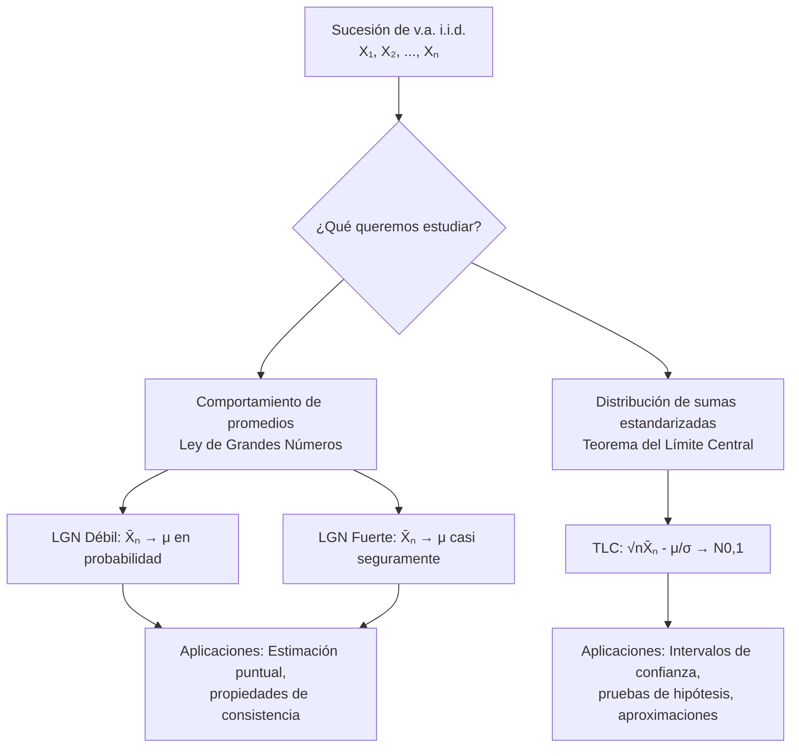

# Probabilidad I - Teoremas límite para sucesiones de variables aleatorias discretas

## 4.4 Enunciado de algunos teoremas límite: Leyes de los Grandes Números, Teorema de Límite Central.

---

Los **teoremas límite** son resultados fundamentales en probabilidad que describen el comportamiento de sucesiones de variables aleatorias cuando el número de términos tiende a infinito. Estas herramientas matemáticas son la base para la inferencia estadística y muchas aplicaciones prácticas.

### Conceptos Preliminares

#### Convergencia en Probabilidad

Una sucesión de variables aleatorias $\{X_n\}$ converge en probabilidad a una variable $X$ si:

$$\lim_{n \to \infty} P(|X_n - X| > \varepsilon) = 0 \quad \text{para todo } \varepsilon > 0$$

Notación: $X_n \xrightarrow{P} X$

#### Convergencia en Distribución

Una sucesión de variables aleatorias $\{X_n\}$ converge en distribución a $X$ si:

$$\lim_{n \to \infty} F_{X_n}(x) = F_X(x)$$

para todos los puntos $x$ donde $F_X$ es continua.
Notación: $X_n \xrightarrow{D} X$

### Leyes de los Grandes Números

#### Ley Débil de los Grandes Números (LGN Débil)

Sea $X_1, X_2, \ldots, X_n$ una sucesión de variables aleatorias i.i.d. con $E[X_i] = \mu$ y $\text{Var}(X_i) = \sigma^2 < \infty$. Entonces:

$$ \bar{X}\_n = \frac{1}{n} \sum_{i=1}^n X\_i \xrightarrow{P} \mu $$

**Demostración (usando Chebyshev):**

$$P(|\bar{X}_n - \mu| > \varepsilon) \leq \frac{\text{Var}(\bar{X}_n)}{\varepsilon^2} = \frac{\sigma^2}{n\varepsilon^2} \to 0$$

#### Ley Fuerte de los Grandes Números (LGN Fuerte)

Bajo las mismas condiciones:

$$\bar{X}_n \xrightarrow{\text{c.s.}} \mu$$

donde $\xrightarrow{\text{c.s.}}$ denota convergencia casi segura.

### Teorema del Límite Central (TLC)

#### Enunciado del TLC

Sea $X_1, X_2, \ldots, X_n$ una sucesión de variables aleatorias i.i.d. con $E[X_i] = \mu$ y $\text{Var}(X_i) = \sigma^2 < \infty$. Entonces:

$$\frac{\bar{X}_n - \mu}{\sigma/\sqrt{n}} \xrightarrow{D} Z \sim N(0, 1)$$

Equivalentemente:

$$\sqrt{n}(\bar{X}_n - \mu) \xrightarrow{D} N(0, \sigma^2)$$

#### Forma Práctica del TLC

Para $n$ suficientemente grande:

$$ \bar{X}\_n \approx N\left(\mu, \frac{\sigma^2}{n}\right) $$

$$ S\_n = \sum_{i=1}^n X\_i \approx N(n\mu, n\sigma^2) $$

### Diagrama de Flujo: Aplicación de Teoremas Límite



### Ejemplos Resueltos

#### Ejemplo 1: Aplicación de LGN

Un dado justo se lanza 1000 veces. Sea $S_n$ la suma de los resultados. Estimar $P(3400 \leq S_n \leq 3600)$.

**Solución:**

- $E[X_i] = 3.5$, $\text{Var}(X_i) = 35/12 \approx 2.9167$
- Por LGN: $\bar{X}_n \approx 3.5$
- $S_n = n\bar{X}_n \approx 3500$

#### Ejemplo 2: Aplicación del TLC

Sea $X_i \sim \text{Bernoulli}(0.4)$ i.i.d. Calcular $P(380 \leq S_{1000} \leq 420)$.

**Solución:**

- $\mu = 0.4$, $\sigma^2 = 0.4 \times 0.6 = 0.24$
- $S_{1000} \approx N(400, 240)$
- $P(380 \leq S_{1000} \leq 420) \approx \Phi\left(\frac{20}{\sqrt{240}}\right) - \Phi\left(\frac{-20}{\sqrt{240}}\right) \approx 0.900$

### Código Python para Simulación

```python
import numpy as np
import matplotlib.pyplot as plt
from scipy.stats import norm, binom, poisson

def demostrar_lgn_tlc(distribucion, params, n_muestras=1000, n_max=1000):
    """
    Demuestra visualmente la LGN y el TLC
    """
    # Configuración
    n_valores = np.arange(10, n_max + 1, 10)
    promedios = []
    sumas_estandarizadas = []

    # Parámetros teóricos
    if distribucion == 'bernoulli':
        mu = params['p']
        sigma = np.sqrt(mu * (1 - params['p']))
        generar_muestra = lambda n: np.random.binomial(1, params['p'], n)
    elif distribucion == 'poisson':
        mu = params['lambda']
        sigma = np.sqrt(mu)
        generar_muestra = lambda n: np.random.poisson(params['lambda'], n)

    # Simulaciones
    for n in n_valores:
        muestras = [generar_muestra(n) for _ in range(n_muestras)]
        promedios_muestra = [np.mean(m) for m in muestras]
        promedios.append(np.mean(promedios_muestra))

        # Para TLC
        if n > 30:  # Condición para aplicación del TLC
            z_values = [(np.mean(m) - mu) / (sigma/np.sqrt(n)) for m in muestras]
            sumas_estandarizadas.extend(z_values)

    # Gráficos
    fig, (ax1, ax2, ax3) = plt.subplots(1, 3, figsize=(15, 5))

    # LGN
    ax1.plot(n_valores, promedios, 'b-', label='Promedio observado')
    ax1.axhline(y=mu, color='r', linestyle='--', label=f'μ = {mu}')
    ax1.set_xlabel('Tamaño de muestra (n)')
    ax1.set_ylabel('Promedio')
    ax1.set_title('Ley de Grandes Números')
    ax1.legend()
    ax1.grid(True)

    # TLC - Histograma
    if sumas_estandarizadas:
        ax2.hist(sumas_estandarizadas, bins=50, density=True, alpha=0.7,
                label='Datos estandarizados')
        x = np.linspace(-4, 4, 100)
        ax2.plot(x, norm.pdf(x), 'r-', label='N(0,1)')
        ax2.set_xlabel('Valor estandarizado')
        ax2.set_ylabel('Densidad')
        ax2.set_title('Teorema del Límite Central')
        ax2.legend()
        ax2.grid(True)

    # TLC - QQ plot
    if sumas_estandarizadas:
        sample_sorted = np.sort(sumas_estandarizadas)
        theoretical_quantiles = norm.ppf(np.linspace(0.01, 0.99, len(sample_sorted)))
        ax3.scatter(theoretical_quantiles, sample_sorted, alpha=0.5)
        min_val = min(theoretical_quantiles.min(), sample_sorted.min())
        max_val = max(theoretical_quantiles.max(), sample_sorted.max())
        ax3.plot([min_val, max_val], [min_val, max_val], 'r--')
        ax3.set_xlabel('Cuantiles teóricos N(0,1)')
        ax3.set_ylabel('Cuantiles muestrales')
        ax3.set_title('QQ-plot para normalidad')
        ax3.grid(True)

    plt.tight_layout()
    plt.show()

# Ejemplo de uso
print("Demostración con Bernoulli(0.4):")
demostrar_lgn_tlc('bernoulli', {'p': 0.4})

print("\nDemostración con Poisson(3):")
demostrar_lgn_tlc('poisson', {'lambda': 3})
```

### Ejercicios Propuestos

#### Ejercicio 1

Sea $X_i \sim \text{Bernoulli}(0.6)$ i.i.d. para $i = 1, 2, \ldots, n$.
a) Use la LGN para estimar el valor de $n$ necesario para que $ P(|\bar{X}\_n - 0.6| > 0.02) \leq 0.05 $
b) Use el TLC para aproximar $ P(\bar{X}\_{100} > 0.62) $

#### Ejercicio 2

Un dado justo se lanza $n$ veces. Sea $S_n$ la suma de los resultados.
a) ¿Qué teorema límite usaría para aproximar $P(S_{100} > 360)$?
b) Calcule esta probabilidad usando la aproximación apropiada
c) Determine $n$ tal que $ P(3.4 \leq \bar{X}\_n \leq 3.6) \geq 0.95 $

#### Ejercicio 3

Sea $ X\_i \sim \text{Poisson}(2) $ i.i.d. para $i = 1, 2, \ldots, n$.
a) Encuentre la distribución exacta de $ S\_n = \sum_{i=1}^n X\_i $
b) Use el TLC para aproximar $ P(S\_{50} \leq 105) $
c) Compare con el valor exacto (si es posible)

#### Ejercicio 4 (Avanzado)

Demuestre la Ley Débil de los Grandes Números usando la desigualdad de Chebyshev. Especifique claramente todas las condiciones necesarias.

### Tabla Comparativa de Teoremas Límite

| Teorema    | Tipo de Convergencia         | Condiciones             | Aplicación             |
| ---------- | ---------------------------- | ----------------------- | ---------------------- |
| LGN Débil  | Convergencia en probabilidad | i.i.d., varianza finita | Estimación consistente |
| LGN Fuerte | Convergencia casi segura     | i.i.d., varianza finita | Convergencia fuerte    |
| TLC        | Convergencia en distribución | i.i.d., varianza finita | Aproximación normal    |

### Aplicaciones Prácticas

1. **Inferencia estadística:** Construcción de intervalos de confianza
2. **Control de calidad:** Límites de control en gráficos de control
3. **Finanzas:** Modelización de rendimientos de activos
4. **Seguros:** Cálculo de primas y reservas
5. **Simulación:** Análisis de resultados de Monte Carlo

### Referencias

1. Durrett, R. (2019). "Probability: Theory and Examples"
2. Billingsley, P. (1995). "Probability and Measure"
3. Casella, G., & Berger, R. L. (2002). "Statistical Inference"
4. Ross, S. M. (2019). "A First Course in Probability"

### Consejos de Estudio

1. **Entienda las diferencias** entre los tipos de convergencia
2. **Verifique siempre las condiciones** de aplicación de cada teorema
3. **Practique con simulaciones** para desarrollar intuición
4. **Aprenda las demostraciones** para comprender profundamente los resultados

### Preguntas de Autoevaluación

1. ¿Cuál es la diferencia fundamental entre la LGN y el TLC?
2. ¿Por qué es importante la condición de varianza finita en estos teoremas?
3. ¿Cómo afecta la dependencia entre variables a la aplicación de estos teoremas?
4. ¿En qué situaciones prácticas sería apropiado usar el TLC para variables discretas?
