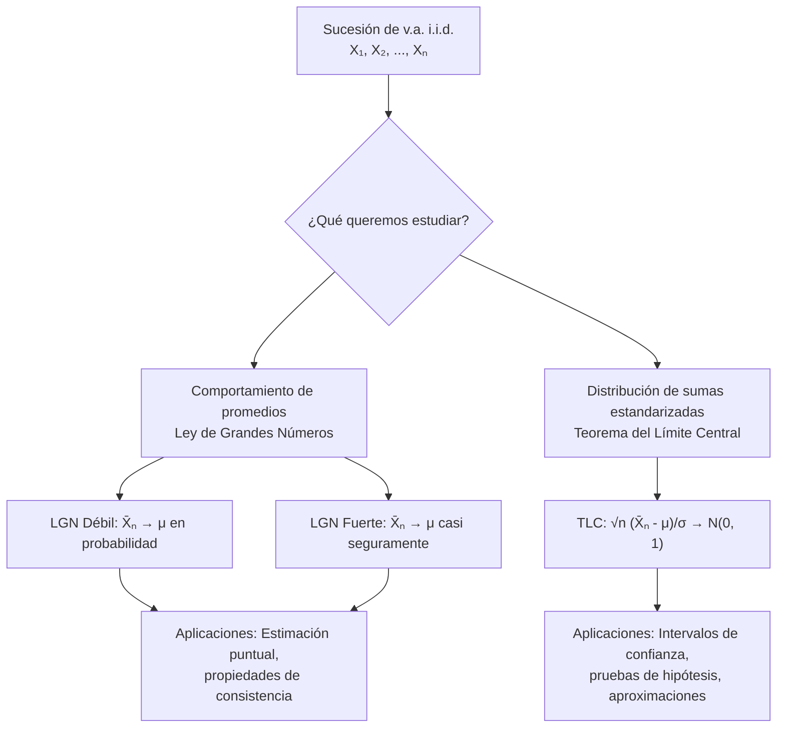

# Probabilidad I - Teoremas límite para sucesiones de variables aleatorias discretas

## 4.4 Enunciado de algunos teoremas límite: Leyes de los Grandes Números, Teorema de Límite Central.

---

Los **teoremas límite** son resultados fundamentales en probabilidad que describen el comportamiento de sucesiones de variables aleatorias cuando el número de términos tiende a infinito. Estas herramientas matemáticas son la base para la inferencia estadística y muchas aplicaciones prácticas.

### Conceptos Preliminares

Una sucesión de variables aleatorias no "converge" en un solo sentido, porque cada $X_n$ es una función y no un número. Se usan varios modos de convergencia, de más fuerte a más débil.

#### Convergencia Casi Segura

$X_n$ converge **casi seguramente** a $X$ si

$$ P\left(\lim_{n \to \infty} X_n = X\right) = 1 $$

es decir, para casi todo resultado $\omega$ del experimento, la sucesión de números $X_n(\omega)$ converge a $X(\omega).$ Notación: $X_n \xrightarrow{\text{c.s.}} X.$

#### Convergencia en Probabilidad

Una sucesión de variables aleatorias $\{X_n\}$ converge en probabilidad a una variable $X$ si:

$$ \lim_{n \to \infty} P(|X_n - X| > \varepsilon) = 0 \quad \text{para todo } \varepsilon > 0 $$

Notación: $X_n \xrightarrow{P} X.$ Para $n$ grande, es poco probable que $X_n$ esté lejos de $X,$ aunque para un $\omega$ particular la sucesión podría alejarse de vez en cuando indefinidamente.

#### Convergencia en Distribución

Una sucesión de variables aleatorias $\{X_n\}$ converge en distribución a $X$ si:

$$\lim_{n \to \infty} F_{X_n}(x) = F_X(x)$$

para todos los puntos $x$ donde $F_X$ es continua. Notación: $X_n \xrightarrow{D} X.$ Solo se refiere a las **distribuciones**: dice que las probabilidades de $X_n$ se parecen a las de $X,$ no que los valores se parezcan. Se excluyen los puntos de discontinuidad porque, por ejemplo, $X_n = \frac{1}{n}$ debe converger a $X = 0,$ aunque $F_{X_n}(0) = 0$ y $F_X(0) = 1.$

Las relaciones entre los tres modos son

$$ X_n \xrightarrow{\text{c.s.}} X \;\Longrightarrow\; X_n \xrightarrow{P} X \;\Longrightarrow\; X_n \xrightarrow{D} X $$

y en general los recíprocos son falsos; la excepción es que la convergencia en distribución a una **constante** implica convergencia en probabilidad.

### Leyes de los Grandes Números

#### Ley Débil de los Grandes Números (LGN Débil)

Sea $X_1, X_2, \ldots, X_n$ una sucesión de variables aleatorias i.i.d. (independientes e idénticamente distribuidas) con $E[X_i] = \mu$ y $\text{Var}(X_i) = \sigma^2 < \infty.$ Entonces:

$$ \bar{X}_n = \frac{1}{n} \sum_{i=1}^n X_i \xrightarrow{P} \mu $$

**Demostración (usando Chebyshev):**

$$ P(|\bar{X}_n - \mu| > \varepsilon) \leq \frac{\text{Var}(\bar{X}_n)}{\varepsilon^2} = \frac{\sigma^2}{n\varepsilon^2} \to 0 $$

El tema 4.5 la desarrolla con detalle. La hipótesis de varianza finita simplifica la demostración, pero no es necesaria: Khinchin demostró que basta $E[|X_i|] < \infty.$

#### Ley Fuerte de los Grandes Números (LGN Fuerte)

Si las $X_i$ son i.i.d. con $E[|X_i|] < \infty$ y $E[X_i] = \mu,$ entonces

$$ \bar{X}_n \xrightarrow{\text{c.s.}} \mu $$

donde $\xrightarrow{\text{c.s.}}$ denota convergencia casi segura (Kolmogorov, 1933). Es la que justifica la interpretación frecuentista: con probabilidad 1, la **trayectoria** de promedios de un experimento concreto converge a $\mu$ (tema 1.9). Si la media no existe, la ley falla: el promedio de variables de Cauchy no converge a nada.

### Teorema del Límite Central (TLC)

#### Enunciado del TLC

Sea $X_1, X_2, \ldots, X_n$ una sucesión de variables aleatorias i.i.d. con $E[X_i] = \mu$ y $\text{Var}(X_i) = \sigma^2 < \infty.$ Entonces:

$$ \frac{\bar{X}_n - \mu}{\sigma/\sqrt{n}} \xrightarrow{D} Z \sim N(0, 1) $$

Equivalentemente:

$$ \sqrt{n}(\bar{X}_n - \mu) \xrightarrow{D} N(0, \sigma^2) $$

Lo notable es que el resultado **no depende** de la distribución de las $X_i:$ sean dados, monedas o tiempos exponenciales, la suma estandarizada se parece a una normal. Por eso la normal aparece en tantos fenómenos que resultan de acumular muchas contribuciones pequeñas e independientes.

**Idea de la demostración.** Sea $Y_i = \frac{X_i - \mu}{\sigma},$ con media 0 y varianza 1, y supongamos que su MGF existe cerca de 0. La MGF de $Z_n = \frac{1}{\sqrt{n}}\sum Y_i$ es

$$ M_{Z_n}(t) = \left[M_Y\left(\frac{t}{\sqrt{n}}\right)\right]^n = \left[1 + \frac{t^2}{2n} + o\left(\frac{1}{n}\right)\right]^n \longrightarrow e^{t^2/2} $$

usando el desarrollo de Taylor $M_Y(s) = 1 + 0 \cdot s + \frac{s^2}{2} + o(s^2).$ El límite es la MGF de $N(0, 1),$ y un teorema de continuidad para funciones generadoras permite concluir la convergencia en distribución. La demostración general usa funciones características, que siempre existen.

#### Forma Práctica del TLC

Para $n$ suficientemente grande:

$$ \bar{X}_n \approx N\left(\mu, \frac{\sigma^2}{n}\right) $$

$$ S_n = \sum_{i=1}^n X_i \approx N(n\mu, n\sigma^2) $$

¿Qué tan grande debe ser $n?$ Depende de la forma de la distribución: para distribuciones simétricas, como el dado, basta $n$ de 10 o 20; para muy asimétricas, como la exponencial o una Bernoulli con $p$ pequeña, se necesita mucho más. La regla de pedir $n \geq 30$ es solo orientativa. Para la binomial se suele pedir $np \geq 5$ y $n(1 - p) \geq 5,$ y conviene usar la **corrección por continuidad** (tema 4.6). La cota de Berry-Esseen cuantifica el error: es del orden de $\frac{E|X - \mu|^3}{\sigma^3\sqrt{n}}.$

### Diagrama de Flujo: Aplicación de Teoremas Límite



### Ejemplos Resueltos

#### Ejemplo 1: Aplicación de LGN

Un dado justo se lanza 1000 veces. Sea $S_n$ la suma de los resultados. Estimar $P(3400 \leq S_n \leq 3600).$

**Solución:**

- $E[X_i] = 3.5,$ $\text{Var}(X_i) = 35/12 \approx 2.9167$
- Por LGN: $\bar{X}_n \approx 3.5,$ así que $S_n = n\bar{X}_n$ estará cerca de $3500.$ La ley dice **que** se concentra, pero no **cuánto**.
- Con Chebyshev se obtiene una garantía: $\text{Var}(S_n) = 1000 \cdot \frac{35}{12} \approx 2916.7,$ y $P(|S_n - 3500| > 100) \leq \frac{2916.7}{100^2} \approx 0.29,$ así que la probabilidad pedida es al menos $0.71.$
- Con el TLC se obtiene una aproximación: $\sigma_{S_n} \approx 54.0$ y $P \approx 2\Phi\left(\frac{100}{54.0}\right) - 1 = 2\Phi(1.85) - 1 \approx 0.936.$

#### Ejemplo 2: Aplicación del TLC

Sea $X_i \sim \text{Bernoulli}(0.4)$ i.i.d. Calcular $P(380 \leq S_{1000} \leq 420).$

**Solución:**

- $\mu = 0.4,$ $\sigma^2 = 0.4 \times 0.6 = 0.24$
- $S_{1000} \approx N(400, 240),$ con desviación estándar $\sqrt{240} \approx 15.49$
- $P(380 \leq S_{1000} \leq 420) \approx \Phi\left(\frac{20}{\sqrt{240}}\right) - \Phi\left(\frac{-20}{\sqrt{240}}\right) = 2\Phi(1.291) - 1 \approx 0.803$
- Con corrección por continuidad, usando $379.5$ y $420.5:$ $2\Phi\left(\frac{20.5}{15.49}\right) - 1 \approx 0.814,$ prácticamente igual al valor binomial exacto $0.8143.$

### Código Python para Simulación

```python
import numpy as np
import matplotlib
matplotlib.use("Agg")
import matplotlib.pyplot as plt
from scipy.stats import norm, binom, poisson

np.random.seed(4)

def demostrar_lgn_tlc(distribucion, params, n_muestras=300, n_max=1000):
    """
    Demuestra visualmente la LGN y el TLC
    """
    # Configuración
    n_valores = np.arange(10, n_max + 1, 10)
    promedios = []
    sumas_estandarizadas = []

    # Parámetros teóricos
    if distribucion == 'bernoulli':
        mu = params['p']
        sigma = np.sqrt(mu * (1 - params['p']))
        generar_muestra = lambda n: np.random.binomial(1, params['p'], n)
    elif distribucion == 'poisson':
        mu = params['lambda']
        sigma = np.sqrt(mu)
        generar_muestra = lambda n: np.random.poisson(params['lambda'], n)

    # Simulaciones
    for n in n_valores:
        muestras = [generar_muestra(n) for _ in range(n_muestras)]
        promedios_muestra = [np.mean(m) for m in muestras]
        promedios.append(np.mean(promedios_muestra))

        # Para TLC
        if n > 30:  # Condición para aplicación del TLC
            z_values = [(np.mean(m) - mu) / (sigma/np.sqrt(n)) for m in muestras]
            sumas_estandarizadas.extend(z_values)

    # Gráficos
    fig, (ax1, ax2, ax3) = plt.subplots(1, 3, figsize=(15, 5))

    # LGN
    ax1.plot(n_valores, promedios, 'b-', label='Promedio observado')
    ax1.axhline(y=mu, color='r', linestyle='--', label=f'μ = {mu}')
    ax1.set_xlabel('Tamaño de muestra (n)')
    ax1.set_ylabel('Promedio')
    ax1.set_title('Ley de Grandes Números')
    ax1.legend()
    ax1.grid(True)

    # TLC - Histograma
    if sumas_estandarizadas:
        ax2.hist(sumas_estandarizadas, bins=50, density=True, alpha=0.7,
                label='Datos estandarizados')
        x = np.linspace(-4, 4, 100)
        ax2.plot(x, norm.pdf(x), 'r-', label='N(0,1)')
        ax2.set_xlabel('Valor estandarizado')
        ax2.set_ylabel('Densidad')
        ax2.set_title('Teorema del Límite Central')
        ax2.legend()
        ax2.grid(True)

    # TLC - QQ plot
    if sumas_estandarizadas:
        sample_sorted = np.sort(sumas_estandarizadas)
        m = len(sample_sorted)
        theoretical_quantiles = norm.ppf((np.arange(1, m + 1) - 0.5) / m)
        ax3.scatter(theoretical_quantiles, sample_sorted, alpha=0.5)
        min_val = min(theoretical_quantiles.min(), sample_sorted.min())
        max_val = max(theoretical_quantiles.max(), sample_sorted.max())
        ax3.plot([min_val, max_val], [min_val, max_val], 'r--')
        ax3.set_xlabel('Cuantiles teóricos N(0,1)')
        ax3.set_ylabel('Cuantiles muestrales')
        ax3.set_title('QQ-plot para normalidad')
        ax3.grid(True)

    plt.tight_layout()
    plt.savefig(f"lgn_tlc_{distribucion}.png", dpi=80)
    return np.std(sumas_estandarizadas)

# Ejemplo de uso
print("Demostración con Bernoulli(0.4): desviación de Z ≈", round(demostrar_lgn_tlc('bernoulli', {'p': 0.4}), 3))
print("Demostración con Poisson(3):     desviación de Z ≈", round(demostrar_lgn_tlc('poisson', {'lambda': 3}), 3))
```

El primer panel muestra la LGN: el promedio de los promedios se queda pegado a $\mu.$ Los otros dos, el TLC: los promedios estandarizados tienen un histograma de campana y su Q-Q plot sigue la diagonal; su desviación estándar es cercana a 1, como debe ser.

### Ejercicios Propuestos

#### Ejercicio 1

Sea $X_i \sim \text{Bernoulli}(0.6)$ i.i.d. para $i = 1, 2, \ldots, n.$
- a) Use la LGN, en su versión con la desigualdad de Chebyshev, para encontrar un valor de $n$ que garantice $P(|\bar{X}_n - 0.6| > 0.02) \leq 0.05.$ Compare con el que sugiere el TLC.
- b) Use el TLC para aproximar $P(\bar{X}_{100} > 0.62).$

#### Ejercicio 2

Un dado justo se lanza $n$ veces. Sea $S_n$ la suma de los resultados.
- a) ¿Qué teorema límite usaría para aproximar $P(S_{100} > 360)?$
- b) Calcule esta probabilidad usando la aproximación apropiada.
- c) Determine $n$ tal que $P(3.4 \leq \bar{X}_n \leq 3.6) \geq 0.95.$

#### Ejercicio 3

Sea $X_i \sim \text{Poisson}(2)$ i.i.d. para $i = 1, 2, \ldots, n.$

- a) Encuentre la distribución exacta de $S_n = \sum_{i=1}^n X_i.$
- b) Use el TLC para aproximar $P(S_{50} \leq 105).$
- c) Compare con el valor exacto.

#### Ejercicio 4 (Avanzado)

Demuestre la Ley Débil de los Grandes Números usando la desigualdad de Chebyshev. Especifique claramente todas las condiciones necesarias.

### Soluciones

**Ejercicio 1.** a) Con $\sigma^2 = 0.24,$ Chebyshev da $P(|\bar{X}_n - 0.6| > 0.02) \leq \frac{0.24}{n(0.02)^2} = \frac{600}{n},$ que es a lo más $0.05$ si $n \geq 12\,000.$ El TLC sugiere $1.96\sqrt{\frac{0.24}{n}} \leq 0.02,$ es decir $n \geq 2305:$ Chebyshev es una garantía válida para cualquier distribución, pero mucho más conservadora. b) $\bar{X}_{100} \approx N(0.6, 0.0024),$ con desviación $0.049:$ $P(\bar{X}_{100} > 0.62) \approx 1 - \Phi(0.408) \approx 0.342.$ Con corrección por continuidad, $P(S > 62) = P(S \geq 63) \approx 1 - \Phi\left(\frac{62.5 - 60}{4.899}\right) \approx 0.305,$ muy cerca del valor exacto $0.307.$

**Ejercicio 2.** a) El TLC, porque se pide una probabilidad concreta y no solo el comportamiento límite. b) $E[S_{100}] = 350$ y $\sigma_{S_{100}} = \sqrt{100 \cdot \frac{35}{12}} \approx 17.08;$ con corrección por continuidad, $P(S_{100} > 360) = P(S_{100} \geq 361) \approx 1 - \Phi\left(\frac{360.5 - 350}{17.08}\right) \approx 1 - \Phi(0.615) \approx 0.269.$ c) Se necesita $1.96 \cdot \frac{1.708}{\sqrt{n}} \leq 0.1,$ es decir $n \geq 1121$ lanzamientos.

**Ejercicio 3.** a) $S_n \sim \text{Poisson}(2n)$ (tema 4.3). b) $S_{50} \sim \text{Poisson}(100) \approx N(100, 100);$ con corrección, $P(S_{50} \leq 105) \approx \Phi\left(\frac{105.5 - 100}{10}\right) = \Phi(0.55) \approx 0.709;$ sin corrección, $\Phi(0.5) \approx 0.691.$ c) El valor exacto es $\sum_{k=0}^{105}e^{-100}\frac{100^k}{k!} \approx 0.713:$ la aproximación con corrección es mejor; la diferencia restante se debe a la ligera asimetría de la Poisson.

**Ejercicio 4.** Condiciones: las $X_i$ son no correlacionadas (en particular, basta que sean independientes), con la misma media $\mu$ y varianzas acotadas por $\sigma^2 < \infty.$ Entonces $E[\bar{X}_n] = \mu$ por linealidad y $\text{Var}(\bar{X}_n) = \frac{1}{n^2}\sum\text{Var}(X_i) \leq \frac{\sigma^2}{n},$ porque las covarianzas son 0. Por Chebyshev, para cada $\varepsilon > 0,$ $P(|\bar{X}_n - \mu| \geq \varepsilon) \leq \frac{\sigma^2}{n\varepsilon^2} \to 0.$ $\blacksquare$ El tema 4.5 discute la demostración y sus variantes.

### Tabla Comparativa de Teoremas Límite

| Teorema    | Tipo de Convergencia         | Condiciones             | Aplicación             |
| ---------- | ---------------------------- | ----------------------- | ---------------------- |
| LGN Débil  | Convergencia en probabilidad | i.i.d., media finita (con varianza finita la prueba es inmediata) | Estimación consistente |
| LGN Fuerte | Convergencia casi segura     | i.i.d., media finita | Justifica la interpretación frecuentista |
| TLC        | Convergencia en distribución | i.i.d., varianza finita y positiva | Aproximación normal, intervalos de confianza |

### Aplicaciones Prácticas

1. **Inferencia estadística:** Construcción de intervalos de confianza
2. **Control de calidad:** Límites de control en gráficos de control
3. **Finanzas:** Modelización de rendimientos de activos
4. **Seguros:** Cálculo de primas y reservas
5. **Simulación:** Análisis de resultados de Monte Carlo

### Referencias

1. Durrett, R. (2019). "Probability: Theory and Examples"
2. Billingsley, P. (1995). "Probability and Measure"
3. Casella, G., & Berger, R. L. (2002). "Statistical Inference"
4. Ross, S. M. (2019). "A First Course in Probability"

### Consejos de Estudio

1. **Entienda las diferencias** entre los tipos de convergencia
2. **Verifique siempre las condiciones** de aplicación de cada teorema
3. **Practique con simulaciones** para desarrollar intuición
4. **Aprenda las demostraciones** para comprender profundamente los resultados

### Preguntas de Autoevaluación

1. ¿Cuál es la diferencia fundamental entre la LGN y el TLC?
2. ¿Por qué es importante la condición de varianza finita en estos teoremas?
3. ¿Cómo afecta la dependencia entre variables a la aplicación de estos teoremas?
4. ¿En qué situaciones prácticas sería apropiado usar el TLC para variables discretas?
