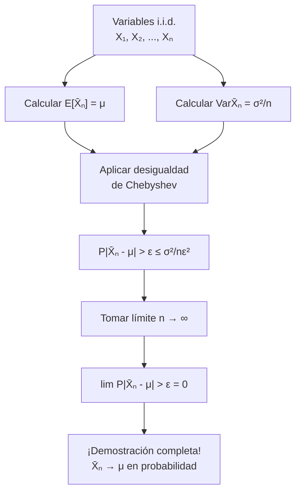

# Probabilidad I - Teoremas límite para sucesiones de variables aleatorias discretas

## 4.5 Demostración de la ley débil de los grandes números.

---

La **Ley Débil de los Grandes Números (LGN)** es uno de los teoremas fundamentales en probabilidad que establece que el promedio de una sucesión de variables aleatorias independientes e idénticamente distribuidas converge en probabilidad a su valor esperado. Esta guía presenta la demostración formal de este importante teorema.

### Conceptos Preliminares

#### Convergencia en Probabilidad

Una sucesión de variables aleatorias $\{X_n\}$ **converge en probabilidad** a una variable $X$ si:

$$\lim_{n \to \infty} P(|X_n - X| > \varepsilon) = 0 \quad \text{para todo } \varepsilon > 0$$

Notación: $X_n \xrightarrow{P} X$

#### Desigualdad de Chebyshev

Para cualquier variable aleatoria $X$ con media $\mu$ y varianza $\sigma^2,$ y para cualquier $k > 0:$

$$P(|X - \mu| \geq k) \leq \frac{\sigma^2}{k^2}$$

### Enunciado Formal de la LGN Débil

#### Teorema (Ley Débil de los Grandes Números)

Sea $X_1, X_2, \ldots, X_n$ una sucesión de variables aleatorias **independientes e idénticamente distribuidas (i.i.d.)** con media finita $\mu = E[X_i]$ y varianza finita $\sigma^2 = \text{Var}(X_i) < \infty.$

Definamos el promedio muestral:

$$ \bar{X}_n = \frac{1}{n} \sum_{i=1}^n X_i $$

Entonces, para todo $\varepsilon > 0:$

$$\lim_{n \to \infty} P(|\bar{X}_n - \mu| > \varepsilon) = 0$$

Es decir, $\bar{X}_n \xrightarrow{P} \mu.$

### Demostración Paso a Paso

#### Paso 1: Esperanza del Promedio Muestral

$$ E[\bar{X}_n] = E\lbrack \frac{1}{n} \sum_{i=1}^n X_i \rbrack = \frac{1}{n} \sum_{i=1}^n E[X_i] = \frac{1}{n} \cdot n \cdot \mu = \mu $$

#### Paso 2: Varianza del Promedio Muestral

$$ \text{Var}(\bar{X}_n) = \text{Var} \lparen \frac{1}{n} \sum_{i=1}^n X_i\rparen = \frac{1}{n^2} \sum_{i=1}^n \text{Var}(X_i) = \frac{1}{n^2} \cdot n \cdot \sigma^2 = \frac{\sigma^2}{n} $$

#### Paso 3: Aplicación de la Desigualdad de Chebyshev

Aplicamos la desigualdad de Chebyshev a $\bar{X}_n:$

$$P(|\bar{X}_n - \mu| > \varepsilon) \leq \frac{\text{Var}(\bar{X}_n)}{\varepsilon^2} = \frac{\sigma^2}{n\varepsilon^2}$$

#### Paso 4: Tomando el Límite

$$ \lim_{n \to \infty} P(|\bar{X}_n - \mu| > \varepsilon) \leq \lim_{n \to \infty} \frac{\sigma^2}{n\varepsilon^2} = 0 $$

Como las probabilidades son no negativas, concluimos:

$$\lim_{n \to \infty} P(|\bar{X}_n - \mu| > \varepsilon) = 0$$

### Diagrama de la Demostración



### Código Python para Visualización

```python
import numpy as np
import matplotlib.pyplot as plt
from scipy.stats import bernoulli, norm

def demostrar_lgn_debil(p=0.5, n_max=1000, epsilon=0.05, n_simulaciones=1000):
    """
    Demuestra visualmente la Ley Débil de los Grandes Números
    """
    n_valores = np.arange(10, n_max + 1, 10)
    probabilidades = []

    for n in n_valores:
        # Simular múltiples muestras de tamaño n
        muestras = bernoulli.rvs(p, size=(n_simulaciones, n))
        promedios = np.mean(muestras, axis=1)

        # Calcular probabilidad empírica
        prob = np.mean(np.abs(promedios - p) > epsilon)
        probabilidades.append(prob)

    # Calcular cota teórica de Chebyshev
    cota_teorica = (p * (1 - p)) / (n_valores * epsilon**2)

    # Gráficos
    plt.figure(figsize=(12, 6))

    plt.plot(n_valores, probabilidades, 'b-', linewidth=2,
             label='Probabilidad empírica $P(|\\bar{X}_n - \\mu| > \\varepsilon)$')
    plt.plot(n_valores, cota_teorica, 'r--', linewidth=2,
             label='Cota teórica de Chebyshev: $\\frac{\\sigma^2}{n\\varepsilon^2}$')
    plt.axhline(y=0, color='k', linestyle='-', alpha=0.3)

    plt.xlabel('Tamaño de muestra (n)')
    plt.ylabel('Probabilidad')
    plt.title(f'Demostración Visual de la LGN Débil (p = {p}, $\\varepsilon$ = {epsilon})')
    plt.legend()
    plt.grid(True, alpha=0.3)
    plt.ylim(-0.01, max(probabilidades) * 1.1)

    plt.show()

    return n_valores, probabilidades, cota_teorica

# Ejecutar demostración
n_valores, probs, cota = demostrar_lgn_debil(p=0.4, epsilon=0.03)
```

### Ejemplos Resueltos

#### Ejemplo 1: Variables de Bernoulli

Sea $X_1, X_2, \ldots, X_n \sim \text{Bernoulli}(p)$ i.i.d. con $p = 0.6.$

- $\mu = E[X_i] = 0.6$
- $\sigma^2 = \text{Var}(X_i) = 0.6 \times 0.4 = 0.24$

Para $\varepsilon = 0.02$ y $n = 2500:$

$$P(|\bar{X}_n - 0.6| > 0.02) \leq \frac{0.24}{2500 \times (0.02)^2} = \frac{0.24}{1} = 0.24$$

#### Ejemplo 2: Precisión de la Estimación

¿Qué tan grande debe ser $n$ para que $P(|\bar{X}_n - \mu| > 0.01) \leq 0.05?$

De la desigualdad de Chebyshev:

$$\frac{\sigma^2}{n(0.01)^2} \leq 0.05 \Rightarrow n \geq \frac{\sigma^2}{0.05 \times 0.0001} = \frac{\sigma^2}{0.000005}$$

Si $\sigma^2 = 0.25,$ entonces $n \geq 50,000.$

### Ejercicios Propuestos

#### Ejercicio 1

Sea $X_1, X_2, \ldots, X_n \sim \text{Poisson}(\lambda)$ i.i.d.
a) Demuestre que $\bar{X}_n \xrightarrow{P} \lambda$
b) Encuentre una cota para $P(|\bar{X}_n - \lambda| > \varepsilon)$ usando Chebyshev
c) Determine el tamaño de muestra necesario para que esta probabilidad sea menor a 0.1

#### Ejercicio 2

Suponga que $X_i$ tienen distribución geométrica con parámetro $p.$
a) Verifique las condiciones de la LGN débil
b) Escriba la desigualdad de Chebyshev para este caso
c) Calcule $n$ tal que $P(|\bar{X}_n - \frac{1}{p}| > 0.1) \leq 0.05$

#### Ejercicio 3

Generalice la demostración para variables que no son idénticamente distribuidas pero sí independientes, con medias $\mu_i$ y varianzas $\sigma_i^2$ acotadas.

#### Ejercicio 4 (Demostración Alternativa)

Intente demostrar la LGN débil usando la función característica en lugar de la desigualdad de Chebyshev.

### Limitaciones y Consideraciones

1. **Varianza finita:** La demostración requiere $\sigma^2 < \infty$
2. **Independencia:** Las variables deben ser independientes
3. **Distribución idéntica:** No es estrictamente necesaria pero simplifica la demostración
4. **Cota conservadora:** La desigualdad de Chebyshev proporciona una cota superior que puede ser conservadora

### Aplicaciones de la LGN Débil

1. **Estimación puntual:** El promedio muestral es un estimador consistente
2. **Simulación Monte Carlo:** Convergencia de aproximaciones
3. **Procesos estocásticos:** Comportamiento a largo plazo
4. **Teoría de la información:** Propiedades de códigos

### Referencias

1. Billingsley, P. (1995). "Probability and Measure"
2. Durrett, R. (2019). "Probability: Theory and Examples"
3. Ross, S. M. (2019). "A First Course in Probability"
4. Feller, W. (1968). "An Introduction to Probability Theory and Its Applications"

### Consejos para el Estudio

1. **Domine la desigualdad de Chebyshev** antes de abordar la demostración
2. **Entienda cada paso** de la demostración, no solo memorice
3. **Practique con ejemplos** concretos de diferentes distribuciones
4. **Compare con la LGN fuerte** para entender las diferencias

### Preguntas de Autoevaluación

1. ¿Por qué es necesaria la condición de varianza finita en esta demostración?
2. ¿Cómo cambiaría la demostración si las variables no fueran idénticamente distribuidas?
3. ¿Qué pasaría si intentáramos aplicar este método a variables con varianza infinita?
4. ¿La LGN débil implica que $\bar{X}_n$ siempre estará cerca de $\mu$ para $n$ grande?
