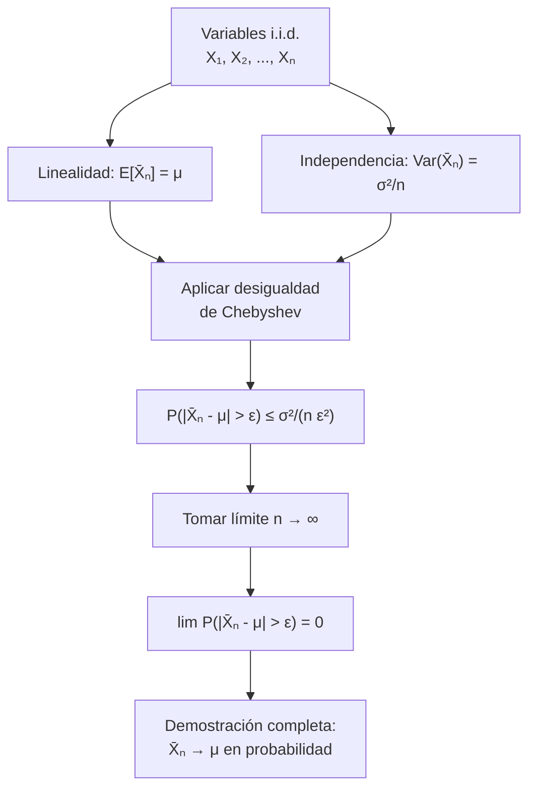

# Probabilidad I - Teoremas límite para sucesiones de variables aleatorias discretas

## 4.5 Demostración de la ley débil de los grandes números.

---

La **Ley Débil de los Grandes Números (LGN)** es uno de los teoremas fundamentales en probabilidad que establece que el promedio de una sucesión de variables aleatorias independientes e idénticamente distribuidas converge en probabilidad a su valor esperado. Esta guía presenta la demostración formal de este importante teorema.

### Conceptos Preliminares

#### Convergencia en Probabilidad

Una sucesión de variables aleatorias $\{X_n\}$ **converge en probabilidad** a una variable $X$ si:

$$\lim_{n \to \infty} P(|X_n - X| > \varepsilon) = 0 \quad \text{para todo } \varepsilon > 0$$

Notación: $X_n \xrightarrow{P} X$

#### Desigualdad de Chebyshev

Para cualquier variable aleatoria $X$ con media $\mu$ y varianza $\sigma^2,$ y para cualquier $k > 0:$

$$P(|X - \mu| \geq k) \leq \frac{\sigma^2}{k^2}$$

### Enunciado Formal de la LGN Débil

#### Teorema (Ley Débil de los Grandes Números)

Sea $X_1, X_2, \ldots, X_n$ una sucesión de variables aleatorias **independientes e idénticamente distribuidas (i.i.d.)** con media finita $\mu = E[X_i]$ y varianza finita $\sigma^2 = \text{Var}(X_i) < \infty.$

Definamos el promedio muestral:

$$ \bar{X}_n = \frac{1}{n} \sum_{i=1}^n X_i $$

Entonces, para todo $\varepsilon > 0:$

$$\lim_{n \to \infty} P(|\bar{X}_n - \mu| > \varepsilon) = 0$$

Es decir, $\bar{X}_n \xrightarrow{P} \mu.$

### Demostración Paso a Paso

#### Paso 1: Esperanza del Promedio Muestral

$$ E[\bar{X}_n] = E\lbrack \frac{1}{n} \sum_{i=1}^n X_i \rbrack = \frac{1}{n} \sum_{i=1}^n E[X_i] = \frac{1}{n} \cdot n \cdot \mu = \mu $$

#### Paso 2: Varianza del Promedio Muestral

$$ \text{Var}(\bar{X}_n) = \text{Var} \left( \frac{1}{n} \sum_{i=1}^n X_i\right) = \frac{1}{n^2} \sum_{i=1}^n \text{Var}(X_i) = \frac{1}{n^2} \cdot n \cdot \sigma^2 = \frac{\sigma^2}{n} $$

La constante $\frac{1}{n}$ sale al cuadrado, por la propiedad $\text{Var}(aX) = a^2\text{Var}(X).$ El segundo paso es el único que usa la **independencia**: en general, la varianza de una suma incluye los términos $2\sum_{i<j}\text{Cov}(X_i, X_j),$ que son 0 para variables independientes (basta, de hecho, que no estén correlacionadas).

#### Paso 3: Aplicación de la Desigualdad de Chebyshev

Aplicamos la desigualdad de Chebyshev a $\bar{X}_n:$

$$ P(|\bar{X}_n - \mu| > \varepsilon) \leq P(|\bar{X}_n - \mu| \geq \varepsilon) \leq \frac{\text{Var}(\bar{X}_n)}{\varepsilon^2} = \frac{\sigma^2}{n\varepsilon^2} $$

usando el paso 1 para saber que la media de $\bar{X}_n$ es $\mu,$ y el paso 2 para su varianza.

#### Paso 4: Tomando el Límite

$$ \lim_{n \to \infty} P(|\bar{X}_n - \mu| > \varepsilon) \leq \lim_{n \to \infty} \frac{\sigma^2}{n\varepsilon^2} = 0 $$

Como las probabilidades son no negativas, por el teorema del sándwich concluimos:

$$ \lim_{n \to \infty} P(|\bar{X}_n - \mu| > \varepsilon) = 0 \qquad \blacksquare $$

#### Qué dice y qué no dice el teorema

- La demostración da algo más que el límite: una **cota explícita** para cada $n,$ $\frac{\sigma^2}{n\varepsilon^2},$ que se puede usar para elegir el tamaño de muestra.
- Dice que, **para cada $n$ grande**, es poco probable que el promedio esté lejos de $\mu.$ No dice que la sucesión concreta de promedios de un experimento converja; eso es la ley **fuerte**.
- El caso de frecuencias es una consecuencia inmediata: si $X_i = \mathbf{1}_A$ en la repetición $i,$ entonces $\bar{X}_n$ es la frecuencia relativa de $A$ y $\mu = P(A).$ Fue el teorema de Jakob Bernoulli (1713), primera versión de la ley.

### Diagrama de la Demostración



### Código Python para Visualización

```python
import numpy as np
import matplotlib
matplotlib.use("Agg")
import matplotlib.pyplot as plt
from scipy.stats import bernoulli, norm

np.random.seed(5)

def demostrar_lgn_debil(p=0.5, n_max=1000, epsilon=0.05, n_simulaciones=500):
    """
    Demuestra visualmente la Ley Débil de los Grandes Números
    """
    n_valores = np.arange(10, n_max + 1, 20)
    probabilidades = []

    for n in n_valores:
        # Simular múltiples muestras de tamaño n
        muestras = bernoulli.rvs(p, size=(n_simulaciones, n))
        promedios = np.mean(muestras, axis=1)

        # Calcular probabilidad empírica
        prob = np.mean(np.abs(promedios - p) > epsilon)
        probabilidades.append(prob)

    # Calcular cota teórica de Chebyshev
    cota_teorica = (p * (1 - p)) / (n_valores * epsilon**2)

    # Gráficos
    plt.figure(figsize=(12, 6))

    plt.plot(n_valores, probabilidades, 'b-', linewidth=2,
             label='Probabilidad empírica $P(|\\bar{X}_n - \\mu| > \\varepsilon)$')
    plt.plot(n_valores, cota_teorica, 'r--', linewidth=2,
             label='Cota teórica de Chebyshev: $\\frac{\\sigma^2}{n\\varepsilon^2}$')
    plt.axhline(y=0, color='k', linestyle='-', alpha=0.3)

    plt.xlabel('Tamaño de muestra (n)')
    plt.ylabel('Probabilidad')
    plt.title(f'Demostración Visual de la LGN Débil (p = {p}, $\\varepsilon$ = {epsilon})')
    plt.legend()
    plt.grid(True, alpha=0.3)
    plt.ylim(-0.01, 1.05)

    plt.savefig("lgn_debil.png", dpi=90)

    return n_valores, probabilidades, cota_teorica

# Ejecutar demostración
n_valores, probs, cota = demostrar_lgn_debil(p=0.4, epsilon=0.03)
for n, pr, c in list(zip(n_valores, probs, cota))[::10]:
    print(f"n = {n:4d}: probabilidad empírica {pr:.3f}  cota de Chebyshev {min(c, 1):.3f}")
```

Para $n$ pequeño la cota de Chebyshev es mayor que 1 y no dice nada; para $n$ grande, tanto la probabilidad simulada como la cota tienden a 0, pero la probabilidad real es mucho menor que la cota: Chebyshev garantiza la convergencia sin aprovechar la forma de la distribución.

### Ejemplos Resueltos

#### Ejemplo 1: Variables de Bernoulli

Sea $X_1, X_2, \ldots, X_n \sim \text{Bernoulli}(p)$ i.i.d. con $p = 0.6.$

- $\mu = E[X_i] = 0.6$
- $\sigma^2 = \text{Var}(X_i) = 0.6 \times 0.4 = 0.24$

Para $\varepsilon = 0.02$ y $n = 2500:$

$$ P(|\bar{X}_n - 0.6| > 0.02) \leq \frac{0.24}{2500 \times (0.02)^2} = \frac{0.24}{1} = 0.24 $$

El TLC da una idea del valor real: $\sigma_{\bar{X}} = \sqrt{\frac{0.24}{2500}} \approx 0.0098,$ y $P \approx 2(1 - \Phi(2.04)) \approx 0.041,$ unas seis veces menor que la cota.

#### Ejemplo 2: Precisión de la Estimación

¿Qué tan grande debe ser $n$ para que $P(|\bar{X}_n - \mu| > 0.01) \leq 0.05?$

De la desigualdad de Chebyshev:

$$ \frac{\sigma^2}{n(0.01)^2} \leq 0.05 \quad \Rightarrow \quad n \geq \frac{\sigma^2}{0.05 \times 0.0001} = \frac{\sigma^2}{0.000005} = 200\,000\,\sigma^2 $$

Si $\sigma^2 = 0.25,$ el máximo posible para una Bernoulli, entonces $n \geq 50\,000.$ Es el número de encuestados que garantiza, sin ninguna aproximación, que una proporción estimada esté a menos de un punto porcentual de la verdadera con probabilidad 0.95; con el TLC bastarían unos 9 604.

### Ejercicios Propuestos

#### Ejercicio 1

Sea $X_1, X_2, \ldots, X_n \sim \text{Poisson}(\lambda)$ i.i.d.

- a) Demuestre que $\bar{X}_n \xrightarrow{P} \lambda.$
- b) Encuentre una cota para $P(|\bar{X}_n - \lambda| > \varepsilon)$ usando Chebyshev.
- c) Determine el tamaño de muestra necesario para que esta probabilidad sea menor a 0.1.

#### Ejercicio 2

Suponga que las $X_i$ son independientes y tienen distribución geométrica con parámetro $p.$

- a) Verifique las condiciones de la LGN débil.
- b) Escriba la desigualdad de Chebyshev para este caso.
- c) Calcule $n$ tal que $P(|\bar{X}_n - \frac{1}{p}| > 0.1) \leq 0.05.$

#### Ejercicio 3

Generalice la demostración para variables que no son idénticamente distribuidas pero sí independientes, con medias $\mu_i$ y varianzas $\sigma_i^2$ acotadas.

#### Ejercicio 4 (Demostración Alternativa)

Intente demostrar la LGN débil usando la función característica en lugar de la desigualdad de Chebyshev.

### Limitaciones y Consideraciones

1. **Varianza finita:** Esta demostración requiere $\sigma^2 < \infty.$ El teorema sigue siendo cierto con solo $E[|X_i|] < \infty$ (Khinchin), pero la prueba necesita otras técnicas, como truncar las variables o usar funciones características (ejercicio 4).
2. **Independencia:** La demostración solo usa que las variables no estén correlacionadas. Sin alguna condición de este tipo el teorema falla: si $X_1 = X_2 = \cdots,$ el promedio es siempre $X_1$ y no se concentra.
3. **Distribución idéntica:** No es estrictamente necesaria pero simplifica la demostración (ejercicio 3).
4. **Cota conservadora:** La desigualdad de Chebyshev proporciona una cota superior que puede ser muy conservadora.
5. **Media finita:** Si la media no existe, el promedio no se estabiliza: el promedio de $n$ variables de Cauchy tiene la misma distribución de Cauchy que una sola.

### Soluciones

**Ejercicio 1.** a) Las $X_i$ son i.i.d. con media $\lambda$ y varianza $\lambda < \infty,$ así que se aplica el teorema. b) $P(|\bar{X}_n - \lambda| > \varepsilon) \leq \frac{\lambda}{n\varepsilon^2}.$ c) Basta $\frac{\lambda}{n\varepsilon^2} < 0.1,$ es decir $n > \frac{10\lambda}{\varepsilon^2};$ con $\lambda = 2$ y $\varepsilon = 0.1,$ $n > 2000.$

**Ejercicio 2.** a) La geométrica tiene media $\frac{1}{p}$ y varianza $\frac{1-p}{p^2},$ finitas para $0 < p \leq 1.$ b) $P\left(\left|\bar{X}_n - \frac{1}{p}\right| \geq \varepsilon\right) \leq \frac{1 - p}{np^2\varepsilon^2}.$ c) $\frac{1-p}{n p^2 (0.01)} \leq 0.05$ da $n \geq \frac{2000(1-p)}{p^2};$ por ejemplo, con $p = 0.5,$ $n \geq 4000.$

**Ejercicio 3.** Si las $X_i$ son independientes con medias $\mu_i$ y varianzas $\sigma_i^2 \leq C,$ sea $\bar{\mu}_n = \frac{1}{n}\sum_{i=1}^n \mu_i.$ Entonces $E[\bar{X}_n] = \bar{\mu}_n$ y $\text{Var}(\bar{X}_n) = \frac{1}{n^2}\sum\sigma_i^2 \leq \frac{C}{n},$ y por Chebyshev $P(|\bar{X}_n - \bar{\mu}_n| > \varepsilon) \leq \frac{C}{n\varepsilon^2} \to 0.$ El promedio se acerca al promedio de las medias. Basta incluso $\frac{1}{n^2}\sum_{i=1}^n\sigma_i^2 \to 0$ (ley de Chebyshev).

**Ejercicio 4.** Sea $\varphi(t) = E[e^{itX_1}].$ Si $E[|X_1|] < \infty,$ $\varphi$ es derivable con $\varphi(t) = 1 + i\mu t + o(t).$ Por independencia, la función característica del promedio es

$$ \varphi_{\bar{X}_n}(t) = \varphi\left(\frac{t}{n}\right)^n = \left(1 + \frac{i\mu t}{n} + o\left(\frac{1}{n}\right)\right)^n \longrightarrow e^{i\mu t} $$

que es la función característica de la constante $\mu.$ Por el teorema de continuidad de Lévy, $\bar{X}_n \xrightarrow{D} \mu,$ y como el límite es constante, la convergencia también es en probabilidad. $\blacksquare$ Esta demostración **no** necesita varianza finita.

### Aplicaciones de la LGN Débil

1. **Estimación puntual:** El promedio muestral es un estimador consistente
2. **Simulación Monte Carlo:** Convergencia de aproximaciones
3. **Procesos estocásticos:** Comportamiento a largo plazo
4. **Teoría de la información:** Propiedades de códigos

### Referencias

1. Billingsley, P. (1995). "Probability and Measure"
2. Durrett, R. (2019). "Probability: Theory and Examples"
3. Ross, S. M. (2019). "A First Course in Probability"
4. Feller, W. (1968). "An Introduction to Probability Theory and Its Applications"

### Consejos para el Estudio

1. **Domine la desigualdad de Chebyshev** antes de abordar la demostración
2. **Entienda cada paso** de la demostración, no solo memorice
3. **Practique con ejemplos** concretos de diferentes distribuciones
4. **Compare con la LGN fuerte** para entender las diferencias

### Preguntas de Autoevaluación

1. ¿Por qué es necesaria la condición de varianza finita en esta demostración?
2. ¿Cómo cambiaría la demostración si las variables no fueran idénticamente distribuidas?
3. ¿Qué pasaría si intentáramos aplicar este método a variables con varianza infinita?
4. ¿La LGN débil implica que $\bar{X}_n$ siempre estará cerca de $\mu$ para $n$ grande?
