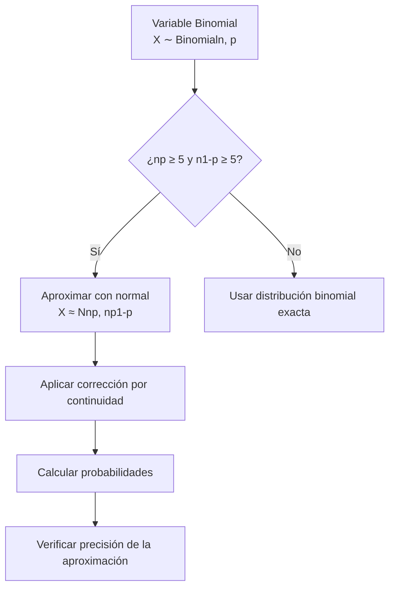

# Probabilidad I - Teoremas límite para sucesiones de variables aleatorias discretas

## 4.6 Teorema de Límite Central para la distribución Bernoulli (Teorema de De Movire-Laplace).

---

El **Teorema de De Moivre-Laplace** es un caso especial del Teorema del Límite Central (TLC) que se aplica específicamente a variables aleatorias binomiales. Este teorema, demostrado inicialmente por Abraham de Moivre en 1733 y posteriormente generalizado por Pierre-Simon Laplace, establece que la distribución binomial puede aproximarse por una distribución normal cuando el número de ensayos es grande.

### Conceptos Preliminares

#### Distribución Binomial

Una variable aleatoria $X$ sigue una distribución binomial si:

$$X \sim \text{Binomial}(n, p)$$

$$P(X = k) = \binom{n}{k} p^k (1-p)^{n-k}, \quad k = 0, 1, 2, \ldots, n$$

#### Esperanza y Varianza

Para $X \sim \text{Binomial}(n, p)$:

- Esperanza: $E[X] = np$
- Varianza: $\text{Var}(X) = np(1-p)$

### Enunciado del Teorema de De Moivre-Laplace

#### Teorema (De Moivre-Laplace)

Sea $X_n \sim \text{Binomial}(n, p)$ con $0 < p < 1$. Entonces, cuando $n \to \infty$, la distribución estandarizada de $X_n$ converge a una distribución normal estándar:

$$\lim_{n \to \infty} P\left(\frac{X_n - np}{\sqrt{np(1-p)}} \leq z\right) = \Phi(z)$$

donde $\Phi(z)$ es la función de distribución acumulada de la normal estándar.

#### Forma de Aproximación

Para $n$ suficientemente grande:

$$X_n \approx N(np, np(1-p))$$

#### Regla Práctica

La aproximación es buena cuando:

$$np \geq 5 \quad \text{y} \quad n(1-p) \geq 5$$

### Corrección por Continuidad

Dado que la binomial es discreta y la normal es continua, se utiliza una **corrección por continuidad**:

$$P(a \leq X \leq b) \approx \Phi\left(\frac{b + 0.5 - np}{\sqrt{np(1-p)}}\right) - \Phi\left(\frac{a - 0.5 - np}{\sqrt{np(1-p)}}\right)$$

### Diagrama del Proceso de Aproximación



### Demostración Conceptual

El teorema se demuestra usando:

1. **Funciones características:** $\phi_X(t) = E[e^{itX}]$
2. **Expansión en serie de Taylor** de la función característica binomial
3. **Límite** cuando $n \to \infty$

La función característica de la binomial estandarizada converge a:

$$\lim_{n \to \infty} \phi_{Z_n}(t) = e^{-t^2/2}$$

que es la función característica de $N(0, 1)$.

### Código Python para Visualización

```python
import numpy as np
import matplotlib.pyplot as plt
from scipy.stats import binom, norm

def visualizar_de_moivre_laplace(n, p):
    """
    Visualiza la aproximación normal a la binomial
    """
    # Parámetros
    mu = n * p
    sigma = np.sqrt(n * p * (1 - p))

    # Valores para graficar
    k_values = np.arange(0, n + 1)
    binomial_probs = binom.pmf(k_values, n, p)

    # Aproximación normal
    x = np.linspace(0, n, 1000)
    normal_probs = norm.pdf(x, mu, sigma)

    # Gráficos
    plt.figure(figsize=(12, 6))

    # Distribución binomial
    plt.bar(k_values, binomial_probs, alpha=0.7,
            label=f'Binomial({n}, {p})', color='skyblue')

    # Aproximación normal
    plt.plot(x, normal_probs, 'r-', linewidth=2,
             label=f'Aproximación N({mu:.1f}, {sigma:.2f}²)')

    plt.xlabel('k')
    plt.ylabel('Probabilidad')
    plt.title(f'Aproximación de De Moivre-Laplace: Binomial({n}, {p})')
    plt.legend()
    plt.grid(alpha=0.3)

    # Verificar condiciones de aproximación
    cond1 = n * p >= 5
    cond2 = n * (1 - p) >= 5

    plt.figtext(0.15, 0.75, f'np = {n*p:.1f} {"≥ 5" if cond1 else "< 5"}',
                fontsize=12, bbox=dict(facecolor='white', alpha=0.7))
    plt.figtext(0.15, 0.70, f'n(1-p) = {n*(1-p):.1f} {"≥ 5" if cond2 else "< 5"}',
                fontsize=12, bbox=dict(facecolor='white', alpha=0.7))

    plt.show()

    return mu, sigma

# Ejemplos de uso
print("Ejemplo 1: Buena aproximación (np ≥ 5, n(1-p) ≥ 5)")
mu1, sigma1 = visualizar_de_moivre_laplace(n=100, p=0.3)

print("\nEjemplo 2: Mala aproximación (np < 5)")
mu2, sigma2 = visualizar_de_moivre_laplace(n=10, p=0.1)
```

### Ejemplos Resueltos

#### Ejemplo 1: Aproximación sin Corrección

Sea $X \sim \text{Binomial}(100, 0.4)$. Calcular $P(35 \leq X \leq 45)$.

**Solución:**

- $\mu = 100 \times 0.4 = 40$
- $\sigma = \sqrt{100 \times 0.4 \times 0.6} = \sqrt{24} \approx 4.90$
- $P(35 \leq X \leq 45) \approx \Phi\left(\frac{45 - 40}{4.90}\right) - \Phi\left(\frac{35 - 40}{4.90}\right)$
- $\approx \Phi(1.02) - \Phi(-1.02) \approx 0.8461 - 0.1539 = 0.6922$

#### Ejemplo 2: Aproximación con Corrección

Mismo caso, pero con corrección por continuidad:

- $P(35 \leq X \leq 45) \approx \Phi\left(\frac{45.5 - 40}{4.90}\right) - \Phi\left(\frac{34.5 - 40}{4.90}\right)$
- $\approx \Phi(1.12) - \Phi(-1.12) \approx 0.8686 - 0.1314 = 0.7372$

### Ejercicios Propuestos

#### Ejercicio 1

Sea $X \sim \text{Binomial}(200, 0.45)$. Calcular:
a) $P(X \leq 100)$ con y sin corrección por continuidad
b) $P(85 \leq X \leq 95)$ con corrección por continuidad
c) Compare con el valor exacto usando Python

#### Ejercicio 2

Un examen tiene 50 preguntas de opción múltiple con 4 opciones cada una. Si un estudiante responde al azar:
a) ¿Cuál es la probabilidad de que acierte al menos 20 preguntas?
b) Use la aproximación de De Moivre-Laplace con corrección por continuidad

#### Ejercicio 3

Demuestre que para $X \sim \text{Binomial}(n, p)$:

$$\lim_{n \to \infty} \frac{P(X = k)}{\frac{1}{\sqrt{2\pi np(1-p)}} \exp\left(-\frac{(k-np)^2}{2np(1-p)}\right)} = 1$$

#### Ejercicio 4

Investigue y explique la diferencia entre el Teorema de De Moivre-Laplace y el Teorema del Límite Central general.

### Tabla de Comparación: Binomial vs Normal

| Característica | Distribución Binomial | Aproximación Normal  |
| -------------- | --------------------- | -------------------- |
| Tipo           | Discreta              | Continua             |
| Parámetros     | n, p                  | μ = np, σ² = np(1-p) |
| Rango          | 0, 1, 2, ..., n       | (-∞, ∞)              |
| Forma          | Asimétrica si p ≠ 0.5 | Siempre simétrica    |
| Condiciones    | Cualquier n, p        | np ≥ 5, n(1-p) ≥ 5   |

### Aplicaciones del Teorema

1. **Control de calidad:** Muestreo de aceptación
2. **Estadística electoral:** Márgenes de error en encuestas
3. **Genética:** Herencia de características
4. **Economía:** Modelos de riesgo crediticio
5. **Bioestadística:** Ensayos clínicos

### Referencias

1. De Moivre, A. (1733). "Approximatio ad Summam Terminorum Binomii (a + b)^n in Seriem expansi"
2. Laplace, P.-S. (1812). "Théorie analytique des probabilités"
3. Feller, W. (1968). "An Introduction to Probability Theory and Its Applications"
4. Ross, S. M. (2019). "A First Course in Probability"

### Consejos para el Estudio

1. **Entienda la corrección por continuidad** y cuándo aplicarla
2. **Verifique siempre las condiciones** np ≥ 5 y n(1-p) ≥ 5
3. **Practique con ejemplos numéricos** para desarrollar intuición
4. **Compare aproximaciones** con valores exactos usando software
5. **Visualice las distribuciones** para entender la calidad de la aproximación

### Preguntas de Autoevaluación

1. ¿Por qué es necesaria la corrección por continuidad?
2. ¿Qué sucede con la aproximación cuando p está cerca de 0 o 1?
3. ¿Cómo mejora la aproximación cuando n aumenta?
4. ¿En qué situaciones preferiría usar la distribución binomial exacta en lugar de la aproximación normal?
