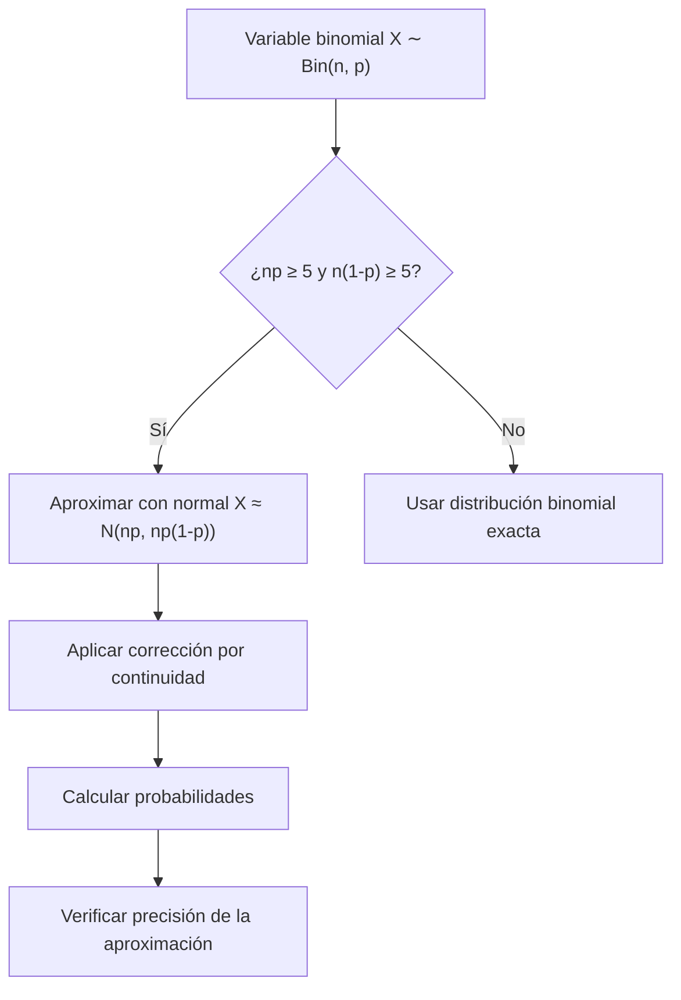

# Probabilidad I - Teoremas límite para sucesiones de variables aleatorias discretas

## 4.6 Teorema de Límite Central para la distribución Bernoulli (Teorema de De Moivre-Laplace).

---

El **Teorema de De Moivre-Laplace** es un caso especial del Teorema del Límite Central (TLC) que se aplica específicamente a variables aleatorias binomiales. Este teorema, demostrado inicialmente por Abraham de Moivre en 1733 para $p = \frac{1}{2}$ y generalizado por Pierre-Simon Laplace a cualquier $p,$ establece que la distribución binomial puede aproximarse por una distribución normal cuando el número de ensayos es grande. Es históricamente la primera aparición de la distribución normal, más de medio siglo antes de Gauss.

Como $X \sim \text{Bin}(n, p)$ es la suma de $n$ variables Bernoulli independientes, el teorema es el TLC para la distribución Bernoulli; lo especial es que, por ser tan concreto, se puede demostrar con cálculos directos usando la fórmula de Stirling.

### Conceptos Preliminares

#### Distribución Binomial

Una variable aleatoria $X$ sigue una distribución binomial si:

$$ X \sim \text{Binomial}(n, p) $$

$$ P(X = k) = \binom{n}{k} p^k (1-p)^{n-k}, \quad k = 0, 1, 2, \ldots, n $$

#### Esperanza y Varianza

Para $X \sim \text{Binomial}(n, p):$

- Esperanza: $E[X] = np$
- Varianza: $\text{Var}(X) = np(1-p)$

### Enunciado del Teorema de De Moivre-Laplace

#### Teorema (De Moivre-Laplace)

Sea $X_n \sim \text{Binomial}(n, p)$ con $0 < p < 1.$ Entonces, cuando $n \to \infty,$ la distribución estandarizada de $X_n$ converge a una distribución normal estándar:

$$ \lim_{n \to \infty} P\left(\frac{X_n - np}{\sqrt{np(1-p)}} \leq z\right) = \Phi(z) $$

para todo $z \in \mathbb{R},$ donde $\Phi(z)$ es la función de distribución acumulada de la normal estándar. Existe también una **versión local**, que aproxima cada probabilidad individual por la densidad normal:

$$ P(X_n = k) \approx \frac{1}{\sqrt{2\pi np(1-p)}}\exp\left(-\frac{(k - np)^2}{2np(1-p)}\right) $$

con un error relativo que tiende a 0 uniformemente para los $k$ con $\frac{|k - np|}{\sqrt{n}}$ acotado (ejercicio 3).

#### Forma de Aproximación

Para $n$ suficientemente grande:

$$ X_n \approx N(np, np(1-p)) $$

y, para la proporción de éxitos, $\hat{p} = \frac{X_n}{n} \approx N\left(p, \frac{p(1-p)}{n}\right).$ De aquí viene el **margen de error** de las encuestas: con $n = 1000$ y $p \approx 0.5,$ $1.96\sqrt{\frac{0.25}{1000}} \approx 0.031,$ los famosos "más o menos 3 puntos".

#### Regla Práctica

La aproximación es buena cuando:

$$ np \geq 5 \quad \text{y} \quad n(1-p) \geq 5 $$

Si $p$ está cerca de 0 o de 1, la binomial es muy asimétrica y la normal, que es simétrica, la aproxima mal; en ese caso es mejor la aproximación de Poisson (tema 4.1).

### Corrección por Continuidad

Dado que la binomial es discreta y la normal es continua, se utiliza una **corrección por continuidad**:

$$ P(a \leq X \leq b) \approx \Phi\left(\frac{b + 0.5 - np}{\sqrt{np(1-p)}}\right) - \Phi\left(\frac{a - 0.5 - np}{\sqrt{np(1-p)}}\right) $$

para enteros $a \leq b.$ La idea: la probabilidad $P(X = k)$ se representa como una barra de ancho 1 centrada en $k,$ que ocupa el intervalo $[k - 0.5, k + 0.5];$ las barras de $a$ a $b$ cubren $[a - 0.5, b + 0.5],$ y es el área de la curva normal en ese intervalo la que hay que calcular. Así también, $P(X = k) \approx \Phi\left(\frac{k + 0.5 - np}{\sigma}\right) - \Phi\left(\frac{k - 0.5 - np}{\sigma}\right),$ que sin corrección valdría 0. Hay que traducir primero las desigualdades estrictas: $P(X < b) = P(X \leq b - 1)$ para enteros.

### Diagrama del Proceso de Aproximación



### Demostración Conceptual

**Con funciones generadoras.** Sea $q = 1 - p,$ $\sigma = \sqrt{npq}$ y $Z_n = \frac{X_n - np}{\sigma}.$ Como $X_n$ es suma de $n$ Bernoulli independientes,

$$ M_{Z_n}(t) = e^{-npt/\sigma}\left(q + pe^{t/\sigma}\right)^n = \left(qe^{-pt/\sigma} + pe^{qt/\sigma}\right)^n $$

Desarrollando las exponenciales hasta segundo orden, con $s = \frac{t}{\sigma}$ pequeño:

$$ qe^{-ps} + pe^{qs} = q\left(1 - ps + \tfrac{p^2s^2}{2}\right) + p\left(1 + qs + \tfrac{q^2s^2}{2}\right) + O(s^3) = 1 + \frac{pq\,s^2}{2} + O(s^3) $$

porque los términos lineales se cancelan: $-qp + pq = 0.$ Como $pq\,s^2 = \frac{pq\,t^2}{npq} = \frac{t^2}{n},$

$$ M_{Z_n}(t) = \left(1 + \frac{t^2}{2n} + O(n^{-3/2})\right)^n \longrightarrow e^{t^2/2} $$

que es la MGF de $N(0, 1).$ Por el teorema de continuidad para funciones generadoras, $Z_n \xrightarrow{D} N(0, 1).$ La misma cuenta con funciones características, $\phi_{Z_n}(t) \to e^{-t^2/2},$ es la que se usa en la demostración del TLC general.

**Con la fórmula de Stirling.** La demostración original de De Moivre usa $n! \approx \sqrt{2\pi n}\left(\frac{n}{e}\right)^n$ para estimar directamente $\binom{n}{k}p^kq^{n-k}$ cuando $k = np + x\sigma,$ lo que da la versión local (ejercicio 3); sumando las probabilidades locales se obtiene una suma de Riemann de $\int \frac{1}{\sqrt{2\pi}}e^{-x^2/2}\,dx.$

### Código Python para Visualización

```python
import numpy as np
import matplotlib
matplotlib.use("Agg")
import matplotlib.pyplot as plt
from scipy.stats import binom, norm

def visualizar_de_moivre_laplace(n, p):
    """
    Visualiza la aproximación normal a la binomial
    """
    # Parámetros
    mu = n * p
    sigma = np.sqrt(n * p * (1 - p))

    # Valores para graficar
    k_values = np.arange(0, n + 1)
    binomial_probs = binom.pmf(k_values, n, p)

    # Aproximación normal
    x = np.linspace(0, n, 1000)
    normal_probs = norm.pdf(x, mu, sigma)

    # Gráficos
    plt.figure(figsize=(12, 6))

    # Distribución binomial
    plt.bar(k_values, binomial_probs, alpha=0.7,
            label=f'Binomial({n}, {p})', color='skyblue')

    # Aproximación normal
    plt.plot(x, normal_probs, 'r-', linewidth=2,
             label=f'Aproximación N({mu:.1f}, {sigma:.2f}²)')

    plt.xlabel('k')
    plt.ylabel('Probabilidad')
    plt.title(f'Aproximación de De Moivre-Laplace: Binomial({n}, {p})')
    plt.legend()
    plt.grid(alpha=0.3)

    # Verificar condiciones de aproximación
    cond1 = n * p >= 5
    cond2 = n * (1 - p) >= 5

    plt.figtext(0.15, 0.75, f'np = {n*p:.1f} {"≥ 5" if cond1 else "< 5"}',
                fontsize=12, bbox=dict(facecolor='white', alpha=0.7))
    plt.figtext(0.15, 0.70, f'n(1-p) = {n*(1-p):.1f} {"≥ 5" if cond2 else "< 5"}',
                fontsize=12, bbox=dict(facecolor='white', alpha=0.7))

    plt.savefig(f"demoivre_{n}_{p}.png", dpi=90)

    return mu, sigma

# Ejemplos de uso
print("Ejemplo 1: Buena aproximación (np ≥ 5, n(1-p) ≥ 5)")
mu1, sigma1 = visualizar_de_moivre_laplace(n=100, p=0.3)

print("\nEjemplo 2: Mala aproximación (np < 5)")
mu2, sigma2 = visualizar_de_moivre_laplace(n=10, p=0.1)

# Comparación numérica del ejemplo resuelto: Bin(100, 0.4), P(35 <= X <= 45)
n, p = 100, 0.4
mu, s = n * p, np.sqrt(n * p * (1 - p))
exacta = binom.cdf(45, n, p) - binom.cdf(34, n, p)
sin_corr = norm.cdf((45 - mu) / s) - norm.cdf((35 - mu) / s)
con_corr = norm.cdf((45.5 - mu) / s) - norm.cdf((34.5 - mu) / s)
print(f"exacta {exacta:.4f}  sin corrección {sin_corr:.4f}  con corrección {con_corr:.4f}")
```

Con $n = 100$ y $p = 0.3,$ la curva normal pasa casi por el centro de cada barra. Con $n = 10$ y $p = 0.1$ la binomial está pegada al 0, es muy asimétrica, y la normal le asigna probabilidad a valores negativos que la binomial no puede tomar.

### Ejemplos Resueltos

#### Ejemplo 1: Aproximación sin Corrección

Sea $X \sim \text{Binomial}(100, 0.4).$ Calcular $P(35 \leq X \leq 45).$

**Solución:**

- $\mu = 100 \times 0.4 = 40$
- $\sigma = \sqrt{100 \times 0.4 \times 0.6} = \sqrt{24} \approx 4.90$
- $P(35 \leq X \leq 45) \approx \Phi\left(\frac{45 - 40}{4.90}\right) - \Phi\left(\frac{35 - 40}{4.90}\right) = \Phi(1.02) - \Phi(-1.02) \approx 0.8461 - 0.1539 = 0.6922$

#### Ejemplo 2: Aproximación con Corrección

Mismo caso, pero con corrección por continuidad:

- $P(35 \leq X \leq 45) \approx \Phi\left(\frac{45.5 - 40}{4.90}\right) - \Phi\left(\frac{34.5 - 40}{4.90}\right) = \Phi(1.12) - \Phi(-1.12) \approx 0.8686 - 0.1314 = 0.7372$

El valor binomial exacto es $0.7386.$ Sin corrección el error es de casi 5 puntos porcentuales; con ella, de una décima: la corrección importa mucho cuando el intervalo es corto comparado con $\sigma.$

### Ejercicios Propuestos

#### Ejercicio 1

Sea $X \sim \text{Binomial}(200, 0.45).$ Calcular:

- a) $P(X \leq 100)$ con y sin corrección por continuidad.
- b) $P(85 \leq X \leq 95)$ con corrección por continuidad.
- c) Compare con el valor exacto usando Python.

#### Ejercicio 2

Un examen tiene 50 preguntas de opción múltiple con 4 opciones cada una. Si un estudiante responde al azar:

- a) ¿Cuál es la probabilidad exacta de que acierte al menos 20 preguntas?
- b) Use la aproximación de De Moivre-Laplace con corrección por continuidad.

#### Ejercicio 3

Demuestre que para $X \sim \text{Binomial}(n, p):$

$$\lim_{n \to \infty} \frac{P(X = k)}{\frac{1}{\sqrt{2\pi np(1-p)}} \exp\left(-\frac{(k-np)^2}{2np(1-p)}\right)} = 1$$

#### Ejercicio 4

Investigue y explique la diferencia entre el Teorema de De Moivre-Laplace y el Teorema del Límite Central general.

### Soluciones

**Ejercicio 1.** $\mu = 90$ y $\sigma = \sqrt{200 \cdot 0.45 \cdot 0.55} \approx 7.036.$

- a) Sin corrección, $\Phi\left(\frac{100 - 90}{7.036}\right) = \Phi(1.421) \approx 0.9224;$ con corrección, $\Phi\left(\frac{100.5 - 90}{7.036}\right) = \Phi(1.492) \approx 0.9322.$
- b) $\Phi\left(\frac{95.5 - 90}{7.036}\right) - \Phi\left(\frac{84.5 - 90}{7.036}\right) = \Phi(0.782) - \Phi(-0.782) \approx 0.5656.$
- c) Los valores exactos, `binom.cdf(100, 200, 0.45)` y `binom.cdf(95, 200, 0.45) - binom.cdf(84, 200, 0.45)`, son $0.9319$ y $0.5656:$ con corrección, el error es de milésimas o menos.

**Ejercicio 2.** El número de aciertos es $X \sim \text{Bin}(50, 0.25),$ con $\mu = 12.5$ y $\sigma = \sqrt{50 \cdot 0.25 \cdot 0.75} \approx 3.062.$ a) $P(X \geq 20) = \sum_{k=20}^{50}\binom{50}{k}0.25^k0.75^{50-k} \approx 0.0139.$ b) $P(X \geq 20) \approx 1 - \Phi\left(\frac{19.5 - 12.5}{3.062}\right) = 1 - \Phi(2.286) \approx 0.0111.$ El error relativo es mayor que en el ejercicio 1 porque se trata de una **cola** lejana, a más de dos desviaciones, donde la asimetría de la binomial $(p = 0.25)$ pesa más.

**Ejercicio 3.** Con $k = np + x\sqrt{npq},$ la fórmula de Stirling aplicada a $n!,$ $k!$ y $(n-k)!$ da

$$ \binom{n}{k}p^kq^{n-k} \approx \frac{1}{\sqrt{2\pi n\frac{k}{n}\frac{n-k}{n}}}\exp\left(-k\ln\frac{k}{np} - (n-k)\ln\frac{n-k}{nq}\right) $$

El factor de la raíz tiende a $\frac{1}{\sqrt{2\pi npq}},$ porque $\frac{k}{n} \to p.$ Para el exponente, con $\frac{k}{np} = 1 + x\sqrt{\frac{q}{np}}$ y $\frac{n - k}{nq} = 1 - x\sqrt{\frac{p}{nq}},$ se usa $(1 + u)\ln(1 + u) = u + \frac{u^2}{2} + O(u^3);$ los términos lineales se cancelan y los cuadráticos suman $\frac{x^2}{2}.$ Así el cociente pedido tiende a 1. $\blacksquare$

**Ejercicio 4.** De Moivre-Laplace es el TLC para sumas de Bernoulli. El TLC general vale para sumas de variables independientes e idénticamente distribuidas con **cualquier** distribución de varianza finita, y versiones más generales (Lindeberg, Lyapunov) ni siquiera piden distribución idéntica. De Moivre-Laplace tiene además la versión local, que en general requiere hipótesis adicionales (por ejemplo, para variables con densidad o con valores en una red de enteros).

### Tabla de Comparación: Binomial vs Normal

| Característica | Distribución Binomial | Aproximación Normal  |
| -------------- | --------------------- | -------------------- |
| Tipo           | Discreta              | Continua             |
| Parámetros     | n, p                  | μ = np, σ² = np(1-p) |
| Rango          | 0, 1, 2, ..., n       | (-∞, ∞)              |
| Forma          | Asimétrica si p ≠ 0.5 | Siempre simétrica    |
| Condiciones    | Cualquier n, p        | np ≥ 5, n(1-p) ≥ 5   |

### Aplicaciones del Teorema

1. **Control de calidad:** Muestreo de aceptación
2. **Estadística electoral:** Márgenes de error en encuestas
3. **Genética:** Herencia de características
4. **Economía:** Modelos de riesgo crediticio
5. **Bioestadística:** Ensayos clínicos

### Referencias

1. De Moivre, A. (1733). "Approximatio ad Summam Terminorum Binomii (a + b)^n in Seriem expansi"
2. Laplace, P.-S. (1812). "Théorie analytique des probabilités"
3. Feller, W. (1968). "An Introduction to Probability Theory and Its Applications"
4. Ross, S. M. (2019). "A First Course in Probability"

### Consejos para el Estudio

1. **Entienda la corrección por continuidad** y cuándo aplicarla
2. **Verifique siempre las condiciones** np ≥ 5 y n(1-p) ≥ 5
3. **Practique con ejemplos numéricos** para desarrollar intuición
4. **Compare aproximaciones** con valores exactos usando software
5. **Visualice las distribuciones** para entender la calidad de la aproximación

### Preguntas de Autoevaluación

1. ¿Por qué es necesaria la corrección por continuidad?
2. ¿Qué sucede con la aproximación cuando p está cerca de 0 o 1?
3. ¿Cómo mejora la aproximación cuando n aumenta?
4. ¿En qué situaciones preferiría usar la distribución binomial exacta en lugar de la aproximación normal?
