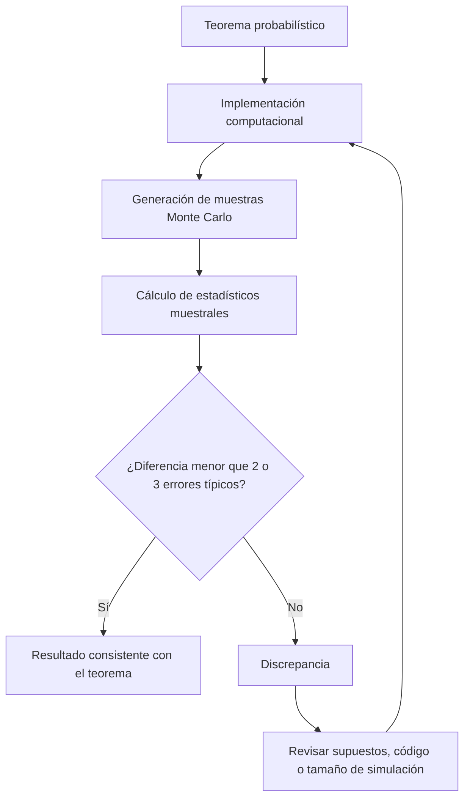

# Probabilidad I - Teoremas límite para sucesiones de variables aleatorias discretas

## 4.7 Contrastar los resultados teóricos con los obtenidos por simulación.

---

El contraste entre **resultados teóricos** y **simulaciones** es fundamental en probabilidad. Las simulaciones permiten verificar teoremas, desarrollar intuición y estimar cantidades cuando los cálculos analíticos son difíciles. Pero una simulación es a su vez un experimento aleatorio: su resultado tiene error, y contrastar bien significa saber **cuánto** error es normal. Este tema reúne los teoremas límite del capítulo (temas 4.4 a 4.6) y los pone a prueba numéricamente.

### Conceptos Fundamentales

#### Simulación Monte Carlo

Método computacional que usa muestreo aleatorio para aproximar resultados numéricos. Para estimar $\theta = E[X]$ se generan $X_1, \ldots, X_R$ independientes con la distribución de $X$ y se calcula

$$ \hat{\theta}_R = \frac{1}{R} \sum_{i=1}^R X_i $$

Cualquier probabilidad es una esperanza, $P(A) = E[\mathbf{1}_A],$ así que el mismo método estima probabilidades mediante frecuencias relativas (tema 1.9). La justificación es la LGN: $\hat{\theta}_R \to \theta$ cuando $R \to \infty.$

#### El error de una simulación

Si $\text{Var}(X) = \sigma^2 < \infty,$ entonces $E[\hat{\theta}_R] = \theta$ y

$$ \text{Var}(\hat{\theta}_R) = \frac{\sigma^2}{R} $$

así que el **error típico** de la estimación es $\frac{\sigma}{\sqrt{R}},$ que se estima con la desviación estándar muestral $s$ en lugar de $\sigma.$ Por el TLC, con probabilidad aproximada de 0.95 el valor verdadero cumple

$$ \theta \in \left[\hat{\theta}_R - 1.96\frac{s}{\sqrt{R}},\ \hat{\theta}_R + 1.96\frac{s}{\sqrt{R}}\right] $$

De aquí sale la regla para el contraste: una diferencia entre teoría y simulación de una o dos veces el error típico es **normal**; una de cinco o más indica un error en la teoría o en el código. Y de aquí también el tamaño de simulación necesario para una precisión $\varepsilon$ con confianza del 95%:

$$ R \geq \left(\frac{1.96\,\sigma}{\varepsilon}\right)^2 $$

Para una probabilidad, $\sigma^2 = p(1-p) \leq \frac{1}{4},$ y basta $R \geq \frac{0.96}{\varepsilon^2}:$ unas $10\,000$ réplicas para una precisión de $0.01.$ Ganar una cifra decimal más cuesta 100 veces más réplicas.

#### Medidas de discrepancia

- **Error absoluto** de una estimación: $|\hat{\theta} - \theta|.$
- **Error cuadrático medio**: $\text{ECM} = E[(\hat{\theta} - \theta)^2] = \text{Var}(\hat{\theta}) + (E[\hat{\theta}] - \theta)^2,$ varianza más sesgo al cuadrado. Para la media muestral el sesgo es 0 y $\text{ECM} = \frac{\sigma^2}{R}.$
- **Distancia de Kolmogorov** entre una distribución $F$ y una teórica $G:$ $D = \sup_x |F(x) - G(x)|.$ Con una muestra se usa la función de distribución empírica $F_R(x) = \frac{1}{R}\#\{i : X_i \leq x\};$ es el estadístico de la prueba de Kolmogorov-Smirnov (tema 2.6).

### Marco Teórico para la Validación

#### Ley de los Grandes Números (LGN)

Si $X_1, X_2, \ldots$ son i.i.d. con $E[|X_i|] < \infty$ y $E[X_i] = \mu,$ entonces:

$$ \bar{X}_n = \frac{1}{n} \sum_{i=1}^n X_i \xrightarrow{\text{c.s.}} \mu $$

Si además la varianza es finita, el error $|\bar{X}_n - \mu|$ es del orden de $\frac{\sigma}{\sqrt{n}};$ más precisamente, por el TLC,

$$ E|\bar{X}_n - \mu| \approx \sqrt{\frac{2}{\pi}}\,\frac{\sigma}{\sqrt{n}} $$

porque $E|Z| = \sqrt{\frac{2}{\pi}} \approx 0.798$ para $Z \sim N(0, 1).$ En una gráfica log-log del error contra $n,$ esto es una recta de pendiente $-\frac{1}{2}.$

#### Teorema del Límite Central (TLC)

Si además $0 < \sigma^2 < \infty,$

$$ Z_n = \frac{\bar{X}_n - \mu}{\sigma/\sqrt{n}} \xrightarrow{D} N(0, 1) $$

#### Teorema de Berry-Esseen

El TLC no dice qué tan rápido converge; el teorema de Berry-Esseen sí. Si $\rho = E|X_i - \mu|^3 < \infty,$

$$ \sup_x |P(Z_n \leq x) - \Phi(x)| \leq \frac{C\rho}{\sigma^3\sqrt{n}} $$

con una constante $C \leq 0.4748$ (Shevtsova, 2011). La distancia de Kolmogorov a la normal decrece al menos como $\frac{1}{\sqrt{n}},$ y la constante crece con la asimetría de la distribución: el TLC funciona antes para distribuciones simétricas.

Para variables **discretas** hay un límite a la precisión: $Z_n$ toma valores en una red con separación $\frac{1}{\sigma\sqrt{n}},$ su función de distribución da saltos, y una función continua como $\Phi$ no puede estar cerca de ambos lados de cada salto. Por eso en el caso discreto la distancia de Kolmogorov es del orden de $\frac{1}{\sqrt{n}}$ y no menor, y por eso funciona la corrección por continuidad (tema 4.6), que evalúa $\Phi$ a la mitad de cada salto.

### Diagrama del Proceso de Validación



### Código Python para Contrastar Teoremas Límite

El código usa un generador con semilla fija para que los resultados sean reproducibles, y aprovecha que la suma de $n$ variables $\text{Bernoulli}(p)$ independientes es $\text{Bin}(n, p)$ y la de $n$ variables $\text{Poisson}(\lambda)$ es $\text{Poisson}(n\lambda)$ para simular $R = 10\,000$ medias muestrales sin generar cada variable por separado.

```python
import numpy as np
import matplotlib
matplotlib.use("Agg")
import matplotlib.pyplot as plt
from scipy.stats import norm, binom

rng = np.random.default_rng(2024)
R = 10_000   # réplicas de cada experimento

# 1. LGN: error absoluto medio de la media muestral de Bernoulli(0.3)
p = 0.3
ns = np.array([10, 40, 160, 640, 2560])
err = []
for n in ns:
    medias = rng.binomial(n, p, size=R) / n        # suma de n Bernoulli = binomial
    err.append(np.mean(np.abs(medias - p)))
pendiente = np.polyfit(np.log(ns), np.log(err), 1)[0]
for n, e in zip(ns, err):
    print(f"n = {n:>4}: error medio {e:.4f}   teórico {np.sqrt(2 / np.pi) * np.sqrt(p * (1 - p) / n):.4f}")
print(f"pendiente log-log: {pendiente:.3f}")

plt.loglog(ns, err, "o-", label="simulación")
plt.loglog(ns, np.sqrt(2 / np.pi * p * (1 - p) / ns), "k--", label="teórico")
plt.xlabel("n"); plt.ylabel("error absoluto medio"); plt.legend()
plt.savefig("lgn.png", dpi=90); plt.close()

# 2. TLC: distancia de Kolmogorov entre la media estandarizada y N(0, 1)
def distancia_ks(z):
    z = np.sort(z)
    m = len(z)
    F = norm.cdf(z)
    return max(np.max(np.arange(1, m + 1) / m - F), np.max(F - np.arange(m) / m))

def berry_esseen(rho, sigma, n):
    return 0.4748 * rho / (sigma ** 3 * np.sqrt(n))

# Bernoulli(0.3): rho = E|X - p|^3 = p q (p^2 + q^2)
q = 1 - p
s = np.sqrt(p * q)
rho = p * q * (p ** 2 + q ** 2)
fig, axes = plt.subplots(1, 3, figsize=(12, 3.5))
for ax, n in zip(axes, [10, 30, 100]):
    z = (rng.binomial(n, p, size=R) / n - p) / (s / np.sqrt(n))
    print(f"Bernoulli n = {n:>3}: D = {distancia_ks(z):.3f}   cota Berry-Esseen {berry_esseen(rho, s, n):.3f}")
    ax.hist(z, bins=40, density=True, alpha=0.6)
    x = np.linspace(-4, 4, 200)
    ax.plot(x, norm.pdf(x), "r-")
    ax.set_title(f"n = {n}")
plt.tight_layout(); plt.savefig("tlc.png", dpi=90); plt.close()

# Poisson(2): las sumas son Poisson(2n)
lam = 2
for n in [10, 30, 100]:
    z = (rng.poisson(lam * n, size=R) / n - lam) / np.sqrt(lam / n)
    print(f"Poisson   n = {n:>3}: D = {distancia_ks(z):.3f}")

# 3. De Moivre-Laplace: error máximo de las probabilidades puntuales, Bin(50, 0.4)
n, p = 50, 0.4
mu, sd = n * p, np.sqrt(n * p * (1 - p))
k = np.arange(n + 1)
exacta = binom.pmf(k, n, p)
densidad = norm.pdf(k, mu, sd)
corregida = norm.cdf(k + 0.5, mu, sd) - norm.cdf(k - 0.5, mu, sd)
sim = np.bincount(rng.binomial(n, p, size=R), minlength=n + 1) / R
print(f"máx |exacta - densidad| = {np.max(np.abs(exacta - densidad)):.4f}")
print(f"máx |exacta - corregida| = {np.max(np.abs(exacta - corregida)):.4f}")
print(f"máx |exacta - simulada| = {np.max(np.abs(exacta - sim)):.4f}")
print(f"error típico de una frecuencia en k = 20: {np.sqrt(exacta[20] * (1 - exacta[20]) / R):.4f}")
```

Salida:

```text
n =   10: error medio 0.1116   teórico 0.1156
n =   40: error medio 0.0567   teórico 0.0578
n =  160: error medio 0.0285   teórico 0.0289
n =  640: error medio 0.0145   teórico 0.0145
n = 2560: error medio 0.0072   teórico 0.0072
pendiente log-log: -0.494
Bernoulli n =  10: D = 0.146   cota Berry-Esseen 0.190
Bernoulli n =  30: D = 0.087   cota Berry-Esseen 0.110
Bernoulli n = 100: D = 0.054   cota Berry-Esseen 0.060
Poisson   n =  10: D = 0.062
Poisson   n =  30: D = 0.039
Poisson   n = 100: D = 0.024
máx |exacta - densidad| = 0.0016
máx |exacta - corregida| = 0.0017
máx |exacta - simulada| = 0.0064
error típico de una frecuencia en k = 20: 0.0032
```

### Ejemplos de Contrastación

#### Ejemplo 1: Validación de la LGN

Para $X_i \sim \text{Bernoulli}(0.3)$ se tiene $\sigma = \sqrt{0.21} \approx 0.458.$ Cada vez que $n$ se multiplica por 4, el error medio se reduce a la mitad, y la pendiente estimada en escala log-log es $-0.494,$ prácticamente el $-\frac{1}{2}$ teórico. Los errores medios simulados coinciden con $\sqrt{\frac{2}{\pi}}\frac{\sigma}{\sqrt{n}}$ hasta la tercera cifra a partir de $n = 160;$ con $n = 10$ la aproximación normal todavía no es buena y aparece una pequeña diferencia.

#### Ejemplo 2: Validación del TLC y de Berry-Esseen

Para $\text{Bernoulli}(0.3),$ la distancia de Kolmogorov entre $Z_n$ y la normal queda por debajo de la cota de Berry-Esseen en los tres casos, y decrece aproximadamente como $\frac{1}{\sqrt{n}}:$ de $n = 10$ a $n = 100$ se divide entre $2.7,$ cerca de $\sqrt{10} \approx 3.2.$ La cota es casi alcanzada porque la Bernoulli es una variable discreta muy concentrada: la mayor parte de $D$ viene de los saltos de la función de distribución.

Para $\text{Poisson}(2),$ la distancia es menor para el mismo $n:$ la suma de $n$ variables $\text{Poisson}(2)$ es $\text{Poisson}(2n),$ con desviación $\sqrt{2n},$ mayor que la de la binomial, $\sqrt{0.21n},$ así que sus saltos son más pequeños en la escala estandarizada.

La simulación agrega su propio error: con $R = 10\,000,$ la distancia de Kolmogorov empírica tiene un error del orden de $\frac{1}{\sqrt{R}} = 0.01,$ así que no tiene sentido comparar distancias menores que eso.

#### Ejemplo 3: De Moivre-Laplace con probabilidades puntuales

Para $\text{Bin}(50, 0.4),$ la diferencia máxima entre $P(X = k)$ y la densidad normal $\phi\left(\frac{k - \mu}{\sigma}\right)\frac{1}{\sigma}$ es $0.0016$ (versión local, tema 4.6). La diferencia entre la probabilidad exacta y la frecuencia simulada es mayor, $0.0064:$ aquí el **error de simulación** domina, pues el error típico de una frecuencia cerca de la moda es $\sqrt{\frac{p_k(1 - p_k)}{R}} \approx 0.0032,$ y el máximo de 51 diferencias suele estar en 2 errores típicos. Para contrastar la aproximación normal se usan las probabilidades **exactas**; la simulación sirve para comprobar que el código y el modelo son correctos.

#### Ejemplo 4: Cuando los supuestos fallan

Si $X_i$ sigue una distribución de Cauchy, con densidad $\frac{1}{\pi(1 + x^2)},$ la esperanza no existe y $\bar{X}_n$ tiene **la misma** distribución de Cauchy para todo $n$ ; se demuestra con la función característica $e^{-|t|}.$ La simulación lo muestra con claridad: la media muestral no se estabiliza y de vez en cuando da saltos enormes causados por una sola observación gigante (ejercicio 4).

### Ejercicios Propuestos

#### Ejercicio 1

Implemente una simulación para verificar la Ley de los Grandes Números para:

- a) $X_i \sim \text{Poisson}(3).$
- b) $X_i \sim \text{Geométrica}(0.2),$ número de ensayos hasta el primer éxito.
- c) Analice la tasa de convergencia en cada caso.

#### Ejercicio 2

Valide el Teorema del Límite Central para:

- a) $X_i \sim \text{Binomial}(10, 0.3).$
- b) $X_i$ uniforme discreta en $\{1, 2, 3, 4, 5, 6\}.$
- c) Compare la velocidad de convergencia.

#### Ejercicio 3

Para el Teorema de De Moivre-Laplace:

- a) Simule $X \sim \text{Binomial}(100, 0.4).$
- b) Compare con la aproximación normal $N(40, 24).$
- c) Calcule el error máximo en la función de distribución con y sin corrección por continuidad.

#### Ejercicio 4

Estudie empíricamente cómo afectan las violaciones de los supuestos:

- a) Variables no idénticamente distribuidas.
- b) Variables dependientes.
- c) Varianza infinita, y esperanza inexistente.

#### Ejercicio 5

¿Cuántas réplicas se necesitan para estimar $P(X \geq 20)$ con $X \sim \text{Bin}(50, 0.25),$ cuyo valor exacto es $0.0139$ según el ejercicio 2 del tema 4.6, con un error relativo de 10% y confianza del 95%?

### Soluciones

```python
import numpy as np
from scipy.stats import norm, binom

rng = np.random.default_rng(7)
R = 2000

# Ejercicio 1: LGN para Poisson(3) y Geométrica(0.2) (número de ensayos, media 5)
casos = {"Poisson(3)": (lambda n: rng.poisson(3, (R, n)), 3, np.sqrt(3)),
         "Geométrica(0.2)": (lambda n: rng.geometric(0.2, (R, n)), 5, np.sqrt(0.8) / 0.2)}
for nombre, (gen, mu, sigma) in casos.items():
    errores = [np.mean(np.abs(gen(n).mean(axis=1) - mu)) for n in [10, 100, 1000]]
    print(nombre, [round(float(e), 3) for e in errores], "sigma =", round(float(sigma), 3))

# Ejercicio 2: asimetría y distancia al normal de la media estandarizada, n = 5
def distancia_ks(z):
    z = np.sort(z); m = len(z); F = norm.cdf(z)
    return max(np.max(np.arange(1, m + 1) / m - F), np.max(F - np.arange(m) / m))
R2 = 20000
for n in [5, 20]:
    b = rng.binomial(10, 0.3, (R2, n)).mean(axis=1)
    d = rng.integers(1, 7, (R2, n)).mean(axis=1)
    zb = (b - 3) / np.sqrt(2.1 / n)
    zd = (d - 3.5) / np.sqrt(35 / 12 / n)
    print(f"n = {n}: D binomial {distancia_ks(zb):.3f}  D dado {distancia_ks(zd):.3f}")
print("asimetrías:", round(0.4 / np.sqrt(2.1), 3), 0)

# Ejercicio 3: Bin(100, 0.4) contra N(40, 24), error máximo en la función de distribución
n, p = 100, 0.4
k = np.arange(n + 1)
F = binom.cdf(k, n, p)
sin = norm.cdf(k, 40, np.sqrt(24))
con = norm.cdf(k + 0.5, 40, np.sqrt(24))
print(f"máx error sin corrección {np.max(np.abs(F - sin)):.4f} en k = {np.argmax(np.abs(F - sin))}")
print(f"máx error con corrección {np.max(np.abs(F - con)):.4f}")
x = rng.binomial(n, p, 100_000)
print("media y varianza simuladas", round(float(x.mean()), 3), round(float(x.var()), 3))

# Ejercicio 4
N = 100_000
# a) no idénticas: Bernoulli con p_i alternando 0.2 y 0.8
pi = np.where(np.arange(N) % 2 == 0, 0.2, 0.8)
print("a) media", round(float((rng.random(N) < pi).mean()), 4))
# b) dependientes: todas iguales a una sola Bernoulli(0.5)
print("b) medias", [float(np.full(N, rng.random() < 0.5).mean()) for _ in range(5)])
# c) Pareto con alfa = 1.5 (media 3, varianza infinita) y Cauchy (sin media)
for n in [10**3, 10**4, 10**5, 10**6]:
    par = (1 + rng.pareto(1.5, n)).mean()
    cau = rng.standard_cauchy(n).mean()
    print(f"c) n = {n:>7}: Pareto {par:.3f}  Cauchy {cau:.3f}")
```

Salida (los valores de los incisos 4b y 4c dependen de la semilla):

```text
Poisson(3) [0.44, 0.142, 0.043] sigma = 1.732
Geométrica(0.2) [1.104, 0.356, 0.116] sigma = 4.472
n = 5: D binomial 0.068  D dado 0.056
n = 20: D binomial 0.034  D dado 0.033
asimetrías: 0.276 0
máx error sin corrección 0.0433 en k = 40
máx error con corrección 0.0027
media y varianza simuladas 40.016 24.0
a) media 0.4996
b) medias [0.0, 1.0, 0.0, 1.0, 0.0]
c) n =    1000: Pareto 2.730  Cauchy 8.586
c) n =   10000: Pareto 2.781  Cauchy -0.121
c) n =  100000: Pareto 2.915  Cauchy 22.080
c) n = 1000000: Pareto 3.016  Cauchy 1037.513
```

**Ejercicio 1.** En ambos casos el error se divide aproximadamente entre $\sqrt{10} \approx 3.2$ cada vez que $n$ se multiplica por 10: la **tasa** es la misma, $\frac{1}{\sqrt{n}}.$ Lo que cambia es la **constante**: la geométrica tiene $\sigma = \frac{\sqrt{1-p}}{p} \approx 4.47$ y la Poisson $\sigma = \sqrt{3} \approx 1.73,$ y el cociente de los errores, $\frac{1.104}{0.44} \approx 2.5,$ es justamente el cociente de las desviaciones. Para que la media de la geométrica tenga el error de la Poisson se necesitan $2.58^2 \approx 6.7$ veces más observaciones.

**Ejercicio 2.** La binomial $(10, 0.3)$ tiene asimetría $\frac{1 - 2p}{\sqrt{10p(1-p)}} \approx 0.28$ y el dado es simétrico, así que Berry-Esseen predice que el dado converge antes; con $n = 5$ se observa $D = 0.056$ contra $0.068.$ Con $n = 20$ ambas distancias son casi iguales: dominan los saltos de la red de valores, que es igual de fina en los dos casos, porque las dos sumas toman valores enteros con desviaciones parecidas, $\sqrt{2.1n}$ y $\sqrt{2.92n}.$

**Ejercicio 3.** La media y la varianza simuladas, $40.016$ y $24.0,$ coinciden con $np = 40$ y $np(1-p) = 24.$ Sin corrección el error máximo en la función de distribución es $0.043$ y ocurre en la moda $k = 40,$ donde el salto de la binomial es mayor: $\Phi$ pasa justo por la mitad del salto $P(X = 40) \approx 0.081.$ Con corrección por continuidad, el error baja a $0.0027,$ dieciséis veces menos.

**Ejercicio 4.**

- a) Con $p_i$ alternando entre 0.2 y 0.8, la media muestral converge al **promedio** de las esperanzas, $0.5.$ La LGN sigue valiendo para variables independientes no idénticas con varianzas acotadas; la demostración por Chebyshev del tema 4.5 solo usa que $\text{Var}(\bar{X}_n) \leq \frac{\max_i \sigma_i^2}{n} \to 0.$
- b) Si $X_1 = X_2 = \cdots$ es una sola variable $\text{Bernoulli}(0.5),$ la media muestral vale 0 o 1 para siempre y no converge a $0.5.$ La independencia, o al menos una dependencia que se debilite con la distancia, es esencial: aquí $\text{Var}(\bar{X}_n) = \frac{1}{4}$ no disminuye.
- c) Para Pareto con $\alpha = 1.5,$ de densidad $\frac{1.5}{x^{2.5}}$ en $x \geq 1,$ la media $\frac{\alpha}{\alpha - 1} = 3$ existe pero la varianza es infinita: la LGN se cumple, pero la convergencia es mucho más lenta: el error es del orden de $n^{-1/3}$ en lugar de $n^{-1/2},$ y la media suele quedar por **debajo** de 3 porque los valores enormes que compensan son raros. Para Cauchy no hay esperanza y la media muestral no converge: cada valor de $n$ da un resultado sin relación con el anterior.

**Ejercicio 5.** Se quiere $1.96\sqrt{\frac{p(1-p)}{R}} \leq 0.1p,$ es decir

$$ R \geq \frac{1.96^2(1 - p)}{0.01\,p} \approx \frac{3.84 \cdot 0.986}{0.000139} \approx 27\,000 $$

Los eventos raros son caros de estimar por simulación directa: el error **relativo** es $\sqrt{\frac{1 - p}{pR}},$ que crece cuando $p \to 0.$ Para probabilidades muy pequeñas se usan técnicas de reducción de varianza como el muestreo por importancia.

### Tabla de Verificación de Teoremas

| Teorema | Variables | Condiciones | Métrica de validación | Tasa de convergencia |
| --- | --- | --- | --- | --- |
| LGN | i.i.d. | $E[\vert X_i \vert] < \infty$ | Error absoluto medio | $\frac{\sigma}{\sqrt{n}}$ si $\sigma^2 < \infty$ |
| TLC | i.i.d. | $\sigma^2 < \infty$ | Distancia de Kolmogorov | $\frac{1}{\sqrt{n}}$ si $E\vert X_i \vert^3 < \infty$ |
| De Moivre-Laplace | Bernoulli | $np \geq 5,$ $n(1-p) \geq 5$ | Error máximo en probabilidades | $\frac{1}{\sqrt{n}}$ |
| Poisson (tema 4.1) | Bernoulli con $np = \lambda$ | $p$ pequeño | Distancia de variación total | $\leq np^2 = \lambda p$ (Le Cam) |

### Aplicaciones Prácticas

1. **Verificación de modelos:** comprobar que un modelo programado reproduce las medias, varianzas y probabilidades que predice la teoría antes de usarlo para preguntas sin respuesta analítica.
2. **Diseño de experimentos:** determinar el tamaño de muestra con la fórmula $R \geq \left(\frac{1.96\sigma}{\varepsilon}\right)^2.$
3. **Análisis de riesgo:** validar si una aproximación normal es aceptable en las colas, donde suele fallar primero.
4. **Control de calidad:** verificar supuestos de independencia y varianza finita en procesos industriales.

### Consejos para el Estudio

1. **Fije la semilla** para que los resultados sean reproducibles, y cámbiela para ver cuánto varían.
2. **Reporte siempre el error típico** junto a cada estimación simulada.
3. **Use escalas logarítmicas** para ver tasas de convergencia: una tasa $n^{-a}$ es una recta de pendiente $-a.$
4. **Separe los dos errores:** el de la aproximación teórica y el de la simulación. Si el segundo es mayor, la simulación no puede detectar el primero.
5. **Pruebe los casos límite,** donde las hipótesis fallan: ahí es donde la simulación enseña más.

### Preguntas de Autoevaluación

1. ¿Cómo determinaría el número de simulaciones necesario para una precisión dada?
2. ¿Qué indicaría si los resultados simulados no convergen a los teóricos?
3. ¿Cómo afecta la dependencia entre variables a la validación de los teoremas?
4. ¿Qué métodos usaría para validar teoremas para variables no idénticamente distribuidas?

### Referencias

1. Robert, C. P., & Casella, G. (2004). _Monte Carlo Statistical Methods_. Springer.
2. Fishman, G. S. (1996). _Monte Carlo: Concepts, Algorithms, and Applications_. Springer.
3. Ross, S. M. (2013). _Simulation_. Academic Press.
4. Rubinstein, R. Y., & Kroese, D. P. (2016). _Simulation and the Monte Carlo Method_. Wiley.
5. Shevtsova, I. (2011). On the absolute constants in the Berry-Esseen type inequalities. _arXiv:1111.6554_.
