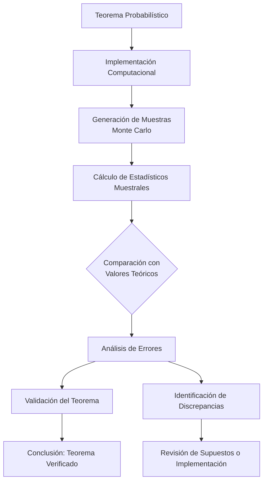

# Probabilidad I - Teoremas límite para sucesiones de variables aleatorias discretas

## 4.7 Contrastar los resultados teóricos con los obtenidos por simulación.

---

El contraste entre **resultados teóricos** y **simulaciones** es fundamental en probabilidad. Las simulaciones nos permiten verificar teoremas, desarrollar intuición y entender el comportamiento de variables aleatorias cuando los cálculos analíticos son complejos.

### Conceptos Fundamentales

#### Simulación Monte Carlo

Método computational que utiliza muestreo aleatorio para aproximar resultados numéricos. Para una variable aleatoria $X:$

$$E[X] \approx \frac{1}{n} \sum_{i=1}^n X_i$$

#### Error de Aproximación

Diferencia entre el valor teórico y la simulación:

$$\text{Error} = |\theta_{\text{teórico}} - \theta_{\text{simulación}}|$$

#### Error Cuadrático Medio (MSE)

$$\text{MSE} = E[(\theta_{\text{teórico}} - \theta_{\text{simulación}})^2]$$

### Marco Teórico para la Validación

#### Ley de los Grandes Números (LGN)

Si $ X_1, X_2, \ldots$ son i.i.d. con $E[X_i] = \mu ,$ entonces:

$$ \bar{X}_n = \frac{1}{n} \sum_{i=1}^n X_i \xrightarrow{\text{c.s.}} \mu $$

#### Teorema del Límite Central (TLC)

$$ \frac{\bar{X}_n - \mu}{\sigma/\sqrt{n}} \xrightarrow{D} N(0, 1) $$

### Diagrama del Proceso de Validación



### Código Python para Contrastar Teoremas Límite

```python
import numpy as np
import matplotlib.pyplot as plt
from scipy.stats import bernoulli, norm, binom, poisson
import seaborn as sns

class ValidadorTeoremas:
    def __init__(self, n_simulaciones=10000):
        self.n_simulaciones = n_simulaciones

    def validar_lgn(self, distribucion, params, n_max=1000):
        """
        Validar la Ley de los Grandes Números
        """
        n_valores = np.arange(10, n_max + 1, 10)
        errores = []

        for n in n_valores:
            # Generar muestras
            if distribucion == 'bernoulli':
                muestras = bernoulli.rvs(params['p'], size=(self.n_simulaciones, n))
            elif distribucion == 'poisson':
                muestras = poisson.rvs(params['lambda'], size=(self.n_simulaciones, n))

            # Calcular promedios
            promedios = np.mean(muestras, axis=1)

            # Calcular error
            if distribucion == 'bernoulli':
                error = np.mean(np.abs(promedios - params['p']))
            elif distribucion == 'poisson':
                error = np.mean(np.abs(promedios - params['lambda']))

            errores.append(error)

        return n_valores, errores

    def validar_tlc(self, distribucion, params, n_valores):
        """
        Validar el Teorema del Límite Central
        """
        fig, axes = plt.subplots(1, len(n_valores), figsize=(15, 5))
        if len(n_valores) == 1:
            axes = [axes]

        for i, n in enumerate(n_valores):
            # Generar muestras
            if distribucion == 'bernoulli':
                muestras = bernoulli.rvs(params['p'], size=(self.n_simulaciones, n))
                mu = params['p']
                sigma = np.sqrt(mu * (1 - params['p']))
            elif distribucion == 'poisson':
                muestras = poisson.rvs(params['lambda'], size=(self.n_simulaciones, n))
                mu = params['lambda']
                sigma = np.sqrt(mu)

            # Estandarizar
            promedios = np.mean(muestras, axis=1)
            z_scores = (promedios - mu) / (sigma / np.sqrt(n))

            # Graficar
            sns.histplot(z_scores, kde=True, ax=axes[i], stat='density')
            x = np.linspace(-4, 4, 100)
            axes[i].plot(x, norm.pdf(x), 'r-', linewidth=2)
            axes[i].set_title(f'n = {n}')
            axes[i].set_xlim(-4, 4)

        plt.suptitle(f'Validación TLC: {distribucion.capitalize()}')
        plt.tight_layout()
        plt.show()

    def validar_de_moivre_laplace(self, n, p, k_values):
        """
        Validar el Teorema de De Moivre-Laplace
        """
        # Valores teóricos
        binomial_probs = binom.pmf(k_values, n, p)
        mu = n * p
        sigma = np.sqrt(n * p * (1 - p))
        normal_probs = norm.pdf(k_values, mu, sigma)

        # Simulación
        simulaciones = binom.rvs(n, p, size=self.n_simulaciones)
        sim_probs = np.array([np.mean(simulaciones == k) for k in k_values])

        # Gráficos
        plt.figure(figsize=(12, 6))

        plt.subplot(121)
        plt.bar(k_values, binomial_probs, alpha=0.7, label='Binomial Teórica')
        plt.bar(k_values, sim_probs, alpha=0.7, label='Binomial Simulada')
        plt.plot(k_values, normal_probs, 'r-', linewidth=2, label='Aproximación Normal')
        plt.xlabel('k')
        plt.ylabel('Probabilidad')
        plt.legend()
        plt.title('Distribuciones')

        plt.subplot(122)
        errores_teoria = np.abs(binomial_probs - normal_probs)
        errores_sim = np.abs(sim_probs - normal_probs)
        plt.plot(k_values, errores_teoria, 'bo-', label='Error Teórico')
        plt.plot(k_values, errores_sim, 'ro-', label='Error Simulación')
        plt.xlabel('k')
        plt.ylabel('Error Absoluto')
        plt.legend()
        plt.title('Errores de Aproximación')

        plt.tight_layout()
        plt.show()

        return {
            'teorico': binomial_probs,
            'simulacion': sim_probs,
            'normal': normal_probs,
            'errores_teoria': errores_teoria,
            'errores_sim': errores_sim
        }

# Ejemplo de uso
validador = ValidadorTeoremas(n_simulaciones=10000)

print("Validando Ley de los Grandes Números (Bernoulli):")
n_vals, errores = validador.validar_lgn('bernoulli', {'p': 0.3})
plt.plot(n_vals, errores)
plt.xlabel('Tamaño de muestra (n)')
plt.ylabel('Error absoluto promedio')
plt.title('Convergencia LGN')
plt.show()

print("Validando Teorema del Límite Central:")
validador.validar_tlc('bernoulli', {'p': 0.3}, [10, 30, 100])

print("Validando Teorema de De Moivre-Laplace:")
resultados = validador.validar_de_moivre_laplace(50, 0.4, np.arange(15, 26))
```

### Ejemplos de Contrastación

#### Ejemplo 1: Validación de la LGN

Para $X_i \sim \text{Bernoulli}(0.4):$

- Teórico: $\lim_{n \to \infty} \bar{X}_n = 0.4$
- Simulación: $\bar{X}_n$ converge a 0.4 cuando $n$ aumenta
- Error: $|\bar{X}_n - 0.4|$ disminuye como $O(1/\sqrt{n})$

#### Ejemplo 2: Validación del TLC

Para $X_i \sim \text{Poisson}(2):$

- Teórico: $\frac{\bar{X}_n - 2}{\sqrt{2/n}} \sim N(0, 1)$
- Simulación: Histograma de Z-scores se aproxima a $N(0, 1)$

### Ejercicios Propuestos

#### Ejercicio 1

Implemente una simulación para verificar la Ley de los Grandes Números para:
a) $X_i \sim \text{Poisson}(3)$
b) $X_i \sim \text{Geométrica}(0.2)$
c) Analice la tasa de convergencia en cada caso

#### Ejercicio 2

Valide el Teorema del Límite Central para:
a) $X_i \sim \text{Binomial}(10, 0.3)$
b) $X_i \sim \text{Uniforme discreta}\{1, 2, 3, 4, 5, 6\}$
c) Compare la velocidad de convergencia

#### Ejercicio 3

Para el Teorema de De Moivre-Laplace:
a) Simule $X \sim \text{Binomial}(100, 0.4)$
b) Compare con la aproximación normal $N(40, 24)$
c) Calcule el error máximo con y sin corrección por continuidad

#### Ejercicio 4

Estudie empíricamente cómo afectan las violaciones de los supuestos:
a) Variables no idénticamente distribuidas
b) Variables dependientes
c) Varianza infinita

### Análisis de Resultados

#### Métricas de Validación

1. **Error absoluto medio:** $\frac{1}{n} \sum |\theta_{\text{teórico}} - \theta_{\text{simulación}}|$
2. **Error cuadrático medio:** $\frac{1}{n} \sum (\theta_{\text{teórico}} - \theta_{\text{simulación}})^2$
3. **Convergencia:** Tasa de disminución del error con $n$

#### Visualización de Resultados

- Gráficos de convergencia
- Histogramas comparativos
- Gráficos Q-Q para normalidad
- Mapas de calor para distribuciones conjuntas

### Tabla de Verificación de Teoremas

| Teorema           | Variables | Condiciones         | Métrica de Validación    | Tasa Convergencia |
| ----------------- | --------- | ------------------- | ------------------------ | ----------------- |
| LGN               | i.i.d.    | $E[X_i] = \mu$      | Error absoluto           | $O(1/\sqrt{n})$   |
| TLC               | i.i.d.    | $\sigma^2 < \infty$ | Distancia distribucional | $O(1/\sqrt{n})$   |
| De Moivre-Laplace | Bernoulli | $np \geq 5$         | Error máximo             | $O(1/\sqrt{n})$   |

### Aplicaciones Prácticas

1. **Verificación de modelos:** Contrastar supuestos teóricos
2. **Diseño de experimentos:** Determinar tamaño muestral necesario
3. **Análisis de riesgo:** Validar aproximaciones en finanzas
4. **Control de calidad:** Verificar supuestos en procesos industriales

### Referencias

1. Robert, C. P., & Casella, G. (2004). "Monte Carlo Statistical Methods"
2. Fishman, G. S. (1996). "Monte Carlo: Concepts, Algorithms, and Applications"
3. Ross, S. M. (2019). "Simulation"
4. Rubinstein, R. Y., & Kroese, D. P. (2016). "Simulation and the Monte Carlo Method"

### Consejos para el Estudio

1. **Comience con casos simples** antes de abordar problemas complejos
2. **Varíe los parámetros** para entender su influencia
3. **Use visualizaciones** para identificar patrones
4. **Documente los resultados** sistemáticamente
5. **Compare múltiples métodos** de simulación

### Preguntas de Autoevaluación

1. ¿Cómo determinaría el número de simulaciones necesario para una precisión dada?
2. ¿Qué indicaría si los resultados simulados no convergen a los teóricos?
3. ¿Cómo afecta la dependencia entre variables a la validación de los teoremas?
4. ¿Qué métodos usaría para validar teoremas para variables no idénticamente distribuidas?
