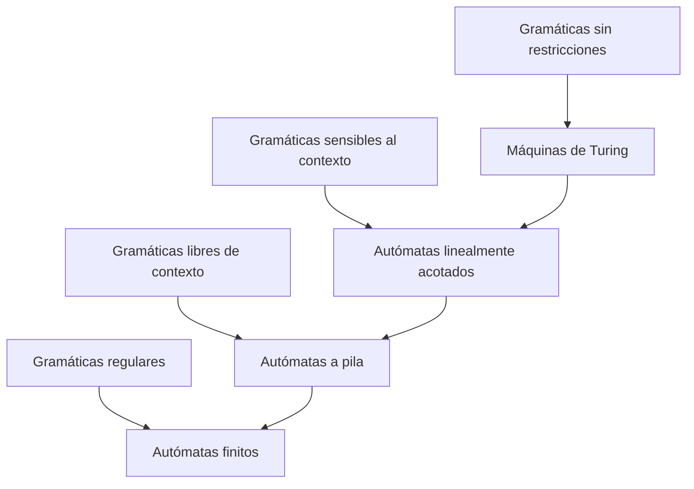
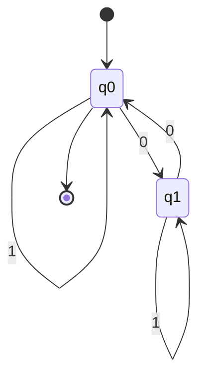

# Autómatas y Lenguajes Formales - Introducción

## 1.1 Motivación.

---

#### ¿Por qué estudiar Autómatas y Lenguajes Formales?

Los autómatas y lenguajes formales proporcionan las bases teóricas para comprender:

- Cómo funcionan los compiladores e intérpretes
- El diseño y análisis de algoritmos
- Los límites de lo que puede ser computado
- La estructura y procesamiento de lenguajes de programación
- La teoría detrás de expresiones regulares y análisis sintáctico

> "La teoría de autómatas es el estudio de máquinas abstractas y los problemas que pueden resolver" - Hopcroft, Motwani y Ullman

#### Conceptos Fundamentales

**Autómata**: Modelo matemático de una máquina que procesa información. Existen diferentes tipos con capacidades computacionales distintas:

- **Autómatas Finitos**: Modelos más simples
- **Autómatas a Pila**: Más potencia que los finitos
- **Máquinas de Turing**: Modelo más potente, base de la computación moderna

**Lenguaje Formal**: Conjunto de cadenas de símbolos que cumplen con ciertas reglas sintácticas.

#### Relación con la Jerarquía de Chomsky

Noam Chomsky clasificó los lenguajes formales en cuatro tipos, cada uno con su autómata correspondiente:



#### Aplicaciones Prácticas

1. **Compiladores**: Análisis léxico (expresiones regulares) y sintáctico (gramáticas libres de contexto)
2. **Procesamiento de lenguaje natural**: Modelado de estructuras lingüísticas
3. **Verificación de software**: Model checking con autómatas temporales
4. **Búsqueda de patrones**: Expresiones regulares en editores de texto y motores de búsqueda
5. **Protocolos de comunicación**: Modelado de secuencias de mensajes válidas

### Conceptos Matemáticos Básicos

#### Alfabeto y Cadenas

**Alfabeto $(\Sigma)$**: Conjunto finito de símbolos.

**Cadena**: Secuencia finita de símbolos de un alfabeto.

**Cadena vacía $(\varepsilon)$**: Cadena de longitud cero.

**Longitud de una cadena $(|w|)$**: Número de símbolos en la cadena $w$.

#### Lenguajes

**Lenguaje $(L)$**: Cualquier conjunto de cadenas sobre un alfabeto $\Sigma$.

**Operaciones con lenguajes**:

- Unión: $L_1 \cup L_2 = \{w \mid w \in L_1 \text{ o } w \in L_2\}$
- Concatenación: $L_1L_2 = \{w_1w_2 \mid w_1 \in L_1 \text{ y } w_2 \in L_2\}$
- Cerradura de Kleene: $L^* = \bigcup_{i=0}^{\infty} L^i$ donde $L^0 = \{\varepsilon\}$, $L^1 = L$, $L^2 = LL$, etc.

### Ejemplo: Autómata Finito

Imaginemos un autómata que reconoce cadenas con un número par de 0's sobre el alfabeto $\Sigma = \{0, 1\}$:



Este autómata tiene:

- Estados: $Q = \{q_0, q_1\}$
- Estado inicial: $q_0$
- Estados de aceptación: $F = \{q_0\}$
- Alfabeto: $\Sigma = \{0, 1\}$
- Funciones de transición definidas por las flechas

### Ejercicios Propuestos

1. **Lenguajes Regulares**:
   - Define el lenguaje $L = \{w \in \{0, 1\}^* \mid w \text{ contiene la subcadena "01"}\}$
   - ¿Este lenguaje es regular? Intenta diseñar un autómata finito que lo reconozca.

2. **Operaciones con lenguajes**:
   - Dados $L_1 = \{a, ab\}$ y $L_2 = {b, ba}$ sobre $\Sigma = \{a, b\}$:
     a) Calcula $L_1 \cup L_2$
     b) Calcula $L_1L_2$
     c) Calcula $L_1^*$

3. **Autómatas**:
   - Diseña un autómata finito que reconozca cadenas sobre $\{0, 1\}$ que terminen con "00".

### Código de Ejemplo (Python)

A continuación, una implementación simple de un autómata finito determinista:

```python
class DFA:
    def __init__(self, states, alphabet, transitions, start_state, accept_states):
        self.states = states
        self.alphabet = alphabet
        self.transitions = transitions  # Dict: (state, symbol) -> next_state
        self.current_state = start_state
        self.start_state = start_state
        self.accept_states = accept_states

    def reset(self):
        self.current_state = self.start_state

    def process_symbol(self, symbol):
        if symbol not in self.alphabet:
            raise ValueError(f"Símbolo {symbol} no está en el alfabeto")
        self.current_state = self.transitions.get((self.current_state, symbol))

    def process_string(self, input_string):
        self.reset()
        for symbol in input_string:
            self.process_symbol(symbol)
        return self.current_state in self.accept_states

# Ejemplo: Autómata para cadenas con número par de 0's
states = {'q0', 'q1'}
alphabet = {'0', '1'}
transitions = {
    ('q0', '0'): 'q1',
    ('q0', '1'): 'q0',
    ('q1', '0'): 'q0',
    ('q1', '1'): 'q1'
}
start_state = 'q0'
accept_states = {'q0'}

dfa = DFA(states, alphabet, transitions, start_state, accept_states)

# Probar algunas cadenas
test_cases = ['', '0', '00', '010', '1010', '1001']
for test in test_cases:
    result = dfa.process_string(test)
    print(f"'{test}': {'Aceptada' if result else 'Rechazada'}")
```

### Referencias

1. Viso G., E., _Introducción a la teoría de la computación_. Las Prensas de Ciencias, 2008. (Capítulo 1: Introducción y motivación)
2. Hopcroft, J. E., Motwani, R., and Ullman, J., _Introduction to Automata Theory, Languages, and Computation_. (Capítulo 1: Introduction to the Theory of Computation)
3. Sipser, M., _Introduction to the Theory of Computation_. (Capítulo 0: Introduction)

### Para profundizar

- Investiga sobre el problema de la parada (Halting Problem) y su relación con los límites de la computación.
- Explora cómo las expresiones regulares que usas en programación se relacionan con los autómatas finitos.
- Consulta la biografía de Alan Turing y su contribución a las ciencias de la computación.
