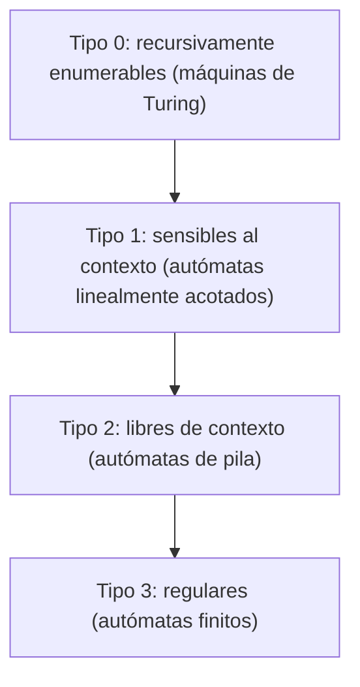
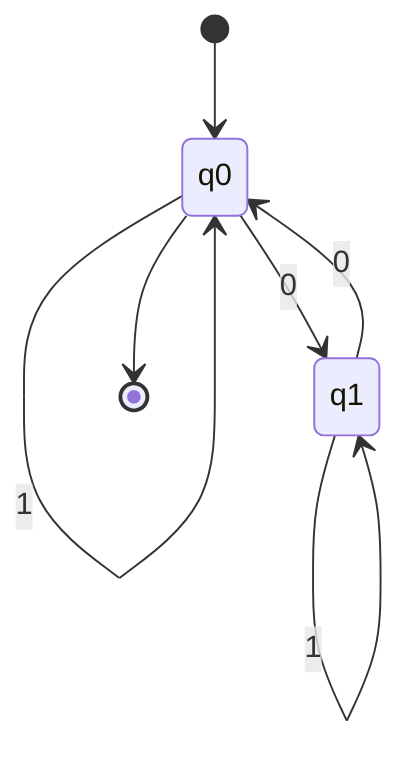

# Autómatas y Lenguajes Formales - Introducción

## 1.1 Motivación.

---

### ¿Por qué estudiar Autómatas y Lenguajes Formales?

Los autómatas y lenguajes formales proporcionan las bases teóricas para comprender:

- Cómo funcionan los compiladores e intérpretes.
- La estructura y el procesamiento de los lenguajes de programación.
- La teoría detrás de las expresiones regulares y del análisis sintáctico.
- Qué problemas puede resolver una máquina con una cantidad dada de memoria.
- Los límites de lo que puede ser computado, sin importar cuánto tiempo o memoria se tenga.

La pregunta central del curso es: **¿qué puede calcular una máquina?** Para responderla con precisión hay que fijar dos cosas: qué es un **problema** y qué es una **máquina**. La teoría de lenguajes formales responde la primera: un problema de decisión es un conjunto de cadenas, las que tienen respuesta "sí". La teoría de autómatas responde la segunda con una familia de modelos matemáticos de máquinas, cada uno con una forma distinta de memoria.

### Problemas como lenguajes

Cualquier problema de decisión se puede codificar como la pregunta de si una cadena $w$ pertenece a un lenguaje $L.$ Por ejemplo:

- ¿Es $n$ un número primo? Es la pregunta de si la representación binaria de $n$ pertenece a $L_{\text{primos}} = \{10, 11, 101, 111, 1011, \ldots\}.$
- ¿Está bien balanceada una expresión con paréntesis? Es pertenecer al lenguaje de las cadenas de paréntesis balanceados.
- ¿Compila este programa? Es pertenecer al lenguaje de los programas sintácticamente correctos de un lenguaje de programación.

Una máquina **reconoce** un lenguaje si, al recibir cualquier cadena, responde "sí" exactamente cuando la cadena está en el lenguaje. Estudiar qué lenguajes reconoce cada tipo de máquina es estudiar qué problemas puede resolver.

### Conceptos Fundamentales

**Autómata.** Modelo matemático de una máquina que lee una cadena símbolo por símbolo, cambia de estado según lo que lee y al final acepta o rechaza. Los tipos se distinguen por la memoria que tienen:

- **Autómatas finitos:** solo tienen un número finito de estados; no pueden contar sin límite.
- **Autómatas de pila:** agregan una pila de tamaño ilimitado, a la que solo se accede por el tope.
- **Autómatas linealmente acotados:** una cinta que se puede leer y escribir libremente, pero del tamaño de la entrada.
- **Máquinas de Turing:** una cinta ilimitada de lectura y escritura. Es el modelo más potente conocido y la base de la computación moderna: según la **tesis de Church-Turing**, todo lo que se puede calcular con un algoritmo lo calcula una máquina de Turing.

**Lenguaje formal.** Conjunto de cadenas de símbolos tomados de un alfabeto finito. Puede ser finito o infinito, y se describe con reglas precisas: una gramática, una expresión regular o una máquina que lo reconoce.

### Un ejemplo de los límites de la memoria finita

Considera el lenguaje $L = \{a^n b^n \mid n \geq 0\} = \{\varepsilon, ab, aabb, aaabbb, \ldots\}.$ Para reconocerlo hay que **contar** cuántas $a$ se leyeron y comparar con las $b.$ Un autómata con $k$ estados no puede distinguir entre las cadenas $a^0, a^1, \ldots, a^k,$ que son $k + 1:$ por el principio del palomar, dos de ellas, $a^i$ y $a^j$ con $i \neq j,$ lo dejan en el mismo estado. Entonces el autómata da la misma respuesta para $a^ib^i$ y para $a^jb^i,$ y se equivoca en una de las dos. Este argumento, que se formaliza en el tema 2, muestra que $L$ **no es regular**. Con una pila sí se reconoce: se apila un símbolo por cada $a$ y se desapila uno por cada $b.$

Así aparece una jerarquía: cada tipo de memoria permite reconocer más lenguajes que el anterior.

### Relación con la Jerarquía de Chomsky

Noam Chomsky clasificó en 1956 las gramáticas formales en cuatro tipos, y a cada tipo le corresponde una clase de autómatas que reconoce exactamente sus lenguajes:

| Tipo | Gramática | Lenguajes | Autómata | Ejemplo |
| --- | --- | --- | --- | --- |
| 0 | Sin restricciones | Recursivamente enumerables | Máquina de Turing | Programas que se detienen |
| 1 | Sensible al contexto | Sensibles al contexto | Autómata linealmente acotado | $\{a^nb^nc^n \mid n \geq 1\}$ |
| 2 | Libre de contexto | Libres de contexto | Autómata de pila | $\{a^nb^n \mid n \geq 0\}$ |
| 3 | Regular | Regulares | Autómata finito | Números en binario pares |

Cada clase está **estrictamente contenida** en la anterior: todo lenguaje regular es libre de contexto, todo libre de contexto es sensible al contexto (salvo por el detalle de la cadena vacía), y todo sensible al contexto es recursivamente enumerable. Los ejemplos de la tabla muestran que las contenciones son estrictas.



Cada flecha va de una clase a una subclase propia de ella.

### Aplicaciones Prácticas

1. **Compiladores:** el análisis léxico usa expresiones regulares y autómatas finitos; el análisis sintáctico, gramáticas libres de contexto y autómatas de pila.
2. **Búsqueda de patrones:** las expresiones regulares de `grep`, de los editores de texto y de las bibliotecas de los lenguajes de programación se compilan a autómatas.
3. **Verificación de software y hardware:** el *model checking* representa los comportamientos de un sistema y las propiedades deseadas con autómatas, por ejemplo autómatas de Büchi sobre cadenas infinitas.
4. **Protocolos de comunicación:** una máquina de estados describe las secuencias válidas de mensajes, como los estados de una conexión TCP.
5. **Procesamiento de lenguaje natural:** los transductores finitos se usan en morfología y en corrección ortográfica; las gramáticas, en el análisis de oraciones.
6. **Límites de la computación:** el problema de la detención muestra que hay preguntas bien definidas sobre programas que ningún algoritmo puede responder (tema 7).

### Conceptos Matemáticos Básicos

Estos conceptos se desarrollan en el tema 1.2; aquí solo se fijan los nombres.

- **Alfabeto** $\Sigma:$ conjunto finito y no vacío de símbolos.
- **Cadena:** secuencia finita de símbolos de un alfabeto.
- **Cadena vacía** $\varepsilon:$ la cadena de longitud cero.
- **Longitud** $|w|:$ número de símbolos de la cadena $w.$
- **Lenguaje** $L:$ cualquier conjunto de cadenas sobre un alfabeto $\Sigma,$ es decir, $L \subseteq \Sigma^*,$ donde $\Sigma^*$ es el conjunto de todas las cadenas sobre $\Sigma.$

Operaciones con lenguajes:

- Unión: $L_1 \cup L_2 = \{w \mid w \in L_1 \text{ o } w \in L_2\}.$
- Concatenación: $L_1L_2 = \{w_1w_2 \mid w_1 \in L_1 \text{ y } w_2 \in L_2\}.$
- Cerradura de Kleene: $L^* = \bigcup_{i=0}^{\infty} L^i,$ donde $L^0 = \{\varepsilon\},$ $L^1 = L,$ $L^2 = LL,$ y así sucesivamente.

### Ejemplo: Autómata Finito

Un autómata que reconoce las cadenas con un número par de ceros sobre el alfabeto $\Sigma = \{0, 1\}.$ Solo necesita recordar una cosa: si hasta ahora ha leído un número par o impar de ceros.



Este autómata tiene:

- Estados: $Q = \{q_0, q_1\},$ donde $q_0$ significa "par" y $q_1$ significa "impar".
- Estado inicial: $q_0,$ porque al principio se han leído cero ceros.
- Estados de aceptación: $F = \{q_0\}.$
- Alfabeto: $\Sigma = \{0, 1\}.$
- Función de transición: un 0 cambia la paridad y un 1 la conserva.

Por ejemplo, con la entrada $1001$ recorre $q_0 \xrightarrow{1} q_0 \xrightarrow{0} q_1 \xrightarrow{0} q_0 \xrightarrow{1} q_0$ y acepta; con $010$ termina en $q_1$ y rechaza.

### Código de Ejemplo (Python)

Una implementación simple de un autómata finito determinista:

```python
class DFA:
    def __init__(self, states, alphabet, transitions, start_state, accept_states):
        self.states = states
        self.alphabet = alphabet
        self.transitions = transitions  # dict: (estado, símbolo) -> estado
        self.start_state = start_state
        self.accept_states = accept_states

    def process_string(self, input_string):
        state = self.start_state
        for symbol in input_string:
            if symbol not in self.alphabet:
                raise ValueError(f"Símbolo {symbol} no está en el alfabeto")
            state = self.transitions[(state, symbol)]
        return state in self.accept_states

# Autómata para cadenas con número par de ceros
transitions = {
    ('q0', '0'): 'q1',
    ('q0', '1'): 'q0',
    ('q1', '0'): 'q0',
    ('q1', '1'): 'q1',
}
dfa = DFA({'q0', 'q1'}, {'0', '1'}, transitions, 'q0', {'q0'})

for test in ['', '0', '00', '010', '1010', '1001']:
    print(f"'{test}': {'Aceptada' if dfa.process_string(test) else 'Rechazada'}")
```

Salida:

```text
'': Aceptada
'0': Rechazada
'00': Aceptada
'010': Aceptada
'1010': Aceptada
'1001': Aceptada
```

La cadena vacía se acepta porque tiene cero ceros, y cero es par.

### Ejercicios Propuestos

1. **Lenguajes regulares.**
   - Define el lenguaje $L = \{w \in \{0, 1\}^* \mid w \text{ contiene la subcadena } 01\}.$
   - Diseña un autómata finito que lo reconozca.

2. **Operaciones con lenguajes.** Dados $L_1 = \{a, ab\}$ y $L_2 = \{b, ba\}$ sobre $\Sigma = \{a, b\}:$
   - a) Calcula $L_1 \cup L_2.$
   - b) Calcula $L_1L_2.$
   - c) Describe $L_1^*$ y lista sus cadenas de longitud a lo más 3.

3. **Autómatas.** Diseña un autómata finito que reconozca las cadenas sobre $\{0, 1\}$ que terminan en $00.$

4. **Memoria finita.** Usa el argumento del palomar de la sección sobre los límites de la memoria finita para explicar por qué ningún autómata finito reconoce el lenguaje de los paréntesis balanceados.

### Soluciones

**Ejercicio 1.** Basta recordar si ya apareció un 0 que pueda iniciar la subcadena: el estado $q_0$ significa "todavía no hay nada útil", $q_1$ "el último símbolo fue un 0" y $q_2$ "ya apareció 01". Las transiciones son $q_0 \xrightarrow{0} q_1,$ $q_0 \xrightarrow{1} q_0,$ $q_1 \xrightarrow{0} q_1,$ $q_1 \xrightarrow{1} q_2,$ y $q_2$ va a sí mismo con ambos símbolos. El único estado de aceptación es $q_2.$ Sí es regular, porque lo reconoce un autómata finito.

**Ejercicio 2.**

- a) $L_1 \cup L_2 = \{a, ab, b, ba\}.$
- b) $L_1L_2 = \{ab, aba, abb, abba\}.$
- c) $L_1^*$ es el conjunto de cadenas que se pueden partir en bloques $a$ y $ab;$ equivalentemente, las cadenas sobre $\{a, b\}$ que no empiezan con $b$ y en las que toda $b$ va precedida inmediatamente por una $a.$ Sus cadenas de longitud a lo más 3 son $\varepsilon, a, aa, ab, aaa, aab, aba.$

**Ejercicio 3.** Los estados recuerdan cuántos ceros seguidos hay al final, hasta 2: $q_0$ (ninguno), $q_1$ (uno) y $q_2$ (dos o más). Con un 0 se pasa de $q_0$ a $q_1,$ de $q_1$ a $q_2$ y $q_2$ se queda en $q_2;$ con un 1 todos regresan a $q_0.$ Se acepta en $q_2.$

**Ejercicio 4.** Si un autómata con $k$ estados reconociera los paréntesis balanceados, entre las $k + 1$ cadenas $(^0, (^1, \ldots, (^k$ habría dos, $(^i$ y $(^j$ con $i < j,$ que lo dejan en el mismo estado. Al agregar $)^i$ a ambas, llega al mismo estado final con $(^i)^i,$ que está balanceada, y con $(^j)^i,$ que no lo está: una de las dos respuestas es incorrecta.

### Referencias

1. Viso G., E., _Introducción a la teoría de la computación_. Las Prensas de Ciencias, 2008. Capítulo 1.
2. Hopcroft, J. E., Motwani, R., and Ullman, J., _Introduction to Automata Theory, Languages, and Computation_. Pearson, 2007. Capítulo 1.
3. Sipser, M., _Introduction to the Theory of Computation_. Cengage, 2013. Capítulo 0.
4. Chomsky, N. (1956). Three models for the description of language. _IRE Transactions on Information Theory_, 2(3), 113-124.

### Para profundizar

- Investiga sobre el problema de la detención y su relación con los límites de la computación.
- Explora cómo las expresiones regulares que usas en programación se relacionan con los autómatas finitos, y qué extensiones, como las referencias hacia atrás, rompen esa relación.
- Consulta la biografía de Alan Turing y su contribución a las ciencias de la computación.
