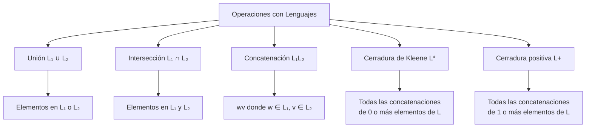

# Autómatas y Lenguajes Formales - Introducción

## 1.2 Cadenas y lenguajes.

---

El estudio de **cadenas y lenguajes** constituye la base fundamental de la teoría de autómatas y lenguajes formales. En esta guía exploraremos los conceptos esenciales que nos permitirán entender cómo se estructuran y manipulan los lenguajes formales.

### Conceptos Básicos

#### Alfabeto

Un **alfabeto** $(\Sigma)$ es un conjunto finito y no vacío de símbolos.

**Ejemplos**:

- $\Sigma = \{0, 1\}$ (alfabeto binario)
- $\Sigma = \{a, b, c, ..., z\}$ (alfabeto del español)
- $\Sigma = \{\text{if}, \text{then}, \text{else}, ;, =, ...\}$ (alfabeto de un lenguaje de programación)

#### Cadena

Una **cadena** (o palabra) sobre un alfabeto $\Sigma$ es una secuencia finita de símbolos de $\Sigma$.

**Notación**:

- $w$ = una cadena cualquiera
- $|w|$ = longitud de la cadena $w$ (número de símbolos)
- $\varepsilon$ = cadena vacía (longitud 0)

**Ejemplos**:

- Para $\Sigma = \{0, 1\}$: $w = 0101$, $|w| = 4$
- Para $\Sigma = \{a, b, c\}$: $w = abcab$, $|w| = 5$

#### Lenguaje

Un **lenguaje** $(L)$ sobre un alfabeto $\Sigma$ es un conjunto de cadenas formadas con símbolos de $\Sigma$.

**Ejemplos**:

- $L_1 = \{\varepsilon, 0, 1, 00, 01, 10, 11, 000, ...\}$ = todas las cadenas binarias
- $L_2 = \{\varepsilon, a, b, aa, ab, ba, bb, aaa, ...\}$ = todas las cadenas sobre $\{a, b\}$
- $L_3 = \{a^n b^n \mid n \geq 0\}$ = cadenas con igual número de a's seguido de igual número de b's

### Operaciones con Cadenas

#### Concatenación

Dadas dos cadenas $w$ y $v$, su **concatenación** ( $w \cdot v$ o simplemente $wv$ ) es la cadena formada al escribir $w$ seguida de $v$.

**Propiedades**:

- $|wv| = |w| + |v|$
- $w\varepsilon = \varepsilon w = w$ (elemento neutro)
- $(wx)v = w(xv)$ (asociativa)

#### Potencia de una Cadena

La **potencia** de una cadena se define recursivamente:

- $w^0 = \varepsilon$
- $w^n = w^{n-1}w$ para $n \geq 1$

**Ejemplo**: Si $w = ab$, entonces:

- $w^0 = \varepsilon$
- $w^1 = ab$
- $w^2 = abab$
- $w^3 = ababab$

#### Reflexión o Reversa

La **reflexión** $(w^R)$ de una cadena $w$ es la cadena escrita en orden inverso.

**Definición formal**:

- Si $w = \varepsilon$, entonces $w^R = \varepsilon$
- Si $w = xa$ donde $a \in \Sigma$, entonces $w^R = a x^R$

**Ejemplo**: Si $w = abcd$, entonces $w^R = dcba$

### Operaciones con Lenguajes

#### Unión

La **unión** de dos lenguajes $L_1$ y $L_2$ es:

$$L_1 \cup L_2 = \{w \mid w \in L_1 \text{ o } w \in L_2\}$$

#### Intersección

La **intersección** de dos lenguajes $L_1$ y $L_2$ es:

$$L_1 \cap L_2 = \{w \mid w \in L_1 \text{ y } w \in L_2\}$$

#### Concatenación

La **concatenación** de dos lenguajes $L_1$ y $L_2$ es:

$$L_1 L_2 = \{wv \mid w \in L_1 \text{ y } v \in L_2\}$$

#### Cerradura de Kleene

La **cerradura de Kleene** (o estrella de Kleene) de un lenguaje $L$ es:

$$L^* = \bigcup_{i=0}^{\infty} L^i$$

donde:

- $L^0 = \{\varepsilon\}$
- $L^1 = L$
- $L^2 = LL$
- $L^3 = LLL$, etc.

#### Cerradura Positiva

La **cerradura positiva** de un lenguaje $L$ es:

$$L^+ = \bigcup_{i=1}^{\infty} L^i$$

**Relación**: $L^* = L^+ \cup \{\varepsilon\}$

### Representación Visual de Operaciones con Lenguajes



### Ejemplos de Operaciones

**Ejemplo 1**: Sean $L_1 = \{a, ab\}$ y $L_2 = {b, ba}$

- $L_1 \cup L_2 = \{a, ab, b, ba\}$
- $L_1 \cap L_2 = \emptyset$ (en este caso)
- $L_1 L_2 = \{ab, aba, abb, abba\}$
- $L_1^* = \{\varepsilon, a, ab, aa, aab, aba, abab, aaa, ...\}$

**Ejemplo 2**: Lenguaje de todas las cadenas binarias con al menos un 0:

$$L = \{w \in \{0, 1\}^* \mid w \text{ contiene al menos un } 0\}$$

### Prefijos, Sufijos y Subcadenas

Para una cadena $w = a_1 a_2 ... a_n$:

- **Prefijo**: Cualquier cadena de la forma $a_1 a_2 ... a_k$ donde $0 \leq k \leq n$
- **Sufijo**: Cualquier cadena de la forma $a_k a_{k+1} ... a_n$ donde $1 \leq k \leq n+1$
- **Subcadena**: Cualquier cadena de la forma $a_k a_{k+1} ... a_m$ donde $1 \leq k \leq m \leq n$

**Ejemplo**: Para $w = abc$:

- Prefijos: $\varepsilon$, $a$, $ab$, $abc$
- Sufijos: $\varepsilon$, $c$, $bc$, $abc$
- Subcadenas: $\varepsilon$, $a$, $b$, $c$, $ab$, $bc$, $abc$

### Código de Ejemplo (Python)

```python
def concatenar(cadena1, cadena2):
    """Concatena dos cadenas"""
    return cadena1 + cadena2

def potencia(cadena, n):
    """Calcula la n-ésima potencia de una cadena"""
    if n == 0:
        return ""
    return cadena * n

def reversa(cadena):
    """Calcula la reversa de una cadena"""
    return cadena[::-1]

def es_prefijo(prefijo, cadena):
    """Determina si prefijo es un prefijo de cadena"""
    return cadena.startswith(prefijo)

def es_sufijo(sufijo, cadena):
    """Determina si sufijo es un sufijo de cadena"""
    return cadena.endswith(sufijo)

def es_subcadena(subcadena, cadena):
    """Determina si subcadena es una subcadena de cadena"""
    return subcadena in cadena

# Ejemplos de uso
if __name__ == "__main__":
    w = "ab"
    v = "cd"

    print(f"Concatenación de '{w}' y '{v}': {concatenar(w, v)}")
    print(f"Potencia '{w}'^3: {potencia(w, 3)}")
    print(f"Reversa de '{w}': {reversa(w)}")
    print(f"'a' es prefijo de 'abc': {es_prefijo('a', 'abc')}")
    print(f"'c' es sufijo de 'abc': {es_sufijo('c', 'abc')}")
    print(f"'b' es subcadena de 'abc': {es_subcadena('b', 'abc')}")
```

### Ejercicios Propuestos

1. **Operaciones con cadenas**:
   - Sea $\Sigma = \{a, b, c\}$, $w = abc$, $v = bca$
   - Calcula: $wv$, $w^3$, $v^R$, $|wv|$

2. **Operaciones con lenguajes**:
   - Sean $L_1 = \{a, ab\}$, $L_2 = {b, ba}$, $L_3 = \{\varepsilon, a\}$
   - Calcula:
     - $L_1 \cup L_2$
     - $L_1 \cap L_3$
     - $L_1 L_2$
     - $L_1^*$
     - $(L_1 L_2) \cap L_3$

3. **Prefijos, sufijos y subcadenas**:
   - Para $w = abcba$, enumera:
     - Todos los prefijos
     - Todos los sufijos
     - 5 subcadenas diferentes

4. **Lenguajes especiales**:
   - Define formalmente los siguientes lenguajes sobre $\Sigma = \{0, 1\}$:
     - Todas las cadenas que comienzan con 0
     - Todas las cadenas que terminan con 1
     - Todas las cadenas que contienen la subcadena 01

5. **Demostraciones**:
   - Demuestra que $(w^R)^R = w$ para cualquier cadena $w$
   - Demuestra que $(wv)^R = v^R w^R$ para cualquier par de cadenas $w, v$

### Referencias

1. Viso G., E., _Introducción a la teoría de la computación_. Las Prensas de Ciencias, 2008. (Capítulo 2: Alfabetos, cadenas y lenguajes)
2. Hopcroft, J. E., Motwani, R., and Ullman, J., _Introduction to Automata Theory, Languages, and Computation_. (Capítulo 3: Lenguajes y gramáticas)
3. Sipser, M., _Introduction to the Theory of Computation_. (Capítulo 0: Preliminares matemáticos)

### Para profundizar

- Investiga sobre la relación entre las operaciones con lenguajes y las operaciones de conjuntos
- Explora cómo estas operaciones se implementan en lenguajes de programación para el manejo de expresiones regulares
- Consulta sobre la importancia de la cerradura de Kleene en la definición de lenguajes regulares
