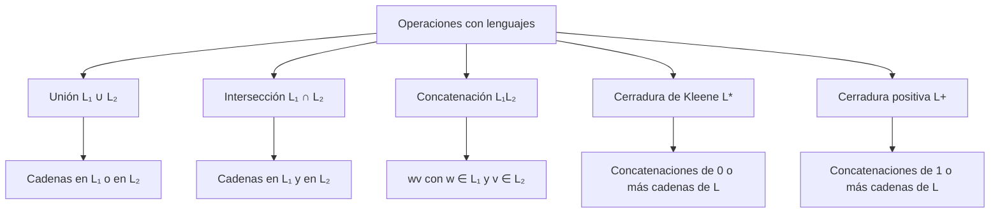

# Autómatas y Lenguajes Formales - Introducción

## 1.2 Cadenas y lenguajes.

---

El estudio de **cadenas y lenguajes** constituye la base de la teoría de autómatas y lenguajes formales. Todo lo que se hará en el curso, desde las expresiones regulares hasta las máquinas de Turing, se define en términos de estos objetos, así que conviene manejarlos con precisión: casi todas las demostraciones del curso son inducciones sobre la longitud de una cadena.

### Conceptos Básicos

#### Alfabeto

Un **alfabeto** $\Sigma$ es un conjunto finito y no vacío de símbolos.

**Ejemplos:**

- $\Sigma = \{0, 1\},$ el alfabeto binario.
- $\Sigma = \{a, b, c, \ldots, z\},$ las letras minúsculas del alfabeto latino básico.
- $\Sigma = \{\texttt{if}, \texttt{then}, \texttt{else}, \texttt{id}, \texttt{=}, \texttt{;}\},$ los tipos de token de un lenguaje de programación: para el analizador sintáctico, cada token es un solo símbolo.
- El conjunto de caracteres Unicode, que es finito aunque enorme.

Que el alfabeto sea **finito** es esencial: los autómatas tienen un número finito de transiciones porque hay finitos símbolos.

#### Cadena

Una **cadena** (o palabra) sobre un alfabeto $\Sigma$ es una secuencia finita de símbolos de $\Sigma.$

**Notación:**

- $w, x, y, v$ denotan cadenas, y $a, b, c$ símbolos.
- $|w|$ es la longitud de $w,$ su número de símbolos, y $|w|_a$ el número de apariciones del símbolo $a$ en $w.$
- $\varepsilon$ es la cadena vacía, de longitud 0. No es un símbolo del alfabeto.
- $\Sigma^n$ es el conjunto de cadenas de longitud $n,$ y $\Sigma^*$ el de todas las cadenas: $\Sigma^* = \Sigma^0 \cup \Sigma^1 \cup \Sigma^2 \cup \cdots$ Se escribe $\Sigma^+$ para las cadenas no vacías.

**Ejemplos:**

- Para $\Sigma = \{0, 1\}:$ $w = 0101,$ $|w| = 4$ y $|w|_1 = 2.$
- Para $\Sigma = \{a, b, c\}:$ $w = abcab,$ $|w| = 5.$

Si $|\Sigma| = k,$ hay exactamente $k^n$ cadenas de longitud $n,$ porque cada una de las $n$ posiciones se elige entre $k$ símbolos. Por ejemplo, hay $2^3 = 8$ cadenas binarias de longitud 3.

#### Lenguaje

Un **lenguaje** $L$ sobre un alfabeto $\Sigma$ es cualquier subconjunto de $\Sigma^*.$

**Ejemplos:**

- $\emptyset,$ el lenguaje vacío, que no tiene cadenas.
- $\{\varepsilon\},$ el lenguaje que solo contiene la cadena vacía. Es distinto de $\emptyset:$ tiene un elemento.
- $\Sigma^* = \{\varepsilon, 0, 1, 00, 01, 10, 11, 000, \ldots\}$ para $\Sigma = \{0, 1\},$ todas las cadenas binarias.
- $\{a^n b^n \mid n \geq 0\} = \{\varepsilon, ab, aabb, \ldots\},$ las cadenas formadas por $n$ letras $a$ seguidas de $n$ letras $b.$
- $\{w \in \{0, 1\}^* \mid |w|_0 = |w|_1\},$ las cadenas con tantos ceros como unos.

#### ¿Cuántos lenguajes hay?

$\Sigma^*$ es infinito pero **numerable**: se pueden listar sus cadenas en **orden canónico** (primero por longitud y, entre las de igual longitud, en orden alfabético): $\varepsilon, 0, 1, 00, 01, 10, 11, 000, \ldots$ En cambio, el conjunto de todos los lenguajes, $\mathcal{P}(\Sigma^*),$ **no es numerable**, por el argumento diagonal de Cantor. Como cada máquina se describe con una cadena finita, solo hay una cantidad numerable de máquinas: la mayoría de los lenguajes no los reconoce ninguna máquina. Esta es la primera señal de que existen problemas sin solución algorítmica (tema 7).

### Operaciones con Cadenas

#### Concatenación

Dadas dos cadenas $w$ y $v,$ su **concatenación** $w \cdot v,$ o simplemente $wv,$ es la cadena formada al escribir $w$ seguida de $v.$

**Propiedades:**

- $|wv| = |w| + |v|.$
- $w\varepsilon = \varepsilon w = w:$ la cadena vacía es el elemento neutro.
- $(wx)v = w(xv):$ es asociativa.
- No es conmutativa: $ab \neq ba.$

Con estas propiedades, $\Sigma^*$ con la concatenación es un **monoide**, el monoide libre generado por $\Sigma.$

#### Potencia de una Cadena

La **potencia** de una cadena se define recursivamente:

- $w^0 = \varepsilon.$
- $w^n = w^{n-1}w$ para $n \geq 1.$

**Ejemplo:** si $w = ab,$ entonces $w^0 = \varepsilon,$ $w^1 = ab,$ $w^2 = abab$ y $w^3 = ababab.$ Siempre $|w^n| = n|w|.$

Hay que distinguir $ab^3 = abbb,$ donde la potencia afecta solo al símbolo $b,$ de $(ab)^3 = ababab.$

#### Reflexión o Reversa

La **reflexión** $w^R$ de una cadena $w$ es la cadena escrita en orden inverso. Su **definición recursiva** es:

- $\varepsilon^R = \varepsilon.$
- $(xa)^R = a\,x^R$ si $a \in \Sigma$ y $x \in \Sigma^*.$

**Ejemplo:** si $w = abcd,$ entonces $w^R = dcba.$ Una cadena con $w = w^R$ es un **palíndromo**, como $abba$ o $radar.$

### Operaciones con Lenguajes

Como los lenguajes son conjuntos, tienen las operaciones de conjuntos: unión, intersección, diferencia y **complemento**, $\overline{L} = \Sigma^* \setminus L.$ Además tienen operaciones propias que vienen de la concatenación.

#### Unión

$$ L_1 \cup L_2 = \{w \mid w \in L_1 \text{ o } w \in L_2\} $$

#### Intersección

$$ L_1 \cap L_2 = \{w \mid w \in L_1 \text{ y } w \in L_2\} $$

#### Concatenación

$$ L_1 L_2 = \{wv \mid w \in L_1 \text{ y } v \in L_2\} $$

Algunas consecuencias de la definición que suelen confundir:

- $L\{\varepsilon\} = \{\varepsilon\}L = L.$
- $L\emptyset = \emptyset L = \emptyset:$ si uno de los dos no tiene cadenas, no hay pares que concatenar.
- $|L_1L_2| \leq |L_1| \cdot |L_2|,$ y puede ser menor: $\{a, ab\}\{b, \varepsilon\} = \{ab, a, abb\}$ tiene 3 elementos y no 4, porque $a \cdot b = ab \cdot \varepsilon.$

#### Cerradura de Kleene

La **cerradura de Kleene** (o estrella de Kleene) de un lenguaje $L$ es

$$ L^* = \bigcup_{i=0}^{\infty} L^i $$

donde $L^0 = \{\varepsilon\}$ y $L^{i} = L^{i-1}L$ para $i \geq 1.$ Es el conjunto de cadenas que se obtienen concatenando **cero o más** cadenas de $L,$ con repetición. Siempre $\varepsilon \in L^*,$ incluso si $L = \emptyset:$ $\emptyset^* = \{\varepsilon\}.$ Cuando $L = \Sigma,$ la definición coincide con $\Sigma^*.$

#### Cerradura Positiva

$$ L^+ = \bigcup_{i=1}^{\infty} L^i = LL^* $$

Siempre $L^* = L^+ \cup \{\varepsilon\},$ pero $L^+ = L^* \setminus \{\varepsilon\}$ solo si $\varepsilon \notin L:$ si $\varepsilon \in L,$ entonces $\varepsilon \in L^+$ y $L^+ = L^*.$

#### Reversa de un lenguaje

$$ L^R = \{w^R \mid w \in L\} $$

### Representación Visual de Operaciones con Lenguajes



### Ejemplos de Operaciones

**Ejemplo 1.** Sean $L_1 = \{a, ab\}$ y $L_2 = \{b, ba\}.$

- $L_1 \cup L_2 = \{a, ab, b, ba\}.$
- $L_1 \cap L_2 = \emptyset.$
- $L_1 L_2 = \{ab, aba, abb, abba\}.$
- $L_2 L_1 = \{ba, bab, baa, baab\},$ distinto de $L_1L_2.$
- $L_1^* = \{\varepsilon, a, aa, ab, aaa, aab, aba, \ldots\}.$

**Ejemplo 2.** El lenguaje de las cadenas binarias con al menos un 0 se puede escribir de varias formas:

$$ L = \{w \in \{0, 1\}^* \mid |w|_0 \geq 1\} = \{0, 1\}^*\{0\}\{0, 1\}^* = \overline{\{1\}^*} $$

### Prefijos, Sufijos y Subcadenas

Sean $w, x, y, z$ cadenas.

- $x$ es **prefijo** de $w$ si existe $y$ con $w = xy.$
- $y$ es **sufijo** de $w$ si existe $x$ con $w = xy.$
- $y$ es **subcadena** de $w$ si existen $x$ y $z$ con $w = xyz.$

La cadena vacía y la propia $w$ son siempre prefijo, sufijo y subcadena de $w.$ Un prefijo, sufijo o subcadena es **propio** si es distinto de $w.$

Una cadena de longitud $n$ tiene exactamente $n + 1$ prefijos y $n + 1$ sufijos, uno por cada longitud de 0 a $n.$ Subcadenas tiene a lo más $1 + \frac{n(n+1)}{2}:$ la vacía más una por cada par de posiciones de inicio y fin; pueden ser menos porque una misma subcadena aparece en varias posiciones.

**Ejemplo:** para $w = abc,$

- Prefijos: $\varepsilon, a, ab, abc.$
- Sufijos: $\varepsilon, c, bc, abc.$
- Subcadenas: $\varepsilon, a, b, c, ab, bc, abc.$ Son $7 = 1 + \frac{3 \cdot 4}{2},$ el máximo, porque las letras son distintas.

No hay que confundir subcadena con **subsecuencia**, que permite saltar símbolos: $ac$ es subsecuencia de $abc$ pero no subcadena.

### Demostraciones por inducción sobre cadenas

Las propiedades de las operaciones definidas recursivamente se demuestran por **inducción sobre la longitud** de una cadena. Como ejemplo, se demuestra que $(wv)^R = v^R w^R$ para todas las cadenas $w$ y $v.$

**Demostración.** Por inducción sobre $|v|,$ con $w$ arbitraria.

- **Base**, $|v| = 0:$ entonces $v = \varepsilon$ y $(w\varepsilon)^R = w^R = \varepsilon w^R = \varepsilon^R w^R.$
- **Paso inductivo:** si $|v| = n + 1,$ se escribe $v = xa$ con $|x| = n$ y $a \in \Sigma.$ Usando la definición de la reversa y la hipótesis de inducción para $x,$

$$ (wv)^R = ((wx)a)^R = a\,(wx)^R = a\,x^R w^R = (xa)^R w^R = v^R w^R $$

donde en el cuarto paso se usó la definición en sentido inverso, $(xa)^R = a\,x^R.$ $\blacksquare$

### Código de Ejemplo (Python)

```python
from itertools import product

def potencia(cadena, n):
    """n-ésima potencia de una cadena."""
    return cadena * n

def reversa(cadena):
    """Reversa, siguiendo la definición recursiva."""
    if cadena == "":
        return ""
    return cadena[-1] + reversa(cadena[:-1])

def prefijos(w):
    return [w[:k] for k in range(len(w) + 1)]

def sufijos(w):
    return [w[k:] for k in range(len(w) + 1)]

def subcadenas(w):
    return {""} | {w[i:j] for i in range(len(w)) for j in range(i + 1, len(w) + 1)}

def concatenar_lenguajes(L1, L2):
    return {x + y for x in L1 for y in L2}

def estrella(L, max_long):
    """Cadenas de L* de longitud a lo más max_long."""
    resultado, frontera = {""}, {""}
    while frontera:
        nuevas = {x + y for x in frontera for y in L if len(x + y) <= max_long} - resultado
        resultado |= nuevas
        frontera = nuevas
    return resultado

def sigma_n(sigma, n):
    """Todas las cadenas de longitud n sobre el alfabeto sigma."""
    return ["".join(t) for t in product(sigma, repeat=n)]

def orden_canonico(cadenas):
    return sorted(cadenas, key=lambda s: (len(s), s))

w = "abcba"
print("Potencia (ab)^3:", potencia("ab", 3))
print("Reversa:", reversa(w), " ¿palíndromo?", w == reversa(w))
print("Prefijos:", prefijos(w))
print("Subcadenas:", len(subcadenas(w)), "de", 1 + len(w) * (len(w) + 1) // 2, "posibles")
print("L1 L2:", orden_canonico(concatenar_lenguajes({"a", "ab"}, {"b", "ba"})))
print("L1*:", orden_canonico(estrella({"a", "ab"}, 3)))
print("|{0,1}^3| =", len(sigma_n("01", 3)))
```

Salida:

```text
Potencia (ab)^3: ababab
Reversa: abcba  ¿palíndromo? True
Prefijos: ['', 'a', 'ab', 'abc', 'abcb', 'abcba']
Subcadenas: 14 de 16 posibles
L1 L2: ['ab', 'aba', 'abb', 'abba']
L1*: ['', 'a', 'aa', 'ab', 'aaa', 'aab', 'aba']
|{0,1}^3| = 8
```

La cadena $abcba$ tiene 14 subcadenas distintas y no 16, porque $a$ y $b$ aparecen cada una en dos posiciones y se cuentan una sola vez.

### Ejercicios Propuestos

1. **Operaciones con cadenas.** Sea $\Sigma = \{a, b, c\},$ $w = abc$ y $v = bca.$ Calcula $wv,$ $w^3,$ $v^R$ y $|wv|.$

2. **Operaciones con lenguajes.** Sean $L_1 = \{a, ab\},$ $L_2 = \{b, ba\}$ y $L_3 = \{\varepsilon, a\}.$ Calcula:
   - $L_1 \cup L_2.$
   - $L_1 \cap L_3.$
   - $L_1 L_2.$
   - Las cadenas de $L_1^*$ de longitud a lo más 4.
   - $(L_1 L_2) \cap L_3.$
   - $L_3^*$ y $L_3^+.$

3. **Prefijos, sufijos y subcadenas.** Para $w = abcba,$ enumera todos los prefijos, todos los sufijos y cinco subcadenas diferentes.

4. **Lenguajes especiales.** Define formalmente los siguientes lenguajes sobre $\Sigma = \{0, 1\}:$
   - Todas las cadenas que comienzan con 0.
   - Todas las cadenas que terminan con 1.
   - Todas las cadenas que contienen la subcadena 01.

5. **Demostraciones.**
   - Demuestra que $(w^R)^R = w$ para cualquier cadena $w.$
   - Demuestra que $|w^R| = |w|.$
   - Demuestra que $(L^*)^* = L^*$ para cualquier lenguaje $L.$

6. ¿Es cierto que $(L_1 \cup L_2)^* = L_1^* \cup L_2^*?$ Demuéstralo o da un contraejemplo.

### Soluciones

**Ejercicio 1.** $wv = abcbca,$ $w^3 = abcabcabc,$ $v^R = acb$ y $|wv| = 6.$

**Ejercicio 2.**

- $L_1 \cup L_2 = \{a, ab, b, ba\}.$
- $L_1 \cap L_3 = \{a\}.$
- $L_1L_2 = \{ab, aba, abb, abba\}.$
- $\varepsilon, a, aa, ab, aaa, aab, aba, aaaa, aaab, aaba, abaa, abab.$
- $(L_1L_2) \cap L_3 = \emptyset,$ porque todas las cadenas de $L_1L_2$ tienen longitud al menos 2.
- $L_3^* = L_3^+ = \{a\}^* = \{\varepsilon, a, aa, \ldots\};$ son iguales porque $\varepsilon \in L_3.$

**Ejercicio 3.** Prefijos: $\varepsilon, a, ab, abc, abcb, abcba.$ Sufijos: $\varepsilon, a, ba, cba, bcba, abcba.$ Cinco subcadenas: $b, bc, cb, bcb, abcb.$

**Ejercicio 4.**

- $\{0w \mid w \in \{0, 1\}^*\} = \{0\}\{0, 1\}^*.$
- $\{w1 \mid w \in \{0, 1\}^*\} = \{0, 1\}^*\{1\}.$
- $\{x01y \mid x, y \in \{0, 1\}^*\} = \{0, 1\}^*\{01\}\{0, 1\}^*.$

**Ejercicio 5.**

- Por inducción sobre $|w|,$ usando la propiedad $(uv)^R = v^Ru^R$ demostrada antes. Base: $(\varepsilon^R)^R = \varepsilon.$ Paso: si $w = xa,$ entonces $w^R = a\,x^R$ y, usando $(uv)^R = v^Ru^R$ con $u = a$ y $v = x^R,$ $(w^R)^R = (x^R)^R a^R = xa = w,$ donde $(x^R)^R = x$ es la hipótesis de inducción y $a^R = a.$ $\blacksquare$
- Base: $|\varepsilon^R| = 0.$ Paso: $|(xa)^R| = |a\,x^R| = 1 + |x^R| = 1 + |x| = |xa|.$ $\blacksquare$
- Como $A \subseteq A^*$ para todo lenguaje $A,$ se tiene $L^* \subseteq (L^*)^*.$ Al revés, una cadena de $(L^*)^*$ es una concatenación $u_1 \cdots u_k$ con cada $u_i \in L^*,$ y cada $u_i$ es a su vez concatenación de cadenas de $L;$ juntándolas, la cadena completa es concatenación de cadenas de $L,$ es decir, está en $L^*.$ $\blacksquare$

**Ejercicio 6.** Es falso. Con $L_1 = \{a\}$ y $L_2 = \{b\},$ la cadena $ab$ está en $(L_1 \cup L_2)^* = \{a, b\}^*$ pero no en $L_1^* \cup L_2^*,$ cuyas cadenas tienen un solo tipo de símbolo. Lo que sí se cumple siempre es $L_1^* \cup L_2^* \subseteq (L_1 \cup L_2)^*.$

### Referencias

1. Viso G., E., _Introducción a la teoría de la computación_. Las Prensas de Ciencias, 2008. Capítulo 2.
2. Hopcroft, J. E., Motwani, R., and Ullman, J., _Introduction to Automata Theory, Languages, and Computation_. Pearson, 2007. Sección 1.5.
3. Sipser, M., _Introduction to the Theory of Computation_. Cengage, 2013. Capítulo 0.

### Para profundizar

- Investiga la relación entre las operaciones con lenguajes y las operaciones de conjuntos.
- Explora cómo estas operaciones se implementan en las bibliotecas de expresiones regulares.
- Consulta por qué la cerradura de Kleene es la operación que da a los lenguajes regulares su poder de describir conjuntos infinitos.
