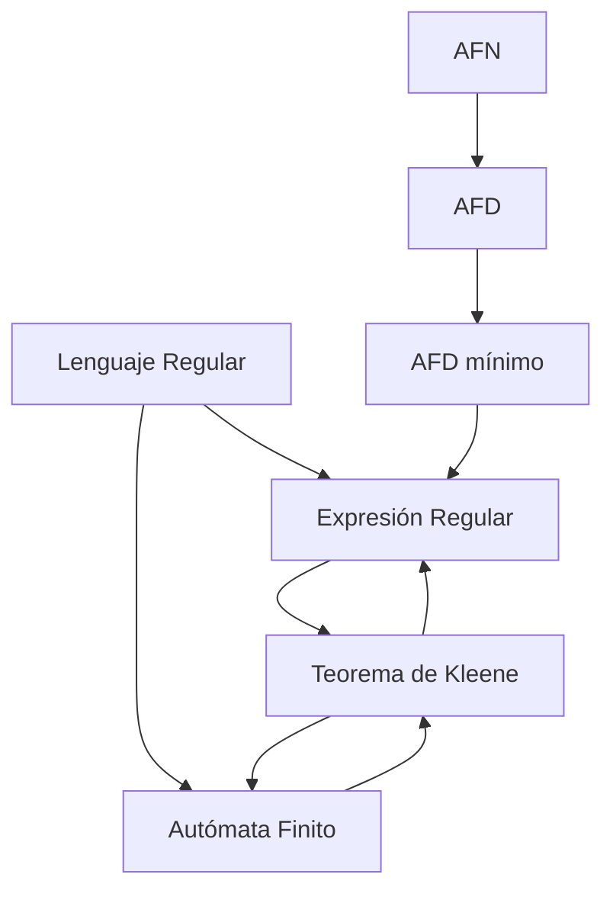

# Autómatas y Lenguajes Formales - Introducción

## 1.3 Expresiones regulares.

---

Las **expresiones regulares** son una herramienta fundamental para describir patrones en cadenas de texto y constituyen la base para la definición de lenguajes regulares. En esta guía exploraremos su sintaxis, semántica y aplicaciones.

### Conceptos Básicos

#### Definición Formal

Una **expresión regular** sobre un alfabeto $\Sigma$ se define recursivamente:

1. **Base**:
   - $\emptyset$ es una expresión regular que denota el lenguaje vacío
   - $\varepsilon$ es una expresión regular que denota el lenguaje $\{\varepsilon\}$
   - Para cada $a \in \Sigma$, $a$ es una expresión regular que denota el lenguaje $\{a\}$

2. **Paso inductivo**: Si $r$ y $s$ son expresiones regulares que denotan los lenguajes $L(r)$ y $L(s)$ respectivamente, entonces:
   - $ (r + s) \text{ es una expresión regular que denota } L(r) \cup L(s) $
   - $ (rs) \text{ es una expresión regular que denota }L(r)L(s) $
   - $ (r^*) \text{ es una expresión regular que denota } L(r)^* $

#### Precedencia de Operadores

La precedencia de mayor a menor es:

1. Cerradura de Kleene $(^*)$
2. Concatenación
3. Unión $(+)$

**Ejemplo**: $ab^* + c$ equivale a $(a(b^*)) + c$

### Operaciones y Extensiones Comunes

#### Operaciones Básicas

| Operación           | Notación | Lenguaje denotado           |
| ------------------- | -------- | --------------------------- |
| Unión               | $r + s$  | $L(r) \cup L(s)$            |
| Concatenación       | $rs$     | $L(r)L(s)$                  |
| Cerradura de Kleene | $r^*$    | $(L(r))^*$                  |
| Cerradura positiva  | $r^+$    | $(L(r))^+$                  |
| Opcional            | $r?$     | $L(r) \cup \{\varepsilon\}$ |

#### Extensiones útiles

- **Rango**: $[a-z]$ equivale a $a + b + c + \cdots + z$
- **Cualquier carácter**: $.$ (depende del contexto)
- **Complemento**: $[^abc]$ (cualquier carácter excepto a, b, c)
- **Repeticiones específicas**: $r\{n,m\}$ (de n a m repeticiones)

### Equivalencias con Autómatas Finitos



**Teorema de Kleene**: Un lenguaje es regular si y sólo si puede ser descrito por una expresión regular.

### Ejemplos de Expresiones Regulares

1. **Cadenas binarias que terminan con 01**:

   $$(0 + 1)^*01$$

2. **Números enteros**:

   $$[0-9]^+$$

3. **Identificadores de programación** (comienzan con letra, luego letras/dígitos):

   $$[a-zA-Z][a-zA-Z0-9]^*$$

4. **Números reales**:

   $$[0-9]^+(.[0-9]^+)?$$

5. **Direcciones email simples**:

   $$ \left\lbrack a-zA-Z0-9.\_\%+- \right\rbrack+@[a-zA-Z0-9.-]+.[a-zA-Z] \set{2,} $$

### Implementación en Python

```python
import re

# Ejemplos de uso de expresiones regulares en Python
def ejemplos_regex():
    texto = "Los números son 123, 45.6, -7 y 1000."

    # Encontrar todos los números enteros
    enteros = re.findall(r'\b\d+\b', texto)
    print("Enteros encontrados:", enteros)

    # Encontrar números decimales
    decimales = re.findall(r'\b\d+\.\d+\b', texto)
    print("Decimales encontrados:", decimales)

    # Validar formato de email
    emails = ["usuario@example.com", "invalid.email", "nombre.apellido@dom.co.uk"]
    patron_email = r'^[a-zA-Z0-9._%+-]+@[a-zA-Z0-9.-]+\.[a-zA-Z]{2,}$'

    for email in emails:
        if re.match(patron_email, email):
            print(f"'{email}' es válido")
        else:
            print(f"'{email}' no es válido")

# Conversión de expresión regular a AFN (simplificado)
def regex_a_afn(expresion):
    """
    Implementación simplificada del algoritmo de Thompson
    para convertir expresiones regulares a AFN
    """
    # Esta es una implementación conceptual simplificada
    # La implementación completa requiere construir el AFN paso a paso

    print(f"Convirtiendo expresión regular: {expresion}")
    # Aquí iría la lógica completa de conversión
    return f"AFN para {expresion}"

if __name__ == "__main__":
    ejemplos_regex()
    print()
    regex_a_afn("(a+b)*ab")
```

### Propiedades Algebraicas de las Expresiones Regulares

#### Leyes de equivalencia

1. **Asociatividad**:
   - $(r + s) + t = r + (s + t)$
   - $(rs)t = r(st)$

2. **Conmutatividad de la unión**:
   - $r + s = s + r$

3. **Distributividad**:
   - $r(s + t) = rs + rt$
   - $(s + t)r = sr + tr$

4. **Elemento identidad**:
   - $r + \emptyset = r$
   - $r\varepsilon = \varepsilon r = r$

5. **Elemento anulador**:
   - $r\emptyset = \emptyset r = \emptyset$

6. **Idempotencia**:
   - $r + r = r$

7. **Leyes de la cerradura**:
   - $\emptyset^* = \varepsilon$
   - $\varepsilon^* = \varepsilon$
   - $r^* = r^*r^* = (r^*)^* = r + r^*$
   - $r^* = \varepsilon + r^+$

### Algoritmo de Conversión de AFD a Expresión Regular

#### Método de Eliminación de Estados

Dado un AFD, podemos convertirlo a expresión regular mediante:

1. **Eliminación sistemática de estados**
2. **Resolución de ecuaciones en expresiones regulares** usando el lema de Arden:

**Lema de Arden**: La ecuación $X = AX + B$ tiene solución única $X = A^*B$ si $\varepsilon \notin A$.

### Ejercicios Propuestos

1. **Expresiones regulares básicas**:
   - Escribe expresiones regulares para:
     a) Cadenas sobre $\{a, b\}$ con exactamente dos a's
     b) Cadenas sobre $\{0, 1\}$ que no contienen la subcadena 001
     c) Números telefónicos en formato (XXX) XXX-XXXX

2. **Conversión y simplificación**:
   - Simplifica las siguientes expresiones regulares:
     a) $a^* + a^*b^* + b^*a^*$
     b) $(a + b)^*a(a + b)^*a(a + b)^*$
   - Convierte la expresión regular $(ab + a)^*$ a un AFN

3. **Propiedades algebraicas**:
   - Demuestra usando las leyes algebraicas:
     a) $(r^*s^*)^* = (r + s)^*$
     b) $r(sr)^* = (rs)^*r$

4. **Implementación**:
   - Escribe una función en Python que valide si una cadena es:
     a) Un número binario múltiplo de 3
     b) Una dirección IPv4 válida
     c) Una contraseña que cumpla con requisitos específicos

5. **Aplicaciones**:
   - Diseña expresiones regulares para:
     a) Extraer URLs de un texto
     b) Validar formatos de fecha (dd/mm/aaaa)
     c) Buscar patrones en código fuente

### Referencias

1. Hopcroft, J. E., Motwani, R., and Ullman, J., _Introduction to Automata Theory, Languages, and Computation_. (Capítulo 3: Expresiones regulares y lenguajes regulares)
2. Sipser, M., _Introduction to the Theory of Computation_. (Capítulo 1: Expresiones regulares)
3. Aho A.V., Lam M., Sethi S.R. and Ullman J.D., _Compilers: Principles, Techniques, & Tools_. (Capítulo 3: Análisis léxico)

### Para profundizar

- Investiga sobre el **algoritmo de Thompson** para convertir expresiones regulares a AFN
- Explora las **diferencias entre implementaciones** de regex en distintos lenguajes
- Estudia las **aplicaciones de expresiones regulares** en procesamiento de lenguaje natural
- Consulta sobre **lenguajes regulares extendidos** y sus capacidades
