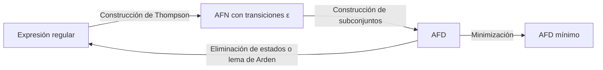

# Autómatas y Lenguajes Formales - Introducción

## 1.3 Expresiones regulares.

---

Las **expresiones regulares** son una notación algebraica para describir lenguajes. Son la base de la definición de los lenguajes regulares y, en la práctica, de herramientas como `grep`, los analizadores léxicos y las funciones de búsqueda de casi todos los lenguajes de programación. En este tema se definen con precisión, se estudian sus leyes algebraicas y se ve cómo se convierten en autómatas y viceversa.

### Conceptos Básicos

#### Definición Formal

Una **expresión regular** sobre un alfabeto $\Sigma,$ y el lenguaje $L(r)$ que denota, se definen recursivamente.

**Base:**

- $\emptyset$ es una expresión regular, y $L(\emptyset) = \emptyset.$
- $\varepsilon$ es una expresión regular, y $L(\varepsilon) = \{\varepsilon\}.$
- Para cada $a \in \Sigma,$ $a$ es una expresión regular, y $L(a) = \{a\}.$

**Paso inductivo.** Si $r$ y $s$ son expresiones regulares, también lo son:

- $(r + s),$ con $L(r + s) = L(r) \cup L(s).$
- $(rs),$ con $L(rs) = L(r)L(s).$
- $(r^*),$ con $L(r^*) = L(r)^*.$

Nada más es una expresión regular. Un lenguaje es **regular** si es $L(r)$ para alguna expresión regular $r.$

Hay que distinguir la **sintaxis**, la expresión como cadena de símbolos, de la **semántica**, el lenguaje que denota: $a^*$ es una expresión de dos símbolos que denota un lenguaje infinito. Dos expresiones son **equivalentes**, $r = s,$ si denotan el mismo lenguaje.

#### Precedencia de Operadores

Para ahorrar paréntesis, la precedencia de mayor a menor es:

1. Cerradura de Kleene $^*.$
2. Concatenación.
3. Unión $+.$

**Ejemplo:** $ab^* + c$ equivale a $(a(b^*)) + c,$ y denota $\{c, a, ab, abb, \ldots\}.$ En cambio, $(ab)^*$ denota $\{\varepsilon, ab, abab, \ldots\}$ y $a(b + c)$ denota $\{ab, ac\}.$

### Operaciones y Extensiones Comunes

#### Operaciones Básicas y Derivadas

| Operación | Notación | Lenguaje denotado | Definición con operaciones básicas |
| --- | --- | --- | --- |
| Unión | $r + s$ | $L(r) \cup L(s)$ | básica |
| Concatenación | $rs$ | $L(r)L(s)$ | básica |
| Cerradura de Kleene | $r^*$ | $L(r)^*$ | básica |
| Cerradura positiva | $r^+$ | $L(r)^+$ | $rr^*$ |
| Opcional | $r?$ | $L(r) \cup \{\varepsilon\}$ | $r + \varepsilon$ |

Las operaciones derivadas no agregan poder: cualquier expresión que las use se puede reescribir solo con las básicas.

#### Notación práctica

Las bibliotecas de los lenguajes de programación usan otra notación y muchas abreviaturas. En ellas la unión se escribe con una barra vertical y no con `+`, que significa una o más repeticiones.

| Notación práctica | Significado | Equivalente teórico |
| --- | --- | --- |
| `[a-z]` | un carácter del rango | $a + b + \cdots + z$ |
| `.` | cualquier carácter, salvo el salto de línea | la unión de todo el alfabeto |
| `[^abc]` | cualquier carácter excepto `a`, `b` y `c` | la unión de los demás símbolos |
| `r{n,m}` | de $n$ a $m$ repeticiones de `r` | $r^n(r + \varepsilon)^{m - n}$ |
| `\d`, `\w` | dígito, carácter de palabra | uniones de símbolos |
| `r\|s` | unión | $r + s$ |

Algunas extensiones de las bibliotecas sí aumentan el poder: las **referencias hacia atrás**, como `(a*)b\1`, que exige repetir lo que capturó el grupo, describen lenguajes que **no** son regulares, como $\{a^nba^n \mid n \geq 0\}.$ Por eso esas bibliotecas no siempre se implementan con autómatas, y algunas expresiones pueden tardar un tiempo exponencial en evaluarse.

### Equivalencia con Autómatas Finitos

**Teorema de Kleene.** Un lenguaje es regular, es decir, lo denota una expresión regular, si y solo si lo reconoce un autómata finito.

La demostración es constructiva y da algoritmos en ambas direcciones (tema 2.8):



#### De expresión regular a autómata: construcción de Thompson

Se construye un AFN con transiciones $\varepsilon,$ con un solo estado inicial y uno final, por inducción sobre la expresión:

- Para $\varepsilon$ y para un símbolo $a,$ dos estados unidos por una transición con $\varepsilon$ o con $a.$
- Para $r + s,$ un nuevo estado inicial con transiciones $\varepsilon$ a los iniciales de $r$ y de $s,$ y transiciones $\varepsilon$ de sus finales a un nuevo estado final.
- Para $rs,$ se une el final de $r$ con el inicial de $s$ por una transición $\varepsilon.$
- Para $r^*,$ nuevos estados inicial y final, con transiciones $\varepsilon$ que permiten saltarse $r$ (cero repeticiones) o regresar del final de $r$ a su inicio (repetir).

Cada operador y cada símbolo agregan dos estados, así que el AFN tiene un número de estados proporcional al tamaño de la expresión.

#### De autómata a expresión regular: el lema de Arden

**Lema de Arden.** Sean $A$ y $B$ lenguajes con $\varepsilon \notin A.$ La ecuación $X = AX \cup B$ tiene como **única** solución $X = A^*B.$ Si $\varepsilon \in A,$ $A^*B$ sigue siendo una solución, la más pequeña, pero ya no la única.

**Demostración.** $A^*B$ es solución porque $A(A^*B) \cup B = (AA^* \cup \{\varepsilon\})B = A^*B.$ Para la unicidad, si $X$ es solución, sustituyendo la ecuación en sí misma $n$ veces,

$$ X = A^{n+1}X \cup A^nB \cup \cdots \cup AB \cup B $$

Así que $A^iB \subseteq X$ para todo $i$ y $A^*B \subseteq X.$ Al revés, si $w \in X$ y $|w| = n,$ como cada cadena de $A$ tiene longitud al menos 1, las cadenas de $A^{n+1}X$ tienen longitud mayor que $n;$ entonces $w$ está en algún $A^iB$ con $i \leq n,$ es decir, en $A^*B.$ $\blacksquare$

**Ejemplo.** El autómata de las cadenas binarias con un número par de ceros (tema 1.1) tiene estados $q_0,$ de aceptación, y $q_1.$ Sea $X_i$ el lenguaje de las cadenas que llevan de $q_i$ a un estado de aceptación. Cada estado da una ecuación, con un término por transición y $\varepsilon$ si el estado es de aceptación:

$$ X_0 = 1X_0 + 0X_1 + \varepsilon, \qquad X_1 = 1X_1 + 0X_0 $$

Por Arden en la segunda, $X_1 = 1^*0X_0.$ Sustituyendo en la primera,

$$ X_0 = 1X_0 + 01^*0X_0 + \varepsilon = (1 + 01^*0)X_0 + \varepsilon $$

y otra vez por Arden, $X_0 = (1 + 01^*0)^*.$ Como el estado inicial es $q_0,$ el lenguaje del autómata es $(1 + 01^*0)^*:$ las cadenas formadas por bloques que son un 1, o un 0 seguido de unos y otro 0.

### Ejemplos de Expresiones Regulares

Sobre $\Sigma = \{0, 1\}:$

| Lenguaje | Expresión regular |
| --- | --- |
| Terminan en $01$ | $(0 + 1)^*01$ |
| Contienen la subcadena $11$ | $(0 + 1)^*11(0 + 1)^*$ |
| Longitud par | $((0 + 1)(0 + 1))^*$ |
| Número par de ceros | $(1 + 01^*0)^*$ |
| No tienen dos unos consecutivos | $(0 + 10)^*(\varepsilon + 1)$ |
| Representan en binario un múltiplo de 3 | $(0 + 1(01^*0)^*1)^*$ |

Con la notación práctica, sobre el alfabeto de caracteres:

| Lenguaje | Expresión |
| --- | --- |
| Números enteros sin signo | `[0-9]+` |
| Identificadores: letra seguida de letras o dígitos | `[a-zA-Z][a-zA-Z0-9]*` |
| Números con parte decimal opcional | `[0-9]+(\.[0-9]+)?` |
| Correos electrónicos simplificados | `[a-zA-Z0-9._%+-]+@[a-zA-Z0-9.-]+\.[a-zA-Z]{2,}` |

En la notación práctica, el punto es un metacarácter que denota cualquier carácter, así que para el punto literal hay que escribir `\.`.

### Propiedades Algebraicas de las Expresiones Regulares

Cada ley es una igualdad de lenguajes, y se demuestra con las definiciones de las operaciones.

1. **Asociatividad:** $(r + s) + t = r + (s + t)$ y $(rs)t = r(st).$
2. **Conmutatividad de la unión:** $r + s = s + r.$ La concatenación **no** es conmutativa.
3. **Distributividad:** $r(s + t) = rs + rt$ y $(s + t)r = sr + tr.$
4. **Elementos identidad:** $r + \emptyset = r$ y $r\varepsilon = \varepsilon r = r.$
5. **Elemento anulador:** $r\emptyset = \emptyset r = \emptyset.$
6. **Idempotencia:** $r + r = r.$
7. **Leyes de la cerradura:**
   - $\emptyset^* = \varepsilon$ y $\varepsilon^* = \varepsilon.$
   - $r^* = r^*r^* = (r^*)^*.$
   - $r^* = \varepsilon + rr^* = \varepsilon + r^+.$
   - $(r + s)^* = (r^*s^*)^* = (r^*s)^*r^*.$
   - $r(sr)^* = (rs)^*r,$ la regla de **desplazamiento**.

Para comprobar que una supuesta ley es **falsa** basta un contraejemplo: $(r + s)^* \neq r^* + s^*,$ porque con $r = a$ y $s = b,$ la cadena $ab$ está en el lado izquierdo y no en el derecho. Tampoco es cierto que $(rs)^* = r^*s^*:$ $aabb$ está en $a^*b^*$ y no en $(ab)^*.$

### Implementación en Python

El siguiente programa implementa la construcción de Thompson para la notación del curso: unión con $+,$ concatenación, estrella, paréntesis, $\varepsilon$ y $\emptyset.$ Simula el AFN resultante manteniendo el **conjunto** de estados en que puede estar. Para comprobarla, compara sus respuestas con el módulo `re` de Python en todas las cadenas de longitud a lo más 8.

```python
import re
from itertools import product

# --- Análisis sintáctico: expresión -> árbol, con precedencia * > concatenación > + ---
def parsear(expr):
    pos = 0

    def ver():
        return expr[pos] if pos < len(expr) else None

    def union():
        nonlocal pos
        nodo = concat()
        while ver() == '+':
            pos += 1
            nodo = ('+', nodo, concat())
        return nodo

    def concat():
        nodo = None
        while ver() is not None and ver() not in '+)':
            f = estrella()
            nodo = f if nodo is None else ('.', nodo, f)
        return nodo if nodo is not None else ('eps',)

    def estrella():
        nonlocal pos
        nodo = atomo()
        while ver() == '*':
            pos += 1
            nodo = ('*', nodo)
        return nodo

    def atomo():
        nonlocal pos
        c = ver()
        pos += 1
        if c == '(':
            nodo = union()
            pos += 1            # consumir ')'
            return nodo
        if c == 'ε':
            return ('eps',)
        if c == '∅':
            return ('vacio',)
        return ('sym', c)

    return union()

# --- Construcción de Thompson: árbol -> AFN-ε con un estado inicial y uno final ---
class AFN:
    def __init__(self):
        self.n = 0
        self.trans = {}         # (estado, símbolo o None) -> conjunto de estados

    def nuevo(self):
        self.n += 1
        return self.n - 1

    def arista(self, p, simbolo, q):
        self.trans.setdefault((p, simbolo), set()).add(q)

def thompson(nodo, m):
    tipo = nodo[0]
    i, f = m.nuevo(), m.nuevo()
    if tipo == 'eps':
        m.arista(i, None, f)
    elif tipo == 'sym':
        m.arista(i, nodo[1], f)
    elif tipo == '+':
        for hijo in nodo[1:]:
            a, b = thompson(hijo, m)
            m.arista(i, None, a)
            m.arista(b, None, f)
    elif tipo == '.':
        a1, b1 = thompson(nodo[1], m)
        a2, b2 = thompson(nodo[2], m)
        m.arista(i, None, a1)
        m.arista(b1, None, a2)
        m.arista(b2, None, f)
    elif tipo == '*':
        a, b = thompson(nodo[1], m)
        m.arista(i, None, a)
        m.arista(i, None, f)        # cero repeticiones
        m.arista(b, None, a)        # repetir
        m.arista(b, None, f)
    # 'vacio': no se agrega ninguna arista, f es inalcanzable
    return i, f

def cerradura(m, estados):
    pila, vistos = list(estados), set(estados)
    while pila:
        p = pila.pop()
        for q in m.trans.get((p, None), ()):
            if q not in vistos:
                vistos.add(q)
                pila.append(q)
    return vistos

def acepta(expr, w):
    m = AFN()
    inicio, fin = thompson(parsear(expr), m)
    actuales = cerradura(m, {inicio})
    for c in w:
        siguientes = set()
        for p in actuales:
            siguientes |= m.trans.get((p, c), set())
        actuales = cerradura(m, siguientes)
    return fin in actuales

# --- Verificación contra el módulo re de Python ---
def a_python(expr):
    return expr.replace('+', '|').replace('ε', '')

for expr in ['(0+1)*01', '(ab+a)*', 'b*ab*ab*', '(1+01)*0*', '(0+1(01*0)*1)*']:
    m = AFN()
    thompson(parsear(expr), m)
    alfabeto = sorted(set(expr) - set('()+*ε∅'))
    cadenas = [''.join(t) for n in range(9) for t in product(alfabeto, repeat=n)]
    iguales = all(acepta(expr, w) == bool(re.fullmatch(a_python(expr), w)) for w in cadenas)
    print(f"{expr:<16} estados AFN: {m.n:>3}  coincide con re en {len(cadenas)} cadenas: {iguales}")
```

Salida:

```text
(0+1)*01         estados AFN:  16  coincide con re en 511 cadenas: True
(ab+a)*          estados AFN:  12  coincide con re en 511 cadenas: True
b*ab*ab*         estados AFN:  24  coincide con re en 511 cadenas: True
(1+01)*0*        estados AFN:  18  coincide con re en 511 cadenas: True
(0+1(01*0)*1)*   estados AFN:  28  coincide con re en 511 cadenas: True
```

La simulación por conjuntos de estados tarda un tiempo proporcional a $|w| \cdot m,$ donde $m$ es el número de estados del AFN, sin importar la expresión. Las bibliotecas que usan búsqueda con retroceso, en cambio, pueden tardar un tiempo exponencial con expresiones como `(a|aa)*b` y entradas largas formadas solo por letras `a`.

### Ejercicios Propuestos

1. **Expresiones regulares básicas.** Escribe expresiones regulares para:
   - a) Cadenas sobre $\{a, b\}$ con exactamente dos $a.$
   - b) Cadenas sobre $\{0, 1\}$ que no contienen la subcadena $001.$
   - c) Números telefónicos en formato `(XXX) XXX-XXXX`, con la notación práctica.

2. **Conversión y simplificación.**
   - a) Simplifica $a^* + a^*b^* + b^*a^*.$
   - b) Describe en palabras el lenguaje de $(a + b)^*a(a + b)^*a(a + b)^*$ y da una expresión equivalente más corta.
   - c) Aplica la construcción de Thompson a $(ab + a)^*.$

3. **Propiedades algebraicas.** Demuestra:
   - a) $(r^*s^*)^* = (r + s)^*.$
   - b) $r(sr)^* = (rs)^*r.$

4. **Implementación.** Escribe una expresión, y pruébala en Python, que reconozca:
   - a) Un número binario múltiplo de 3.
   - b) Una dirección IPv4 válida.
   - c) Una contraseña de al menos 8 caracteres con al menos un dígito.

5. **Lema de Arden.** Obtén una expresión regular para el autómata con estados $q_0,$ inicial, y $q_1,$ de aceptación, y transiciones $q_0 \xrightarrow{a} q_0,$ $q_0 \xrightarrow{b} q_1,$ $q_1 \xrightarrow{a} q_0$ y $q_1 \xrightarrow{b} q_1.$

### Soluciones

**Ejercicio 1.**

- a) $b^*ab^*ab^*.$
- b) $(1 + 01)^*0^*.$ Una vez que aparecen dos ceros seguidos ya no puede venir ningún 1, así que la cadena es una parte sin $00,$ formada por bloques $1$ y $01,$ seguida de puros ceros. El programa de la sección anterior la comprueba contra `re`.
- c) `\(\d{3}\) \d{3}-\d{4}`; los paréntesis literales se escriben `\(` y `\)`.

**Ejercicio 2.**

- a) $a^*b^* + b^*a^*,$ porque $L(a^*) \subseteq L(a^*b^*).$
- b) Son las cadenas con al menos dos $a.$ Una expresión equivalente es $b^*ab^*a(a + b)^*,$ que fija la primera y la segunda $a.$
- c) Para $a$ y para $b,$ dos estados cada una; $ab$ agrega un estado inicial y uno final y une las piezas con transiciones $\varepsilon;$ $ab + a$ agrega un inicial y un final que se bifurcan hacia $ab$ y hacia $a;$ la estrella agrega otros dos estados con las transiciones para saltar y para repetir. Son 12 estados, como reporta el programa.

**Ejercicio 3.**

- a) Como $r$ y $s$ están contenidas en $r^*s^*,$ se tiene $r + s \subseteq r^*s^*$ y, aplicando la estrella, $(r + s)^* \subseteq (r^*s^*)^*.$ Al revés, $r^*s^* \subseteq (r + s)^*(r + s)^* = (r + s)^*,$ y por lo tanto $(r^*s^*)^* \subseteq ((r + s)^*)^* = (r + s)^*.$ $\blacksquare$
- b) Por asociatividad, $r(sr)^n = (rs)^nr$ para todo $n:$ ambos lados son $rsrs \cdots r$ con $n + 1$ apariciones de $r.$ Tomando la unión sobre $n \geq 0$ y usando que la concatenación distribuye sobre uniones, $r(sr)^* = \bigcup_n r(sr)^n = \bigcup_n (rs)^nr = (rs)^*r.$ $\blacksquare$

**Ejercicio 4.**

- a) $(0 + 1(01^*0)^*1)^*,$ que en Python se escribe `(0|1(01*0)*1)*`. Se obtiene del autómata de tres estados que lleva el residuo módulo 3; acepta también la cadena vacía, que se interpreta como 0.
- b) Con `o = r'(25[0-5]|2[0-4]\d|1\d\d|[1-9]?\d)'`, la expresión es `o + r'(\.' + o + r'){3}'`. Cada octeto de 0 a 255 se describe por casos según sus primeros dígitos, y se excluyen los ceros a la izquierda.
- c) `(?=.*\d).{8,}`. La **anticipación** `(?=...)` no es una operación regular, pero el lenguaje sí es regular: es la intersección de dos lenguajes regulares, y los lenguajes regulares son cerrados bajo intersección (tema 2.7).

**Ejercicio 5.** Las ecuaciones son $X_0 = aX_0 + bX_1$ y $X_1 = aX_0 + bX_1 + \varepsilon.$ Por Arden en la segunda, $X_1 = b^*(aX_0 + \varepsilon) = b^*aX_0 + b^*.$ Sustituyendo, $X_0 = aX_0 + bb^*aX_0 + bb^* = (a + bb^*a)X_0 + bb^*,$ y por Arden $X_0 = (a + b^+a)^*b^+.$ Son las cadenas que terminan en $b,$ y en efecto la expresión es equivalente a $(a + b)^*b.$

### Referencias

1. Hopcroft, J. E., Motwani, R., and Ullman, J., _Introduction to Automata Theory, Languages, and Computation_. Pearson, 2007. Capítulo 3.
2. Sipser, M., _Introduction to the Theory of Computation_. Cengage, 2013. Sección 1.3.
3. Aho, A. V., Lam, M., Sethi, R., and Ullman, J. D., _Compilers: Principles, Techniques, and Tools_. Pearson, 2006. Capítulo 3.
4. Thompson, K. (1968). Regular expression search algorithm. _Communications of the ACM_, 11(6), 419-422.
5. Cox, R. (2007). _Regular Expression Matching Can Be Simple And Fast_. swtch.com/~rsc/regexp/regexp1.html.

### Para profundizar

- Compara la construcción de Thompson con la de Glushkov, que da un AFN sin transiciones $\varepsilon.$
- Explora las diferencias entre las implementaciones de expresiones regulares basadas en autómatas, como RE2, y las basadas en retroceso, como las de Python y Perl.
- Investiga las **derivadas de Brzozowski**, otra forma de convertir expresiones regulares en autómatas.
