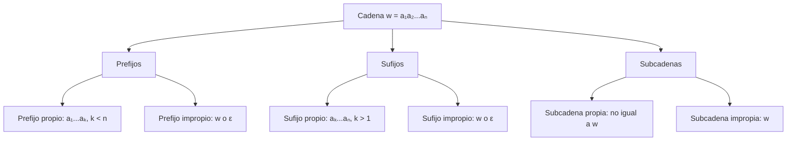
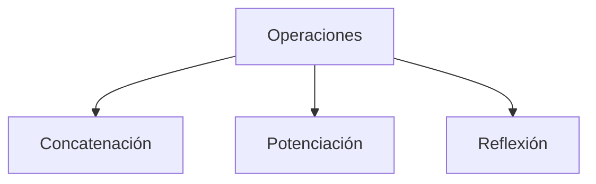

# Autómatas y Lenguajes Formales - Introducción

## 1.4 Modelos matemáticos de cadenas.

---

Los **modelos matemáticos de cadenas** proporcionan las herramientas formales para representar y manipular secuencias de símbolos. Estos modelos son fundamentales para el estudio de lenguajes formales y autómatas, permitiendo describir patrones, estructuras y operaciones sobre cadenas de manera precisa.

### Conceptos Fundamentales

#### Alfabeto y Cadenas

**Alfabeto $(\Sigma)$**: Conjunto finito y no vacío de símbolos.

$$\Sigma = \{a_1, a_2, \ldots, a_n\}$$

**Cadena**: Secuencia finita de símbolos de un alfabeto.

$$w = a_1 a_2 \ldots a_k \quad \text{donde } a_i \in \Sigma$$

**Cadena vacía $(\varepsilon)$**: Cadena de longitud cero.

$$|\varepsilon| = 0$$

**Longitud de una cadena**: Número de símbolos en la cadena.

$$|w| = \text{número de símbolos en } w$$

#### Operaciones Básicas sobre Cadenas

##### Concatenación

Dadas dos cadenas $w$ y $v$, su concatenación $w \cdot v$ es:

$$w \cdot v = a_1 a_2 \ldots a_m b_1 b_2 \ldots b_n$$

donde $w = a_1 a_2 \ldots a_m$ y $v = b_1 b_2 \ldots b_n$

**Propiedades**:

- Asociativa: $(w \cdot v) \cdot u = w \cdot (v \cdot u)$
- Elemento neutro: $w \cdot \varepsilon = \varepsilon \cdot w = w$
- Longitud: $|w \cdot v| = |w| + |v|$

##### Potenciación

$$w^n = \underbrace{w \cdot w \cdot \ldots \cdot w}_{n \text{ veces}}$$

con $w^0 = \varepsilon$

##### Reflexión o Reversa

$$w^R = a_n a_{n-1} \ldots a_1 \quad \text{si } w = a_1 a_2 \ldots a_n$$

#### Prefijos, Sufijos y Subcadenas

Para una cadena $w = a_1 a_2 \ldots a_n$:

- **Prefijo**: Cualquier cadena de la forma $a_1 a_2 \ldots a_k$ donde $0 \leq k \leq n$
- **Sufijo**: Cualquier cadena de la forma $a_k a_{k+1} \ldots a_n$ donde $1 \leq k \leq n+1$
- **Subcadena**: Cualquier cadena de la forma $a_k a_{k+1} \ldots a_m$ donde $1 \leq k \leq m \leq n$

### Relaciones y Operaciones Formales

#### Relación de Prefijo

La relación "ser prefijo de" es una **relación de orden parcial**:

- Reflexiva: $w$ es prefijo de sí misma
- Antisimétrica: Si $w$ es prefijo de $v$ y $v$ es prefijo de $w$, entonces $w = v$
- Transitiva: Si $w$ es prefijo de $v$ y $v$ es prefijo de $u$, entonces $w$ es prefijo de $u$

#### Diagrama de Relaciones entre Cadenas





### Lenguajes Formales

**Lenguaje $(L)$**: Cualquier conjunto de cadenas sobre un alfabeto $\Sigma$.

$$L \subseteq \Sigma^*$$

#### Operaciones con Lenguajes

- **Unión**: $L_1 \cup L_2 = \{w \mid w \in L_1 \text{ o } w \in L_2\}$
- **Intersección**: $L_1 \cap L_2 = \{w \mid w \in L_1 \text{ y } w \in L_2\}$
- **Concatenación**: $L_1 L_2 = \{wv \mid w \in L_1 \text{ y } v \in L_2\}$
- **Cerradura de Kleene**: $L^* = \bigcup_{i=0}^{\infty} L^i$
- **Cerradura positiva**: $L^+ = \bigcup_{i=1}^{\infty} L^i$

#### Propiedades Algebraicas

| Propiedad          | Unión                                               | Concatenación                               |
| ------------------ | --------------------------------------------------- | ------------------------------------------- |
| Asociativa         | $(L_1 \cup L_2) \cup L_3 = L_1 \cup (L_2 \cup L_3)$ | $(L_1 L_2) L_3 = L_1 (L_2 L_3)$             |
| Conmutativa        | $L_1 \cup L_2 = L_2 \cup L_1$                       | No conmutativa                              |
| Elemento identidad | $L \cup \emptyset = L$                              | $L\{\varepsilon\} = \{\varepsilon\}L = L$   |
| Elemento anulador  | $L \cup \Sigma^* = \Sigma^*$                        | $L\emptyset = \emptyset L = \emptyset$      |
| Distributiva       | $L_1 (L_2 \cup L_3) = L_1 L_2 \cup L_1 L_3$         | $(L_1 \cup L_2) L_3 = L_1 L_3 \cup L_2 L_3$ |

### Representación Formal con Monoides

El conjunto de todas las cadenas sobre $\Sigma$ forma un **monoide libre** bajo la operación de concatenación:

- **Conjunto**: $\Sigma^*$
- **Operación**: Concatenación $(\cdot)$
- **Elemento identidad**: $\varepsilon$

**Propiedad fundamental**:

$$(\Sigma^*, \cdot, \varepsilon) \text{ es un monoide libre generado por } \Sigma$$

### Código de Ejemplo (Python)

```python
class Cadena:
    """Implementación de operaciones formales sobre cadenas"""

    def __init__(self, valor=""):
        self.valor = valor

    def __str__(self):
        return self.valor

    def longitud(self):
        """Calcula la longitud de la cadena"""
        return len(self.valor)

    def concatenar(self, otra):
        """Concatena dos cadenas"""
        return Cadena(self.valor + otra.valor)

    def potencia(self, n):
        """Calcula la n-ésima potencia de la cadena"""
        if n == 0:
            return Cadena("")
        return Cadena(self.valor * n)

    def reversa(self):
        """Calcula la reversa de la cadena"""
        return Cadena(self.valor[::-1])

    def es_prefijo(self, prefijo):
        """Verifica si una cadena es prefijo"""
        return self.valor.startswith(prefijo.valor)

    def es_sufijo(self, sufijo):
        """Verifica si una cadena es sufijo"""
        return self.valor.endswith(sufijo.valor)

    def es_subcadena(self, subcadena):
        """Verifica si una cadena es subcadena"""
        return subcadena.valor in self.valor

    def prefijos(self):
        """Genera todos los prefijos de la cadena"""
        return [Cadena(self.valor[:i]) for i in range(len(self.valor) + 1)]

    def sufijos(self):
        """Genera todos los sufijos de la cadena"""
        return [Cadena(self.valor[i:]) for i in range(len(self.valor) + 1)]

    def subcadenas(self):
        """Genera todas las subcadenas de la cadena"""
        n = len(self.valor)
        return [Cadena(self.valor[i:j]) for i in range(n) for j in range(i+1, n+1)]

# Ejemplos de uso
if __name__ == "__main__":
    w = Cadena("abc")
    v = Cadena("def")

    print(f"Cadena w: {w}")
    print(f"Longitud de w: {w.longitud()}")
    print(f"Concatenación w·v: {w.concatenar(v)}")
    print(f"Potencia w³: {w.potencia(3)}")
    print(f"Reversa de w: {w.reversa()}")

    print(f"Prefijos de 'abc': {[str(p) for p in w.prefijos()]}")
    print(f"Sufijos de 'abc': {[str(s) for s in w.sufijos()]}")
    print(f"Subcadenas de 'abc': {[str(s) for s in w.subcadenas()]}")
```

### Ejercicios Propuestos

1. **Operaciones básicas**:
   - Sea $\Sigma = \{0, 1\}$, $w = 101$, $v = 010$
   - Calcula: $w \cdot v$, $v^3$, $w^R$, $|w \cdot v|$

2. **Propiedades algebraicas**:
   - Demuestra que $(w \cdot v)^R = v^R \cdot w^R$ para cualquier par de cadenas
   - Demuestra que la concatenación es asociativa pero no conmutativa

3. **Prefijos, sufijos y subcadenas**:
   - Para $w = ababa$, enumera:
     a) Todos los prefijos propios
     b) Todos los sufijos propios
     c) Todas las subcadenas de longitud 3

4. **Lenguajes formales**:
   - Sean $L_1 = \{a, ab\}$, $L_2 = \{b, ba\}$, $L_3 = \{\varepsilon, a\}$
   - Calcula:
     a) $L_1 \cup L_2$
     b) $L_1 L_2$
     c) $L_1^*$
     d) $(L_1 L_2) \cap L_3$

5. **Demostraciones formales**:
   - Demuestra que $\emptyset^* = \{\varepsilon\}$
   - Demuestra que $L^* = L^+ \cup \{\varepsilon\}$
   - Demuestra que $(L^*)^* = L^*$

6. **Implementación**:
   - Extiende la clase Cadena para incluir:
     a) Verificación de palíndromos
     b) Cálculo de la subcadena común más larga entre dos cadenas
     c) Implementación de las operaciones de lenguajes

### Aplicaciones de los Modelos de Cadenas

1. **Teoría de la computación**: Base para autómatas y lenguajes formales
2. **Procesamiento de texto**: Búsqueda de patrones, editores de texto
3. **Bioinformática**: Secuenciación de ADN, alineamiento de secuencias
4. **Criptografía**: Análisis de patrones en textos cifrados
5. **Lingüística computacional**: Procesamiento de lenguaje natural

### Referencias

1. Hopcroft, J. E., Motwani, R., and Ullman, J., _Introduction to Automata Theory, Languages, and Computation_. (Capítulo 3: Lenguajes y gramáticas)
2. Sipser, M., _Introduction to the Theory of Computation_. (Capítulo 0: Preliminares matemáticos)
3. Viso G., E., _Introducción a la teoría de la computación_. (Capítulo 2: Alfabetos, cadenas y lenguajes)
4. Kozen, D. C., _Automata and Computability_. (Capítulo 2: Strings and Languages)

### Para profundizar

- Investiga sobre la **teoría de códigos** y la decodificación de cadenas
- Explora los **sistemas de reescritura de cadenas** y gramáticas formales
- Estudia la **complejidad de algoritmos** de manipulación de cadenas
- Consulta sobre **lenguajes infinitos** y sus propiedades topológicas

Esta guía proporciona las bases matemáticas para el estudio formal de cadenas y lenguajes, sentando las bases para comprender autómatas, gramáticas y la teoría de la computación en general.
