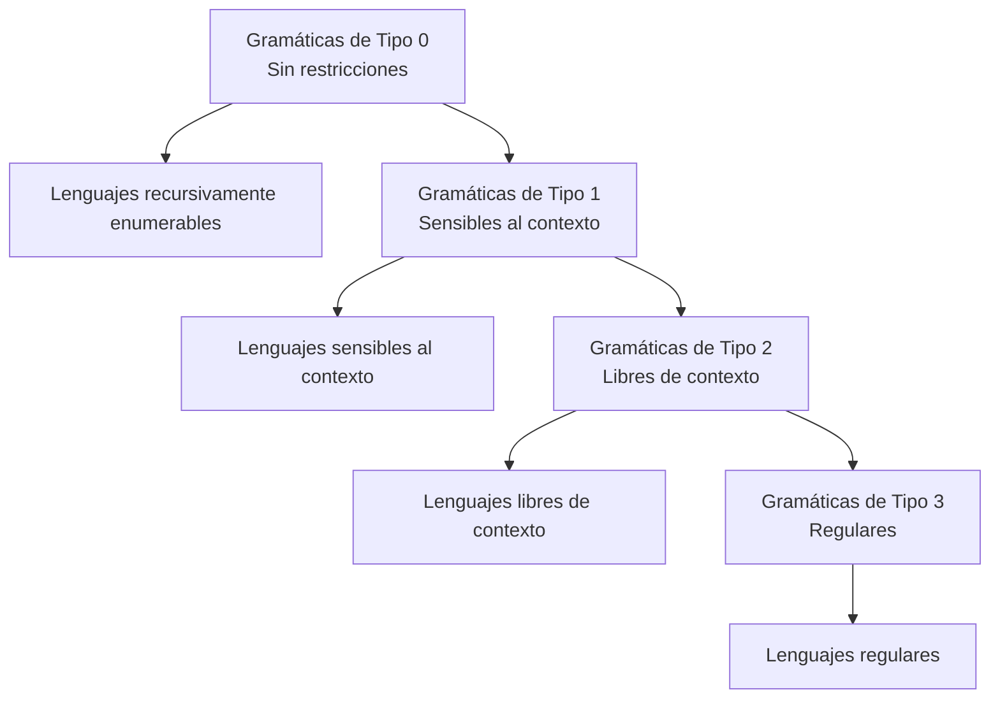
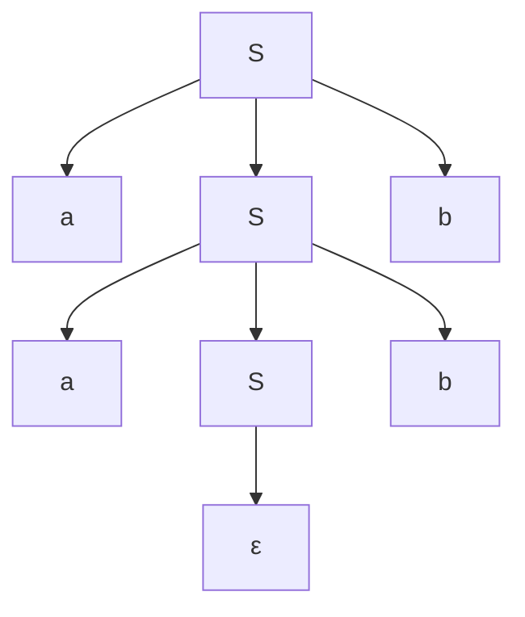

# Autómatas y Lenguajes Formales - Introducción

## 1.5 Gramáticas y lenguajes formales.

---

Las **gramáticas formales** son mecanismos para generar lenguajes formales mediante reglas de producción. Constituyen la base teórica para la definición de la sintaxis de lenguajes de programación y son fundamentales en el diseño de compiladores.

### Conceptos Fundamentales

#### Definición Formal de Gramática

Una **gramática formal** es una cuádrupla $G = (V, \Sigma, P, S)$ donde:

- $V$: Conjunto finito de **símbolos no terminales** (variables)
- $\Sigma$: Conjunto finito de **símbolos terminales** (alfabeto), donde $V \cap \Sigma = \emptyset$
- $P$: Conjunto finito de **reglas de producción** de la forma $\alpha \rightarrow \beta$
- $S$: **Símbolo inicial** $(S \in V)$

#### Derivación y Lenguaje Generado

**Derivación directa $(\Rightarrow)$**: Dada una gramática $G$, decimos que $w$ deriva directamente en $v$ ( $w \Rightarrow v$ ) si existen cadenas $x$, $y$, $\alpha$, $\beta$ tales que:

$$w = x\alpha y, \quad v = x\beta y, \quad \text{y} \quad \alpha \rightarrow \beta \in P$$

**Derivación $(\Rightarrow^*)$**: La cerradura reflexiva y transitiva de $\Rightarrow$.

**Lenguaje generado por G**:

$$L(G) = \{w \in \Sigma^* \mid S \Rightarrow^* w\}$$

### Jerarquía de Chomsky

Noam Chomsky clasificó las gramáticas en cuatro tipos según sus restricciones:



#### Tipos de Gramáticas

| Tipo | Restricciones en producciones                                                             | Lenguaje                  | Autómata                     |
| ---- | ----------------------------------------------------------------------------------------- | ------------------------- | ---------------------------- |
| 0    | $\alpha \rightarrow \beta$ (sin restricciones)                                            | Recursivamente enumerable | Máquina de Turing            |
| 1    | $\alpha A \beta \rightarrow \alpha \gamma \beta$ ( $A \in V$, $\gamma \neq \varepsilon$ ) | Sensible al contexto      | Autómata linealmente acotado |
| 2    | $A \rightarrow \alpha$ ( $A \in V$ )                                                      | Libre de contexto         | Autómata a pila              |
| 3    | $A \rightarrow aB$ o $A \rightarrow a$ ( $A,B \in V$, $a \in \Sigma$ )                    | Regular                   | Autómata finito              |

### Ejemplos de Gramáticas Formales

#### Gramática Regular (Tipo 3)

$$G = (\{S, A\}, \{a, b\}, P, S)$$

donde $P$ contiene:

$$S \rightarrow aA \mid bS \mid \varepsilon$$

$$A \rightarrow aS \mid bA$$

#### Gramática Libre de Contexto (Tipo 2)

$$G = (\{S\}, \{a, b\}, P, S)$$

donde $P$ contiene:

$$S \rightarrow aSb \mid \varepsilon$$

Esta gramática genera el lenguaje $L = \{a^n b^n \mid n \geq 0\}$

#### Gramática Sensible al Contexto (Tipo 1)

$$G = (\{S, A, B, C\}, \{a, b, c\}, P, S)$$

donde $P$ contiene:

$$S \rightarrow aSBC \mid aBC$$

$$CB \rightarrow BC$$

$$aB \rightarrow ab$$

$$bB \rightarrow bb$$

$$bC \rightarrow bc$$

$$cC \rightarrow cc$$

Esta gramática genera $L = \{a^n b^n c^n \mid n \geq 1\}$

### Árboles de Derivación

Para gramáticas libres de contexto, las derivaciones pueden representarse como árboles:

**Ejemplo**: Para la gramática $S \rightarrow aSb \mid \varepsilon$ y la cadena "aabb":



### Ambigüedad en Gramáticas

Una gramática es **ambigua** si existe una cadena $w \in L(G)$ que tiene más de un árbol de derivación.

**Ejemplo**: La gramática $E \rightarrow E + E \mid E * E \mid (E) \mid id$ es ambigua porque la expresión "id + id * id" tiene dos árboles de derivación.

### Implementación en Python

```python
class Gramatica:
    """Implementación básica de una gramática formal"""

    def __init__(self, no_terminales, terminales, producciones, inicial):
        self.V = set(no_terminales)  # No terminales
        self.Σ = set(terminales)     # Terminales
        self.P = producciones        # Producciones
        self.S = inicial             # Símbolo inicial

        # Validar que los conjuntos son disjuntos
        assert self.V.isdisjoint(self.Σ), "V y Σ deben ser disjuntos"
        assert self.S in self.V, "S debe estar en V"

    def derivar(self, cadena, max_pasos=1000):
        """Deriva cadenas a partir del símbolo inicial"""
        from collections import deque

        # BFS para encontrar derivaciones
        cola = deque([(self.S, 0)])  # (cadena, pasos)
        resultados = []

        while cola and len(resultados) < 10:  # Limitar resultados
            actual, pasos = cola.popleft()

            if pasos > max_pasos:
                continue

            # Si es una cadena terminal, añadir a resultados
            if all(simbolo in self.Σ for simbolo in actual):
                resultados.append(actual)
                continue

            # Encontrar el primer no terminal
            for i, simbolo in enumerate(actual):
                if simbolo in self.V:
                    # Aplicar todas las producciones posibles
                    for produccion in self.P.get(simbolo, []):
                        nueva_cadena = actual[:i] + produccion + actual[i+1:]
                        cola.append((nueva_cadena, pasos + 1))
                    break

        return resultados

    def es_terminal(self, cadena):
        """Verifica si una cadena contiene solo terminales"""
        return all(simbolo in self.Σ for simbolo in cadena)

# Ejemplo de uso: Gramática para expresiones aritméticas simples
if __name__ == "__main__":
    # Gramática: E -> E + T | T, T -> T * F | F, F -> (E) | id
    no_terminales = ['E', 'T', 'F']
    terminales = ['+', '*', '(', ')', 'id']
    producciones = {
        'E': [['E', '+', 'T'], ['T']],
        'T': [['T', '*', 'F'], ['F']],
        'F': [['(', 'E', ')'], ['id']]
    }
    inicial = 'E'

    gramatica = Gramatica(no_terminales, terminales, producciones, inicial)

    # Generar algunas cadenas
    print("Algunas cadenas generadas:")
    cadenas = gramatica.derivar(gramatica.S)
    for cadena in cadenas[:5]:  # Mostrar primeras 5
        print(''.join(cadena))
```

### Ejercicios Propuestos

1. **Diseño de gramáticas**:
   - Diseña gramáticas formales para:
     a) Palíndromos sobre {a, b}
     b) Expresiones aritméticas con suma, resta y paréntesis
     c) Direcciones email simples

2. **Clasificación**:
   - Clasifica las siguientes gramáticas según la jerarquía de Chomsky:
     a) $S \rightarrow aS \mid bS \mid a \mid b$
     b) $S \rightarrow aSb \mid ab$
     c) $aS \rightarrow Sa, aS \rightarrow a$

3. **Derivaciones**:
   - Para la gramática $S \rightarrow 0S1 \mid 01$:
     a) Encuentra todas las derivaciones de "000111"
     b) Demuestra que $L(G) = \{0^n1^n \mid n \geq 1\}$

4. **Ambigüedad**:
   - Demuestra que la siguiente gramática es ambigua: $E \rightarrow E + E \mid E * E \mid (E) \mid id$
   
   - Propón una versión no ambigua

5. **Implementación**:
   - Extiende la clase Gramatica para:
     a) Detectar ciclos infinitos en derivaciones
     b) Generar todas las cadenas de longitud n
     c) Verificar si una cadena pertenece al lenguaje

6. **Transformaciones**:
   - Convierte la siguiente gramática a Forma Normal de Chomsky: 
      
     $S \rightarrow ASA \mid aB$
     $A \rightarrow B \mid S$  
     $B \rightarrow b \mid \varepsilon$

### Aplicaciones de las Gramáticas Formales

1. **Compiladores**: Análisis sintáctico (parsing)
2. **Lingüística computacional**: Modelado de lenguajes naturales
3. **Procesamiento de lenguaje natural**: Análisis de estructuras sintácticas
4. **Bioinformática**: Estructura de secuencias de ADN y proteínas
5. **Verificación formal**: Especificación de protocolos y sistemas

### Referencias

1. Hopcroft, J. E., Motwani, R., and Ullman, J., _Introduction to Automata Theory, Languages, and Computation_. (Capítulo 5: Gramáticas libres de contexto)
2. Sipser, M., _Introduction to the Theory of Computation_. (Capítulo 2: Context-Free Languages)
3. Aho A.V., Lam M., Sethi S.R. and Ullman J.D., _Compilers: Principles, Techniques, & Tools_. (Capítulo 4: Análisis sintáctico)
4. Linz, P., _An Introduction to Formal Languages and Automata_. (Capítulo 3: Gramáticas regulares)
5. Viso G., E., _Introducción a la teoría de la computación_. (Capítulo 4: Gramáticas formales)

### Para profundizar

- Investiga sobre **formas normales** (Chomsky, Greibach) y sus aplicaciones
- Explora los **algoritmos de parsing** (CYK, Earley, LR)
- Estudia las **propiedades de clausura** de los lenguajes formales
- Consulta sobre **gramáticas atribuidas** y su uso en compiladores
