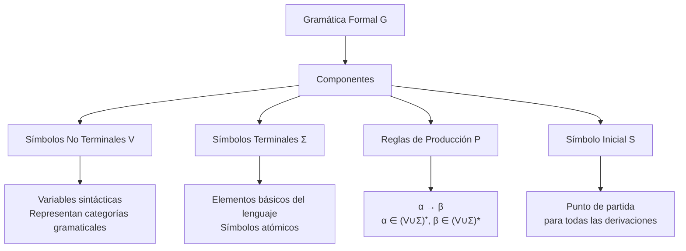
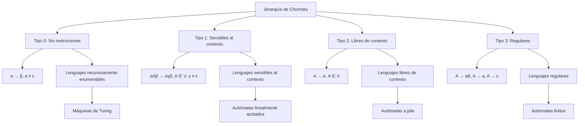
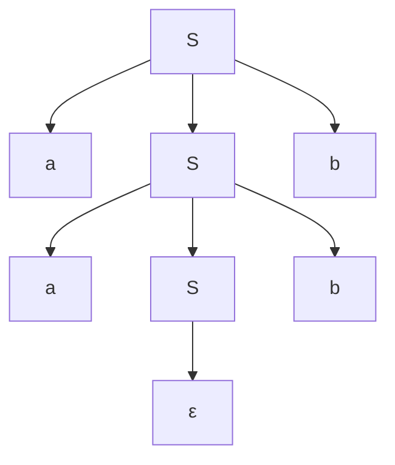

# Autómatas y Lenguajes Formales - Introducción

## 1.7 Gramáticas formales.

---

Las **gramáticas formales** son sistemas de reglas que definen la estructura sintáctica de los lenguajes formales. Constituyen la base teórica para la definición de sintaxis en lenguajes de programación y son fundamentales en el diseño de compiladores y procesadores de lenguaje natural.

### Conceptos Fundamentales

#### Definición Formal de Gramática

Una **gramática formal** es una cuádrupla $G = (V, \Sigma, P, S)$ donde:

- $V$: Conjunto finito de **símbolos no terminales** (variables sintácticas)
- $\Sigma$: Conjunto finito de **símbolos terminales** (alfabeto), con $V \cap \Sigma = \emptyset$
- $P$: Conjunto finito de **reglas de producción** de la forma $\alpha \rightarrow \beta$
- $S$: **Símbolo inicial** $(S \in V)$

El **lenguaje generado** por la gramática $G$ es:

$$L(G) = \{w \in \Sigma^* \mid S \Rightarrow^* w\}$$

#### Componentes de una Gramática Formal



### Derivaciones y Lenguajes

#### Relación de Derivación

**Derivación directa $(\Rightarrow)$**:

$$w \Rightarrow z \text{ si } w = u\alpha v, z = u\beta v \text{ y } \alpha \rightarrow \beta \in P$$

**Derivación en k pasos $(\Rightarrow^k)$**:

$$w \Rightarrow^k z \text{ si existe una secuencia } w = w_0 \Rightarrow w_1 \Rightarrow \cdots \Rightarrow w_k = z$$

**Derivación en cero o más pasos $(\Rightarrow^*)$**: Cerradura reflexiva y transitiva de $\Rightarrow$.

### Jerarquía de Chomsky

Noam Chomsky clasificó las gramáticas en cuatro tipos según sus restricciones:



#### Detalle de los Tipos de Gramáticas

| Tipo | Nombre               | Restricciones                                                                          | Lenguaje                  | Autómata                     |
| ---- | -------------------- | -------------------------------------------------------------------------------------- | ------------------------- | ---------------------------- |
| 0    | Sin restricciones    | $\alpha \rightarrow \beta$, $\alpha \neq \varepsilon$                                  | Recursivamente enumerable | Máquina de Turing            |
| 1    | Sensible al contexto | $\alpha A \beta \rightarrow \alpha \gamma \beta$, $A \in V$, $\gamma \neq \varepsilon$ | Sensible al contexto      | Autómata linealmente acotado |
| 2    | Libre de contexto    | $A \rightarrow \alpha$, $A \in V$                                                      | Libre de contexto         | Autómata a pila              |
| 3    | Regular              | $A \rightarrow aB$, $A \rightarrow a$, $A \rightarrow \varepsilon$                     | Regular                   | Autómata finito              |

### Ejemplos de Gramáticas Formales

#### Gramática Regular (Tipo 3)

$$G_1 = (\{S, A\}, \{a, b\}, P, S)$$

donde $P$ contiene:

$$S \rightarrow aA \mid bS \mid \varepsilon$$

$$A \rightarrow aS \mid bA$$

#### Gramática Libre de Contexto (Tipo 2)

$$G_2 = (\{S\}, \{a, b\}, P, S)$$

donde $P$ contiene:

$$S \rightarrow aSb \mid \varepsilon$$

Genera: $L(G_2) = \{a^n b^n \mid n \geq 0\}$

#### Gramática Sensible al Contexto (Tipo 1)

$$G_3 = (\{S, A, B, C\}, \{a, b, c\}, P, S)$$

donde $P$ contiene:

$$S \rightarrow aSBC \mid aBC$$

$$CB \rightarrow BC$$

$$aB \rightarrow ab$$

$$bB \rightarrow bb$$

$$bC \rightarrow bc$$

$$cC \rightarrow cc$$

Genera: $L(G_3) = \{a^n b^n c^n \mid n \geq 1\}$

### Árboles de Derivación

Para gramáticas libres de contexto, las derivaciones pueden representarse como árboles:

**Ejemplo**: Para $S \rightarrow aSb \mid \varepsilon$ y la cadena "aabb":



### Ambigüedad Gramatical

Una gramática es **ambigua** si existe una cadena $w \in L(G)$ que tiene más de un árbol de derivación.

**Ejemplo**: La gramática $E \rightarrow E + E \mid E * E \mid (E) \mid id$ es ambigua para la expresión "id + id * id".

### Implementación en Python

```python
class GramaticaFormal:
    """Implementación de una gramática formal"""

    def __init__(self, no_terminales, terminales, producciones, inicial):
        self.V = set(no_terminales)
        self.Σ = set(terminales)
        self.P = producciones
        self.S = inicial

        # Validaciones
        assert self.V.isdisjoint(self.Σ), "V y Σ deben ser disjuntos"
        assert self.S in self.V, "S debe estar en V"

    def es_terminal(self, cadena):
        """Verifica si una cadena contiene solo terminales"""
        return all(simbolo in self.Σ for simbolo in cadena)

    def derivar(self, max_pasos=1000):
        """Genera derivaciones a partir del símbolo inicial"""
        from collections import deque

        cola = deque([(self.S, 0, [self.S])])  # (cadena, pasos, historial)
        resultados = []

        while cola and len(resultados) < 10:
            actual, pasos, historial = cola.popleft()

            if pasos > max_pasos:
                continue

            if self.es_terminal(actual):
                resultados.append((''.join(actual), historial))
                continue

            # Encontrar el primer no terminal
            for i, simbolo in enumerate(actual):
                if simbolo in self.V:
                    # Aplicar todas las producciones posibles
                    for produccion in self.P.get(simbolo, []):
                        nueva_cadena = actual[:i] + produccion + actual[i+1:]
                        nuevo_historial = historial + [f"Paso {pasos+1}: {''.join(nueva_cadena)}"]
                        cola.append((nueva_cadena, pasos + 1, nuevo_historial))
                    break

        return resultados

    def clasificar_chomsky(self):
        """Clasifica la gramática según la jerarquía de Chomsky"""
        es_regular = True
        es_libre_contexto = True
        es_sensible_contexto = True

        for izquierda, derechas in self.P.items():
            if len(izquierda) != 1 or izquierda[0] not in self.V:
                es_libre_contexto = False
                es_sensible_contexto = False

            for derecha in derechas:
                # Verificar tipo 3 (regular)
                if len(derecha) > 2 or (len(derecha) == 2 and (derecha[0] not in self.Σ or derecha[1] not in self.V)):
                    es_regular = False

                # Verificar tipo 1 (sensible al contexto)
                if len(izquierda) > len(derecha):
                    es_sensible_contexto = False

        if es_regular:
            return "Tipo 3 (Regular)"
        elif es_libre_contexto:
            return "Tipo 2 (Libre de contexto)"
        elif es_sensible_contexto:
            return "Tipo 1 (Sensible al contexto)"
        else:
            return "Tipo 0 (Sin restricciones)"

    def generar_ejemplos(self, n=5):
        """Genera n ejemplos del lenguaje"""
        return self.derivar(1000)[:n]

# Ejemplo de uso
if __name__ == "__main__":
    # Gramática para expresiones aritméticas
    no_terminales = ['E', 'T', 'F']
    terminales = ['+', '*', '(', ')', 'id']
    producciones = {
        'E': [['E', '+', 'T'], ['T']],
        'T': [['T', '*', 'F'], ['F']],
        'F': [['(', 'E', ')'], ['id']]
    }
    inicial = 'E'

    gramatica = GramaticaFormal(no_terminales, terminales, producciones, inicial)

    print("Clasificación:", gramatica.clasificar_chomsky())
    print("\nEjemplos generados:")
    ejemplos = gramatica.generar_ejemplos(3)
    for cadena, historial in ejemplos:
        print(f"Cadena: {cadena}")
        for paso in historial[-3:]:
            print(f"  {paso}")
        print()
```

### Ejercicios Propuestos

1. **Diseño de gramáticas**:
   - Diseña gramáticas para:
     a) Palíndromos sobre $\{a, b\}$
     b) Expresiones con paréntesis balanceados
     c) Números decimales con signo opcional

2. **Clasificación**:
   - Clasifica según Chomsky:
     a) $S \rightarrow aS \mid bS \mid a \mid b$
     b) $S \rightarrow aSb \mid ab$
     c) $aS \rightarrow Sa, aS \rightarrow a$

3. **Derivaciones**:
   - Para $S \rightarrow 0S1 \mid 01$:
     a) Encuentra la derivación de "000111"
     b) Demuestra que $L(G) = \{0^n1^n \mid n \geq 1\}$

4. **Ambigüedad**:
   - Demuestra que $E \rightarrow E + E \mid E * E \mid (E) \mid id$ es ambigua
   - Propón una versión no ambigua

5. **Implementación**:
   - Extiende la clase GramaticaFormal para:
     a) Detectar ciclos infinitos en derivaciones
     b) Generar todas las cadenas de longitud n
     c) Verificar si una cadena pertenece al lenguaje

6. **Transformaciones**:
   - Convierte la siguiente gramática a Forma Normal de Chomsky:
   
     $S \rightarrow ASA \mid aB$  
     $A \rightarrow B \mid S$  
     $B \rightarrow b \mid \varepsilon$

### Aplicaciones Prácticas

1. **Compiladores**: Análisis sintáctico (parsing)
2. **Procesamiento de lenguaje natural**: Análisis de estructura sintáctica
3. **Bioinformática**: Modelado de secuencias de ADN y proteínas
4. **Verificación formal**: Especificación de protocolos y sistemas

### Referencias

1. Hopcroft, J. E., Motwani, R., and Ullman, J., _Introduction to Automata Theory, Languages, and Computation_. (Capítulo 5: Gramáticas libres de contexto)
2. Sipser, M., _Introduction to the Theory of Computation_. (Capítulo 2: Context-Free Languages)
3. Aho A.V., Lam M., Sethi S.R. and Ullman J.D., _Compilers: Principles, Techniques, & Tools_. (Capítulo 4: Análisis sintáctico)
4. Linz, P., _An Introduction to Formal Languages and Automata_. (Capítulo 3-5: Gramáticas y lenguajes formales)
5. Viso G., E., _Introducción a la teoría de la computación_. (Capítulo 4: Gramáticas formales)

### Para Profundizar

- **Formas normales**: Chomsky, Greibach
- **Algoritmos de parsing**: CYK, Earley, LR
- **Propiedades de clausura**: Operaciones que preservan tipos gramaticales
- **Gramáticas atribuidas**: Uso en compiladores para análisis semántico
