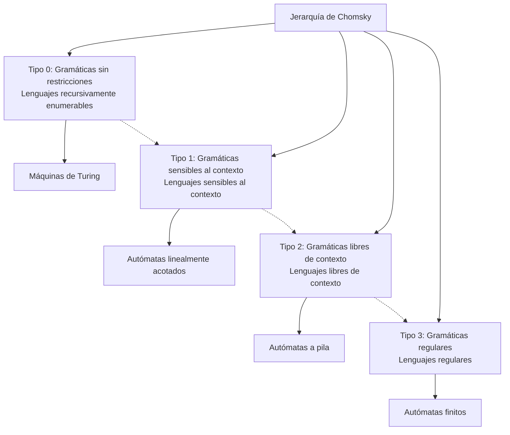
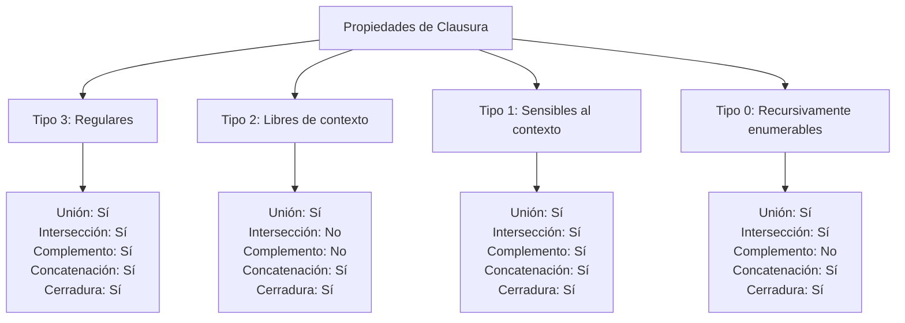

# Autómatas y Lenguajes Formales - Introducción

## 1.8 Clasificación de gramáticas.

---

La **clasificación de gramáticas** es fundamental en la teoría de lenguajes formales y autómatas. Desarrollada por Noam Chomsky, esta clasificación organiza las gramáticas en una jerarquía según su poder expresivo y las restricciones en sus reglas de producción.

### Jerarquía de Chomsky

#### Estructura General de la Jerarquía



### Detalle de los Tipos de Gramáticas

#### Tipo 0: Gramáticas Sin Restricciones

**Definición formal**:

$$G = (V, \Sigma, P, S) \text{ donde } P \subseteq \{(V \cup \Sigma)^+ \times (V \cup \Sigma)^*\}$$

**Restricciones**:

- $\alpha \rightarrow \beta$ donde $\alpha \in (V \cup \Sigma)^+$, $\beta \in (V \cup \Sigma)^*$
- $\alpha$ debe contener al menos un símbolo no terminal

**Lenguaje generado**: Lenguajes recursivamente enumerables

**Autómata equivalente**: Máquina de Turing

**Ejemplo**:

$$S \rightarrow aSb \mid ab \mid \varepsilon$$

$$aS \rightarrow Sa$$

$$Sb \rightarrow bS$$

#### Tipo 1: Gramáticas Sensibles al Contexto

**Definición formal**:

$$G = (V, \Sigma, P, S) \text{ donde } |\alpha| \leq |\beta| \text{ para toda } \alpha \rightarrow \beta \in P$$

**Forma normal**: $\alpha A \beta \rightarrow \alpha \gamma \beta$ donde $A \in V$, $\alpha, \beta \in (V \cup \Sigma)^*$, $\gamma \in (V \cup \Sigma)^+$

**Lenguaje generado**: Lenguajes sensibles al contexto

**Autómata equivalente**: Autómata linealmente acotado

**Ejemplo**:

$$S \rightarrow aSBC \mid aBC$$

$$CB \rightarrow BC$$

$$aB \rightarrow ab$$

$$bB \rightarrow bb$$

$$bC \rightarrow bc$$

$$cC \rightarrow cc$$

#### Tipo 2: Gramáticas Libres de Contexto

**Definición formal**:

$$G = (V, \Sigma, P, S) \text{ donde } P \subseteq V \times (V \cup \Sigma)^*$$

**Restricciones**: $A \rightarrow \alpha$ donde $A \in V$, $\alpha \in (V \cup \Sigma)^*$

**Lenguaje generado**: Lenguajes libres de contexto

**Autómata equivalente**: Autómata a pila

**Ejemplo**:

$$S \rightarrow aSb \mid \varepsilon$$

$$E \rightarrow E + T \mid T$$

$$T \rightarrow T * F \mid F$$

$$F \rightarrow (E) \mid id$$

#### Tipo 3: Gramáticas Regulares

**Definición formal**:

$$G = (V, \Sigma, P, S) \text{ donde } P \subseteq V \times (\Sigma V \cup \Sigma \cup \{\varepsilon\})$$

**Formas equivalentes**:

- Lineal por la derecha: $A \rightarrow aB \mid a$
- Lineal por la izquierda: $A \rightarrow Ba \mid a$

**Lenguaje generado**: Lenguajes regulares

**Autómata equivalente**: Autómata finito

**Ejemplo**:

$$S \rightarrow aA \mid bS \mid \varepsilon$$

$$A \rightarrow aS \mid bA$$

### Propiedades de Clausura

#### Resumen de Propiedades



### Implementación en Python

```python
class ClasificadorGramaticas:
    """Clasificador de gramáticas según la jerarquía de Chomsky"""

    def __init__(self, V, Sigma, P, S):
        self.V = set(V)  # No terminales
        self.Sigma = set(Sigma)  # Terminales
        self.P = P  # Producciones
        self.S = S  # Símbolo inicial

    def es_tipo_3(self):
        """Verifica si es gramática regular (Tipo 3)"""
        for izquierda, derechas in self.P.items():
            if izquierda not in self.V:
                return False
            for derecha in derechas:
                # Verificar formas A → aB, A → a, A → ε
                if derecha == '' or derecha == 'ε':  # A → ε
                    continue
                if len(derecha) == 1 and derecha in self.Sigma:  # A → a
                    continue
                if len(derecha) == 2 and derecha[0] in self.Sigma and derecha[1] in self.V:  # A → aB
                    continue
                if len(derecha) == 2 and derecha[0] in self.V and derecha[1] in self.Sigma:  # A → Ba
                    continue
                return False
        return True

    def es_tipo_2(self):
        """Verifica si es gramática libre de contexto (Tipo 2)"""
        for izquierda in self.P.keys():
            if len(izquierda) != 1 or izquierda not in self.V:
                return False
        return True

    def es_tipo_1(self):
        """Verifica si es gramática sensible al contexto (Tipo 1)"""
        for izquierda, derechas in self.P.items():
            for derecha in derechas:
                # Verificar |α| ≤ |β| para α → β
                if len(izquierda) > len(derecha):
                    return False
                # Verificar que el lado izquierdo contenga al menos un no terminal
                if not any(simbolo in self.V for simbolo in izquierda):
                    return False
        return True

    def clasificar(self):
        """Clasifica la gramática según la jerarquía de Chomsky"""
        if self.es_tipo_3():
            return "Tipo 3: Gramática Regular"
        elif self.es_tipo_2():
            return "Tipo 2: Gramática Libre de Contexto"
        elif self.es_tipo_1():
            return "Tipo 1: Gramática Sensible al Contexto"
        else:
            return "Tipo 0: Gramática Sin Restricciones"

    def generar_ejemplos(self, n=3):
        """Genera ejemplos del lenguaje (implementación básica)"""
        # Esta es una implementación simplificada
        ejemplos = []
        actual = self.S

        for _ in range(n):
            # Aplicar una producción aleatoria
            if actual in self.P:
                producciones = self.P[actual]
                produccion = producciones[0]  # Tomar la primera producción
                actual = produccion
                if all(simbolo in self.Sigma for simbolo in actual):
                    ejemplos.append(actual)
                    actual = self.S  # Reiniciar
        return ejemplos

# Ejemplos de uso
if __name__ == "__main__":
    # Gramática regular
    V_reg = ['S', 'A']
    Sigma_reg = ['a', 'b']
    P_reg = {
        'S': ['aA', 'bS', ''],
        'A': ['aS', 'bA']
    }

    clasificador_reg = ClasificadorGramaticas(V_reg, Sigma_reg, P_reg, 'S')
    print("Gramática regular:", clasificador_reg.clasificar())
    print("Ejemplos:", clasificador_reg.generar_ejemplos())

    # Gramática libre de contexto
    V_lc = ['S']
    Sigma_lc = ['a', 'b']
    P_lc = {
        'S': ['aSb', '']
    }

    clasificador_lc = ClasificadorGramaticas(V_lc, Sigma_lc, P_lc, 'S')
    print("\nGramática libre de contexto:", clasificador_lc.clasificar())
    print("Ejemplos:", clasificador_lc.generar_ejemplos())
```

### Ejercicios Propuestos

1. **Clasificación de gramáticas**:
   - Clasifica las siguientes gramáticas según la jerarquía de Chomsky:

      - a) $S \rightarrow aS \mid bS \mid a \mid b$
      - b) $S \rightarrow aSb \mid ab$
      - c) $aS \rightarrow Sa, aS \rightarrow a$
      - d) $S \rightarrow SS \mid aSb \mid \varepsilon$

2. **Propiedades de clausura**:
   - Para cada tipo de gramática, indica si es cerrada bajo:
      - a) Unión
      - b) Intersección
      - c) Complemento
      - d) Concatenación
      - e) Cerradura de Kleene

3. **Conversión entre tipos**:
   - Convierte la siguiente gramática regular a autómata finito:

     $S \rightarrow aA \mid bB$

     $A \rightarrow aS \mid bA \mid \varepsilon$
     
     $B \rightarrow aB \mid bS$

4. **Lenguajes no regulares**:
   - Demuestra que el lenguaje $L = \{a^n b^n \mid n \geq 0\}$ no es regular usando el lema de bombeo.

5. **Implementación**:
   - Extiende la clase ClasificadorGramaticas para:
     a) Detectar gramáticas ambiguas
     b) Convertir entre formas normales
     c) Verificar si una cadena pertenece al lenguaje

6. **Aplicaciones**:
   - Para cada tipo de gramática, menciona al menos dos aplicaciones prácticas en informática.

### Problemas de Decidibilidad

| Problema                           | Tipo 3    | Tipo 2       | Tipo 1       | Tipo 0       |
| ---------------------------------- | --------- | ------------ | ------------ | ------------ |
| Membresía ( $w \in L(G)$ )         | Decidible | Decidible    | Decidible    | No decidible |
| Vaciedad ( $L(G) = \emptyset$ )    | Decidible | Decidible    | Decidible    | No decidible |
| Finitud ( $L(G)$ es finito )       | Decidible | Decidible    | Decidible    | No decidible |
| Equivalencia ( $L(G_1) = L(G_2)$ ) | Decidible | No decidible | No decidible | No decidible |

### Referencias

1. Hopcroft, J. E., Motwani, R., and Ullman, J., _Introduction to Automata Theory, Languages, and Computation_. (Capítulos 3-5)
2. Sipser, M., _Introduction to the Theory of Computation_. (Capítulos 2-3)
3. Linz, P., _An Introduction to Formal Languages and Automata_. (Capítulos 3-8)
4. Viso G., E., _Introducción a la teoría de la computación_. (Capítulo 4)
5. Kozen, D. C., _Automata and Computability_. (Capítulos 3-5)

### Para Profundizar

- **Formas normales**: Chomsky (para LLC), Greibach (para LLC)
- **Lema de bombeo**: Para lenguajes regulares y libres de contexto
- **Algoritmos de parsing**: LL(k), LR(k) para gramáticas LLC
- **Propiedades de clausura**: Estudio detallado para cada tipo de lenguaje
- **Problemas de decidibilidad**: Análisis de qué problemas son decidibles para cada tipo
