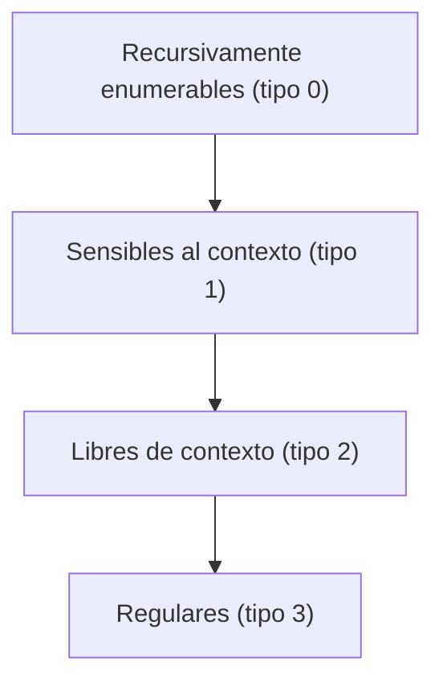

# Autómatas y Lenguajes Formales - Introducción

## 1.8 Clasificación de gramáticas.

---

La **clasificación de gramáticas** propuesta por Noam Chomsky en 1956 organiza las gramáticas en cuatro tipos según la forma de sus producciones. Cada restricción reduce el poder expresivo, pero hace que los problemas sobre la gramática sean más fáciles de resolver. La jerarquía resultó corresponder exactamente a cuatro tipos de máquinas, y por eso organiza todo el curso.

### Los cuatro tipos

Sea $G = (V, \Sigma, P, S).$ Como siempre, $A, B \in V,$ $a \in \Sigma,$ $w \in \Sigma^*$ y $\alpha, \beta, \gamma \in (V \cup \Sigma)^*.$

| Tipo | Nombre | Forma de las producciones | Lenguajes | Máquina |
| --- | --- | --- | --- | --- |
| 0 | Sin restricciones | $\alpha \rightarrow \beta,$ con al menos un no terminal en $\alpha$ | Recursivamente enumerables | Máquina de Turing |
| 1 | Sensible al contexto | $\alpha A \beta \rightarrow \alpha\gamma\beta$ con $\gamma \neq \varepsilon$ o, equivalentemente, $\vert\alpha\vert \leq \vert\beta\vert$ | Sensibles al contexto | Autómata linealmente acotado |
| 2 | Libre de contexto | $A \rightarrow \alpha$ | Libres de contexto | Autómata de pila no determinista |
| 3 | Regular | todas $A \rightarrow wB$ y $A \rightarrow w,$ o todas $A \rightarrow Bw$ y $A \rightarrow w$ | Regulares | Autómata finito |

Algunas precisiones que suelen omitirse:

- **Tipo 3: linealidad consistente.** Una gramática **lineal por la derecha** tiene producciones $A \rightarrow wB$ y $A \rightarrow w;$ una **lineal por la izquierda**, $A \rightarrow Bw$ y $A \rightarrow w.$ Ambas generan exactamente los lenguajes regulares, pero **no se pueden mezclar**: la gramática $S \rightarrow aA \mid \varepsilon,$ $A \rightarrow Sb$ usa una regla de cada clase y genera $\{a^nb^n \mid n \geq 0\},$ que no es regular. La forma más restringida, con $|w| \leq 1,$ es decir $A \rightarrow aB,$ $A \rightarrow a$ y $A \rightarrow \varepsilon,$ genera los mismos lenguajes.
- **Tipo 1 y la cadena vacía.** Una regla monótona nunca puede producir $\varepsilon.$ Para que un lenguaje sensible al contexto pueda contener $\varepsilon$ se permite $S \rightarrow \varepsilon,$ siempre que $S$ no aparezca a la derecha de ninguna regla.
- **Tipo 2 contra tipo 1.** Una gramática libre de contexto con reglas $A \rightarrow \varepsilon$ no es monótona, así que, estrictamente, no es de tipo 1. Pero toda gramática libre de contexto se puede transformar en una equivalente sin reglas $\varepsilon,$ salvo $S \rightarrow \varepsilon$ (tema 4.2). Por eso la contención vale entre **lenguajes**: todo lenguaje libre de contexto es sensible al contexto.



Cada flecha va de una clase a una subclase **propia**. Los lenguajes que separan las clases son:

| Contención | Lenguaje en la clase mayor que no está en la menor | Se demuestra en |
| --- | --- | --- |
| Regulares en libres de contexto | $\{a^nb^n \mid n \geq 0\}$ | lema de bombeo para regulares, tema 2.7 |
| Libres de contexto en sensibles al contexto | $\{a^nb^nc^n \mid n \geq 1\}$ | lema de bombeo para libres de contexto, tema 4.6 |
| Sensibles al contexto en recursivamente enumerables | lenguajes que una máquina de Turing reconoce pero no decide, como el de la detención | tema 7.2 |

### Cómo clasificar una gramática

El tipo de una gramática es el **más restrictivo** cuyas condiciones cumplen **todas** sus producciones. Se revisa en orden:

1. ¿Todas las producciones tienen un solo no terminal a la izquierda? Si no, la gramática es de tipo 1 o 0.
2. Si sí, ¿son todas lineales por la derecha, o todas lineales por la izquierda? Entonces es de tipo 3; si no, de tipo 2.
3. Si no es libre de contexto, ¿todas cumplen $|\alpha| \leq |\beta|,$ salvo una posible $S \rightarrow \varepsilon$ permitida? Entonces es de tipo 1; si no, de tipo 0.

Hay que distinguir el tipo de una **gramática** del de su **lenguaje**. La gramática $S \rightarrow aSa \mid aSb \mid bSa \mid bSb \mid \varepsilon$ es de tipo 2, pero genera las cadenas de longitud par, un lenguaje regular. Un lenguaje es de tipo $k$ si **alguna** gramática de tipo $k$ lo genera.

### Propiedades de cerradura

Una clase de lenguajes es **cerrada** bajo una operación si, al aplicarla a lenguajes de la clase, el resultado sigue en la clase.

| Operación | Regulares | Libres de contexto | Sensibles al contexto | Recursivamente enumerables |
| --- | --- | --- | --- | --- |
| Unión | Sí | Sí | Sí | Sí |
| Concatenación | Sí | Sí | Sí | Sí |
| Estrella de Kleene | Sí | Sí | Sí | Sí |
| Intersección | Sí | No | Sí | Sí |
| Intersección con un regular | Sí | Sí | Sí | Sí |
| Complemento | Sí | No | Sí | No |

Los dos casos más interesantes son negativos o sorprendentes. Los libres de contexto no son cerrados bajo intersección: $\{a^nb^nc^m\}$ y $\{a^mb^nc^n\}$ son libres de contexto y su intersección es $\{a^nb^nc^n\},$ que no lo es. Y la cerradura de los sensibles al contexto bajo complemento fue un problema abierto durante más de veinte años, resuelto en 1987-1988 de forma independiente por Immerman y Szelepcsényi.

### Problemas de decisión

| Problema | Tipo 3 | Tipo 2 | Tipo 1 | Tipo 0 |
| --- | --- | --- | --- | --- |
| Pertenencia, $w \in L(G)$ | Decidible, tiempo lineal | Decidible, tiempo cúbico (CYK) | Decidible, PSPACE-completo | No decidible |
| Vacuidad, $L(G) = \emptyset$ | Decidible | Decidible | No decidible | No decidible |
| Finitud, $L(G)$ finito | Decidible | Decidible | No decidible | No decidible |
| Universalidad, $L(G) = \Sigma^*$ | Decidible | No decidible | No decidible | No decidible |
| Equivalencia, $L(G_1) = L(G_2)$ | Decidible | No decidible | No decidible | No decidible |

Mientras más arriba en la jerarquía, menos preguntas se pueden responder algorítmicamente. Para las gramáticas libres de contexto, que son las que se usan en compiladores, se puede decidir si una cadena pertenece al lenguaje, pero no si dos gramáticas son equivalentes ni, como se verá en el tema 7.5, si una gramática es ambigua.

### Implementación en Python

El clasificador revisa las condiciones en el orden de la sección anterior. Representa cada producción como un par de cadenas, con los no terminales en mayúsculas y $\varepsilon$ como la cadena vacía.

```python
def es_var(c):
    return c.isupper()

def lineal_derecha(izq, der):
    """A -> wB o A -> w, con w una cadena de terminales."""
    return all(not es_var(c) for c in der[:-1])

def lineal_izquierda(izq, der):
    """A -> Bw o A -> w."""
    return all(not es_var(c) for c in der[1:])

def clasificar(reglas, inicial="S"):
    """Devuelve el tipo más restrictivo (3, 2, 1 o 0) de la gramática."""
    libre = all(len(izq) == 1 and es_var(izq) for izq, _ in reglas)
    if libre:
        if all(lineal_derecha(i, d) for i, d in reglas) or all(lineal_izquierda(i, d) for i, d in reglas):
            return 3
        return 2
    # Tipo 1: monótona, salvo S -> ε si S no aparece a la derecha
    s_a_la_derecha = any(inicial in d for _, d in reglas)
    def monotona(izq, der):
        if izq == inicial and der == "" and not s_a_la_derecha:
            return True
        return len(izq) <= len(der)
    return 1 if all(monotona(i, d) for i, d in reglas) else 0

ejemplos = {
    "a) S→aS|bS|a|b":            [("S", "aS"), ("S", "bS"), ("S", "a"), ("S", "b")],
    "b) S→aSb|ab":               [("S", "aSb"), ("S", "ab")],
    "c) aS→Sa, aS→a":            [("aS", "Sa"), ("aS", "a")],
    "d) S→SS|aSb|ε":             [("S", "SS"), ("S", "aSb"), ("S", "")],
    "e) S→aA, A→Sb, S→ε (mixta)": [("S", "aA"), ("A", "Sb"), ("S", "")],
    "f) S→Aa|b, A→Ab|a":         [("S", "Aa"), ("S", "b"), ("A", "Ab"), ("A", "a")],
    "g) a^n b^n c^n":            [("S", "aSBC"), ("S", "aBC"), ("CB", "BC"), ("aB", "ab"),
                                  ("bB", "bb"), ("bC", "bc"), ("cC", "cc")],
}
for nombre, reglas in ejemplos.items():
    print(f"{nombre:<30} tipo {clasificar(reglas)}")
```

Salida:

```text
a) S→aS|bS|a|b                 tipo 3
b) S→aSb|ab                    tipo 2
c) aS→Sa, aS→a                 tipo 0
d) S→SS|aSb|ε                  tipo 2
e) S→aA, A→Sb, S→ε (mixta)     tipo 2
f) S→Aa|b, A→Ab|a              tipo 3
g) a^n b^n c^n                 tipo 1
```

La gramática e) se clasifica como tipo 2 aunque cada una de sus reglas, por separado, es de las permitidas en el tipo 3: mezcla linealidad por la derecha y por la izquierda. La f) es lineal por la izquierda: $A$ genera $ab^*$ y $S$ genera $ab^*a + b,$ un lenguaje regular.

### Ejercicios Propuestos

1. **Clasificación.** Clasifica las gramáticas a) a d) del programa y explica por qué cada una no es del tipo siguiente.

2. **Tipo de gramática y tipo de lenguaje.** Da una gramática de tipo 1 que no sea libre de contexto pero cuyo lenguaje sea regular.

3. **De gramática a autómata.** Construye un autómata finito para la gramática lineal por la derecha

   $$ S \rightarrow aA \mid bB, \quad A \rightarrow aS \mid bA \mid \varepsilon, \quad B \rightarrow aB \mid bS $$

4. **Lenguajes no regulares.** Demuestra que $\{a^nb^n \mid n \geq 0\}$ no es regular.

5. **Cerradura.** Demuestra que si $L$ es regular, también lo es $L^R.$ Sugerencia: invierte las producciones de una gramática lineal por la derecha.

### Soluciones

**Ejercicio 1.**

- a) Tipo 3: todas son lineales por la derecha. Genera $(a + b)^+.$
- b) Tipo 2: $S \rightarrow aSb$ tiene el no terminal en medio, así que no es lineal por la derecha ni por la izquierda.
- c) Tipo 0: el lado izquierdo $aS$ tiene dos símbolos, así que no es libre de contexto, y $aS \rightarrow a$ acorta, así que no es monótona.
- d) Tipo 2: $S \rightarrow SS$ tiene dos no terminales a la derecha.

**Ejercicio 2.** $S \rightarrow aA,$ $aA \rightarrow ab.$ La segunda regla tiene dos símbolos a la izquierda y es monótona, así que la gramática es de tipo 1 y no de tipo 2, pero genera $\{ab\},$ un lenguaje finito y por lo tanto regular.

**Ejercicio 3.** Cada no terminal es un estado y $S$ es el inicial. Una regla $A \rightarrow aB$ es una transición de $A$ a $B$ con $a,$ y una regla $A \rightarrow \varepsilon$ hace de $A$ un estado de aceptación. El autómata tiene estados $S,$ $A$ y $B,$ con $A$ de aceptación, y transiciones $S \xrightarrow{a} A,$ $S \xrightarrow{b} B,$ $A \xrightarrow{a} S,$ $A \xrightarrow{b} A,$ $B \xrightarrow{a} B$ y $B \xrightarrow{b} S.$ Acepta, por ejemplo, $a,$ $ab$ y $baba,$ y rechaza $b$ y $aa.$ Si hubiera reglas $A \rightarrow a,$ se agregaría un estado final nuevo $F$ con la transición $A \xrightarrow{a} F.$

**Ejercicio 4.** Si un autómata con $k$ estados lo reconociera, entre $a^0, a^1, \ldots, a^k$ habría dos, $a^i$ y $a^j$ con $i < j,$ que lo dejan en el mismo estado. Entonces llegaría al mismo estado con $a^ib^i,$ que debe aceptar, y con $a^jb^i,$ que debe rechazar: contradicción. $\blacksquare$

**Ejercicio 5.** Si $L$ lo genera una gramática lineal por la derecha, se cambia cada regla $A \rightarrow wB$ por $A \rightarrow Bw^R$ y cada $A \rightarrow w$ por $A \rightarrow w^R.$ La gramática resultante es lineal por la izquierda y genera $L^R:$ cada derivación $S \Rightarrow w_1A_1 \Rightarrow w_1w_2A_2 \Rightarrow \cdots$ se corresponde con una que escribe los mismos pedazos, invertidos, de derecha a izquierda. Como las gramáticas lineales por la izquierda también generan lenguajes regulares, $L^R$ es regular. $\blacksquare$

### Referencias

1. Hopcroft, J. E., Motwani, R., and Ullman, J., _Introduction to Automata Theory, Languages, and Computation_. Pearson, 2007. Capítulos 3 a 5 y 9.
2. Sipser, M., _Introduction to the Theory of Computation_. Cengage, 2013. Capítulos 1 a 5.
3. Linz, P., _An Introduction to Formal Languages and Automata_. Jones & Bartlett, 2016. Capítulo 11.
4. Chomsky, N. (1959). On certain formal properties of grammars. _Information and Control_, 2(2), 137-167.
5. Immerman, N. (1988). Nondeterministic space is closed under complementation. _SIAM Journal on Computing_, 17(5), 935-938.

### Para profundizar

- Investiga las clases que quedan **entre** los tipos de la jerarquía: los lenguajes libres de contexto deterministas, los lenguajes indexados y los lenguajes ligeramente sensibles al contexto que se usan en lingüística.
- Estudia la demostración del teorema de Immerman-Szelepcsényi.
- Consulta por qué el problema de pertenencia para gramáticas sensibles al contexto es PSPACE-completo.
